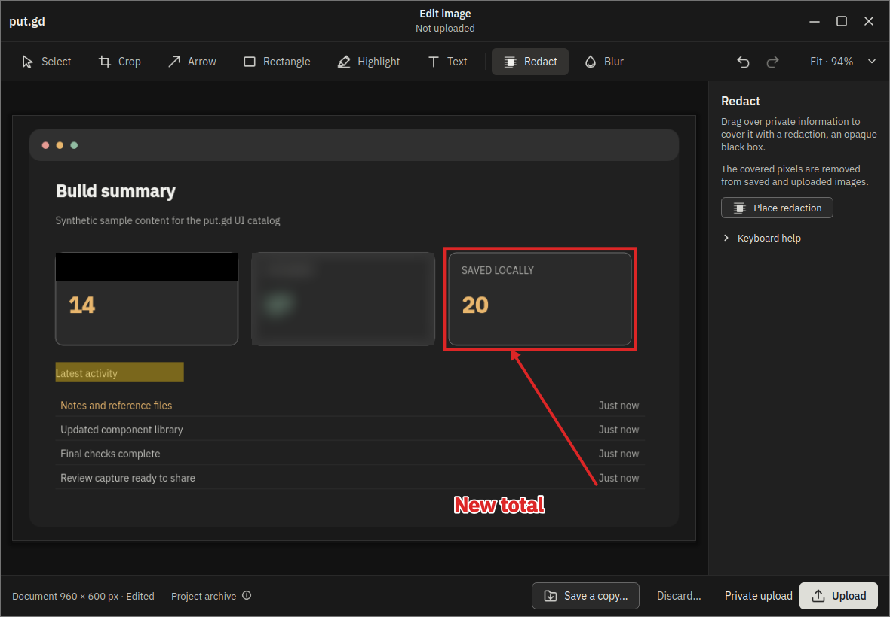

# put.gd

[](https://app.put.gd/)
[](https://github.com/patrick-hudson/put.gd-desktop/releases/latest)
[](LICENSE)

**Take a screenshot or screen recording on Linux and get a link to share it.**

Press a shortcut, drag over what you want to share, and the link is on your clipboard, ready to paste into a chat or a ticket.

Files go to storage you control, and there's no put.gd account. If you've used ShareX on Windows or CleanShot X on a Mac, it's that idea for Linux.

| | Supported |
| --- | --- |
| **Desktops** | [Cinnamon](docs/desktops/cinnamon.md), [GNOME 50](docs/desktops/gnome.md), [KDE Plasma](docs/desktops/kde.md), [Budgie](docs/desktops/budgie.md)\*, [Hyprland](docs/desktops/hyprland.md)\* (tested on Omarchy) |
| **Linux** | Ubuntu 24.04/26.04, Linux Mint 22, Debian 13, Fedora 44/45, Arch and Arch-based distributions\*, or any other distribution with glibc 2.39 or newer through the AppImage |
| **Storage** | Amazon S3, Cloudflare R2, Backblaze B2, any other S3-compatible service, [Proton Drive](docs/user/proton-drive.md) (experimental) |

\* New, and in nightly builds only until the next stable release. See [Install](#install).



## Install

```sh
curl -fsSL https://app.put.gd/install | sh
```

This installs the right package for your Linux distribution (x86_64) and verifies it first. To install an AppImage for just your user, with no `sudo`:

```sh
curl -fsSL https://app.put.gd/install | sh -s -- --appimage
```

For Budgie, Hyprland or the Arch package, use the nightly channel until the next stable release:

```sh
curl -fsSL https://app.put.gd/install | sh -s -- --channel nightly
```

Prefer to download a package yourself? They're all on [app.put.gd](https://app.put.gd/).

**On GNOME 50**, finish by logging out and back in, then run `gnome-extensions enable putgd@put.gd`. With the AppImage, [install the GNOME extension](docs/desktops/gnome.md#setup) first.

## Get started

1. Open put.gd and choose **Destinations → Add destination**.
2. Enter your storage details, or connect Proton Drive, then click **Test connection**.
3. Pick that destination in **Settings → Capture**.
4. Press a shortcut:

| Shortcut | What it captures |
| --- | --- |
| `Ctrl+Shift+1` | A region you drag |
| `Ctrl+Shift+2` | The active window |
| `Ctrl+Shift+3` | The whole desktop |

The capture uploads and the link lands on your clipboard. Press Escape to cancel a region. You can change the keys in **Settings → Shortcuts**.

## What else it does

**Edit before you share.** Choose **Capture region & edit** to crop, add arrows or text, and redact anything private. Nothing uploads until you click **Upload**.

**Record your screen.** Choose **Record screen**, drag a region, and use the floating bar. You can include system audio, then trim the clip or blur parts of it before you save or upload. It exports MP4, WebM, GIF or animated WebP.


**Find old captures.** History lets you search everything you've captured and copy a link again. put.gd keeps running in the tray when you close the window.


**Automate it.** [`putgd-cli`](docs/automation/cli.md) controls the app from scripts, and an optional [MCP helper](docs/automation/mcp.md) gives AI agents the same controls.

## Your data

Uploads go only to the destination you choose. Edits and recordings stay on your computer until you upload them. Passwords and keys are kept in your system keychain, not in config files. put.gd checks for updates once a day and you can turn that off. Proton Drive support is experimental, and its links open a share page instead of the image itself.

## More

[User guide](docs/user/user-guide.md) · [Troubleshooting](docs/design/diagnostics.md) · [Build from source](docs/release/build.md) · [Developer docs](docs/README.md) · [Report a bug](https://github.com/patrick-hudson/put.gd-desktop/issues) · [MIT license](LICENSE)
