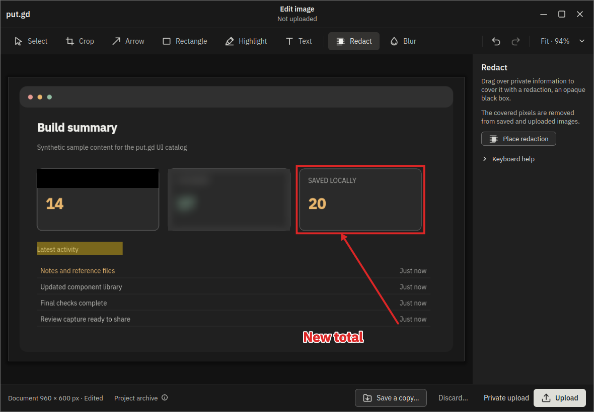
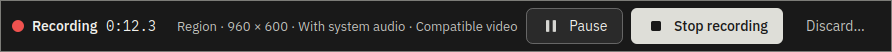
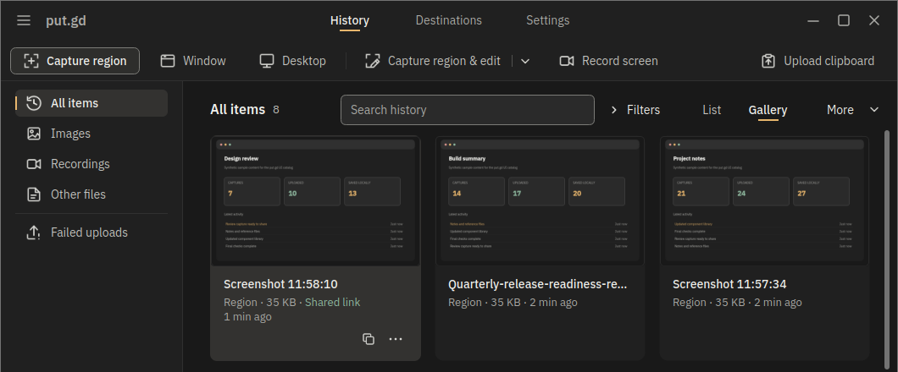

# put.gd

[](https://app.put.gd/)
[](https://github.com/patrick-hudson/put.gd-desktop/actions/workflows/ci.yml?query=branch%3Anightly)
[](https://github.com/patrick-hudson/put.gd-desktop/releases)
[](https://app.put.gd/dl/nightly/appimage)
[](LICENSE)

put.gd captures screenshots and screen recordings on Linux, uploads them to your storage, and copies a shareable link to the clipboard. Edit and redact images before uploading, then find previous captures and links in History. Use S3-compatible storage, Backblaze B2 or Proton Drive, or keep captures local.

Downloads and release notes: **[app.put.gd](https://app.put.gd/)**.



## How to use it

### Install

Install the package for your Linux x86_64 distribution:

```sh
curl -fsSL https://app.put.gd/install | sh
```

For a per-user AppImage install without sudo:

```sh
curl -fsSL https://app.put.gd/install | sh -s -- --appimage
```

The installer verifies SHA-256 before installing. Native packages use sudo only for `apt install` or `dnf install`; AppImage installs to `~/.local/bin/putgd.AppImage`. It defaults to stable, falling back to nightly until the first stable release. Add `--dry-run`, `--channel nightly` or `--help` after `sh -s --` as needed. [Read the installer](packaging/install.sh).

Manual downloads are currently **nightly previews**, for Linux x86_64:

- **DEB:** [Ubuntu 24.04 / Mint 22](https://app.put.gd/dl/nightly/ubuntu24.04), [Ubuntu / Kubuntu 26.04](https://app.put.gd/dl/nightly/ubuntu26.04) or [Debian 13](https://app.put.gd/dl/nightly/debian13). Install with `sudo apt install ./putgd-*.deb`.
- **RPM:** [Fedora 44](https://app.put.gd/dl/nightly/fedora44). Install with `sudo dnf install ./putgd-*.rpm`. For recording, also run `sudo dnf install openh264 gstreamer1-plugin-openh264` to replace Fedora's placeholder; the one-line installer runs this codec step for you when the Cisco repository is enabled. If it is disabled, the installer prints the enable-then-install commands; see [codec setup](docs/recording.md#packages-and-codecs).
- **AppImage:** [Download](https://app.put.gd/dl/nightly/appimage) for Aurora and other distributions with glibc 2.39+. Make it executable with `chmod +x putgd-*.AppImage`, then open it.

DEB and RPM installs add the put.gd package repository for updates. AppImage updates are offered in the app. See [updates](docs/updates.md).

**GNOME 50:** after installing a DEB or RPM, log out and back in, then run `gnome-extensions enable putgd@put.gd`. AppImage users also need the matching host extension; follow [GNOME setup](docs/desktops/gnome.md#setup).

### First run

Open put.gd and choose **Destinations → Add destination**. Enter your storage details and credentials, or connect a Proton Drive account and choose a folder. Use **Test connection**, then select the destination in **Settings → Capture**. To save locally too, turn on **Settings → General → Local copies → Keep a local copy**.

### Everyday use

Use the buttons across the top of the window, the tray menu, or a shortcut:

| Default shortcut | Action |
| --- | --- |
| `Ctrl+Shift+1` | Capture a region |
| `Ctrl+Shift+2` | Capture the active window |
| `Ctrl+Shift+3` | Capture the whole desktop |

Change keys in **Settings → Shortcuts**. **Capture region & edit**, **Record screen** and **Upload clipboard** have no default shortcut.

- **Capture:** drag a region, capture the active window, or capture all screens. Escape cancels region selection. Ordinary captures upload immediately to the selected destination; shared uploads copy their link.
- **Edit:** choose **Capture region & edit**, or **Edit image** in History for a file or clipboard image. Crop, add arrows or text, and use **Redact** to remove private pixels. Nothing uploads until you choose **Upload**.
- **Record:** choose **Record screen**, drag a region, and start from the floating bar. Include system audio, pause or resume, then stop to review. Trim or add timed blur/solid covers before saving a copy or choosing **Upload**. Export MP4, WebM, GIF or animated WebP. See [recording setup](docs/recording.md), including Fedora's encoder requirements.



- **History:** search captures, switch between list and gallery, copy a link again, or reopen a saved local image for editing. Closing the window keeps put.gd running in the tray; click the tray icon to reopen History, or right-click for capture and upload commands. **Upload clipboard** accepts files, images and text.



## Other information

**Desktops.** Cinnamon on X11, GNOME 50 on Wayland, and KDE Plasma on Wayland or X11. Aurora uses the AppImage on Plasma Wayland. See the desktop notes for [Cinnamon](docs/desktops/cinnamon.md), [GNOME](docs/desktops/gnome.md) and [KDE](docs/desktops/kde.md).

**Destinations.** Amazon S3, Cloudflare R2 and other S3-compatible services; Backblaze B2 through its native API; and [Proton Drive](docs/proton-drive.md), an experimental third-party integration. Proton links open a share page rather than a direct image URL. Local saving is independent of uploads.

**CLI and MCP.** `putgd-cli` controls the running app from scripts. The optional MCP helper exposes capture, editing, recording, uploads and History to agents. See [CLI](docs/cli.md) and [MCP setup](docs/mcp.md).

**Build from source.** C++20, Qt 6 Widgets, CMake, Ninja and the official AWS C++ SDK. Follow the [build instructions](docs/build.md).

**Privacy and credentials.** Uploads go to the destination you choose. Image edits and recordings stay private until you explicitly upload them. Saved credentials use the system keychain; configuration stores references, not secret values. S3 credentials can also stay in memory for the session. The daily update check can be disabled, and updates require your action. See [credentials](docs/credentials.md) and [updates](docs/updates.md).

**License.** [MIT](LICENSE).

[User guide](docs/user-guide.md) · [Image editor](docs/image-editor.md) · [Screen recording](docs/recording.md) · [Configuration](docs/configuration.md) · [Troubleshooting](docs/diagnostics.md) · [Developer documentation](docs/agents.md) · [Issues](https://github.com/patrick-hudson/put.gd-desktop/issues)
