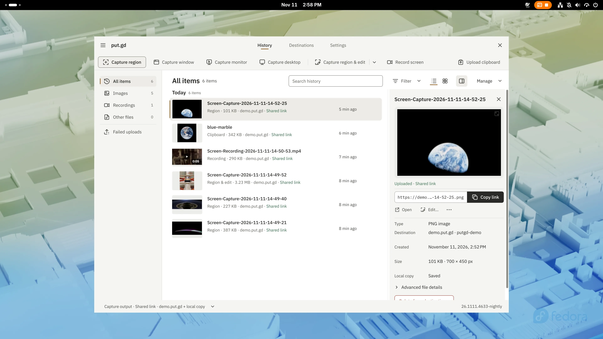
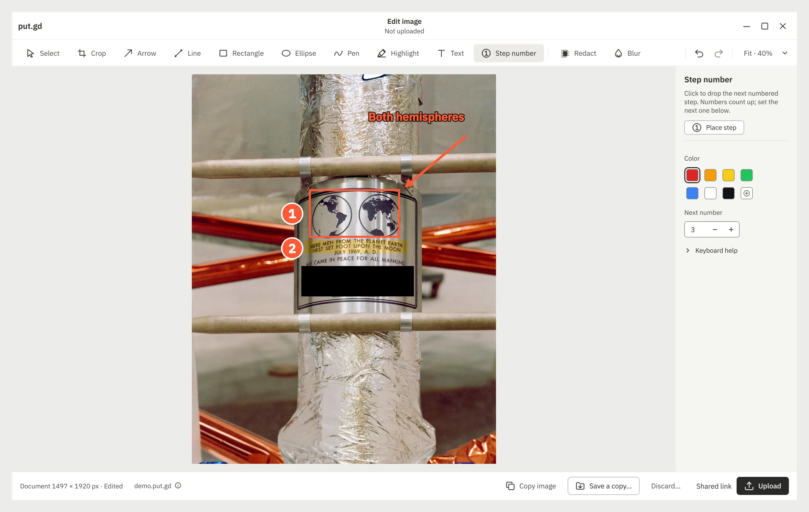
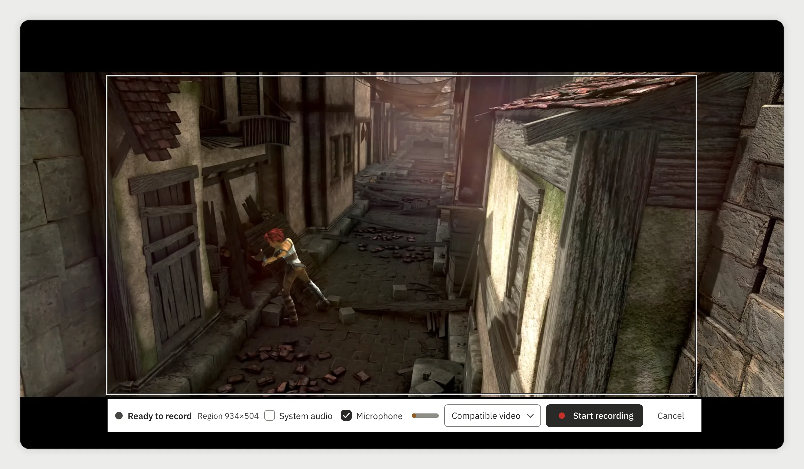

<p align="center">
  
</p>

<h1 align="center">put.gd</h1>

<p align="center">
  <b>Capture anything on your Linux screen and share it as a link.</b>
</p>

<p align="center">
  <a href="#install">Install</a> ·
  <a href="#your-first-link">Your first link</a> ·
  <a href="https://app.put.gd/userguide">User guide</a> ·
  <a href="https://app.put.gd/">Downloads</a>
</p>

> [!NOTE]
> put.gd is under heavy development. It's heavily tested, but it's one person and a lot
> of LLMs. It works for my use case, and maybe it'll work for yours. Fork it, steal it,
> change it, contribute, do whatever you want with it.

Press a hotkey, drag over what you want to show, and a link is on your clipboard, ready
to paste into a chat, a ticket or a pull request. put.gd takes screenshots, scrolling
pages and screen recordings. You can mark up and redact an image, trim, cut and cover
parts of a clip, or copy text and QR codes straight off your screen. Uploads go to
storage you control: Amazon S3 or an S3-compatible server, Cloudflare R2, Backblaze B2,
Nextcloud, WebDAV, SFTP, Proton Drive or a custom HTTP uploader. There is no put.gd
account and no put.gd cloud.

If you've used ShareX on Windows or CleanShot X on a Mac, it's that idea, built for Linux.

<p align="center">
  <picture>
    <source media="(prefers-color-scheme: dark)" srcset="docs/readme/shots/desktop-dark.webp">
    
  </picture>
</p>

## Why

I was tired of screenshot tools built on a webview, and with LLMs, native code is easier to
write than ever. put.gd is C++ and Qt, and memory is a deliberate design choice: a
screenshot tool shouldn't use 100 MB or more sitting in your system tray. It's been
ruthlessly trimmed to idle well under 40 MB, often 10–20 MB, and less once the kernel
reclaims its pages.
The main window, the editor and the recorder are separate processes that exit when you're
done with them ([memory strategy](docs/design/memory-strategy.md)).

C++20 was a choice I regret. I'd like to move to C++23 eventually.

## Install

put.gd runs on x86_64 Linux. The installer picks the package for your distribution
([see where it runs](#where-it-runs)). A DEB or RPM is checked against the release
checksums, then installed, and it adds the signed update repository. On Arch, pacman
installs it from the signed put.gd repository. On other distributions, Atomic systems, or
Arch derivatives with a different OpenSSL, it installs the self-updating AppImage after
checking its checksum:

```sh
curl -fsSL https://app.put.gd/install | sh
```

For an AppImage just for your user, with no `sudo`:

```sh
curl -fsSL https://app.put.gd/install | sh -s -- --appimage
```

To follow daily development builds instead of stable releases, use the nightly channel
(add `--appimage` for an AppImage):

```sh
curl -fsSL https://app.put.gd/install | sh -s -- --channel nightly
```

Direct downloads (DEB, RPM, pacman and AppImage) are also on [app.put.gd](https://app.put.gd/).
The guide covers [updating and switching between stable and nightly](https://app.put.gd/userguide/updating.html#switch-between-nightly-and-stable).
A few desktops need one more thing:

- **GNOME 50:** log out and back in [once](https://app.put.gd/userguide/desktops.html#gnome) when put.gd asks.
- **KDE Plasma on Ubuntu 24.04 (Wayland):** use the AppImage. The package there has no
  region selector.
- **Budgie:** window capture needs labwc 0.20 or newer. With an older labwc, capture a
  region instead.

## Your first link

1. Open put.gd, go to **Destinations** and select **Add destination**. Choose
   [Amazon S3 (or S3-compatible)](https://app.put.gd/userguide/destinations-s3.html),
   [Cloudflare R2](https://app.put.gd/userguide/destinations-r2.html), [Backblaze B2](https://app.put.gd/userguide/destinations-b2.html),
   [Nextcloud or WebDAV](https://app.put.gd/userguide/destinations-nextcloud.html), [SFTP](https://app.put.gd/userguide/destinations-sftp.html),
   [Proton Drive](https://app.put.gd/userguide/destinations-proton.html) or a [custom uploader (HTTP)](https://app.put.gd/userguide/destinations-custom.html)
   (import a ShareX `.sxcu` file or fill in the request), then enter its details.
2. Save credentials with **Save to keychain** (for Nextcloud select **Sign in…**, for
   Proton Drive select **Connect account…** and pick a folder, and for SFTP you can rely
   on your SSH agent and `~/.ssh/config`). Run the destination's test (**Test upload and
   link** for most; for Proton Drive, **Check account and folder**, which checks access
   without uploading), then **Make default** if it isn't already.
3. Press a hotkey:

   | Hotkey | Captures |
   | --- | --- |
   | `Ctrl+Shift+1` | A region you drag (Escape cancels) |
   | `Ctrl+Shift+2` | The active window |
   | `Ctrl+Shift+3` | The whole desktop |

The capture uploads, and its link is on your clipboard when the destination gives one. Every capture is also in the main window and the tray menu.
**Settings → Hotkeys** lets you change any key and says why one couldn't be set, for
example when another app already uses it. Closing the window leaves put.gd running in the
tray. The [quick start](https://app.put.gd/userguide/quickstart.html) walks through it
with pictures.

## What it does

**Capture what you need.** Capture a region, the active window, one monitor or the whole
desktop. Repeat the last region, or set a 3, 5 or 10 second delay so a menu can stay open.
**Capture scrolling region** stitches a tall page, chat or document as you scroll or
while **Auto-scroll** turns the wheel for you (moving the mouse pauses it).
**Upload clipboard** sends a copied image, text or files, and **Upload with put.gd** in your file
manager sends files and folders.
[Capturing →](https://app.put.gd/userguide/capture.html) · [Scrolling capture →](https://app.put.gd/userguide/scrolling.html) · [File manager →](https://app.put.gd/userguide/file-manager.html)

**Mark it up and check for secrets.** **Capture region & edit** opens an editor with
crop, arrows, lines, shapes, pen, highlights that snap to text, text labels, numbered
steps, blur, pixelate and a **Style** tool for backdrops, rounded corners and shadows
(also available automatically via **Capture style**). **Redact** removes the covered
pixels from the image you save or upload.
**Quick redact** suggests covers for email addresses, phone numbers, IP addresses, card
numbers, keys, tokens, secret QR codes, your own username and name, and words or
patterns you list. The editor uploads only when you select **Upload**; you can also save
or copy the image without uploading. **Check captures for sensitive text before
uploading** can warn or cover text in screenshots before they upload. It doesn't check
captures you edit, recordings, retries, or files other than PNG and JPEG images. Recognition can miss text, so look
before you share.
[The editor →](https://app.put.gd/userguide/edit.html) · [Sensitive text check →](https://app.put.gd/userguide/sensitive-text.html) · [Capture style →](https://app.put.gd/userguide/style.html)

<p align="center">
  <picture>
    <source media="(prefers-color-scheme: dark)" srcset="docs/readme/shots/edit-dark.webp">
    
  </picture>
</p>

**Record your screen.** Record a region, window or screen as MP4 or WebM with system
audio and your microphone, or as a silent GIF or animated WebP, with optional click
highlights. Stopping opens a private review window where you trim the ends, cut out the
middle, and redact or blur parts of the clip before you save or upload.
[Screen recording →](https://app.put.gd/userguide/record.html)

<p align="center">
  <picture>
    <source media="(prefers-color-scheme: dark)" srcset="docs/readme/shots/record-bar-dark.webp">
    
  </picture>
</p>

**Copy text off the screen.** Drag over text you can't select (an error dialog, a slide,
a video frame, a screenshot of a terminal) to put it on your clipboard, along with the text of any QR,
Micro QR, Data Matrix or Aztec code it recognizes. Recognition runs on your computer in a
sandboxed helper with no network access, and reads common non-Latin scripts when their
language data is installed. put.gd never saves or uploads the text on its own. You can also select and copy
text in the editor, or run **Copy text** on local images in History.
[Copy text →](https://app.put.gd/userguide/copy-text.html)

**Find it again.** History keeps your captures in a list or a gallery, searchable by name
and filterable. Copy a link again, refresh an expired S3, R2 or B2 link, show a link as a
QR code for your phone, delete a remote upload where supported, or retry a failed upload.
[History →](https://app.put.gd/userguide/history.html)

**Script it.** [`putgd-cli`](https://app.put.gd/userguide/cli.html) runs every action from
a script, and the optional [MCP helper](https://app.put.gd/userguide/cli.html#mcp-for-agents)
gives AI agents the same controls.

## Where it runs

| | |
| --- | --- |
| **Desktops** | [Cinnamon](https://app.put.gd/userguide/desktops.html#cinnamon), [GNOME 50](https://app.put.gd/userguide/desktops.html#gnome), [KDE Plasma](https://app.put.gd/userguide/desktops.html#kde-plasma), [Budgie](https://app.put.gd/userguide/desktops.html#budgie), [Hyprland](https://app.put.gd/userguide/desktops.html#hyprland) (tested on Omarchy) |
| **Packages** | Signed `apt` repos for Ubuntu 24.04 and 26.04, Linux Mint 22 and Debian 13 (DEB). Signed `dnf` repos for Fedora 44 and 45 (RPM). Signed `pacman` repo for Arch and Arch-based distributions. Self-updating AppImage for any other distribution with glibc 2.39 or newer and FUSE. x86_64 only. |
| **Storage** | [Amazon S3 and S3-compatible servers](https://app.put.gd/userguide/destinations-s3.html#s3-compatible-services) (such as Garage), [Cloudflare R2](https://app.put.gd/userguide/destinations-r2.html), [Backblaze B2](https://app.put.gd/userguide/destinations-b2.html), [Nextcloud](https://app.put.gd/userguide/destinations-nextcloud.html#nextcloud), [WebDAV](https://app.put.gd/userguide/destinations-nextcloud.html#webdav), [SFTP](https://app.put.gd/userguide/destinations-sftp.html) (using your OpenSSH client), [Proton Drive](https://app.put.gd/userguide/destinations-proton.html) (experimental, links open a share page), and [custom HTTP uploaders](https://app.put.gd/userguide/destinations-custom.html) (ShareX `.sxcu`, tested with Zipline, Chibisafe and XBackBone) |

[Your desktop](https://app.put.gd/userguide/desktops.html) says what put.gd can and can't do on each one.

## Your data

- Uploads go only to the destination you choose.
- Edits and recordings stay on your computer until you upload them.
- Text recognition runs in a sandboxed helper on your computer. put.gd never saves, logs
  or uploads the text it reads on its own. Text you copy goes to your clipboard, where a
  clipboard manager may keep it.
- Passwords, tokens and keys that put.gd saves as secrets live in your system keychain
  (or in memory for the current session), never in its config files. SFTP uses your own SSH
  keys and agent and never changes your `~/.ssh` files.
- put.gd checks app.put.gd for updates once a day. You can turn that off.

## More

[User guide](https://app.put.gd/userguide) ·
[Troubleshooting](https://app.put.gd/userguide/troubleshooting.html) ·
[Build from source](docs/release/build.md) ·
[Developer docs](docs/README.md) ·
[Report a bug](https://github.com/patrick-hudson/put.gd-desktop/issues) ·
[MIT license](LICENSE)

<sub>Screenshots: put.gd 26.1111.4633 nightly on GNOME 50.6 (Wayland), Fedora Linux 44.
Demo media: [Sintel](https://commons.wikimedia.org/wiki/File:Sintel_trailer-1080p.ogv)
© copyright Blender Foundation | durian.blender.org,
[CC BY 3.0](https://creativecommons.org/licenses/by/3.0/); NASA photos (public domain).</sub>
