<div align="center">

<picture>
  <source media="(prefers-color-scheme: dark)" srcset="docs/readme/banner-dark.svg">
  <source media="(prefers-color-scheme: light)" srcset="docs/readme/banner-light.svg">
  
</picture>

<br>

**A native Linux sharing app.** Hit a hotkey, grab a region, window, desktop, clipboard or screen recording. The public link lands on your clipboard the moment it uploads. Qt 6 and C++20, talking straight to your own S3 bucket or Proton Drive. No middleman, no telemetry, no updater.

<br>

[](https://github.com/patrick-hudson/put.gd-desktop/actions/workflows/ci.yml)
[](https://github.com/patrick-hudson/put.gd-desktop/actions/workflows/nightly.yml)
[](https://github.com/patrick-hudson/put.gd-desktop/actions/workflows/release.yml)
[](https://github.com/patrick-hudson/put.gd-desktop/releases)
[](https://github.com/patrick-hudson/put.gd-desktop/releases)
[](LICENSE)


<br>

[**Download**](#-download) · [**Quickstart**](#-quickstart) · [**What you get**](#-what-you-get) · [**Screenshots**](#-screenshots) · [**Build**](#-build-from-source) · [**Release channels**](#-release-channels) · [**Docs**](#-documentation)

</div>

<br>


<br>

##  What you get

<table>
<tr>
<td width="50%" valign="top">

###  Capture anything
Region, active window or whole desktop, or upload whatever is on the clipboard: an image, text, or any files of any type, a hundred at a time. It all goes through one pipeline, and both storage backends take all of it. Region selection runs over the live desktop with Escape to cancel. Three global hotkeys out of the box, every action rebindable, and each row in Settings tells you whether the desktop actually granted the key.

</td>
<td width="50%" valign="top">

###  Edit before it leaves
**Capture region & edit** opens a small editor first. **Redact** strips the pixels from the upload, not just a blur. Crop, arrow, rectangle, highlight and text, with undo and a 100% zoom to check edges. Nothing uploads until you press Upload, and Cancel stores nothing.

</td>
</tr>
<tr>
<td width="50%" valign="top">

###  Record the screen
MP4 (H.264/H.265), WebM (VP9), GIF and animated WebP. Pause and resume on one timeline, then trim and add timed blur or solid masks in a private review window. X11 and Wayland, with VA-API and NVENC export where the GPU allows. Stop always reviews; only Upload publishes.

</td>
<td width="50%" valign="top">

###  Your storage, your links
Any S3-compatible bucket with your own link domain, Backblaze B2 through its native API, or Proton Drive through the official SDK. Public-read or private, chosen per destination and per action. Collision policy, naming templates and a Test connection that uploads, verifies the public link and cleans up after itself.

</td>
</tr>
<tr>
<td width="50%" valign="top">

###  History that works offline
Every capture, link and outcome in a searchable, filterable ledger with thumbnails, in list or gallery view. Copy the link again, open it, re-edit a local copy, or delete the remote object after reviewing exactly what will be removed. Nothing is listed or fetched from the cloud to show it.

</td>
<td width="50%" valign="top">

###  Scriptable to the bone
A resident JSON CLI over a private Unix socket, and an optional MCP helper so an agent can capture, edit, record, upload and inspect history with the same contracts as the GUI. Every interactive feature has a session method; operation IDs tell you what actually happened.

</td>
</tr>
<tr>
<td width="50%" valign="top">

###  Native on three desktops
Cinnamon/X11 through the compositor's own screenshot service, GNOME 50 Wayland through a Shell extension, KDE Plasma Wayland through KWin ScreenShot2 and layer-shell overlays. No portal picker for region capture, no permission bypasses, no XWayland tricks.

</td>
<td width="50%" valign="top">

###  Quiet and small
One resident process; windows, capture helpers, the recorder and the AWS SDK worker start on demand and go away when done. The idle resident family stays under 40 MiB in the measured workflows on all three desktops, and nothing phones home.

</td>
</tr>
</table>

##  Screenshots

Every image below is the current nightly build (`0.1.1-dev.343+gac92b2158535`) on a real desktop: Linux Mint Cinnamon, Fedora 44 GNOME 50 on Wayland and Debian 13 Plasma 6 on Wayland, all from the acceptance lab.

<p align="center">
  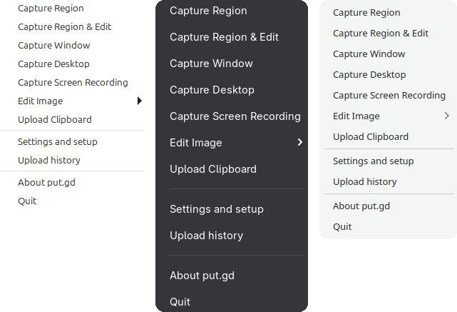
  <br>
  <sub>The tray is the app. Cinnamon, GNOME and Plasma, same menu: capture, capture &amp; edit, record, edit an image, upload the clipboard.</sub>
</p>

<p align="center">
  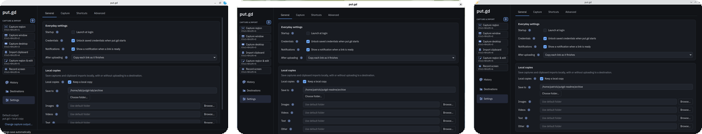
  <sub>One window, three desktops. The rail shows every action with its live shortcut.</sub>
</p>

<table>
<tr>
<td width="50%">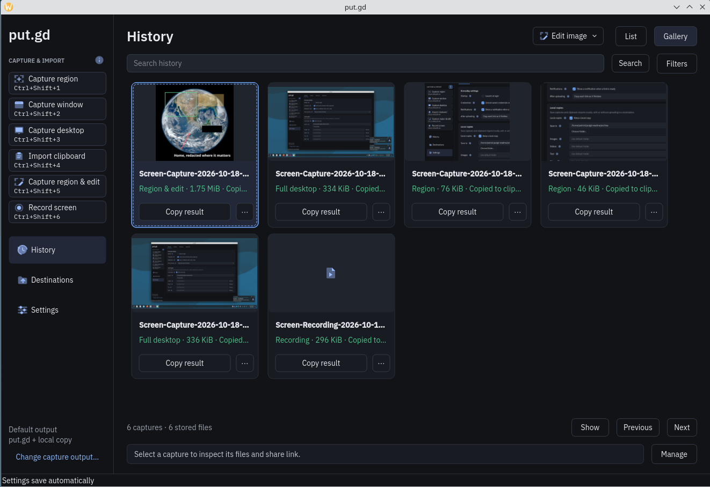</td>
<td width="50%">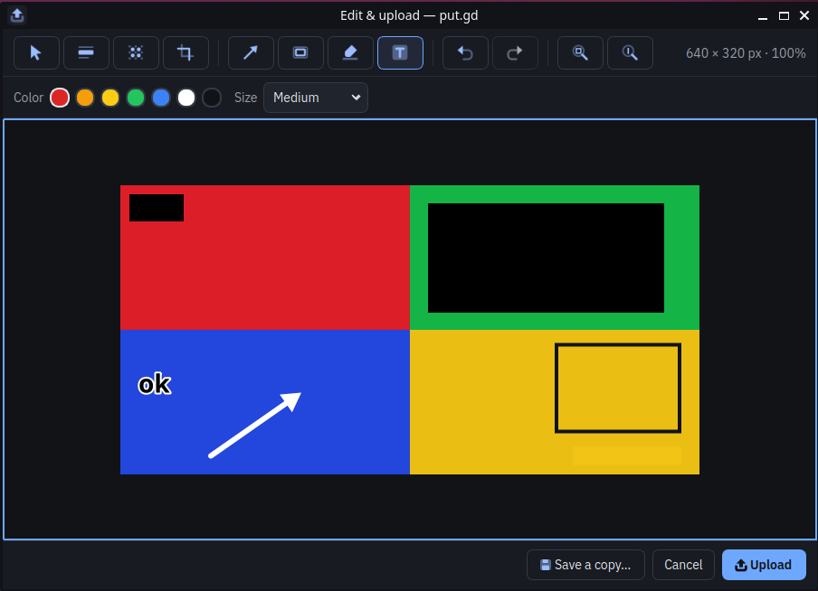</td>
</tr>
<tr>
<td align="center"><sub><b>History</b> — offline ledger in gallery or list view: region and desktop captures, an edited upload, a screen recording. Copy the link again, re-edit, or prepare a guarded remote deletion.</sub></td>
<td align="center"><sub><b>Edit &amp; upload</b> — rectangle, highlight, redaction, arrow and text on a photo. Redact removes the pixels from the upload; nothing is sent until Upload.</sub></td>
</tr>
<tr>
<td width="50%">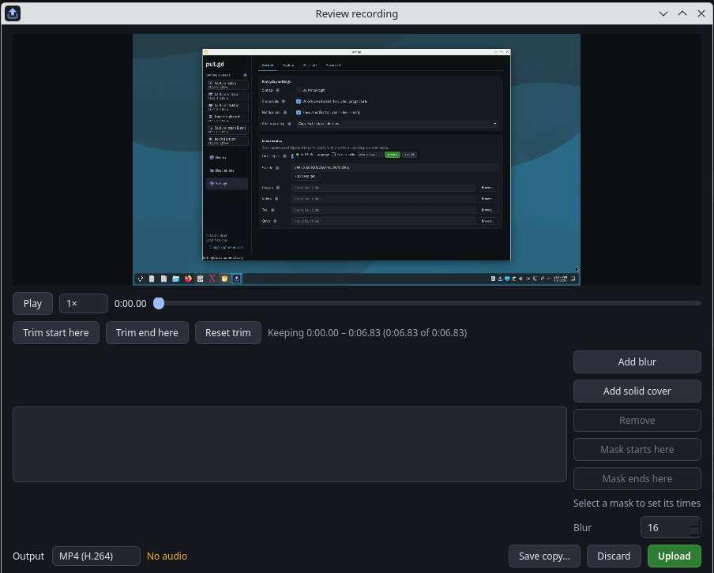</td>
<td width="50%">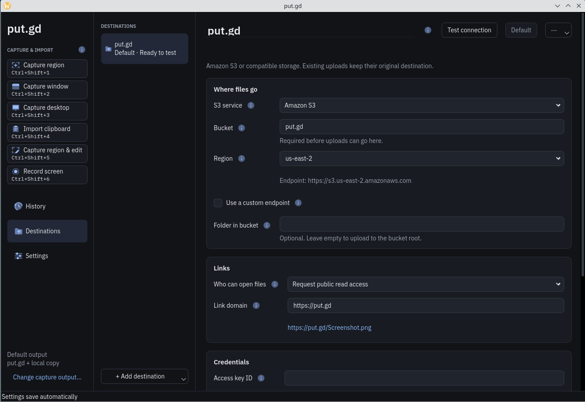</td>
</tr>
<tr>
<td align="center"><sub><b>Screen recording</b> — Stop always opens this private review: scrub, trim, add timed blur or solid masks, pick the output, then Upload or Discard.</sub></td>
<td align="center"><sub><b>Destinations</b> — S3 basics up front, endpoints, addressing, storage class and timeouts under Advanced. Test connection uploads a synthetic object, checks the public link, then cleans up.</sub></td>
</tr>
</table>

<details>
<summary><b>More</b> — capture output, shortcuts</summary>
<br>
<table>
<tr>
<td width="50%">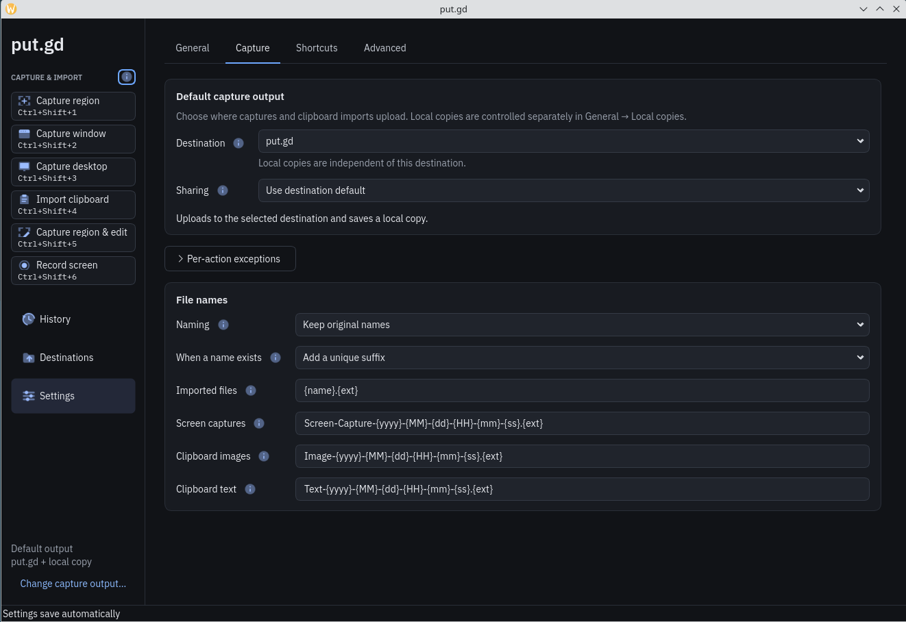</td>
<td width="50%">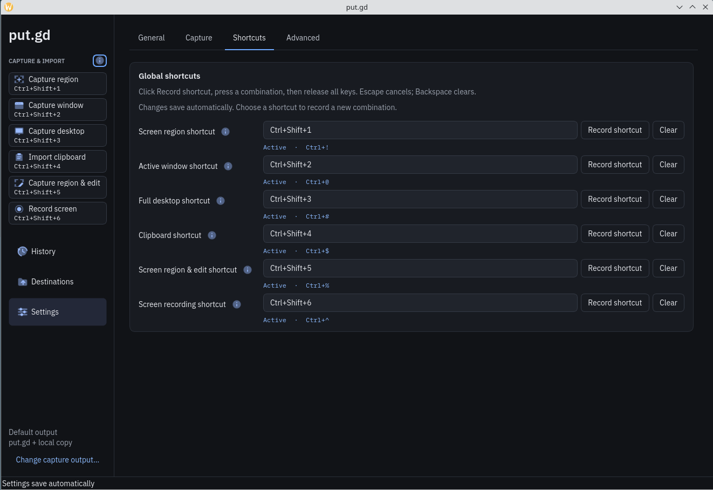</td>
</tr>
<tr>
<td align="center"><sub><b>Capture</b> — one default output, per-action exceptions, and naming templates for captures, clipboard images and text.</sub></td>
<td align="center"><sub><b>Shortcuts</b> — record a chord per action; each row reports whether the desktop actually granted it.</sub></td>
</tr>
</table>
</details>

##  Download

<p align="center">
  <a href="https://github.com/patrick-hudson/put.gd-desktop/releases"></a>&nbsp;
  <a href="https://github.com/patrick-hudson/put.gd-desktop/releases"></a>&nbsp;
  <a href="https://github.com/patrick-hudson/put.gd-desktop/releases"></a>&nbsp;
  <a href="https://github.com/patrick-hudson/put.gd-desktop/releases"></a>&nbsp;
  <a href="https://github.com/patrick-hudson/put.gd-desktop/releases"></a>
</p>

Every build, nightly or stable, ships the same fourteen files. Grab the one for your distro from the [releases page](https://github.com/patrick-hudson/put.gd-desktop/releases):

| You run | Download | Qt |
| --- | --- | --- |
| Ubuntu 24.04 · Linux Mint 22 | `putgd-VERSION-ubuntu24.04-x86_64.deb` | distro Qt 6.4 |
| Ubuntu 26.04 · Kubuntu 26.04 | `putgd-VERSION-ubuntu26.04-x86_64.deb` | distro Qt + LayerShellQt |
| Debian 13 | `putgd-VERSION-debian13-x86_64.deb` | distro Qt 6.8 + LayerShellQt |
| Fedora 44 | `putgd-VERSION-fedora44-x86_64.rpm` | distro Qt + LayerShellQt |
| Anything else with glibc 2.39+ | `putgd-VERSION-x86_64.AppImage` | bundled Qt 6.8.3, dynamically linked |
| GNOME 50 (any of the above) | `putgd-gnome50-VERSION.zip` | host Shell extension; the DEB/RPM already install it |
| Building it yourself | `putgd-VERSION-source.tar.gz` | curated source with `source-info.json` |

Plus `SHA256SUMS`, `release-builds.json` (full build receipts), a combined `putgd-VERSION-release.zip`, the AppImage's media source, and the Proton helper's corresponding source in two parts. Each DEB installs only on the release it names, because it links that release's FFmpeg.

<details open>
<summary><b>Fetch the newest nightly from the terminal</b></summary>

```bash
repo=patrick-hudson/put.gd-desktop
tag=$(gh release list -R "$repo" --exclude-drafts --json tagName -q '[.[].tagName | select(test("-nightly\\."))][0]')
gh release download "$tag" -R "$repo" -p '*ubuntu24.04*.deb' -p SHA256SUMS   # or *ubuntu26.04*, *debian13*, *fedora44*, *.AppImage
sha256sum --check --ignore-missing SHA256SUMS
```

</details>

```bash
# Debian family
sudo apt install ./putgd-*.deb
# Fedora
sudo dnf install ./putgd-*.rpm
# AppImage
chmod +x putgd-*.AppImage && ./putgd-*.AppImage
# GNOME 50 only: enable the capture extension, then log out and back in
gnome-extensions enable putgd@put.gd
```

> **Nightlies are build-tested, not desktop-certified.** Each one passed the full Linux test suites, the Windows compile, package audits and a production build of its own source tarball. Graphical, memory and live-S3 acceptance are recorded separately per candidate in [verification.md](docs/verification.md). Candidates and stable releases land on the same page once their exact packages pass acceptance on real desktops; a published stable becomes GitHub's *Latest*.

##  Quickstart

1. **Install** a package above and start `putgd`. It lives in the tray; the window opens on demand.
2. **Add a destination.** `Destinations → Add destination`: bucket + region for S3, then **Store credentials** (keychain or this session only) and **Test connection**. Or **Connect account…** for Proton Drive and pick a folder.
3. **Press `Ctrl+Shift+1`**, drag a region, let go. The link is on your clipboard and the capture is in History.

| Default key | Action | Notes |
| --- | --- | --- |
| `Ctrl+Shift+1` | Capture region | live desktop, Escape cancels |
| `Ctrl+Shift+2` | Capture window | focused external window, frame included |
| `Ctrl+Shift+3` | Capture desktop | all enabled monitors |
| *unbound* | Upload clipboard | files, then image, then text |
| *unbound* | Capture region & edit | opens the editor first |
| *unbound* | Record screen | toggles start/stop; Stop opens the review |

Rebind anything in `Settings → Shortcuts`; each row reports whether the desktop actually granted the binding. Local copies, naming templates, per-action destinations and sharing modes are in `Settings → General` and `Settings → Capture`. The full walkthrough is the [user guide](docs/user-guide.md).

### From a terminal or an agent

The resident speaks newline-delimited JSON over an owner-only socket at `$XDG_RUNTIME_DIR/putgd/session.sock`. `putgd-cli` is the production client; everything the tray and windows do goes through the same methods.

```bash
putgd-cli capabilities                                  # what this desktop actually supports
putgd-cli action.invoke '{"action":"region"}'           # returns an operation id immediately
putgd-cli operation.inspect '{"id":"OPERATION-ID"}'     # phase, bytes, link, outcome
putgd-cli history.list '{"limit":5,"category":"images"}'
putgd-cli recording.prepare '{"target":{"kind":"region"},"format":"mp4","fps":30}'
```

The optional MCP helper wraps the CLI with typed tools (`perform_action`, `edit_image`, `prepare_recording`, `upload_recording`, `list_history`, …) for Claude Code, Claude Desktop or any stdio MCP client:

```bash
uv sync --project tools/mcp --locked
```

```json
{ "mcpServers": { "putgd": {
    "command": "/path/to/repo/tools/mcp/.venv/bin/putgd-mcp",
    "args": ["--cli", "/usr/bin/putgd-cli"] } } }
```

Details, every method and error code: [CLI](docs/cli.md) · [MCP](docs/mcp.md) · [image editor](docs/image-editor.md) · [recording](docs/recording.md).

##  Desktop support

| Desktop | Session | Capture path | Hotkeys | Clipboard |
| --- | --- | --- | --- | --- |
| **Cinnamon** (Linux Mint) | X11 | Muffin's screenshot service, XCB fallback with Damage tracking | XCB passive grabs | ICCCM selections |
| **GNOME 50** (Ubuntu, Fedora) | Wayland | `putgd@put.gd` Shell extension: Shell screenshot API, St selector | Shell key bindings | Mutter selection API |
| **KDE Plasma 6** (Kubuntu, Debian) | Wayland | KWin ScreenShot2 with LayerShellQt overlays | KGlobalAccel | `ext-data-control-v1` |
| Other X11 | X11 | post-selection root capture | XCB | ICCCM |

Screen recording uses GStreamer `ximagesrc` on X11. On Wayland it takes a PipeWire stream straight from KWin or Mutter where it can, and otherwise through the ScreenCast portal with restore tokens, so the picker shows once per target kind. Window capture on Plasma includes the frame, matching KWin's own geometry.

Windows compiles in CI as future-platform evidence; macOS is not built. Flatpak needs no host helper: it keeps every capture feature except direct screenshots on Plasma Wayland (the Screenshot portal stands in), tracked in [#83](https://github.com/patrick-hudson/put.gd-desktop/issues/83) and [docs/flatpak.md](docs/flatpak.md). The required lab matrix is Mint, Ubuntu, Kubuntu, Fedora and Debian across Cinnamon, GNOME and KDE on real X11 and Wayland sessions, on physical machines where the gate demands it: [acceptance matrix](docs/acceptance-matrix.md).

##  Build from source

Baseline: GCC 13, CMake 3.24+, Ninja, Qt 6.4.2+, QtKeychain 0.14.2+. The exact `apt-get` and `dnf` package lists are in [build.md](docs/build.md). CMake never downloads anything; the pinned AWS SDK is built once with its own official project.

```bash
# 1. The pinned official AWS SDK (S3 only), verified against cmake/dependency-lock.json
git clone --depth 1 --branch 1.11.907 --recurse-submodules --shallow-submodules \
  https://github.com/aws/aws-sdk-cpp.git build/dependencies/aws-sdk-cpp
python3 tools/verify_dependencies.py build/dependencies/aws-sdk-cpp
cmake -S build/dependencies/aws-sdk-cpp -B build/aws -G Ninja -DCMAKE_BUILD_TYPE=Release \
  -DCMAKE_INSTALL_PREFIX="$PWD/build/sdk" -DBUILD_ONLY=s3 -DBUILD_SHARED_LIBS=ON \
  -DENABLE_TESTING=OFF -DAUTORUN_UNIT_TESTS=OFF -DENABLE_UNITY_BUILD=ON -DUSE_OPENSSL=ON
cmake --build build/aws --parallel && cmake --install build/aws

# 2. The app
cmake --preset dev
cmake --build --preset dev
ctest --preset dev
./build/dev/putgd
```

| Preset | What it is |
| --- | --- |
| `dev` | Debug build with the full CTest suite: 60+ contract, integration and GUI tests on offscreen Qt and a disposable Xvfb |
| `release` | What the packages are built from; add `-DPUTGD_RELEASE_TAG=vX.Y.Z` only on a clean, exactly tagged checkout |
| `asan` / `tsan` | AddressSanitizer+UBSan and ThreadSanitizer builds of the application code |

Optional pieces: `python3 tools/proton/provision_runtime.py` then `-DPUTGD_BUNDLE_PROTON=ON` for Proton Drive; the GStreamer and FFmpeg development packages for the `putgd-record` helper (CMake reports `putgd-record not built` without them). Packages come from `cmake --preset release` plus `tools/releases/native.py`, which audits ownership, modes, helper identities, licenses and SDK hashes before it hands you a DEB or RPM.

Every binary knows exactly what it is:

```console
$ ./build/dev/putgd --version
0.1.1-dev.340+g70722c3a4cbb
$ ./build/dev/putgd-cli --version-json | jq .gitCommit
"70722c3a4cbb…"
```

Development builds are `BASE-dev.COUNT+gSHORT` (`.dirty` if the tree is), packages order as `BASE~nightly.N` < `BASE~rc.N` < `BASE`, and installation refuses to mix executables from different commits. [versioning.md](docs/versioning.md) has the whole contract.

##  Release channels

`nightly` is the trunk and the default branch; `main` only moves by promotion. Nothing is pushed directly to either, tags are never moved, and every channel publishes the same verified asset set.

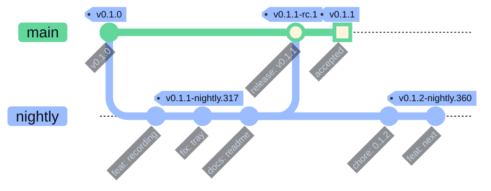

| Channel | Tag | When | What you get |
| --- | --- | --- | --- |
| **Nightly** | `vBASE-nightly.N` | 05:23 UTC daily, only if `nightly` changed | automatic prerelease after the full CI and package matrix passed on that exact tag |
| **Candidate** | `vBASE-rc.N` | every push to `main` (a promotion PR or a hotfix) | draft, published after exact-asset acceptance on real desktops |
| **Stable** | `vBASE` | manual Release run on an accepted candidate commit | draft, published the same way; becomes GitHub's *Latest* |

`N` in a nightly is the commit count of the tagged source, so it only goes up. Every release carries a `release-builds.json` with the producing workflow run, commit, tree and the SHA-256 of each asset, and the publisher refuses to replace bytes that are already public. The daily pipeline, job selection by changed paths and the SDK prefix caches are described in [ci.md](docs/ci.md); the promotion runbook in [release.md](docs/release.md).

<details>
<summary><b>What a nightly actually proves</b></summary>
<br>

- Python contracts: release tooling, packaging, lab identity and storage safety, the cold-family memory observer, a replay of saved live-S3 numeric evidence.
- The Debug `dev` build and the full CTest suite on Ubuntu 24.04 (minimum Qt API) and Ubuntu 26.04 (LayerShellQt), as an unprivileged user with private socket paths.
- The shared production code compiled on Windows with the official Qt.
- Ubuntu 24.04 and 26.04 DEBs, the Fedora 44 RPM and the AppImage, each built in a pinned container and audited for ownership, modes, ELF resolution, helper identities and SDK hashes.
- A production compile of the exact curated source tarball that gets published.

It does **not** certify compositor behaviour, memory on a real desktop or a live bucket. Those are separate, recorded gates.
</details>

##  How it fits together

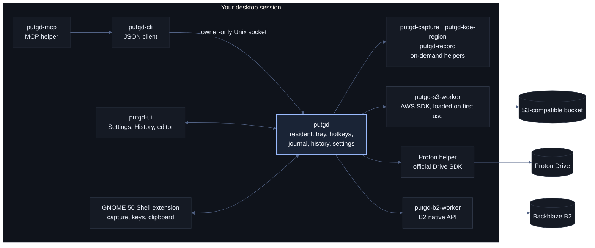

One resident owns the journal, settings, history, hotkeys and the tray. Windows, capture helpers, the recorder and the storage workers are separate processes that start when needed and exit when done, so an idle put.gd is one small process. Acceptance, acquisition, naming, archive, publication, retry and clipboard copy are one shared pipeline for every source, including finalized recordings. The [architecture](docs/architecture.md), [UI process protocol](docs/ui-process-protocol.md) and [storage provider contract](docs/storage-providers.md) have the details, and adding a provider is a matter of implementing one interface.

##  Things it refuses to do

- **Keep a secret in a file.** S3 keys go in the system keychain or die with the session; `config.json` holds references. The CLI rejects credentials on the command line outright.
- **Guess.** An interrupted upload becomes *unknown*, never a made-up URL. Retry reconciles against the saved publication identity before it does anything.
- **Delete without a receipt.** Remote deletion is prepare → review the exact IDs and effects → confirm with the returned acknowledgement. Clearing History never touches the bucket.
- **Upload behind your back.** The editor and the recorder stage everything privately; only Upload publishes. Private uploads make no link and leave the clipboard alone.
- **Ship a mystery binary.** Every executable embeds its commit, tree and dirty state; packages reject mixed builds; release assets ship with checksums and receipts tied to the workflow run that made them.

##  Documentation

| Area | Start here |
| --- | --- |
| Using it | [User guide](docs/user-guide.md) · [Configuration](docs/configuration.md) · [Credentials](docs/credentials.md) · [Troubleshooting](docs/troubleshooting.md) · [Errors](docs/errors.md) |
| Automating it | [CLI](docs/cli.md) · [MCP helper](docs/mcp.md) · [Image editor](docs/image-editor.md) · [Screen recording](docs/recording.md) |
| Storage | [S3](docs/s3.md) · [Backblaze B2](docs/b2.md) · [Proton Drive](docs/proton-drive.md) · [Provider contract](docs/storage-providers.md) |
| Desktops | [Cinnamon / X11](docs/desktops/cinnamon.md) · [GNOME 50](docs/desktops/gnome.md) · [KDE Plasma](docs/desktops/kde.md) · [Acceptance matrix](docs/acceptance-matrix.md) |
| Building and shipping | [Build](docs/build.md) · [Versioning](docs/versioning.md) · [CI](docs/ci.md) · [Releases](docs/release.md) · [Verification](docs/verification.md) |
| Internals | [Architecture](docs/architecture.md) · [Memory strategy](docs/memory-strategy.md) · [Design](docs/design.md) · [UI process protocol](docs/ui-process-protocol.md) |

##  Contributing

Branch from `nightly`, open the pull request against `nightly`, and let the `CI` check decide; it only runs the jobs your changed paths can affect. Leave the version in `CMakeLists.txt` alone in feature PRs. [AGENTS.md](AGENTS.md) is the authoritative working agreement, including for AI agents, and [docs/agents.md](docs/agents.md) maps the source tree. Bugs and ideas go in [issues](https://github.com/patrick-hudson/put.gd-desktop/issues).

##  License

[MIT](LICENSE) © 2026 Patrick Hudson. Bundled dependencies keep their own licenses; see [THIRD_PARTY_NOTICES.md](THIRD_PARTY_NOTICES.md). The Proton Drive integration is a third-party integration and is not endorsed by Proton.

<div align="center">
<br>

<br>
<sub>Capture. Upload. Link copied.</sub>
<br><br>
<a href="#readme">Back to top ↑</a>
</div>
