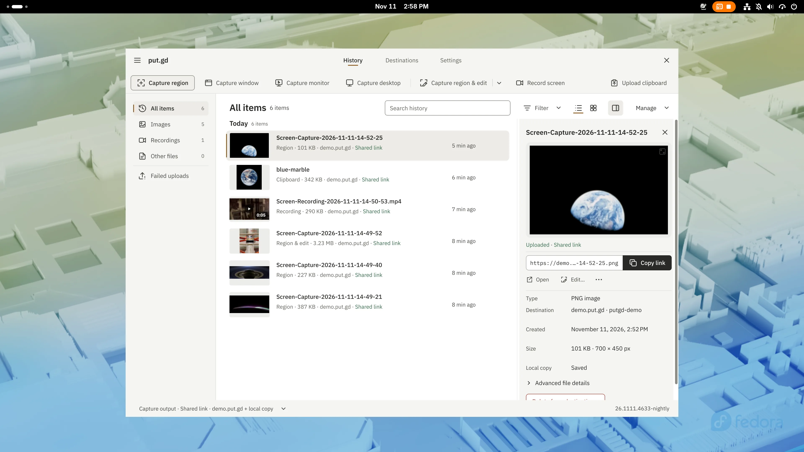
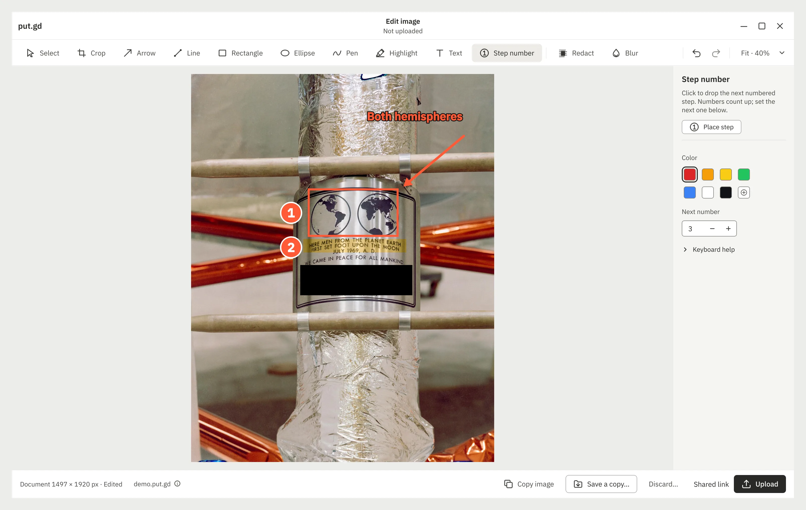
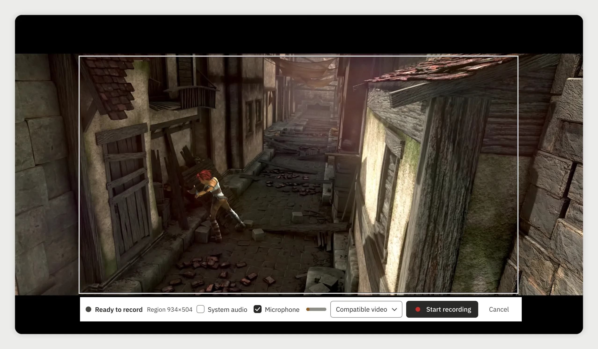

<p align="center">
  
</p>

<h1 align="center">put.gd</h1>

<p align="center">
  <b>Capture anything on your Linux screen and share it as a link.</b>
</p>

<p align="center">
  <a href="#install">Install</a> ·
  <a href="#your-first-link">Your first link</a> ·
  <a href="https://app.put.gd/userguide">User guide</a> ·
  <a href="https://app.put.gd/">Downloads</a>
</p>

Press a hotkey, drag over what you want to show, and a link is on your clipboard, ready
to paste into a chat, a ticket or a pull request. put.gd takes screenshots, scrolling
pages and screen recordings, lets you annotate and redact an image or trim and blur a
clip first, and can copy the text and QR codes straight off your screen. Uploads go to
storage you control: an S3 bucket, Backblaze B2, Proton Drive or your own server.
There is no put.gd account and no put.gd cloud.

If you've used ShareX on Windows or CleanShot X on a Mac, it's that idea, built for Linux.

<p align="center">
  <picture>
    <source media="(prefers-color-scheme: dark)" srcset="docs/readme/shots/desktop-dark.webp">
    
  </picture>
</p>

## Install

put.gd runs on x86_64 Linux. This installs the right package for your distribution
([see where it runs](#where-it-runs)) and verifies it first:

```sh
curl -fsSL https://app.put.gd/install | sh
```

For an AppImage just for your user, with no `sudo`:

```sh
curl -fsSL https://app.put.gd/install | sh -s -- --appimage
```

Many features on this page are new and in nightly builds until the next stable
release, among them scrolling capture, Copy text, custom uploaders, Budgie and
Hyprland. To get them now, use the nightly channel (add `--appimage` for an AppImage):

```sh
curl -fsSL https://app.put.gd/install | sh -s -- --channel nightly
```

Packages are also on [app.put.gd](https://app.put.gd/), and the guide explains
[switching between stable and nightly](https://app.put.gd/userguide/updating.html#switch-between-nightly-and-stable).
A few desktops need one more thing:

- **GNOME 50:** log out and back in [once](https://app.put.gd/userguide/desktops.html#gnome) when put.gd asks. The current stable release
  then also needs `gnome-extensions enable putgd@put.gd`.
- **KDE Plasma on Ubuntu 24.04 (Wayland):** use the AppImage. The package there has no
  region selector.
- **Budgie:** window capture needs labwc 0.20 or newer. With an older labwc, capture a
  region instead.

## Your first link

1. Open put.gd, go to **Destinations** and click **Add destination**. Choose
   [Amazon S3 or Cloudflare R2](https://app.put.gd/userguide/destinations-s3.html),
   [Backblaze B2](https://app.put.gd/userguide/destinations-b2.html), [Proton Drive](https://app.put.gd/userguide/destinations-proton.html)
   or a [custom uploader](https://app.put.gd/userguide/destinations-custom.html) (import a ShareX `.sxcu` file),
   and fill in its details.
2. Click **Save to keychain** (for Proton Drive, **Connect account…** and pick a
   folder), then **Test upload and link** (for Proton Drive, **Check account and
   folder**, which checks access but tries no upload or share link), and
   **Make default** if it isn't already.
3. Press a hotkey:

   | Hotkey | Captures |
   | --- | --- |
   | `Ctrl+Shift+1` | A region you drag (Escape cancels) |
   | `Ctrl+Shift+2` | The active window |
   | `Ctrl+Shift+3` | The whole desktop |

The capture uploads and its link is on your clipboard. Every capture is also in the
main window and the tray menu. **Settings → Hotkeys** lets you change any key and says
why one couldn't be set, for example when another app already uses it. Closing the
window leaves put.gd running in the tray. The [quick start](https://app.put.gd/userguide/quickstart.html) walks
through it with pictures.

## What it does

**Capture what you need.** A region, a window, one monitor or the whole desktop; the
same region again; or after a 3, 5 or 10 second delay, so a menu can stay open.
**Capture scrolling region** scrolls a page, chat or document for you and stitches it
into one tall image. **Upload clipboard** sends whatever you copied, and
**Upload with put.gd** in your file manager sends files and folders.
[Capturing →](https://app.put.gd/userguide/capture.html) · [File manager →](https://app.put.gd/userguide/file-manager.html)
· [Scrolling capture →](docs/user/user-guide.md#capture-a-scrolling-region)

**Mark it up first.** **Capture region & edit** opens an editor with crop, arrows,
shapes, highlights, text and numbered steps. **Redact** removes pixels for good, and
**Quick redact** suggests covers for email addresses, phone numbers, card numbers and
keys (check them before you share). Nothing uploads until you click **Upload**.
[The editor →](https://app.put.gd/userguide/edit.html)

<p align="center">
  <picture>
    <source media="(prefers-color-scheme: dark)" srcset="docs/readme/shots/edit-dark.webp">
    
  </picture>
</p>

**Record your screen.** Record MP4 or WebM with system audio and your microphone, or a
silent GIF or animated WebP, with optional click highlights. Stopping opens a private
review where you trim the clip and blur or cover parts of it before you save or upload.
[Screen recording →](https://app.put.gd/userguide/record.html)

<p align="center">
  <picture>
    <source media="(prefers-color-scheme: dark)" srcset="docs/readme/shots/record-bar-dark.webp">
    
  </picture>
</p>

**Copy text off the screen.** Drag over text you can't select (an error dialog, a
slide, a video frame, a screenshot of a terminal) and it's on your clipboard, along
with what any QR code in it holds. It's read on your computer by a sandboxed helper
with no network access, and put.gd saves and uploads none of it. The editor can select
and copy text from an image too. [Copy text →](docs/user/user-guide.md#copy-text-from-the-screen)

**Find it again.** History keeps your captures in a list or a gallery, searchable by
name and filterable. Copy a link again, refresh an expired S3 or B2 link, show a link
as a QR code for your phone, or retry a failed upload. [History →](https://app.put.gd/userguide/history.html)

**Script it.** [`putgd-cli`](https://app.put.gd/userguide/cli.html) runs every action from a script, and the
optional [MCP helper](https://app.put.gd/userguide/cli.html#mcp-for-agents) gives AI agents the same controls.

## Where it runs

| | |
| --- | --- |
| **Desktops** | [Cinnamon](https://app.put.gd/userguide/desktops.html#cinnamon), [GNOME 50](https://app.put.gd/userguide/desktops.html#gnome), [KDE Plasma](https://app.put.gd/userguide/desktops.html#kde-plasma), [Budgie](https://app.put.gd/userguide/desktops.html#budgie), [Hyprland](https://app.put.gd/userguide/desktops.html#hyprland) (tested on Omarchy) |
| **Distributions** | Ubuntu 24.04 and 26.04, Linux Mint 22, Debian 13, Fedora 44 and 45, Arch and Arch-based; any other distribution with glibc 2.39 or newer through the AppImage. x86_64 only. |
| **Storage** | Amazon S3, Cloudflare R2 and other [S3-compatible services](https://app.put.gd/userguide/destinations-s3.html#s3-compatible-services), [Backblaze B2](https://app.put.gd/userguide/destinations-b2.html), [Proton Drive](https://app.put.gd/userguide/destinations-proton.html) (experimental; links open a share page), or your own server through a [custom uploader](https://app.put.gd/userguide/destinations-custom.html) |

[Your desktop](https://app.put.gd/userguide/desktops.html) says what put.gd can and can't do on each one.

## Your data

- Uploads go only to the destination you choose.
- Edits and recordings stay on your computer until you upload them.
- put.gd never saves or uploads text you copy off the screen, though a clipboard
  manager may keep it.
- Passwords and keys live in your system keychain, never in config files.
- put.gd checks app.put.gd for updates once a day. You can turn that off.

## More

[User guide](https://app.put.gd/userguide) ·
[Troubleshooting](https://app.put.gd/userguide/troubleshooting.html) ·
[Build from source](docs/release/build.md) ·
[Developer docs](docs/README.md) ·
[Report a bug](https://github.com/patrick-hudson/put.gd-desktop/issues) ·
[MIT license](LICENSE)

<sub>Screenshots: put.gd 26.1111.4633 nightly on GNOME 50.6 (Wayland), Fedora Linux 44.
Demo media: [Sintel](https://commons.wikimedia.org/wiki/File:Sintel_trailer-1080p.ogv)
© copyright Blender Foundation | durian.blender.org,
[CC BY 3.0](https://creativecommons.org/licenses/by/3.0/); NASA photos (public domain).</sub>
