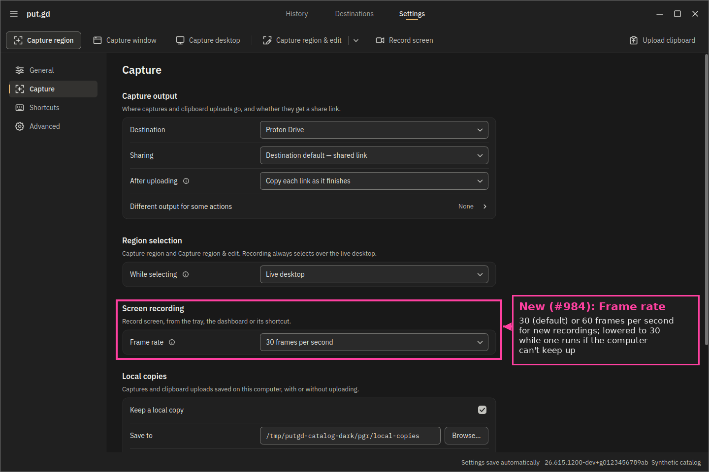

# Screen recording: sessions, exports and settings

Part of [Screen recording](../recording.md).

## Time, geometry and the edit model

- Time is an integer count of **microseconds on the recorded-clip timeline**
  with pauses removed; intervals are half-open `[start, end)`. Export rounds
  to the nearest frame boundary at the recording's `fps` (the `fps` filter of the
  export graph).
- The output canvas is fixed when the recording starts (`canvas: [w, h]`);
  masks use canvas pixels. A topology change during recording ends it with a
  helper failure rather than moving the canvas.
- `edit` holds one contiguous trim (`trimStart`, `trimEnd` or null for the clip
  end) and up to 64 masks `{id, kind: blur|solid, rect: [x,y,w,h], start, end,
  strength}`. Masks are stored in source time. At export each mask is
  intersected with the retained interval and rebased by the trim start:
  retaining 10–30 s makes a source mask at 12–15 s active at output 2–5 s, and
  a mask wholly outside the trim is dropped. Changing the trim never moves a
  mask on the source timeline.
- Every accepted `edit` advances `revision`. `upload` and `edit` take the
  revision they were reviewed at and fail with `recording_stale` otherwise.
- Animated exports (GIF, WebP) are silent and must fit
  `limits.recordingAnimationSeconds` (retained duration); a longer clip is
  refused, never shortened. An output whose long edge is over
  `limits.recordingAnimationEdge` gets the recording's `maxEdge` set to that
  limit once the canvas is known (at `ready`, at stop, or when GIF or WebP is
  chosen in review), and `inspect` shows the new `maxEdge` and `outputSize`. A
  smaller `maxEdge` is kept.

## Session methods

All methods go through `putgd-cli` unchanged. `id` is the recording ID.

| Method | Params | Result / effect |
| --- | --- | --- |
| `recording.capabilities` | | availability and reason, target kinds, formats, codecs per format, `audio {system, microphone, microphoneDevice \| microphoneReason, microphoneMessage}` (the microphone as the sound server offers it at that moment), `clickHighlights {available, route, drawnBy, targets, reason?, message?}`, `active` recording ID, limits, `timeUnit`; no capture, no device opened, no prompt |
| `recording.microphones` | `{device?}` | the inputs a recording can narrate from, `devices [{id, label, default}]` (never an output's monitor), `defaultIsMonitor`, and for `device` (omitted: `preferences.recordingMicrophoneDevice`, else the system default input) `available` with `device {id, label}`, or `reason` and `message`; see [Microphone](microphone-and-clicks.md#device). Asks the sound server; opens no device |
| `recording.windows` | | KDE Plasma, GNOME Wayland and Budgie (labwc 0.20+, Magpie on Mir 2.29+; ext toplevel identifiers, `rect` empty): the windows a `window` target can follow, `windows [{identity, title, appId, rect, active, minimized}]` and `activeExcluded` (the focused window is put.gd's own); put.gd's windows are never listed. `recording_unsupported` elsewhere, `helper_outdated` while an older GNOME extension is loaded ([Window recordings](wayland.md#window-recordings)); no capture, no prompt |
| `recording.prepare` | `target {kind: monitor\|desktop\|region\|window, identity?, rect?}`, `format mp4\|webm\|gif\|webp`, `codec?`, `fps? (1–60; omitted: preferences.recordingFrameRate)`, `adaptiveFps? (boolean, default true)`, `audio? {system?, microphone?, microphoneDevice?}`, `clickHighlights? (boolean, default false)`, `maxEdge?` | durable intent, then ready bounds/controls and any OS consent; replies at once with `state: preparing`; poll `inspect` for `ready`. A region without `rect` opens the desktop's selector (Escape cancels; `inspect` shows `selecting: true`); the chosen bounds appear in `inspect` as `target.rect`, and `overlayExcluded` / `overlayPlacement` say whether the control bar stayed out of the recorded pixels. Refused with `disk_space_insufficient` (details `freeBytes`, `reserveBytes` for the system reserve, `reservedBytes` for uploads in progress, `availableBytes`, `requiredBytes`, `shortfallBytes`, `hint`) before anything is accepted when free disk above both reservations can't hold three 64 MiB budgets (#213) |
| `recording.select` | `{id, rect: [x, y, w, h]}` | completes an open region selector with that rectangle as a drag would (X11 root pixels, logical desktop pixels on Wayland); `recording_state` when no selector is open |
| `recording.start` / `pause` / `resume` / `stop` | `{id}` | acknowledged once the backend reached the state; a duplicate of the in-flight command returns the current state, a different one is `recording_busy`; an acknowledged user `stop` returns `durationUs` and `stopReason: user` and enters `reviewing`, including when stopped through CLI, MCP or the toggle hotkey. A `stop` that arrives after the helper stopped on its own (its budget) answers with the existing `reviewing` state and preserves `stopReason: budget` and `stopDetails`, like a duplicate stop |
| `recording.cancel` | `{id}` | discards the clip; the operation ends `cancelled` |
| `recording.inspect` | `{id}` | state, pending command, `selecting`, target, config, canvas, `durationUs`, `retainedUs`, edit, progress (`frameRate`, optional `frameRateReduced`, `framesDelivered`, `framesCaptured`; `exportFraction` while exporting; see [Frame rate](#frame-rate); `audioSources`, `recordingMicrophone`, `microphoneLost` and `clickHighlightsError`: see [Microphone and click highlights](microphone-and-clicks.md#what-a-session-reports)), `overlayExcluded`, `overlayPlacement`, `lastExport`, `window {identity, title, appId, rect}` for a window the resident resolved, `stopReason` (`user`, `budget`, `target_closed` when the recorded window closed, `source_lost` when its stream could not be reopened) once the capture stopped, and after a budget stop `stopDetails` (`reason` `disk_space` or `max_file_bytes`, `message`, `hint`, `budgetBytes`, `maxFileBytes`, `durationUs`, and for the disk `freeBytes`, `reserveBytes`, `availableBytes`; see [Capture and export engine](capture-and-export.md#capture-and-export-engine-x11)), error; an ended session is `recording_unavailable` and its operation holds the outcome |
| `recording.audio` | `{id, microphone?, system?}` (at least one) | the ready bar's audio toggles, set as a click sets them, while the session is `ready`; answers like `inspect`. `recording_unsupported` with the reason when no microphone can be opened, `recording_state` from Record on. See [Microphone and click highlights](microphone-and-clicks.md#what-a-session-reports) |
| `recording.raise` / `recording.overlay` | `{id}` / `{id, visible}` | overlay control; a hidden bar stays hidden through state changes until `raise` (a full-screen clip without the handle); the recording indicator stays visible |
| `recording.edit` | `{id, revision, commands[1–100]}` | atomic `setTrim {start, end\|null}`, `resetTrim`, `addMask {mask}`, `updateMask {maskId, mask}`, `removeMask {maskId}` |
| `recording.preview` | `{id, time, maxEdge? 64–1600}` | one PNG frame (base64 `png`) at clip time with current trim/masks, plus `retained`, `outputTimeUs`, `revision`; returned only to the requesting client |
| `recording.review` | `{id, action, time?, speed?, kind?, rect?, maskId?, strength?, format?, codec?}`; `action` also `saveCopyDialog` / `closeFileDialog` | works one review-window control as a user does and answers with the window's state and the resident's edit (see [Review window](overlay-and-review.md#review-window)); `reviewing` only, `inspect` also while `exporting` |
| `recording.saveCopy` | `{id, path, overwrite?}` | exports to an absolute path with the format's extension; no upload. Replies once the export starts with `state: exporting`; poll `inspect` until `reviewing`, then `lastExport.status` is `saved` or `failed` |
| `recording.upload` | `{id, revision}` | the only publishing action. Replies once the export starts with `state: exporting` and the linked `operationId`; see "Exports" below |

If a helper budget-stop event reaches review before a pending `stop` command's
reply, that reply returns the current finalized session, including an export
already in progress. It preserves the clip duration, stop details, edit model
and current state. A subsequent `stop` while still reviewing returns that review.

### Exports

An export can run for minutes: the helper allows 600 s, and a 60 s GIF or a
long H.265 clip on a busy machine takes well over the CLI's 15 s wait. So
`saveCopy` and `upload` check the request first (state, path and `overwrite`,
the revision, the animation limits) and refuse it at once, or reply as soon as
the export starts, like `prepare`. The reply is the session as `inspect` shows
it: `state: exporting`, `pending: saveCopy|upload`. Edits, previews and other
exports are refused with `recording_state` until the export ends; `cancel` still
works and discards it. While it runs, `progress.exportFraction` reports how far
it got, and `operation.inspect` reports phase `exporting` (copy) or `encoding`
(upload).

`lastExport` is the session's latest export: `{command, status, revision}`, plus
`path` for a copy. `status` is `exporting`, then `saved` (with `bytes` and
`durationUs`) or `failed` (with `error`, for example `recording_export_failed`,
`input_excessive` or `local_save_failed`). A failed export writes nothing and
returns the session to `reviewing`. For a copy, poll `recording.inspect` until
`state` is `reviewing` again. For an upload, `reviewing` with
`lastExport.status: failed` means nothing was uploaded. A successful upload export
hands the bytes to the pipeline and ends the session: `recording.inspect` then
answers `recording_unavailable`, and `operation.inspect` on the `operationId`
follows the upload to `completed` or `failed`.

Codec rules: MP4 takes `h264` (default) or `h265`; WebM takes `vp9`; GIF and
WebP take none. `audio.system` is the computer's playback and `audio.microphone` an
input device, alone or mixed with it into the one audio track; both are refused
for GIF/WebP (`invalid_request`). A request for the microphone when none can be
opened, or for `clickHighlights` where the desktop has no route or not for that
target kind, is refused with `recording_unsupported` and the reason in
`details.reason` ([Microphone and click highlights](microphone-and-clicks.md)). Errors: `recording_unavailable` (from `prepare`,
`details.reason` says why; on Budgie and Hyprland `wlr_capture_unavailable` is a
missing image-copy global or a failed connection, named in the message; `inspect` and
later commands on a recording that has ended return it with no reason),
`disk_space_insufficient`, `recording_disk_full` (capture could not be finalized),
`recording_unsupported`, `recording_active`, `recording_state`,
`recording_busy`, `recording_stale`, `recording_mask_unknown`,
`region_unavailable` (a Wayland desktop without a region selector),
`recording_animation_too_long`, `recording_animation_too_large`,
`recording_export_failed`, `file_exists`, plus the shared `invalid_request`,
`queue_full`, `busy_selecting`, `editor_active` and `output_required`.

Once `cancel` answers, `capabilities.active` is null, but the previous
`putgd-record` can take up to its stop deadline (2 s) to exit. A `prepare` in
that window waits for the exit and then starts, instead of failing with
`recording_active`. Only one prepare waits; cancelling it first means it never
starts a helper ([#1296](https://github.com/patrick-hudson/put.gd-desktop/issues/1296)).

## Settings

| Field | Meaning |
| --- | --- |
| `preferences.recordingFrameRate` | Optional, `30` (default) or `60`; Settings → Capture → Screen recording → Frame rate. Used by `recording.prepare` when `fps` is omitted; an explicit `fps` wins |
| `preferences.recordingMicrophone` | Optional boolean, default `false`: the bar's Microphone toggle, remembered. Recordings started from the tray, the dashboard or the hotkey begin with it; `recording.prepare` records the microphone only when `audio.microphone` says so |
| `preferences.recordingMicrophoneDevice` | Optional source name, default empty (the system default input); Settings → Capture → Screen recording → Microphone. An explicit `audio.microphoneDevice` wins |
| `preferences.recordingClickHighlights` | Optional boolean, default `false`; Settings → Capture → Screen recording → Click highlights. Used by the tray, dashboard and hotkey; `recording.prepare` takes `clickHighlights` |
| `actions.record` | Optional route like the other actions; absent documents inherit the region route with no hotkey |
| `naming.recordingTemplate` | Optional, default `Screen-Recording-{yyyy}-{MM}-{dd}-{HH}-{mm}-{ss}.{ext}` |
| `limits.recordingAnimationSeconds` | Optional, default 60 |
| `limits.recordingAnimationEdge` | Optional, default 1280 |

### Frame rate

Settings → Capture → **Screen recording → Frame rate** chooses 30 (default)
or 60 frames per second for new recordings. An untouched configuration keeps
no key and uses 30; an existing explicit key is preserved when saved. CLI `settings.patch` and MCP `patch_configuration` set
`preferences.recordingFrameRate`; an explicit `recording.prepare` `fps` overrides it.

This is a synthetic UI catalog render, not desktop acceptance. Its provenance
and the bounded physical measurements are in the [frame-rate receipt](https://github.com/patrick-hudson/put.gd-evidence/blob/874703b35562c732268c6fe0bc9b42614ffda928/records/2026-10-31-recording-rate/README.md).

The adaptive rate is enabled by default. The helper samples one window per
second, waits two warm-up windows, then lowers the rate after three bad windows
in a row. A good window resets that count. A window is bad when:

- the capture queue leaked at least three frames and more than 5% of delivered
  frames (`encoder`);
- X11's `ximagesrc` grabbed under 80% of the configured rate (`capture`);
- the machine was at least 90% busy while the recorder used at least half a
  CPU core (`cpu`, sampled from `/proc`).

Queue leaks and late grabs step 60 → 30 → 15; other explicit rates halve to a
15 fps floor. CPU pressure alone only lowers rates above 30, so it never takes
30 fps below that floor. Each reduction restarts the warm-up. The rate never
rises during the recording. X11 gates frames after the source; PipeWire changes
the cadence lock's period, retaining its configured-frame tolerance.
`videorate` follows `videoconvert`, so repeated frames are not converted again.
After a reduction its repeats (the buffers it flags `GAP`) stop before the
encoder, which encodes only the kept frames with variable-rate timestamps
([#1045](https://github.com/patrick-hudson/put.gd-desktop/issues/1045)). The caps
keep the configured rate, because `matroskamux` refuses a mid-stream change and
it would re-initialise the encoder. `x264enc`, `openh264enc` and `vaapih264enc`
keep their input timestamps; `vah264lpenc` and `vah264enc` stamp their output
contiguously, so the helper puts each frame's input time back on its output, in
order (they run with `b-frames=0`). The clip keeps its full timeline; a player
or export holds each kept frame until the next. A recording that never reduces
its rate is encoded as before. Stop ends the skip so the clip reaches its last
slot. Keyframes stay 2 × the configured rate apart in encoded frames, so they
are further apart in time after a reduction (4 s at 60 → 30). Export rebases
video on the trim start and its `fps` filter starts at 0, because a trim can
start between two kept frames while the audio starts on it.

On the one setup measured so far, an AMD Radeon 740M (Plasma 6.8.2, 1080p,
`vah264enc` against `x264enc`), hardware and software encoding hold the same
cadence at 60 fps. Ten alternating pairs measured 59.81 and 59.82 distinct source
frames per second, and the recorder reported zero dropped frames and capture-queue
leaks. Other GPUs and loaded hosts are unverified. On that setup, a notification
with a timeout bar lowers the cadence with either encoder while it is on screen, to about 50 distinct frames per second in the same test: source
arrivals roughly double, the cadence lock drops the extra arrivals as early, and
the recorded window's own frame clock slows too. With no recorder running, the
same notifications cost the window nothing. See the
[#1216 record](https://github.com/patrick-hudson/put.gd-evidence/blob/60f55f661388abea6f37f53cc2d816cb19d01b9c/records/2026-11-09-amd-cadence-1216/README.md).

`recording.inspect` (MCP `get_recording`) reports these under `progress`:

| Field | Meaning |
| --- | --- |
| `frameRate` | Current adaptive capture rate, not a measured distinct-frame rate |
| `frameRateReduced` | Present after a reduction: latest `{from, to, reason, atUs}`; reason is `encoder`, `capture` or `cpu`, and `atUs` is retained clip time in microseconds |
| `framesDelivered` | Cumulative frames delivered by the source to the gate |
| `framesCaptured` | Cumulative frames kept by the gate before `videorate` adds repeats |

For lab A/B runs, set `recording.prepare` `adaptiveFps: false` (MCP
`adaptive_fps: false`) or `PUTGD_RECORD_ADAPTIVE_RATE=off` in the helper's
environment, and `PUTGD_RECORD_ENCODE_REPEATS=on` keeps encoding the repeats
after a reduction. `PUTGD_RECORD_DEBUG_LOG` includes one `rate window:` line per
second with delivered/leaked counts and machine/recorder CPU shares, plus
`rate lowered …` when it changes and `repeats: N skipped before the encoder`
when the capture ends. Use synthetic content and the desktop lock
when running the [fluidity harness](../../lab/remote-builders.md).
