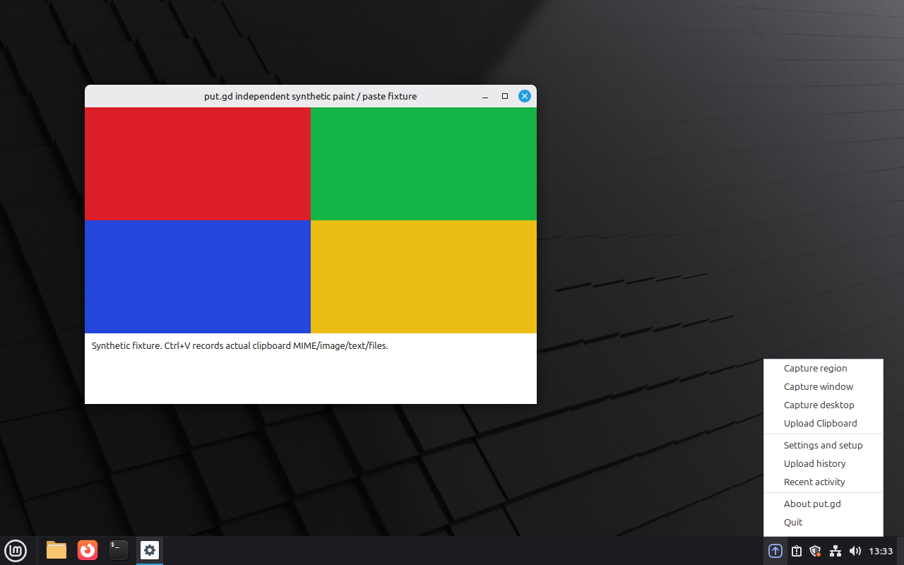

# Clipboard tray wording — 2026-10-16

The native Linux tray and Qt fallback display **Upload Clipboard**. The
`clipboard` identifier, menu ID, destination, shortcut and processing remain
unchanged. This is the wording correction requested in
[issue #36](https://github.com/patrick-hudson/put.gd-desktop/issues/36).

The existing widget action-routing test now selects the new label, and the
native D-Bus layout test checks its exact capitalization. Both failed on the
old label before the implementation changed. Both complete tray suites passed
afterwards and again after committing the implementation:

```sh
cmake --preset dev
cmake --build --preset dev --target test_gui_tray test_native_tray
ctest --preset dev -R '^(gui_tray|native_tray_integration)$'
```

The committed-candidate run passed 2/2 suites in 55.08 seconds. Review found no
actionable issues. No unrelated suites or sanitizer campaign were required for
this wording change.

On a fresh Cinnamon 6.6.4 / Qt 6.4.2 KVM overlay, the visible menu showed the
requested label. Selecting it through the console completed the clipboard
action. The unchanged lab oracle verified synthetic text in the configured
local destination and an independent native paste. No network upload was
performed. The existing `Ctrl+Shift+4` binding remained bound.



The development package used implementation commit
`e51132eb1f52386a9424d27d4ed0836a512049d3`, tracked tree
`9ae659da3dd435048e7703dacc17cc1e3e23303b`, Debug mode and the synthetic lab
fixture. Proton bundling was off. Its version was
`0.1.1-dev.220+ge51132eb1f52.dirty`: the pre-existing untracked
`tools/qemu-grid/` work was preserved and excluded from commits. This is a
development functional check, not release-package acceptance.

- DEB SHA-256: `5ca7f6f1857327a00eb0b82fb19112c196cb154557482b8cbf58b4bb8ca8c551`
- Installed/running resident SHA-256: `8358504528f641a5147301fbb5ed6d852a934a6f428fedae388ff89d54b0f52a`
- Overlay run identity: `837c4269-6c42-4c85-b126-9ea5ef7c2560`
- Native operation: `cb37c9be-75bf-495a-bcaf-4c28665077f0`, completed with local output saved and copy status `copied`.

Memory testing was waived by explicit user instruction for this string change.
An initial harness attempt rejected the dirty build before sampling; zero
samples were collected, and it was not retried. No memory acceptance is claimed.
The initial interrupted broad rebuild and Ninja dependency-log recovery remain
in the private attempt record; the subsequent sequential candidate build and
both tray suites passed.

Private evidence is retained under `work/i36/` and
`work/lab-runs/i36c1/`, including socket/capacity preflights, commands, build and
test logs, native results, package/process identities and overlay retirement
receipts. This check does not certify GNOME/KDE, full Cinnamon functionality,
physical performance or the broader acceptance work in
[issue #44](https://github.com/patrick-hudson/put.gd-desktop/issues/44).
