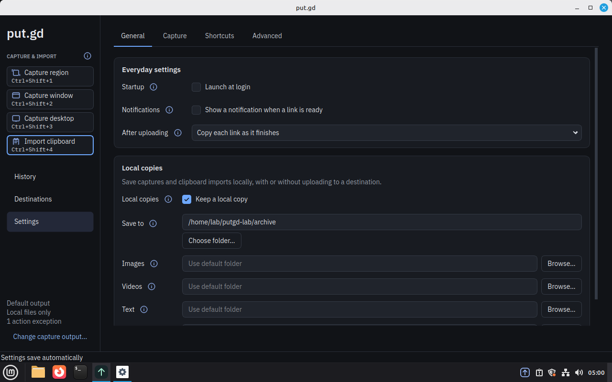
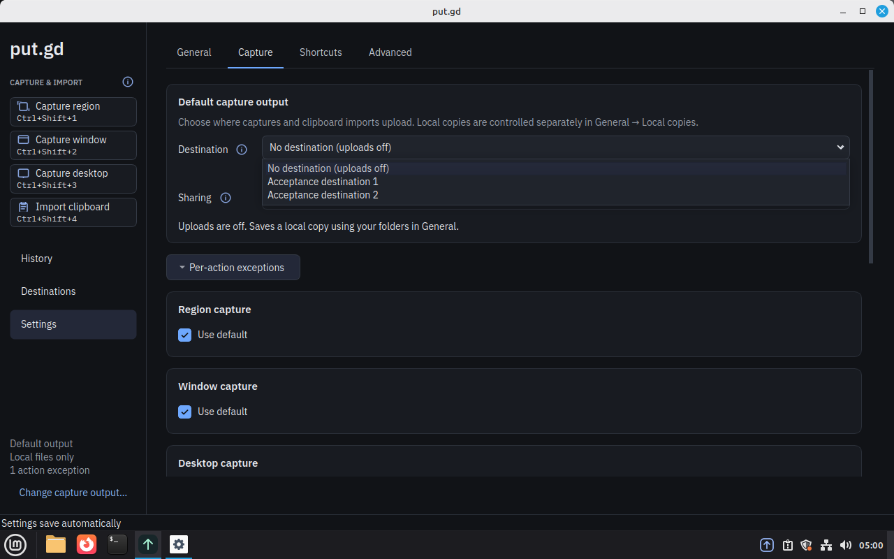
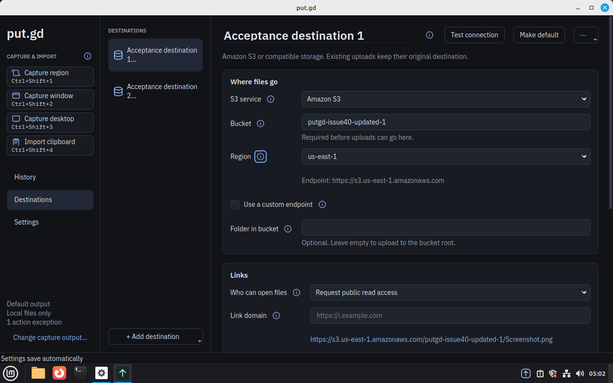
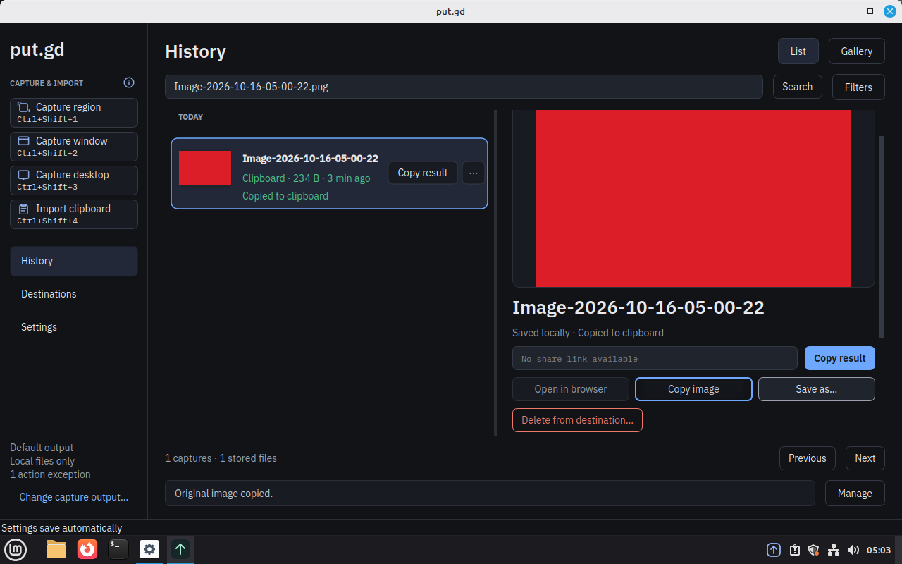
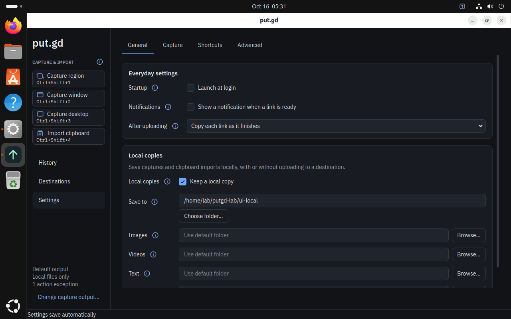
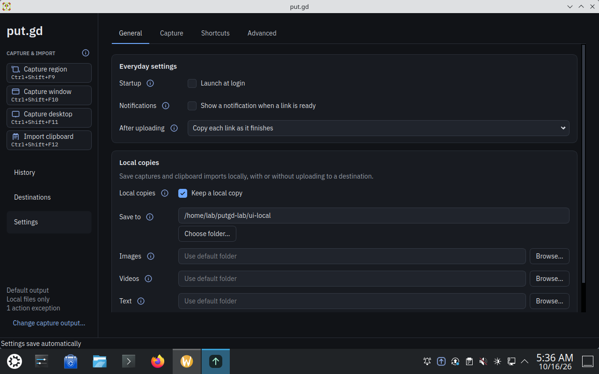

# Issue 40 redesign acceptance — 2026-10-16

The user approved the first visual round and authorized expanded acceptance.
The redesign was integrated in its own checkout from freshly fetched main
`da8cfc7543e5774e3382d24fdbd1d2b28751e974`. The original experiment remains separate.
Production tray pane source is unchanged.

## Exact candidate

All final host suites and native desktop gates below use product source
`1010842c9d2540bdd587225fd3dfdeefd4183fc0`, tree `b5e1bee9cb3a61497d3921370c8917b3fc60e79e`, count 211.
Tracked-source archive SHA-256: `520322813d54ab70a1e216151264b80470a2706f9e6b1007a984a41c02cc9dde`.
The JSON companion binds the curated source export, audited packages, installed
binaries, live resident identity, private storage module and Proton helper.
Later documentation-only evidence commits do not relabel measured binaries.

Cinnamon uses Mint 22.3 / system Qt 6.4.2. GNOME and KDE use Ubuntu/Kubuntu 26.04
with system Qt 6.10.2. Each uses an audited Release DEB; the independent synthetic
Qt/GTK paint/paste fixture is installed separately and excluded from the package.
Golden disks were never booted or modified; each desktop used a fresh overlay.
Graphical interactions remained visible on localhost VNC and the display wall.
Resolved Unix socket paths were checked before isolated launches.

## Completed checks

- Complete Dev CTest: 58/58; complete ASan/UBSan CTest: 58/58. Raw logs have no
  sanitizer reports and no suppressions. Distro Qt/external AWS are uninstrumented.
- Locked official-SDK MCP suite: 3/3; configuration schema suite: 4/4.
  Twenty-four unchanged Python packaging/release/lab/observer contract scripts
  passed earlier at `e6f49b3`; that limited unchanged scope is explicit in JSON.
- On each desktop: 12 native Qt/GTK capture, clipboard, cancellation and byte/pixel
  oracle cases; all four actual rail buttons before and after resident restart;
  repeated native view navigation and helper exit after final window close.
- Real edits autosave; focus/blur without editing preserves accepted revision,
  configuration bytes, inode and mtime. Native root and bucket edits change only
  their intended fields. Two/three-option lists fit, and tab-wheel events keep
  the selected tab. Default inheritance, explicit exceptions, independent local
  copies and rejection before acquisition when neither output is enabled pass.
- History list/gallery/search, native Save as exact bytes, and independent GTK
  Copy image paste exact pixels pass while the UI is open and after its helper
  exits. Resident restart retains settings and history. All navigation labels
  remain visible with native desktop row metrics.
- Two serial five-minute post-use resident observations per desktop passed the
  unchanged harness: peak RSS ≤40 MiB, CPU <0.5% of one core, zero swap, one
  resident process and no escaped/UI helper. Cinnamon passed before either
  Wayland build/test campaign started.

| Desktop | Peak RSS MiB, windows 1 / 2 | CPU % one core, windows 1 / 2 | Observation |
| --- | --- | --- | --- |
| cinnamon | 30.43 / 30.43 | 0.0033 / 0.0067 | 2 × 300 s; zero swap; no UI/helper |
| gnome | 30.89 / 30.89 | 0.0033 / 0.0067 | 2 × 300 s; zero swap; no UI/helper |
| kde | 31.11 / 30.98 | 0.0133 / 0.0067 | 2 × 300 s; zero swap; no UI/helper |

Synthetic widget/service regressions additionally cover credential hints and
explicit storage, stale autosave proposals, save errors/retry/conflicts, late
Proton replies, stable account identity during destination navigation and the
separate Refresh folders button with loading feedback. These seams do not prove
live cloud GUI or compositor behavior.

## Acceptance fixes and retained attempts

The first native rail candidate photographed its own window. The corrected
handoff completes pending settings writes and hides its windows before capture,
preserving unfinished credentials and open dialogs; rejection restores windows.
A later native KDE check exposed duplicate list spacing that pushed History out
of view. Both failed candidates were retired before acceptance of their successors.

Native KDE then exposed History image clipboard ownership being lost when its UI
helper exited. Copy image now resolves a journal ID in the resident, verifies the
retained regular original file/hash, converts at full size in a bounded transient
GUI worker, and commits through the serialized native clipboard path. Regressions
cover symlink/FIFO/changed-file rejection, prior resident acknowledgement versus
external clipboard ownership, and cancellation of an obsolete conversion so it
cannot block a newer copy for ten seconds. Each fault was reproduced before its
fix. A 3001×3001 RGBA64 regression also exposed a four-byte decoded pixel budget;
the final bound preserves exact 16-bit samples at the existing 32 MiB encoded-input
and 16Mpx limits (128 MiB decoded, 129 MiB PNG output).

The earlier `8656491` Dev run hit a synthetic deferred-upload readiness deadline:
the expected two completions arrived at 5.35 s, beyond its 5 s assertion, and the
unfinished fixture reached the suite's 120 s ceiling. Three unchanged isolated
runs passed in 476/943/985 ms. The full Dev suite was repeated after ASan finished,
with no product change or timeout relaxation. The cause of the one deadline miss
remains unconfirmed; its original log is retained and hashed in JSON.

A historical 57/58 sanitizer run exposed a synthetic sharing-restore fixture race:
its config watcher observed sibling journal metadata and assertions preceded
asynchronous details. Separate config/data directories and a delayed-response
readiness barrier preserve the original no-replay and outcome assertions. The
complete suites above were rerun on the final clean source.

On earlier source `8656491`, one KDE rail-region attempt and one GNOME Escape attempt
remained acquiring after the fixed-delay synthetic input and timed out without
artifacts. A separate KDE diagnostic with intermediate screenshots and a delayed
gesture passed; it is not counted as acceptance. Three unchanged targeted
confirmations and complete unchanged native matrices were then repeated for both
desktops. No product code, input delay, timeout or pixel/paste oracle changed.
The exact cause of these initial input misses is unconfirmed; all attempts remain
preserved. These functional runs do not establish selector startup latency.

On final source `1010842`, a KDE window capture completed and copied but its evidence transfer
failed with SCP exit 255 before the pixel/paste oracle completed. The failed receipt is retained. A
later diagnostic retrieval matched the recorded artifact hash and original pixel oracle, without
acceptance credit. Three unchanged window confirmations and a complete unchanged native matrix then
passed. The exact transfer failure cause remains unconfirmed; no app, timing, timeout or oracle
changed.

On `1010842`, one GNOME post-restart desktop rail capture passed its artifact oracle but collection
of the independent paste witness returned SCP exit 1 after the fixed 500 ms wait. The files appeared
later; a diagnostic verified the original pixel oracle and byte-identical captured/pasted PPM. That
diagnostic did not count as acceptance. Three unchanged desktop rail confirmations and the complete
four-button post-restart rail campaign then passed. Original failures are retained; no app, delay,
timeout or oracle was changed.

One earlier zero-area cancellation lacked a paste witness; another KDE gesture
timed out without artifacts. Original failures remain preserved. Unchanged retry
and confirmation runs passed; no cancellation or byte/pixel oracle was weakened.
Incorrect UI-driver focus/coordinates, asynchronous chooser timing, interrupted
supervisors and approval-review timeouts are retained separately from product
passes. Incomplete runs are never credited.

The `8656491` GNOME candidate failed both five-minute memory windows at 41.14 MiB RSS. Its normal
idle cleanup had already run. A same-binary diagnostic using a fixed 128 KiB allocation threshold
reduced retained anonymous pages; a reverse default-policy repeat restored most of that retention.
Neither diagnostic counted as acceptance. The final source applies the existing KDE glibc allocation
policy to native GNOME residents and repeats all three desktop gates with ordinary production
launches.

A later full ASan run at `f19353e` exposed another synthetic control-peer omission: if its 250 ms
checkpoint timer fired before the accepted capture reply, the test never acknowledged that
checkpoint. The controller correctly kept the helper open. A forced-pending checkpoint reproduced
the failure. The corrected fixture isolates configuration metadata and explicitly checks the
hidden/disabled wait, ignores a mismatched acknowledgement, then acknowledges the exact checkpoint
and final close sequences. No production behavior or timeout changed. All full host and desktop
gates above were repeated at the final clean test-fix source.

Source review and scoped follow-ups resolved the reported findings. Anthropic
attempts produced no completed review: earlier transport setup failed, and a
later Claude ACP attempt failed OAuth refresh. Fresh local readers supplied the
completed reviews; no cross-model review is claimed.

## Proton reproducibility and bounded live check

The helper SHA-256 is
`b75fa484a33933c5e74d4cb0e5b5428f174cfabdb4aa932dd84dce2dfe233ff0`.
Its published original source packet plus the two-file MIT application overlay
rebuilds byte-for-byte with the documented command. Both overlay files are in the
curated application source export. Dependency pins and published original-source
checksums are retained.

The same helper passed a bounded live production-adapter check using an existing
opaque keychain reference: account email/folder inspection, a new isolated folder,
18,432 synthetic uploaded bytes and stat, and a one-day share created, inspected,
revoked and confirmed absent. The private synthetic folder/file remain because
safe remote deletion is unsupported. Existing user objects/settings were unchanged.
The recorded CLI/probe identities precede the UI corrections and are not relabeled.
This is backend evidence, not native cloud GUI or recipient/browser acceptance.

## Native screenshots

## Scope

These are synthetic single-display VM and host-contract checks. Tagged-release,
physical performance, mixed-display and wider U9/U10 release gates remain separate.
Unsupported Proton sign-out/safe deletion and individual local history removal
remain documented. No recording, editor or OCR feature was added.
