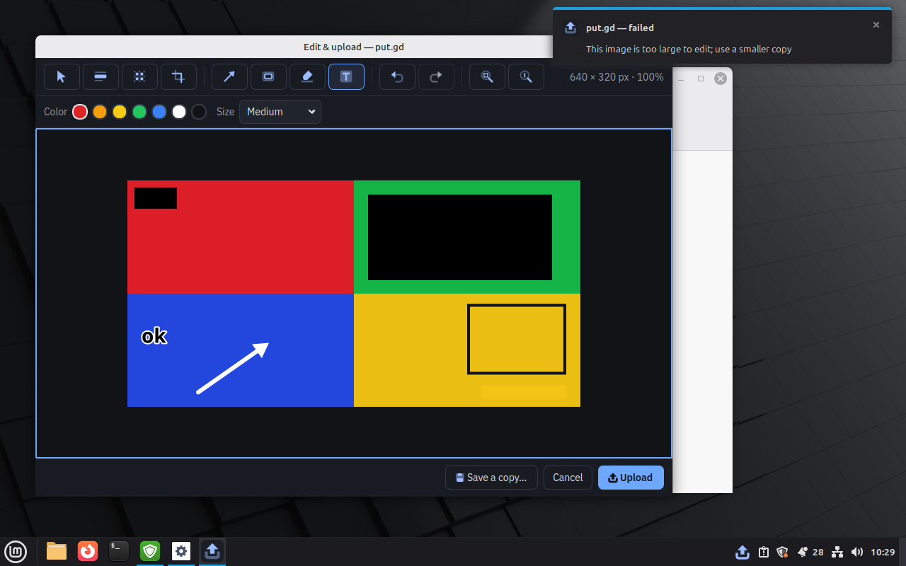
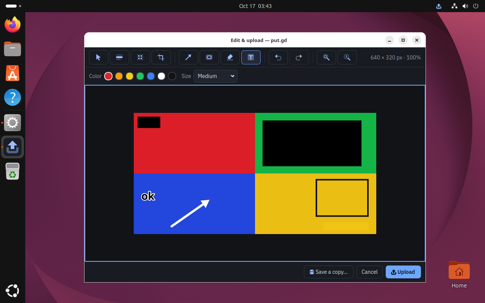
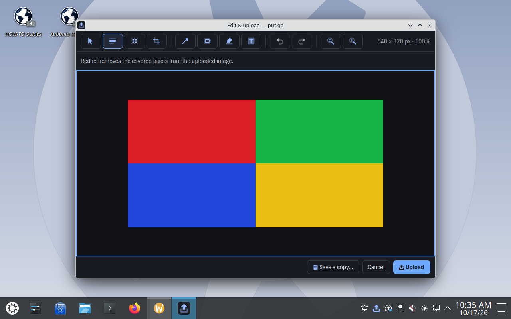

# Edit & upload — 2026-10-17

[Issue #51](https://github.com/patrick-hudson/put.gd-desktop/issues/51) adds the
on-demand image editor ([design and contract](../image-editor.md)). This receipt
covers development candidate `329d73671a61`. That candidate also carries:

- the X11 half of the selection-outline fix for
  [issue #54](https://github.com/patrick-hudson/put.gd-desktop/issues/54)
  (merged from its branch)
- the Plasma/Wayland half of that fix
- the `wlr-data-control` clipboard fallback for KWin 6.3

This is Linux-only development acceptance. No Windows behavior or
release-package claim is made.

## Automated

The full Dev suite passed on every build host:

| Host | Qt | Suites |
| --- | --- | --- |
| Mint 22.3 workstation | 6.4.2 | 63/63 |
| Kubuntu 26.04.1 | 6.10.2 | 63/63 |
| Debian 13 | 6.8.2, with LayerShellQt | 64/64 |

An earlier candidate on this branch (`909f8ee`) passed 63/64 on Fedora 44. Its
one failure, `cli_integration`, fails the same way on builds without the editor.

`kde_ownership_integration` now serves both data-control protocols from its
fixture compositor. It proves wlr-only fallback, ext preference and result
copying over each. The wlr-only case fails on the previous client.

## Graphical, memory and MCP gates

Cinnamon ran first. Each desktop ran the region scenario's baseline, then
`tools/lab/edit_acceptance.py`, `tools/lab/edit_memory.py` and
`tools/lab/mcp_editor_e2e.py` ([drivers](../vm-lab.md#editor-acceptance-drivers)).
Physical desktops ran through `tools/lab/physical.py`, using the uinput agent
and VNC frames. There, the region baseline ran three times and the editor
acceptance twice.

| Desktop | Region | Editor | Memory | MCP |
| --- | --- | --- | --- | --- |
| Mint 22.3 Cinnamon / X11, Qt 6.4.2 (KVM) | pass | 21/21 | 5/5 | 13/13 |
| Ubuntu 26.04.1 GNOME / Wayland, Qt 6.10.2 (KVM) | pass | 21/21 | 5/5 | — |
| Kubuntu 26.04.1 Plasma / Wayland, Qt 6.10.2 (KVM) | pass | 21/21 | 5/5 | — |
| Debian 13 Plasma 6.3.6 / Wayland, Qt 6.8.2 (physical, 1920x1080) | 3/3 | 21/21 ×2 | 5/5 | 13/13 |
| Kubuntu 26.04.1 Plasma 6.6.6 / X11, Qt 6.10.2 (physical, 1920x1080) | 3/3 | 21/21 ×2 | 5/5 | 13/13 |

Packages (SHA-256 prefixes): Mint `fe7844d1`, Ubuntu/Kubuntu `a573bbfd`,
Debian `3323ec9c`.

The 21 graphical checks are:

- **Opening the editor:** the shortcut opens the editor on a mouse-dragged region
  selection, and the operation stays `editing` with no items.
- **Hand editing:** a mouse-drawn redaction has the expected geometry; keyboard
  text entry, undo and redo work; plain Enter does not submit.
- **Agent commands:** agent commands apply atomically, an invalid batch is rejected
  whole, and a preview is returned.
- **Uploaded result:** the artifact is a PNG of the right size. Every redacted pixel
  is black, and no source pixel survives inside a mask. Untouched pixels match the
  fixture. An independent client's paste matches the artifact.

The MCP run uses the official client through `putgd-mcp` and the production
`putgd-cli`. It covers every editor tool, every shape kind, crop,
update/remove, undo/redo, atomic rejection, the image preview, save-copy with
its no-overwrite refusal, submit (artifact hash equals the saved copy) and
cancel (stores nothing).

### Memory

Figures are the whole-family incremental peak (RSS+swap, MiB) against the
3R + 96 MiB target. Here R is the image's 32-bit raster size.

| Case | Target | Cinnamon | GNOME | KDE VM | Debian | Kubuntu |
| --- | --- | --- | --- | --- | --- | --- |
| 1920x1080 file, edit, submit | 119.7 | 89.0 | 100.3 | 103.4 | 107.7 | 105.7 |
| 3840x2160 file, edit, submit | 190.9 | 157.5 | 165.8 | 174.6 | 180.7 | 172.0 |
| 24 MP file, edit, submit | 370.7 | 305.3 | 313.1 | 318.0 | 325.0 | 318.7 |
| 3840x2160, 100 edits plus undo/redo | 190.9 | 82.9 | 93.7 | 102.5 | 104.7 | 98.6 |
| 3840x2160, open/cancel five times | 190.9 | 81.9 | 92.9 | 101.3 | 103.9 | 97.6 |

Opening a 24 MP file took 3.3–3.8 s. After every case, the resident returned
to its baseline once the independent fixture took clipboard ownership:

| Desktop | Resident baseline |
| --- | --- |
| Cinnamon | 29.6 MiB |
| GNOME | 61.3 MiB |
| KDE VM | 32.7 MiB |
| Debian | 31–34 MiB |
| Kubuntu | 118.8 MiB |

The Kubuntu figure is mostly shared library pages. Plasma's platform theme loads
the Mesa/LLVM GPU driver into the resident, and that predates the editor. While
the resident still owns the clipboard, it holds the last edited PNG (up to
50 MiB for 24 MP). That memory is charged in the peaks above. An over-admission
6000x4001 file failed with `edit_input_too_large` and stored nothing.

On physical Debian an earlier candidate missed the memory target by about
85 MiB. The cause was Qt 6.8 loading `KDEPlasmaPlatformTheme6`, with Qt Quick
and the GPU driver, into the editor helper despite
`QT_QPA_PLATFORMTHEME=generic`. The helper now also clears its desktop identity
variables. This made the helper 11–15 MiB lighter on Cinnamon too.

The Cinnamon banner comes from the earlier candidate's over-admission check. Since
`613f103`, a failure toast shows the operation's own error instead of the
clipboard status. Cinnamon keeps a warning banner on screen until it is
dismissed. Physical-desktop screenshots stay private because they show the
host's other windows.

## Fixes found by this acceptance

- **Clipboard on Plasma 6.3.** KWin 6.3 offers only `zwlr_data_control_manager_v1`,
  so result copying and clipboard import failed with `clipboard_unavailable`.
  put.gd now binds wlr when ext is absent. The two protocols have identical
  layouts; ext stays preferred.
- **Outline on physical Plasma/Wayland.** KWin animates a closing layer surface
  from the last frame it rendered. The selector now commits fully transparent
  content and waits for the frame callback before it unmaps. Before the fix, 3/4
  repeat runs captured the frame. Since the fix, 11/11 region runs and 6/6 editor
  runs on Debian were clean.
- **Outline on X11.** The issue #54 compositor-settle fix, merged here, is
  verified on physical Kubuntu: 6/6 region runs and 4/4 editor runs.

## Follow-up: tool switching and moving marks (`b280fbf`)

User testing found two problems:

- **Tool switching restyled marks.** Choosing a tool re-applied its style to the
  selected mark, so a selected rectangle turned yellow when Highlight was chosen.
- **Moving needed Select.** Adjusting a mark meant switching to the Select tool.

Now only style controls edit the selection, and choosing a drawing tool
deselects. Drawing tools pick up the visible mark under the pointer and move it;
Ctrl draws over marks instead. New contract tests fail on the previous code.

The Cinnamon gate reran on `b280fbf`:

- Region baseline: pass.
- Editor: 23/23. The two new real-mouse checks move the redaction with the
  Rectangle tool (no new shape) and undo the move.
- Memory: 5/5 within target.

The other desktops' results above are from `329d736`. This follow-up changes
only platform-neutral canvas input handling.

## Not covered

- The physical Fedora 44 GNOME desktop. Its display was being reconfigured
  separately.
- Windows, which is portable code only, and live remote uploads. All runs used
  local output.

Private evidence: `work/verification/2026-10-17-editor-{cinnamon,gnome-vm,kde-vm,debian-physical,kubuntu-physical}/gate-329d736/`
and `work/verification/2026-10-17-editor-cinnamon/mcp-329d736/`.
