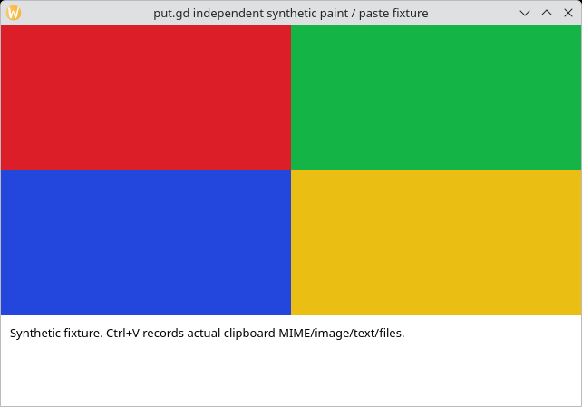
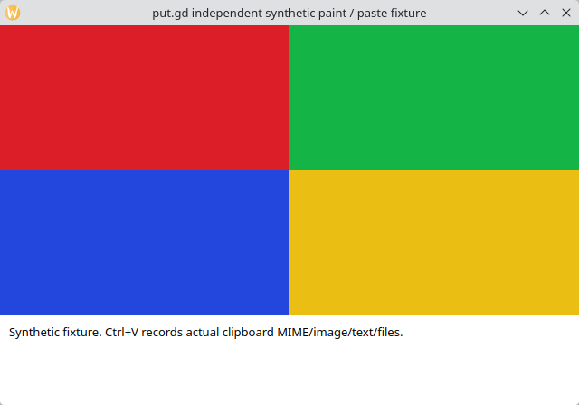

# KDE window frame check — 2026-10-17

Window capture on Plasma/Wayland includes KWin's window frame, as the app's help
says ("including its frame where supported"). Plasma 6.3 and 6.6 behave the
same. The window failure on physical Debian 13 came from the lab: it expected
the bare client area. The lab is fixed; the product is unchanged.

## Decision

Keep frame-inclusive window capture. `KWinCapture` requests
`include-decoration: true` and `include-shadow: false` from ScreenShot2, and
every desktop's recorded window evidence is framed: Cinnamon 640×452,
GNOME 662×480 and Kubuntu KDE 640×448. A frameless capture would be a
behaviour change, and nothing asks for one.

## Cause

`tools/lab/lab.py` asked KWin's `queryWindowInfo` picker for the frame only when
the profile was named exactly `kde-wayland`. The physical Debian host config
names its profile `kde-wayland-physical`, so the runner fell back to native Qt
`frameMargins`. Those are zero for KWin's server-side decorations, so the runner
expected 640×420 at the fixture's paint origin. The real capture was 642×449,
with the paint at (1, 28), and failed on both `d11940f` and `95a0f9b`.

The runner now chooses the KWin check from the fixture's observed KDE Wayland
session. `test_window_frame_oracle_follows_observed_kwin_session_not_profile_name`
drives the real `fixture_run` window path for the VM and physical KDE profiles
and for GNOME Wayland. Against the old runner it reproduces Debian's exact
failure. `tools/lab/physical.py` also gained any-scenario actions and an
optional `fixture_bin` for hosts whose package has no lab fixture.

## Runs

Runner `lab.py` `31c59422…`, `physical.py` `7cb17396…` (branch
`claude/objective-wiles-d45cba`, commit `e8d376c` on `a327e6f`).

| Desktop | Build | KWin frame (pre-action) | Artifact = paste | Result |
| --- | --- | --- | --- | --- |
| Physical Debian 13 `d69`, Plasma 6.3.6 / Wayland, Qt 6.8.2, 1920×1080 | installed `0.1.1~dev.293+g95a0f9bb6839` (deb `545ce930…`, `putgd` `719e72ea…`), verified, not reinstalled | (639, 293) 642×449 | 642×449, `6486e58b…` | 2/2 pass |
| Kubuntu 26.04 VM on Fedora `f44` (KVM, QEMU 10.2.2), Plasma 6.6.6 / Wayland, Qt 6.10.2, 1280×800 | PR head product `0.1.1~dev.294+gd11940f4b533` Kubuntu build (deb `b4ff4b39…`, `putgd` `af979bd4…`) | (320, 149) 640×448 | 640×448, `21989991…` | 2/2 pass |

The Debian artifact is byte-identical to the earlier failing baseline artifact,
so the product output was right all along. Operations: Debian `d14e7f31…`,
`56b1a656…`; Kubuntu `c5a2c6c0…`, `d1d30197…`. The commits from `d11940f` to
`a327e6f` change only documentation, so that package is the PR head's product.

Debian | Kubuntu
--- | ---
 | 

Preserved failed attempts:

- Debian attempt 1 timed out at readiness because the 95a0f9b package has no
  `putgd-desktop-fixture`. The rerun put the lab-built fixture (`f970ab04…`) on
  `PATH` with `fixture_bin`.
- One Kubuntu attempt failed before the scenario started. The custom driver
  could not overwrite the fixture binary while the previous run's fixture was
  still executing it. The driver now copies to a temporary name and renames it
  into place. The Kubuntu fixture is `9c66cbd3…`.

## Host state afterwards

- d69 is left on `95a0f9b`, with no put.gd process and its input agent stopped.
- The Kubuntu overlay `kwf-de5754a5` was retired with a completed guarded-cleanup
  receipt, and the golden is unchanged (`49fcacff…`).
- Its wall tile and tunnel are removed. The workstation lab bootstrap key now
  also lives on f44 in `work/lab-bootstrap-f44/`, at the user's request. A
  KDE host pin for port 22434 sits beside it.

Private evidence, including every attempt, witnesses, manifests and the driver,
is under `work/kde-window-frame/`.
