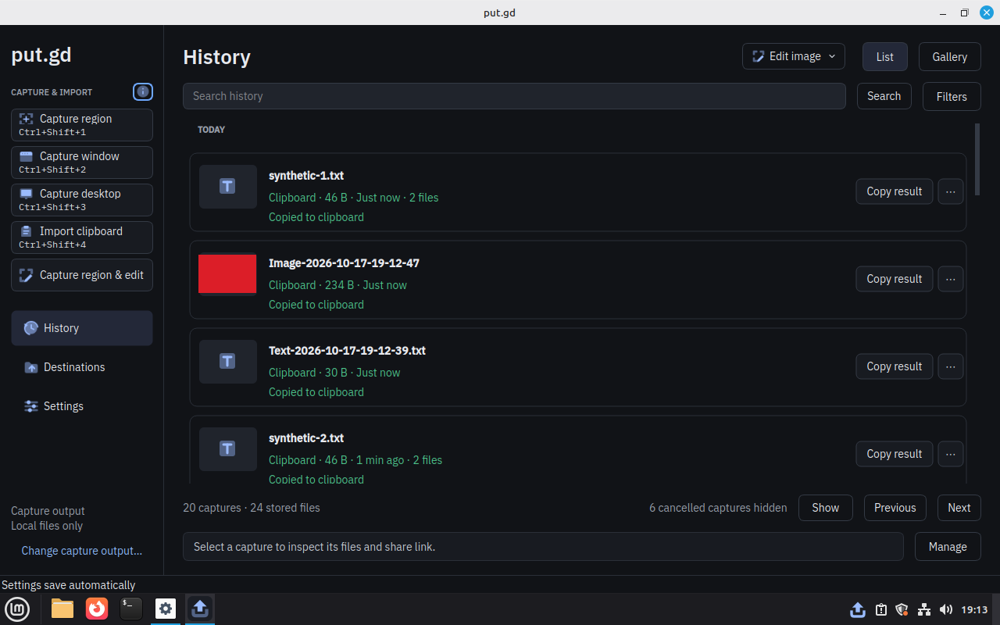
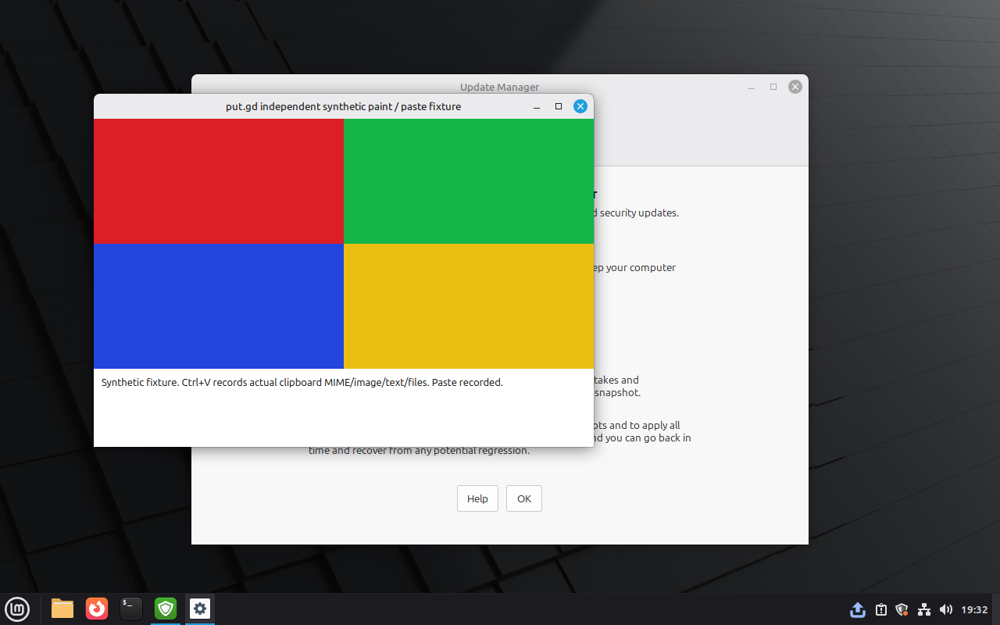

# X11 clipboard import without Qt image plugins — 2026-10-17

The X11 resident's clipboard import no longer loads Qt image plugins for text, file-list or PNG offers. Candidate `d11940f` passed the host suite and the Cinnamon, KDE/X11, KDE/Wayland and GNOME/Wayland gates. On physical Kubuntu Plasma X11, the resident is 10.2 MiB smaller after its first clipboard import. One Debian window-capture case fails the same way on the unchanged baseline. The [structured receipt](2026-10-17-x11-clipboard-plugins.json) has exact identities, hashes and per-case results.

## Candidate

Commit `d11940f4b5339f25a1b213b1039ada819c6c9c07` on `feat/edit-and-upload` (`95a0f9b`), tree `1ee12ea3898263a62155c65e1836a1e2b5b4b731`, count 294, version `0.1.1-dev.294+gd11940f4b533`. Tracked-source archive SHA-256 `0c2e193577ffbfeb6ac9554f139c2926b42dfabb44b53dc5b610cc24f29f1de8`. Each host built its native package from that archive, with supplied provenance. The packages omit the Proton helper, which isn't provisioned and isn't touched by this change. Later documentation commits do not relabel these binaries.

An earlier candidate, `a6cdb0c`, was built on `main` by mistake. Its Cinnamon run is kept only on branch `claude/vigilant-aryabhata-d2dfa4-main-based`, and it is not credited here.

Before the change, `X11Clipboard` called `QImageReader::supportedMimeTypes()` on every import and decoded images with no format. Both load every installed image plugin. See [image worker](../image-worker.md#x11-integration) for the new path and a Qt-version probe. On Qt 6.4.2 and 6.8.2, a `"png"`-named reader still loads every plugin unless automatic detection is off.

## Host checks

On the Mint 22.3 workstation (Qt 6.4.2), the complete `ctest --preset dev` passed **64/64** at `d11940f`. The new `x11_clipboard_import` test fails 5 of 10 cases against the feature branch's previous `X11Clipboard`/`ImageJob`. Its cancellation case uses a synthetic plugin that takes three seconds to load, and it passed 10 consecutive runs. The earlier `a237588` suite failed that case on a race and `gui_history_view` once; `gui_history_view` passed in 2 of 3 isolated reruns and in the final suite. Another session's pattern kill interrupted one run, which is recorded without a verdict.

## Desktop gates

All four ran in parallel. The Cinnamon-first ordering was retired at the user's instruction in `e59c040`.

| Desktop | Where | Qt | Native cases | Views, restart | Two 300 s windows, peak RSS |
| --- | --- | --- | --- | --- | --- |
| Cinnamon 6.6.4 / X11 | Mint 22.3 VM, workstation KVM | 6.4.2 | 12/12 | pass | 25.95 / 25.95 MiB |
| Plasma 6.6.6 / X11 | physical Kubuntu 26.04 (`k72`) | 6.10.2 | 12/12 | pass | 37.57 / 37.57 MiB |
| Plasma 6.3.6 / Wayland | physical Debian 13 (`d69`) | 6.8.2 | 11/12 | pass | 28.86 / 28.86 MiB |
| GNOME 50.0 / Wayland | physical Fedora 44 (`f44`) | 6.11.2 | 12/12 | pass | 33.23 / 33.23 MiB |

Every window had 61 samples, zero swap and no helpers, with at most 0.007 % of one core. The cases cover region, window and desktop capture, Qt and GTK clipboard text/image/files with independent paste, and three region cancellations. The Cinnamon VM runs locally because its goldens trust only the workstation lab key.

The Debian failure is the window case. KWin 6.3 returned the window with its title bar and frame (642×449), so the colour checks miss. The unchanged `95a0f9b` baseline fails identically on the same desktop, so this predates the change; a separate task tracks it.

## Plugin witness on the real residents

Each resident was restarted fresh and given five synthetic imports: Qt text, Qt files, GTK text, GTK files, then Qt image. After each import, the executable image-plugin mappings were read from its `/proc/PID/maps`. On the KDE hosts the unchanged `95a0f9b` package was then installed and run the same way. The baseline runs are diagnostic only.

| Host | Installed plugins | Candidate, text/files | Candidate, image | Baseline, after first text |
| --- | ---: | ---: | ---: | ---: |
| Cinnamon VM, Qt 6.4.2 | 3 | 0 | 3 | — |
| `k72` Plasma X11, Qt 6.10.2 | 34 | 0 | 0 | 33 |
| `d69` Plasma Wayland, Qt 6.8.2 | 4 | 0 | 4 | 0 |
| `f44` GNOME Wayland, Qt 6.11.2 | 30 | 0 | 0 | — |

On `k72` the baseline resident grew from 35.26 to 46.48 MiB after its first text import. The candidate went from 35.41 to 36.26 MiB, about 10.2 MiB less. That is the KDE X11 case this change targets. The image-import plugins on Cinnamon and Debian match Qt 6.4.2 and 6.8.2 loading every plugin for an in-process PNG *writer*. That is a separate follow-up, and the attribution is from the probe, not a trace. Debian's KDE/Wayland importer already avoided plugins, so its baseline matches. The Fedora witness lists 0 installed plugins only because its helper reads the Debian path; the mapped-plugin check is path-independent.

## Harness and host fixes

- **`k72`:** a maximized `btop` terminal hid the fixture. The user moved it. The runner now parks the pointer on empty desktop before each case, because the region drag had left it over the fixture.
- **`f44`:** GNOME's focus-stealing prevention left Settings unfocused, so `views.py` now clicks the physical title bar. Stock Fedora GNOME has no tray host, so the frozen memory harness refused (`resident_tray_unavailable`). With the user's approval, AppIndicator 64 was installed and enabled and GDM restarted. The fresh login opened in the Activities overview, so that pass was rerun after closing it.
- **Fedora SDK:** the AWS runtime is under `lib64` there, and the build script now detects it.

Every failed attempt is kept with its correction under `work/x11-plugins/feat/`. None involved the application.

## Host state and open items

- `k72` and `d69` were left on the unchanged `95a0f9b` package. `f44` was left on the candidate, with AppIndicator now enabled. Input agents and tunnels are stopped.
- The Kubuntu KDE/Wayland and Ubuntu GNOME VM profiles were not rerun. Physical Debian and Fedora cover those sessions instead.
- Guarded cleanup still refuses while raw-backed Windows USB test overlays exist under `work/windows/runs/usb*`. The stopped Cinnamon overlays `x11c1` and `x11c2` and the restored workstation golden they use are retained.
- Physical-desktop screenshots, packages, receipts, memory samples and every attempt are private under `work/x11-plugins/feat/`.
