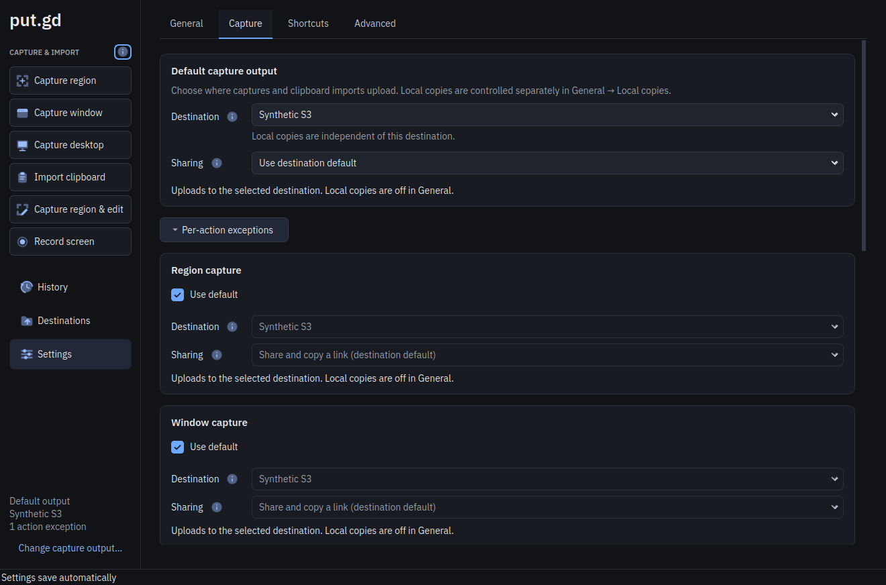
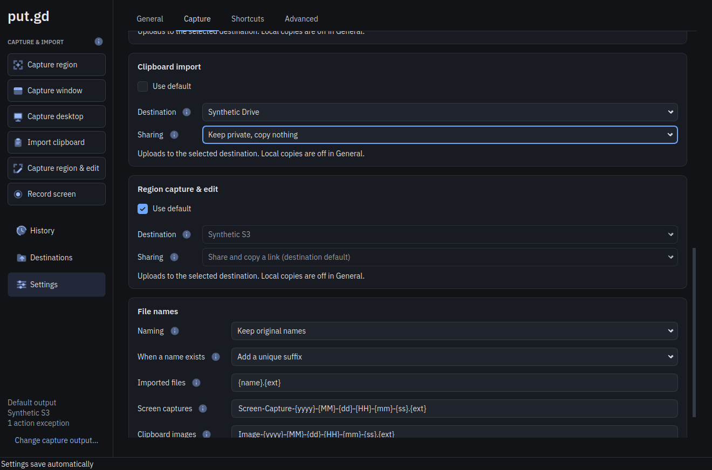
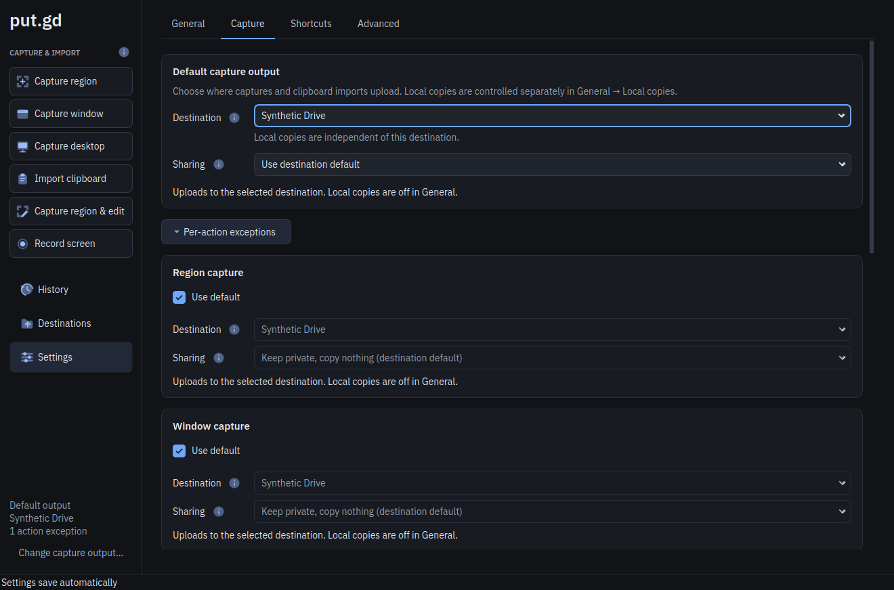
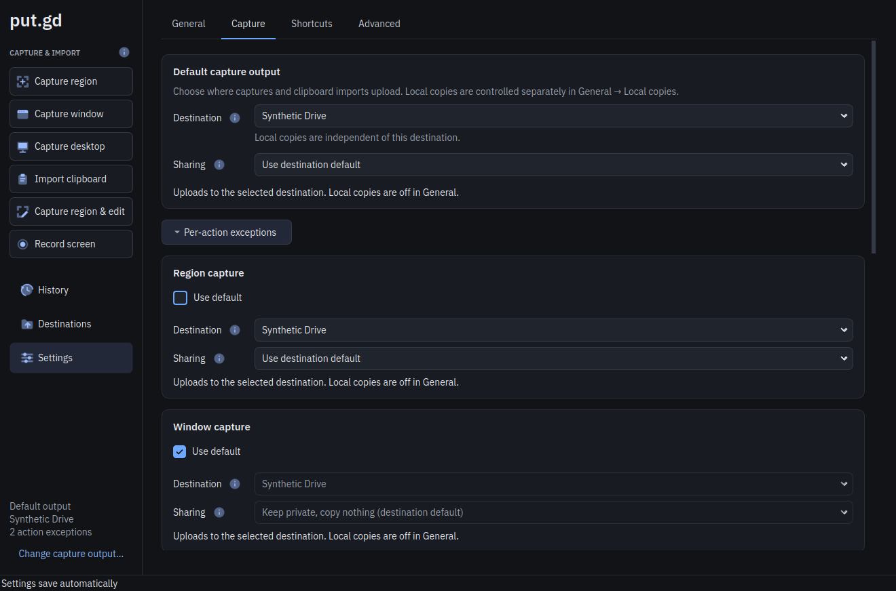

# Inherited capture output in Settings — 2026-10-18

[Issue #58](https://github.com/patrick-hudson/put.gd-desktop/issues/58): in
Settings → Capture → Per-action exceptions, a card with **Use default** checked
used to hide its whole editor. Every card (Region capture, Window capture,
Desktop capture, Clipboard import and Region capture & edit) now keeps its
Destination, Sharing and status line visible. While inherited, both controls
are disabled, use the existing dark theme's disabled style and show the default
output. "Use destination default" is shown as the setting that applies, for
example "Share and copy a link (destination default)". Screen recording has no
card; it follows the region route.

The Settings checkpoint carries a derived `captureRouting` projection, and the
resident returns it through `ui.viewState` (MCP `get_view_state`); see
[UI state](../ui-process-state.md).

## Source and build

- Implementation commit `48c2b57`, branched from nightly `70722c3`.
- `cmake --preset dev` (Debug), distro Qt 6.4.2, workstation Linux Mint 22.3.
  `putgd --version`: `0.1.1-dev.341+g48c2b575f78e`.
- SHA-256: `putgd` `5e178b14b209e9caf3511928512d928b79d61f1b9d2df0356f1ecf38d0c8b15a`,
  `putgd-ui` `da8938105733654f081d65612ce846d9fded4ce3adca4925e495a40cd70d5d36`,
  `putgd-cli` `20ec781e33473529eab7153fb911b6594082c71fdc396afc5d1f6c76d7292c42`.

## Automated checks

- `ctest --preset dev`: 72/72 passed in 722.83 s, on the tree committed as `48c2b57`.
- New offscreen case `SettingsGui::inheritedActionsShowTheDefaultOutputDisabled`
  covers the disabled controls, displayed and resolved values, accessible names,
  live updates from Default capture output (S3, a Proton destination that
  defaults to private, an explicit sharing mode, no destination), uncheck then
  save of an explicit exception, reopening, and strict validation of the
  projection. With the old `setVisible(!inherit)` restored, it failed.
- `ui_process_integration` and `ui_endpoints_integration` cover the resident
  projection (no draft leaves it) and the `ui.viewState` method.
- MCP suite (`uv run --project tools/mcp --locked python -m unittest discover -s
  tests/integration -p test_mcp.py`): 3/3 passed, including `get_view_state`
  discovery and forwarding.

## Native Cinnamon check

On the workstation's own Cinnamon 6.6.4 X11 session (`:0`), the built `putgd`
ran with private `XDG_CONFIG_HOME`, `XDG_DATA_HOME`, `XDG_STATE_HOME`,
`XDG_CACHE_HOME` and `XDG_RUNTIME_DIR`. The socket path preflight passed
(33 bytes). The installed put.gd kept running, untouched. The configuration,
saved with `putgd-cli settings.save`, had two synthetic destinations ("Synthetic
S3"; "Synthetic Drive", Proton with `shareByDefault: false`) without
credentials, no shortcuts, Default capture output on Synthetic S3 with "Use
destination default", four inheriting actions and Clipboard import as an
explicit Synthetic Drive/private exception. No capture or upload ran.

- Inherited cards showed Synthetic S3 and "Share and copy a link (destination
  default)", grayed and not editable. Clipboard import stayed editable.
  `putgd-cli ui.viewState` reported the same values, with `destinationEnabled`
  and `sharingEnabled` false for the four inherited actions.
- Choosing Synthetic Drive as the default destination changed every inheriting
  card at once to "Keep private, copy nothing (destination default)".
- Unchecking Region capture's **Use default** enabled its controls with
  Synthetic Drive and "Use destination default". The saved document then held
  `region: {destination: upload, profileId: synthetic-proton}`, the other three
  actions stayed `default`, and the rail reported 2 action exceptions.
- The MCP helper's `get_view_state`, through the production CLI to this
  resident, returned the same projection.
- `ui.quit` shut the instance down; the resident exited 0 with an empty log.

The screenshots are cropped to the window. The blue outline on Clipboard
import's Sharing is the wheel focus a combo box takes while the page scrolls
past it; its value did not change (same accepted revision before and after).

## Not covered

GNOME, KDE and Wayland, the VM matrix, memory, the light theme planned in
[issue #60](https://github.com/patrick-hudson/put.gd-desktop/issues/60) and a
screen-reader pass. The accessible names are checked offscreen only. This is a
focused development check, not release acceptance.
