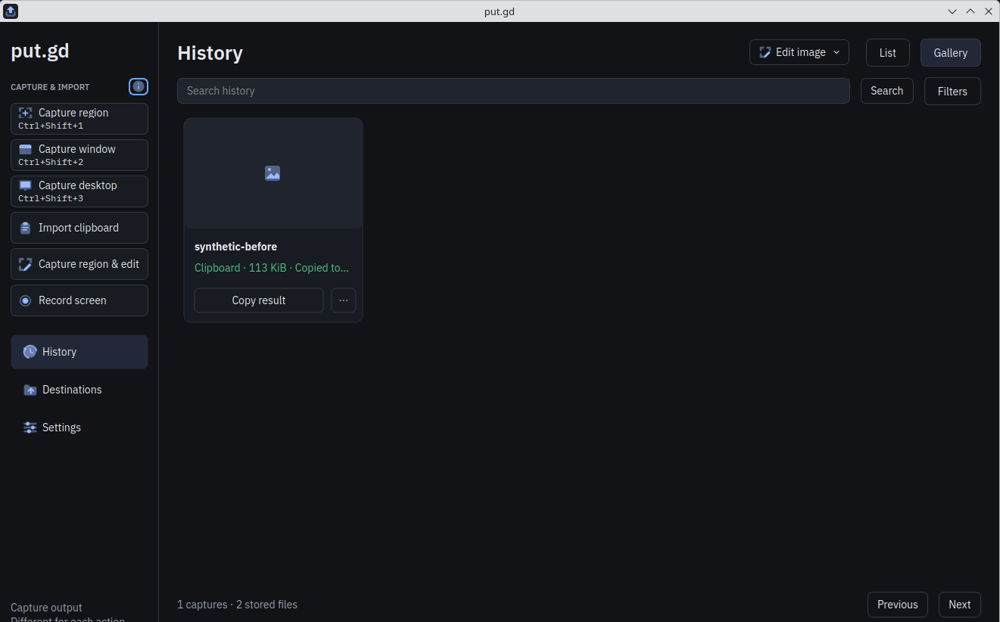
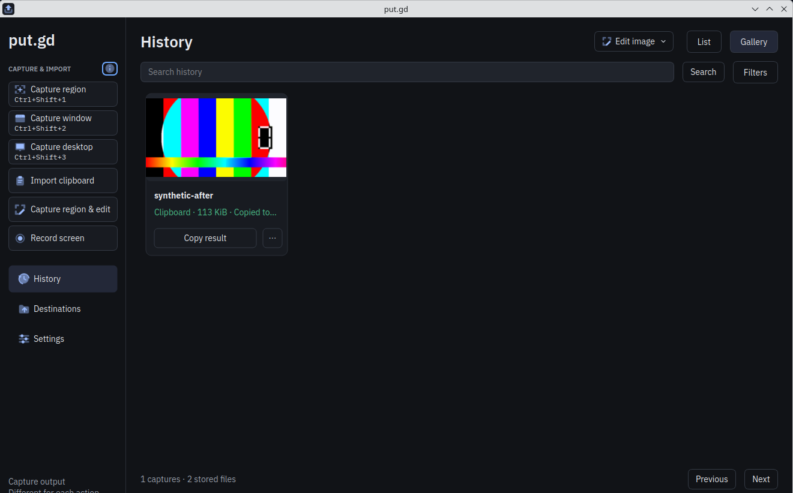

# AppImage image worker on Qt's offscreen platform — 2026-10-19

This record certifies what pull request #80 (`claude/appimage-image-job-offscreen`
into `nightly`) fixed and how it was checked. In the AppImage, the resident's
transient image worker `putgd-ui --image-job` aborted on every non-PNG preview,
because the image did not carry the offscreen platform the resident starts it on
(`src/core/ImageJob.cpp`). The builder now deploys `libqoffscreen.so` and starts
the worker from the AppDir before packing (`tools/releases/portable_appimage.py`,
`audit_platforms`).

## Candidates

| Commit | Built by | AppImage (SHA-256, bytes) |
| --- | --- | --- |
| `e13fee9` (`0.1.1-dev.366+ge13fee972459`), nightly before the fix | nightly push CI | `228a26e5…`, 99,236,344 |
| `ef5cade` (CI merge `4a178c2`, `0.1.1-dev.368+g4a178c2ef8de`) | pull request CI run 39194140045 | `14984dd8…`, 99,277,304 |

PR #75's AppImage (`399d491`, CI merge `dd0e3d7`) has the same platform set as
nightly and failed the same way.

## Original failure

Six `putgd-ui --image-job` core dumps on Kubuntu 26.04 Plasma/X11 (`.72`) from
2026-10-18 20:25 to 21:42 CDT (PR #75 test AppImages) all contain:

```
qt.qpa.plugin: Could not find the Qt platform plugin "offscreen" in ""
Available platform plugins are: wayland-egl, wayland, xcb.
```

linuxdeploy's Qt plugin deploys `xcb` plus `EXTRA_PLATFORM_PLUGINS`, which named
only the two Wayland platforms. Distro Qt ships offscreen in its GUI package, so
the DEB/RPM never failed.

## Checks

- Workstation: `python3 tests/unit/test_portable_appimage.py`, 11 tests passed
  (synthetic worker scripts, no ELF proof).
- Pull request CI on `ef5cade`: contracts, Linux 24.04/26.04, Windows portable,
  native packages and AppImage. The AppImage receipt records
  `postDeploymentAudit.qtPlatforms` = `libqoffscreen.so`, `libqwayland-egl.so`,
  `libqwayland-generic.so`, `libqxcb.so`, `imageWorkerStartedOffscreen: true`.
- Debian 13 builder (`.69`), SSH only, extracted CI AppImages:
  - Worker started with private pipes on offscreen: nightly and PR #75 trees
    `returncode -6` with the message above. With official Qt 6.8.3
    `libqoffscreen.so` added: `returncode 3` (closed control pipe) in 55 ms.
  - Resident under Xvfb, private XDG dirs, local-only clipboard action on a
    synthetic JPEG and GIF (file URIs). Nightly: both records saved,
    `previewPath` empty, two worker core files with the message. Patched tree:
    both 256 px PNG previews, no cores.
  - `audit_platforms` on the real trees: nightly rejected (plugin missing),
    patched tree passes, an empty `libqoffscreen.so` rejected with Qt's loader
    error.

## Physical desktop: Kubuntu 26.04.1 LTS, Plasma 6.6.6 on X11 (`.72`)

Packed AppImages run in the existing Plasma session after its 03:12Z sddm
restart, under `desktop-k72.lock` (03:29Z–03:33Z). Each run used a private
`XDG_CONFIG_HOME`/`XDG_DATA_HOME`/`XDG_CACHE_HOME`/`XDG_RUNTIME_DIR`, a GTK4
clipboard owner offering a synthetic 640×360 JPEG and 8-frame GIF as
`text/uri-list`, a local-only clipboard route (`archive.keepUploads`), then
`ui.show` History. Frames were taken through the wall VNC tunnel.

| Run | AppImage | History records | Worker cores |
| --- | --- | --- | --- |
| Before (03:30:54Z) | nightly `e13fee9` | GIF and JPEG saved, `previewPath: ""` | 2 × SIGABRT at 22:30:56 CDT |
| After (03:31:50Z) | PR #80 `4a178c2` | GIF and JPEG saved, both previews written | none |





Afterwards no AppImage process, mount, desktop entry or clipboard owner of the
run remained, and the desktop matched its initial frame. The full frames,
history JSON, identities, preview PNGs and the CI receipt are kept privately in
`work/evidence/2026-10-19-appimage-image-job/` with `SHA256SUMS`.

## Not covered

- Recording GIF/WebP uploads use the same `ArtifactStore::preview` path but
  were not rerun; the clipboard files exercise the same worker.
- Fedora 44 GNOME showed a separate AppImage `putgd-ui` abort (2026-10-18
  20:38:34 CDT) under a forced `QT_QPA_PLATFORM=wayland`: the image has no Qt
  Wayland shell integration (`libxdg-shell.so`), so the Wayland platform fails
  and, unforced, Qt falls back to XWayland. That is a separate change with its
  own desktop acceptance.
