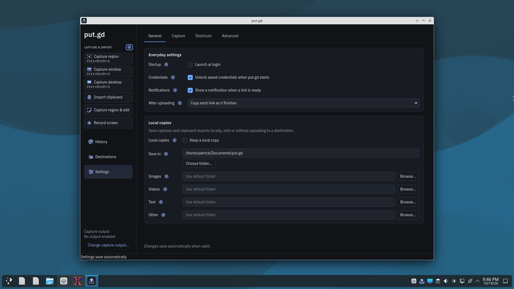

# Settings::validate dangling QJsonValueRef — 2026-10-19

`Settings::validate` read each action with
`const auto value = doc["actions"].toObject()[name];`. The non-const `operator[]`
of the temporary `QJsonObject` returns a `QJsonValueRef` into it, and `auto`
kept that ref after the temporary was destroyed. On Debian 13 the release
resident crashed with SIGSEGV on every `settings.save` of a local-only document,
on the settings worker thread. The recording-packaging session found it while
verifying installed packages; its gdb trace was `QJsonValueConstRef::concreteType`
← `Settings::validate` ← `writeCandidate` ← the `SettingsService::asyncLoad` lambda.
`SettingsWindow::populate` had the same defect. Both now read `QJsonValue` copies
through `value()`.

## Source and builds

- Fix commit `4fcd43c`, branched from nightly `e13fee9`. Scratch trees were rsync
  copies without `.git`, so binaries report `0.1.1-dev.unknown`.
- "Before" builds restore only the original `Settings.cpp` line in that tree.

## Automated checks

- k72 (Kubuntu 26.04.1 LTS, GCC 15.2, Qt 6.10.2), `ctest --preset dev` on `4fcd43c`
  (env -i, private HOME/TMPDIR, `--parallel 2` with `tools/ci/ctest-resources.json`):
  74/74 passed in 351 s, including `settings_contract`, `json_ref_lifetime_contract`
  and `gui_settings`.
- k72 `asan` preset, `test_settings`: 21/21 passed on the fix. With the original
  line restored it also passed 21/21 with no AddressSanitizer report. GCC does
  not poison full-expression temporaries, so `json_ref_lifetime_contract` checks
  the source pattern instead.
- `json_ref_lifetime_contract` on unmodified nightly `e13fee9` failed and named
  `src/core/Settings.cpp:157` and `src/ui/SettingsWindow.cpp:301`; on `4fcd43c` it
  passed (319 files, 0.25 s).
- k72 `gui_settings`, `optionalDefaultsStayAbsentAndDoNotBlockDestinationSetup`, with
  only the original `SettingsWindow.cpp:301` restored: failed 3/3. The absent
  optional `pendingImageBytes` field showed `""` instead of its default `64` (MiB).
  With the fix it passed.

## Physical Debian desktop

d69: Debian 13.7, kernel 6.12.107+deb13-amd64, Plasma 6.3.6 on Wayland (KWin
6.3.6), Qt 6.8.2+dfsg-9+deb13u2, GCC 14.2. Release tree configured like CI's
package job (`-DBUILD_TESTING=OFF -DPUTGD_LAB_FIXTURE=OFF
-DPUTGD_PHYSICAL_BENCHMARKS=OFF -DCMAKE_INSTALL_PREFIX=/usr`, no Proton bundle),
packaged with `tools/releases/native.py --format DEB --require-kde`. The two DEBs
differ only in the recompiled `Settings.cpp`.

| DEB | SHA-256 | `/usr/bin/putgd` |
| --- | --- | --- |
| original line | `20792fb63447e8f5dc707e48c86028b3bf212e09e5c41e5a9356f25ade0ff9d7` | `4ab38d2d7df9251580b99f25b117a0db1465894d13940c8b322f39f338830d71` |
| fixed | `b400f2efbe5a0400a75a9ff2f803124c2be1e771fa209a2ad9b60a71ca4b4454` | `33626a71f7f75bc918252c6e8ee67f771ce46d1b6e96c4e210d91412dd3c441b` |

Each run installed one DEB with `sudo -n apt-get install`, started `putgd` in the
Plasma session (`QT_QPA_PLATFORM=wayland`, real `XDG_RUNTIME_DIR`, fresh private
`XDG_CONFIG_HOME`/`XDG_DATA_HOME`/`XDG_CACHE_HOME`), read `settings.get`, and sent
`settings.save` with every routed action's destination `local`, `captureDefaults`
`{destination: local, profileId: null, publicationMode: default}`,
`archive.keepUploads: true` and an archive root under the run directory. The
socket preflight passed (`/run/user/1000/putgd/session.sock`, 33 bytes).

- Original line, 02:46:40Z: the resident exited with status 139 (SIGSEGV;
  "Segmentation fault" in its log). `putgd-cli` returned `transport_failed`. The
  dashboard and tray icon disappeared.
- Fixed, 02:47:10Z: `settings.save` returned `ok`, the resident stayed up, and
  `settings.get` returned accepted revision `d5465d66…` with validation `ok`. The
  dashboard showed "Keep a local copy" checked, the run's archive folder and
  "Local files only". After `ui.quit` (exit 0), a new resident loaded the saved
  `config.json` at the same revision with validation `ok`, then quit with exit 0.
- Afterwards the package was removed and no put.gd process or file remained.

Full frames, logs and request/response JSON are kept privately under
`work/evidence/settings-validate-uaf-d69/` on the workstation.

## Not covered

- No GUI autosave was driven on the desktop. Dashboard autosave sends the same
  `settings.save` request through `UiSession`.
- Fedora 44 and Mint were not rerun; they never crashed, and the CTest run covers
  the changed code on k72.
