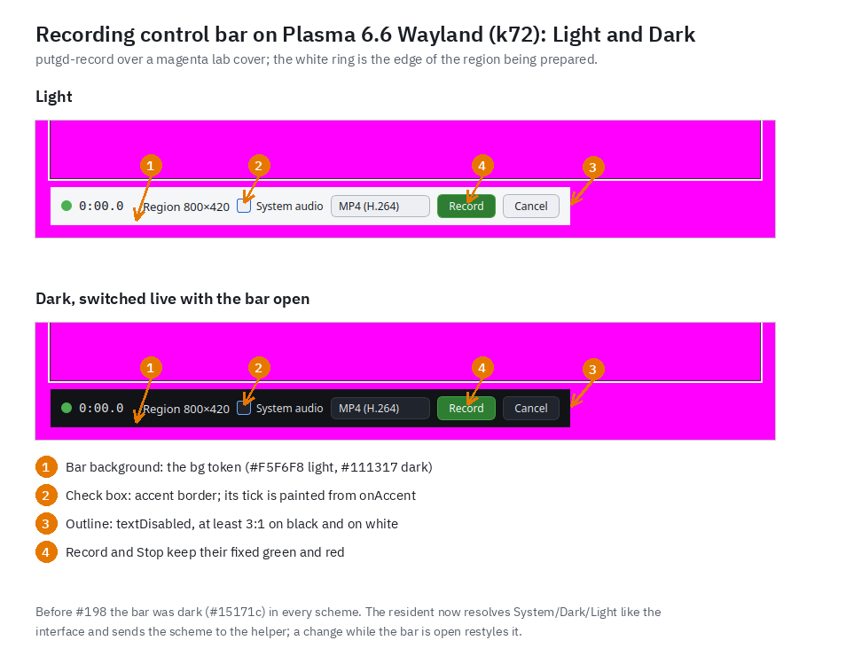
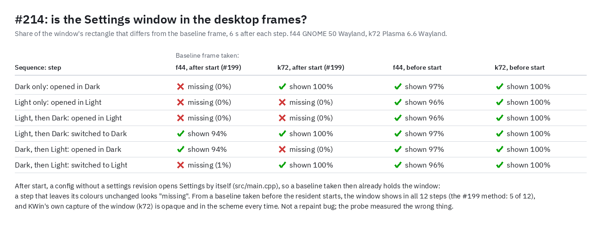

# Recording overlays follow the appearance (#198), and the missing Settings frames (#214)

Taken 2026-10-20 15:22–15:50Z in the physical desktop sessions of f44 (GNOME 50.0 Wayland,
Qt 6.11) and k72 (Plasma 6.6.6 Wayland, KWin 6.6.6, Qt 6.10), from scratch lab builds of
`claude/record-overlay-theme-198` (code PR #224, source `b998ffa`) in
`/home/patrick/work/put.gd-r9appear`. Each run used a private resident (private config, data,
cache, state and runtime folders, the session's Wayland display and bus, `PIPEWIRE_RUNTIME_DIR`
on the session's runtime folder) driven by `putgd-cli`. Frames came from the host's loopback VNC
tile and were read on the host; only numbers and the crops listed here left it.

## #198: the control bar in Light and Dark

k72: a full-screen magenta cover (`tools/lab/cover_player.py play`, precheck 100% cover), then
`recording.prepare {target: region [560,300,800,420], format: mp4}` (KWin's screencast protocol,
no picker; `overlayPlacement: outside`). Nothing was recorded. Frame 1 with the setting Light;
then `settings.patch` to Dark with the bar left open, and frame 2 two seconds later: the open bar
restyled live through the new `appearance` frame, and `recording.cancel` still answered. Each crop
is the box of what changed against the cover, ignoring the bottom 6% (Plasma 6.6 raises its panel
over the cover once layer surfaces map), and was kept only because every crop edge is cover
magenta (100%, both crops); the crops are 92% magenta. `k72-plasma66-bar-light.png` and
`k72-plasma66-bar-dark-live.png` are those crops, unannotated.

f44 (GNOME, no Shell extension installed, `overlayPlacement: compositor`): the cover stayed behind
the session's windows (0% cover at precheck), so no frame was kept. Measured on the host instead:
the bar's band was 31% the light `bg` token (`#F5F6F8`) with Light and 30% the dark `bg`
(`#111317`) after the live switch to Dark, and `recording.cancel` answered.

Found on the lab and fixed in #224: the first live switch ended the helper with
`recording_helper_protocol`, because `UiControl`'s frame-type allowlist didn't know `appearance`.
`recording_helper_integration` now sends `appearance` frames mid-session.

Tests: full `ctest --preset dev` on d69 (Debian 13, Qt 6.8.2), offscreen with private folders:
89/89 passed, including `bar_placement_contract` (the bar follows the scheme live, its outline
and text contrast, the light audio box) and `gui_theme` (the resident's resolver leaves the active
scheme alone).

## #214: the Settings window wasn't missing

Four sequences per host: Dark only, Light only, Light then Dark, Dark then Light, each from a
fresh private resident (`putgd --background`, then `settings.patch`, `ui.show settings`, frames at
0.3–6 s, then `ui.show history`). The table is the share of the window's rectangle that differs
from the baseline frame 6 s after each step (`214-steps.json`; k72 uses KWin's frame geometry of
the `putgd-ui` window, f44 the changed area against a 1320×911 window).

- Baseline taken after the resident started and the theme was set (the #199 method): the window
  is "missing" in 7 of 12 steps, Dark and Light alike.
- Baseline taken before the resident started: shown in all 12.

The resident opens Settings by itself at start when the config has no settings revision
(`src/main.cpp`: `!parser.isSet("background")||settings.revision().isEmpty()`), and a fresh private
config has none, so the #199 baseline already held the window in whatever scheme it had then. A
step that left those colours in place compared equal. On k72, KWin's own capture of the active
window (`spectacle -b -n -a`, alpha channel read on the host and the file deleted) was opaque
(under 1% of pixels below alpha 250, the corners) and in the scheme after every step; a pointer
move over the window changed nothing; and with no put.gd window open, KWin's full-screen capture
and the VNC tile differed by 275 pixels (a cursor-sized box). No repaint, mapping or capture fault
in put.gd or the VNC tile: the probe measured against the wrong frame. The lab notes in
[remote-builders](../../remote-builders.md) now say to take baselines before the resident starts.

## Cleanup

k72: the temporary `~/.local/share/applications/putgd-r9a-record.desktop` was removed and
`kbuildsycoca6 --noincremental` run; private run folders removed; lock released verified-clean at
15:45Z. f44: private run folders removed; lock released at 15:50Z with storage-cleanup's resident
(started on that desktop during the slot) named as not ours. A `plasmashell --version` run over SSH
on k72 aborted without a display (core dump, DrKonqi launcher found no crash metadata, no dialog);
the session's own plasmashell was untouched.
