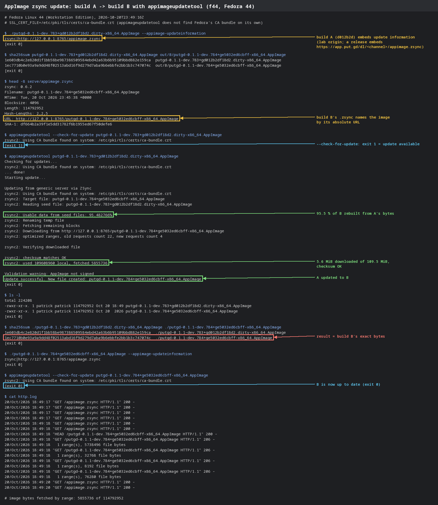
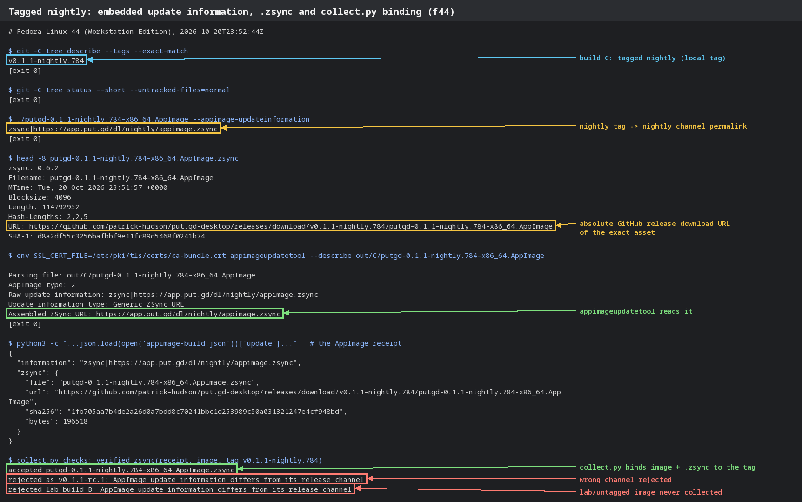

# AppImage zsync updates (issue #293, phase 1)

Packaging half of phase 1: tagged AppImages embed
`zsync|https://app.put.gd/dl/<channel>/appimage.zsync` and every release ships
`putgd-VERSION-x86_64.AppImage.zsync`
([AppImage updates](../../release.md#appimage-updates),
[assembly](../../../packaging/appimage/README.md#update-information)).
Code: `tools/releases/appimage_update.py`, `portable_appimage.py`, `collect.py`
on branch `claude/appimage-zsync-update-info`.

Recorded 2026-10-20 on the f44 build server (Fedora 44). Nothing ran on the
workstation and no desktop session was used.

## What was built

Three AppImages from `tools/releases/build-appimage.sh`, unchanged, in an
`ubuntu:24.04` container on f44 that reproduces the CI `appimage` job
([lab/provision.sh](lab/provision.sh): the same apt packages, Qt 6.8.3 through
aqtinstall, `provision-sdk.sh`, `provision-appimage.py`, the Proton runtime;
[lab/build.sh](lab/build.sh), `-j3` under `nice -n 10`):

| Build | Commit | Environment | Embedded update information | `.zsync` image URL |
| --- | --- | --- | --- | --- |
| A | `d012b2d` (`0.1.1-dev.783`, dirty from a provisioning log in the checkout) | `PUTGD_APPIMAGE_UPDATE_ORIGIN=http://127.0.0.1:8765` | `zsync\|http://127.0.0.1:8765/appimage.zsync` | `http://127.0.0.1:8765/putgd-0.1.1-dev.783+…AppImage` |
| B | `e5032ed` (`0.1.1-dev.784`, the next commit) | same | same | `http://127.0.0.1:8765/putgd-0.1.1-dev.784+…AppImage` |
| C | `e5032ed` with a local, never pushed tag `v0.1.1-nightly.784` | `RELEASE_TAG=v0.1.1-nightly.784` | `zsync\|https://app.put.gd/dl/nightly/appimage.zsync` | `https://github.com/patrick-hudson/put.gd-desktop/releases/download/v0.1.1-nightly.784/putgd-0.1.1-nightly.784-x86_64.AppImage` |

Each image is 114,792,952 bytes; each `.zsync` about 196 KB (4096-byte blocks).
After build C the checkout was clean (`git status` empty): appimagetool runs
beside the image, so the `.zsync` it writes itself (relative URL, replaced by
ours) never lands in the source tree. Build A showed the problem before the fix.

## Update A → B with appimageupdatetool

[lab/update-lab.sh](lab/update-lab.sh) serves B and its `.zsync` (also as
`appimage.zsync`, standing in for the site permalink) from
[lab/range_server.py](lab/range_server.py), a static server with HTTP Range and
multipart support like GitHub's release CDN. Python's `http.server` has no Range
support; with it zsync2 reused the seed and then failed with "not a partial
content response". The tool is `appimageupdatetool` 2.0.0-alpha-1-20251018
(build 255, SHA-256 `d976cdac667b03dee8cb23fb95ef74b042c406c5cbab3ff294d2b16efeaff84f`), run extracted.

Text: [update-f44.txt](update-f44.txt) (Fedora 44 host),
[update-u2404.txt](update-u2404.txt) (the Ubuntu 24.04 container, the Mint and
Ubuntu base). Paths are shortened (`appimageupdatetool` for the extracted
tool's `AppRun`); progress lines are removed.

| Check | f44 (Fedora 44) | Ubuntu 24.04 container |
| --- | --- | --- |
| `A --appimage-updateinformation` | `zsync\|http://127.0.0.1:8765/appimage.zsync` | same |
| `appimageupdatetool --check-for-update A` | exit 1 (update available) | exit 1 |
| `appimageupdatetool A` | "Update successful", new file beside A | same |
| Reused from A / fetched | 95.48 %, 109,608,960 local bytes; 5,855,736 bytes in 4 range requests | identical |
| SHA-256 of the result | `1ec7710b…3c747074c` = build B | same |
| `appimageupdatetool --check-for-update B` | exit 0 (up to date) | exit 0 |

The client fetched the image only from the `.zsync`'s absolute URL, as it will
from GitHub behind the `app.put.gd` redirect.

**Fedora 44 needs `SSL_CERT_FILE`.** Without it, both appimageupdatetool
2.0.0-alpha-1-20251018 and -20241225 print `zsync2: Unknown error while checking
whether file (null) exists: Bad address` thirty times and segfault before any
request: zsync2 doesn't find Fedora's CA bundle. With
`SSL_CERT_FILE=/etc/pki/tls/certs/ca-bundle.crt` it works; `CURL_CA_BUNDLE`
does not help. On Ubuntu 24.04 it finds `/etc/ssl/certs/ca-certificates.crt`
on its own. This is upstream behaviour, tracked in #297.

## Tagged build and the collector

Text: [tagged-f44.txt](tagged-f44.txt), script [lab/tagged.sh](lab/tagged.sh).
Build C embeds the nightly permalink, appimageupdatetool `--describe` reads it,
and its `.zsync` names the exact GitHub release asset. `collect.verified_zsync`
accepts C for `v0.1.1-nightly.784`, and rejects it as `v0.1.1-rc.1` (wrong
channel) and rejects lab build B (lab origin), each with "AppImage update
information differs from its release channel".

## zsyncmake choice

The pinned appimagetool 1.9.1 bundles a static zsync 0.6.2 `zsyncmake`
(SHA-256 `4fa6642a3bca4d1ba038b3eeadc249ab5fabc252a9973bdb86321544f9f7e098`, recorded in `tools.lock.json`). zsync2's
`zsyncmake2` (2.0.0-alpha-1 build 93, the latest release) was tried first and
rejected: for a 6,000,000-byte file it writes `Length: 5998592` and the SHA-1
of those bytes, dropping the trailing partial block. An updater would then
install a truncated image. `appimage_update.verify_zsync` rejects such a file
(unit test in `tests/releases/test_appimage_update.py`).

## Not covered here

- Gear Lever and AppImageLauncher, and autostart after an update with a logout
  and login: #295.
- A live update through `https://app.put.gd/dl/<channel>/appimage.zsync`: needs
  the put.gd-site permalink and published nightlies that carry the `.zsync` (#296).
- The full `collect.py` run on CI assets; covered by `tests/releases/test_collect.py`
  with synthetic assets.

## Clean-up

The f44 container `putgd-zsync` and `/home/patrick/work/put.gd-zsync/` (scratch
clone with the local tag, builds, lab files) were removed after recording.
