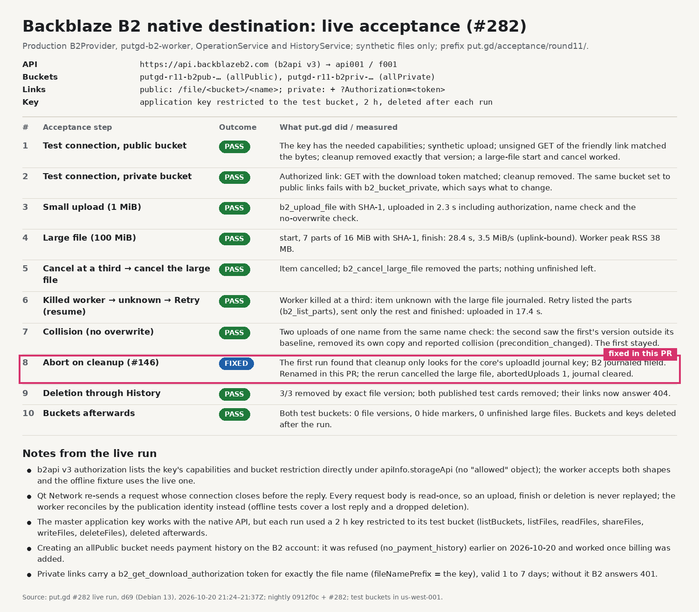
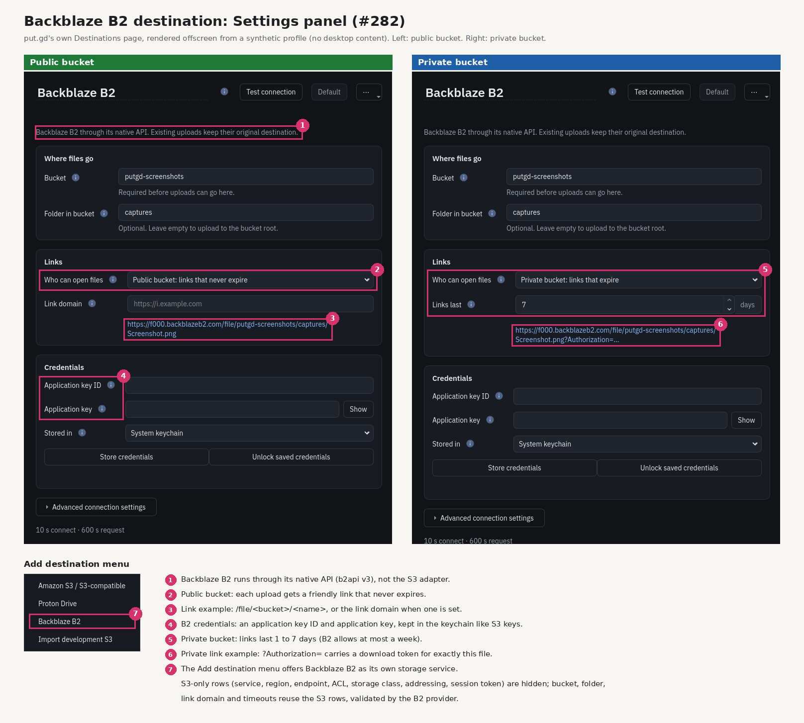
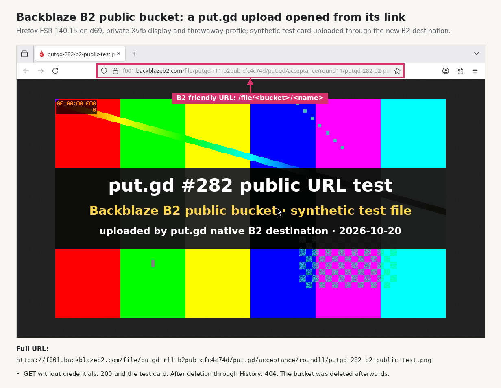
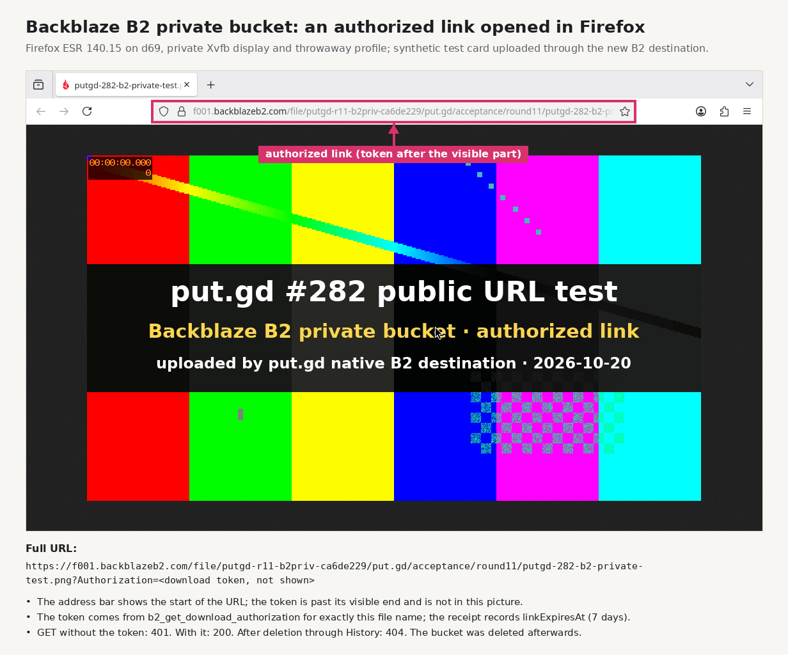

# Backblaze B2 native destination: live acceptance (#282)

PR #287 adds the Backblaze B2 destination ([b2.md](../../b2.md)). This is its live run
against B2.

- **Builder:** d69 (Debian 13), headless: offscreen Qt, private XDG directories,
  D-Bus disabled, no desktop lock.
- **Build:** nightly `0912f0c` + #287, `dev` preset.
- **When:** 2026-10-20, 21:24–21:50Z.
- **Buckets:** created for this run with Patrick's approval and deleted afterwards:
  `putgd-r11-b2pub-…` (allPublic) and `putgd-r11-b2priv-…` (allPrivate), region
  us-west-001. Prefix `put.gd/acceptance/round11/`.
- **Keys:** the master key stayed on d69. Each step minted an application key
  restricted to its bucket (2 h expiry, `listBuckets`, `listFiles`, `readFiles`,
  `shareFiles`, `writeFiles`, `deleteFiles`), handed it to the probe on stdin, and
  deleted it afterwards. See `b2lab.py`.

## Results

The live run caught two defects, both fixed in #287 before review:

- **Authorization shape.** b2api v3 authorization puts `capabilities` and the bucket
  restriction directly under `apiInfo.storageApi`, not under `allowed`. The first
  Test connection therefore reported missing capabilities. The worker now reads both
  shapes, and the offline fixture uses the live one.
- **Abort on cleanup.** Cleanup aborts only journals keyed `uploadId`, but the B2
  journal named the large file `fileId`. The first run left one unfinished large file
  (`abortedUploads: 0`). The journal now uses `uploadId`. The rerun cancelled it
  (`abortedUploads: 1`, journal cleared), and the earlier leftover was cancelled by the
  lab helper before the final check.

## Settings

## Links in Firefox

Firefox ESR 140.15 ran in a private Xvfb display (`:282`) that only this run used, with
a throwaway profile. Each test card was uploaded through the new destination and opened
from the receipt's URL.

The private link's download token is not in any picture or file here. Firefox shows only
the start of the URL, and the token sits after its visible end.

## Cleanup receipts

- Every upload was deleted through History: 3/3 in the full run, and 1/1 for each test
  card. Both test-card links answer 404.
- Before teardown, `b2lab.py verify` counted, in each bucket, 0 file versions, 0 hide
  markers and 0 unfinished large files.
- `b2lab.py teardown` deleted both buckets (200 each). `b2_list_buckets` and
  `b2_list_keys` then showed no `putgd-r11-` buckets or keys.
- On d69, `/home/patrick/work/put.gd-b2native` (scratch tree, synthetic files, Xvfb
  profiles) was removed after this evidence was copied.

## Files

- `live-results.jsonl`: every step's JSON line. B2 file IDs and bucket IDs are replaced
  by `<fileId>` and `<bucketId>`. No key or token was ever in it.
- `b2lab.py`: the lab helper. It creates and tears down buckets, mints scoped keys,
  verifies and cancels.
- The probe is `tests/performance/b2_live_probe.cpp` in #287.
