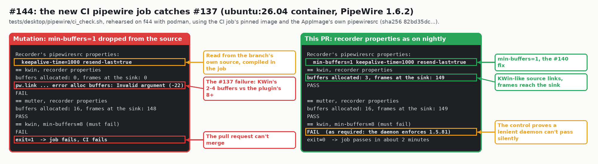
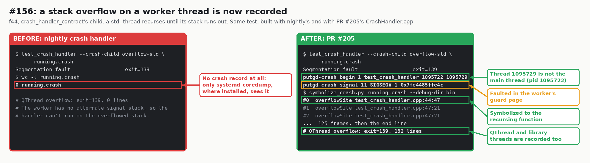
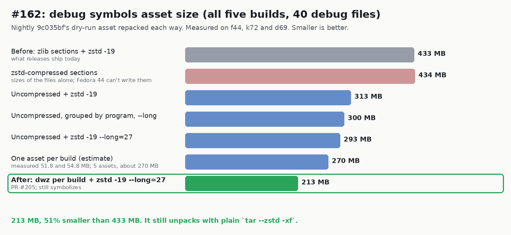
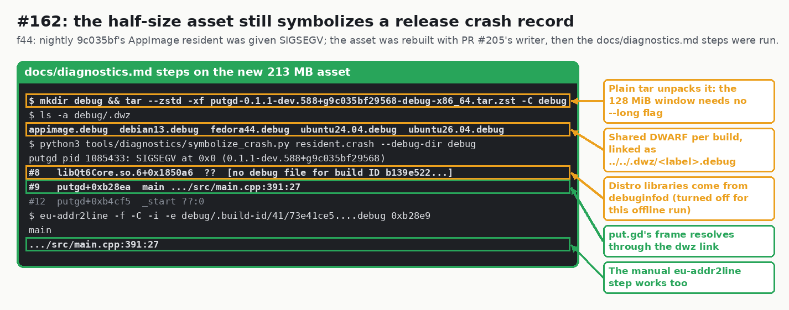

# CI PipeWire 1.6 check, per-thread crash stacks and a half-size debug asset (issues #144, #156, #162)

Evidence for pull request #205. Hosts: f44 (Fedora 44), d69 (Debian 13) and k72
(Kubuntu 26.04), headless and isolated: offscreen, no display or session bus, and
private XDG directories.

## #144: the AppImage's pipewiresrc on PipeWire 1.6

`tests/desktop/pipewire/ci_check.sh` ran on f44 under podman, in the CI job's
pinned `ubuntu:26.04` image (PipeWire 1.6.2), with nightly 428's AppImage
(`libgstpipewire.so` sha256 `82bd35dc...`).

| Source | kwin | mutter | `min-buffers=8` control | Result |
| --- | --- | --- | --- | --- |
| recorder properties `min-buffers=1 keepalive-time=1000 resend-last=true` | PASS, 3 buffers, 149 frames | PASS, 16 buffers, 149 frames | refused (`-22`) | pass, 2 min 4 s |
| `min-buffers=1` removed from `pipewireSourceDescription()` | FAIL, `error alloc buffers: Invalid argument (-22)` | PASS, 148 frames | refused | fail |

## #156: a stack overflow on a worker thread is recorded

The same `test_crash_handler` was built on f44 with nightly's and with PR #205's
`CrashHandler.cpp`, and its child overflowed a `std::thread` and a `QThread`.

| Build | `std::thread` overflow | `QThread` overflow |
| --- | --- | --- |
| nightly | SIGSEGV, empty record | SIGSEGV, empty record |
| PR #205 | SIGSEGV, 132-line record from thread 1095729 (pid 1095722), 125 frames of `overflowSite` | SIGSEGV, 132-line record |

On k72, `crash_handler_contract` passed 12/12 in ten runs. With the per-thread
stack skipped, its `std::thread`, `QThread` and library-thread cases failed with no
record.

## #162: the debug asset at about half its size

Each option repacked the 40 debug files (five builds) of nightly 9c035bf's
`debug-symbols-dry-run` artifact (CI run 39373943483).

| Option | Bytes | Where |
| --- | ---: | --- |
| zlib sections, `zstd -19` (before) | 432,821,671 | f44 |
| zstd-compressed sections (files only) | 433,611,792 | k72 |
| uncompressed, `zstd -19` | 312,758,294 | f44 |
| uncompressed, grouped by program, `--long=27` | 300,157,179 | k72 |
| uncompressed, `zstd -19 --long=27` | 293,046,073 | k72 |
| one asset per build, uncompressed, `--long=27` | 51,848,605 (ubuntu24.04), 54,842,888 (appimage) | d69 |
| `dwz` per build, `zstd -19 --long=27` (chosen) | 213,116,937 | d69 |
| PR #205's `debug_symbols.write()` | 213,117,237, 281 s on two cores | f44 |

The record comes from that run's AppImage resident on f44, sent SIGSEGV. After
`tar --zstd -xf`, `symbolize_crash.py` resolved `putgd+0xb28ea` to
`main src/main.cpp:391:27`, and `eu-addr2line`, `addr2line` and
`llvm-symbolizer` 21 gave the same result by hand. With an absolute
`/usr/lib/debug/.dwz/...` link instead of the relative one, `eu-addr2line` printed
`??` and `addr2line` reported `unable to read alt ref`.
