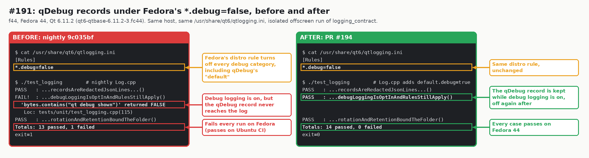

# Debug logging keeps qDebug records under Fedora's qtlogging.ini (issue #191)

Fedora's qt6-qtbase ships `/usr/share/qt6/qtlogging.ini` with `*.debug=false`.
That also disables Qt's `default` category, which `qDebug` writes to, so turning
on debug logging kept put.gd's own debug records but not `qDebug`'s, although
[diagnostics](../diagnostics.md#debug-logging) promises both.
`logging_contract` failed every time on Fedora and passed on Ubuntu, which has no
such file. Pull request #194 makes debug logging enable `default.debug` as well.
Qt applies those rules after the distro file, and `QT_LOGGING_RULES` still
overrides both. The suite now runs every host under the same `*.debug=false` rule,
through a private `QtProject/qtlogging.ini`, which Qt reads with the same
precedence.

## Runs

| Host | Build | Rules | Result |
| --- | --- | --- | --- |
| f44, Fedora 44, Qt 6.11.2 (`qt6-qtbase-6.11.2-3.fc44`) | nightly `9c035bf` `Log.cpp` and test | distro `*.debug=false` | `debugLoggingIsOptInAndRulesStillApply` FAIL, `'bytes.contains("qt debug shown")' returned FALSE`; 13 passed, 1 failed |
| f44, same | PR #194 | distro file and the suite's private copy | 14 passed, 0 failed |
| d69, Debian 13 | PR #194 | the suite's private `*.debug=false` | 14 passed, three runs |
| d69, Debian 13 | PR #194 test with nightly's `Log.cpp` | the suite's private `*.debug=false` | FAIL, `'QLoggingCategory::defaultCategory()->isDebugEnabled()' returned FALSE` |

Each run was isolated: `QT_QPA_PLATFORM=offscreen`, no display or session bus,
`QT_LOGGING_RULES` unset and private XDG directories. Both builds were the `dev`
preset's `test_logging` target, built on the host from the same tree. Only the
two files differed.
