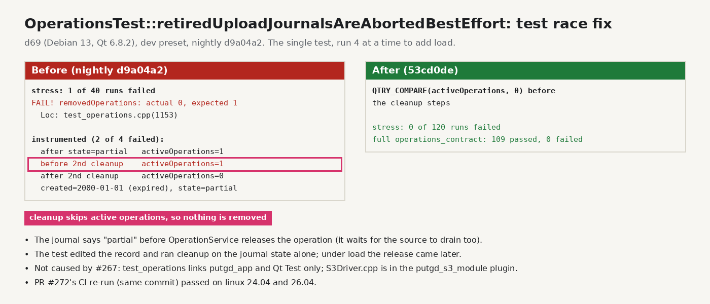

# operations_contract race in retiredUploadJournalsAreAbortedBestEffort (2026-10-20)

PR #272's CI failed `OperationsTest::retiredUploadJournalsAreAbortedBestEffort` at
`test_operations.cpp:1153` (`removedOperations` 0, expected 1) on linux 24.04 and
26.04. A re-run of the same commit passed. The cause is a race in the test.

The test waited only for the operation journal to say `partial` or `failed`.
`OperationService` releases the operation later, once the source has drained too,
and artifact cleanup skips active operations. Under load, the second cleanup started
while the operation was still active and removed nothing. The fix waits for
`activeOperations` to reach 0 before the cleanup steps.

- Reproduction on d69 (Debian 13, Qt 6.8.2), nightly `d9a04a2`: 1 failure in 40
  runs of the single test, run four at a time. In an instrumented copy, both
  failures had `activeOperations` 1 when the second cleanup started; the record's
  `created` was still 2000-01-01.
- With the fix: 0 failures in 120 runs, and the full `operations_contract` suite
  passed (109/109).
- Not caused by #267. `test_operations` links only `putgd_app` and Qt Test, and
  `S3Driver.cpp` is built into the `putgd_s3_module` plugin.
