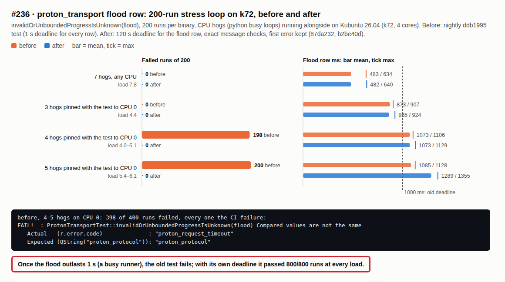

# proton_transport flood row stress loop (#236), 2026-10-20

`ProtonTransportTest::invalidOrUnboundedProgressIsUnknown(flood)` failed once on CI
`linux (24.04)` with `proton_request_timeout` instead of `proton_protocol`. The
flood fixture writes 2.8 MB of valid progress lines, which trips the 2 MiB output
budget on byte count alone; the row shared the suite's 1 s request deadline, and
parsing 40000 lines can outlast it on a busy runner.

The fix (pull request below) gives the flood row a 120 s deadline, checks every
row's exact protocol message, and keeps the transport's first error after the
helper is killed (the final read used to overwrite it).

## Stress loop

Kubuntu 26.04 (k72, 4 cores), scratch build of nightly ddb1995 with the
`proton_transport` target. `test_proton_transport.before` is nightly's test;
`test_proton_transport` has 87da232 and b2be40d. Each condition ran 200 flood
runs per binary with Python busy loops alongside ([`stress236.sh`](stress236.sh)).
Per-run results: `summary.tsv`.

| Condition | Before: failed / 200 | After: failed / 200 | Flood row, mean / max ms (before → after) |
| --- | --- | --- | --- |
| 7 hogs, any CPU (load 5.6–7.8) | 0 | 0 | 483 / 634 → 482 / 640 |
| 3 hogs + test on CPU 0 | 0 | 0 | 873 / 907 → 865 / 924 |
| 4 hogs + test on CPU 0 | **198** | 0 | 1073 / 1106 → 1073 / 1129 |
| 5 hogs + test on CPU 0 | **200** | 0 | 1085 / 1128 → 1289 / 1355 |

Every before failure was the CI failure, `proton_request_timeout`. Once the
flood takes longer than 1 s, the old row fails; with its own deadline it passed
all 800 runs. The whole suite (30 rows) passes after the change.

