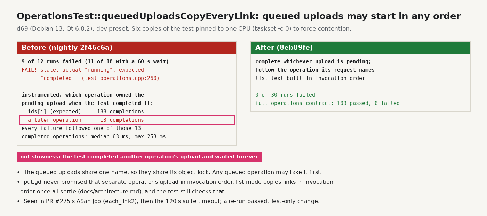

# queuedUploadsCopyEveryLink: queued uploads may start in any order (2026-10-20)

PR #275's sanitizers job failed `OperationsTest::queuedUploadsCopyEveryLink(each_link2)`
at `test_operations.cpp:260`: the operation was still "running" when "completed" was
expected, and then `operations_contract` hit its 120 s timeout. A re-run passed.

The test queues up to three clipboard uploads of the same name and completes the
pending upload, assuming it belongs to `ids[i]`. Uploads of one name share its object
lock, and any queued operation may take it first. Under CPU load the pending upload
sometimes belonged to a later operation. The test completed that one and then waited on
`ids[i]`, whose upload it never completed. put.gd has never promised that separate
operations upload in invocation order. `list` mode does promise invocation order for
the copied list ([architecture](../../architecture.md)), and the test still checks that.

- Reproduction on d69 (Debian 13, Qt 6.8.2), nightly `2f46c6a`: six copies of the
  test pinned to one CPU (`taskset -c 0`) failed in 9 of 12 runs, 13 failed rows.
  An instrumented copy logged whose upload was pending. 13 of 201 completions
  belonged to a later operation, and each of the 13 failures followed one of them.
  With a 60 s wait, 11 of 18 runs still failed, while every operation that did
  complete took at most 253 ms. So the failures were not slowness.
- Fix (test-only): identify the pending upload's operation from the recorded
  request, follow that operation, and build the expected list in invocation order.
  0 of 30 runs failed under the same load, and the full `operations_contract` suite
  passed (109/109).
