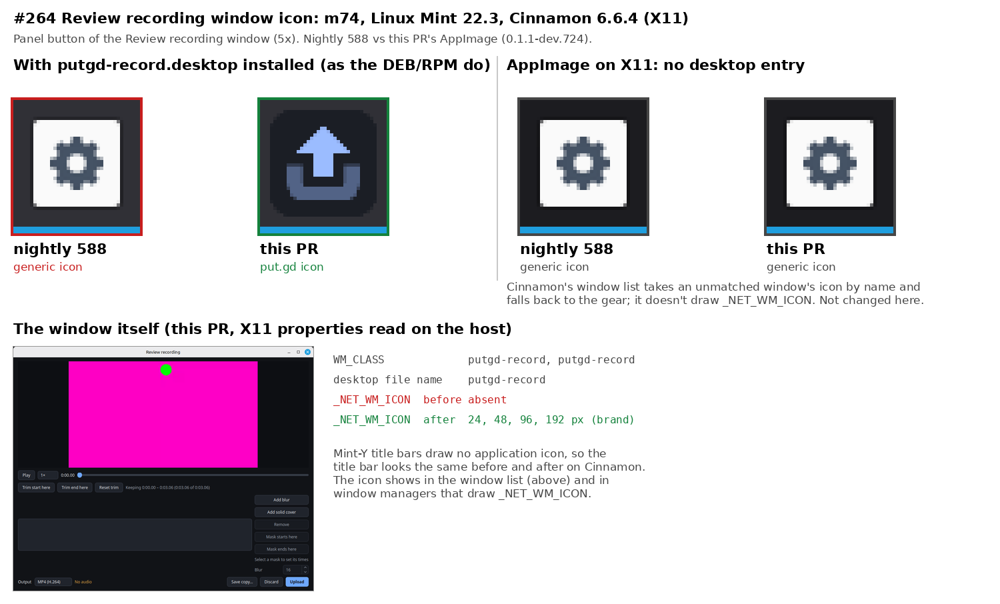
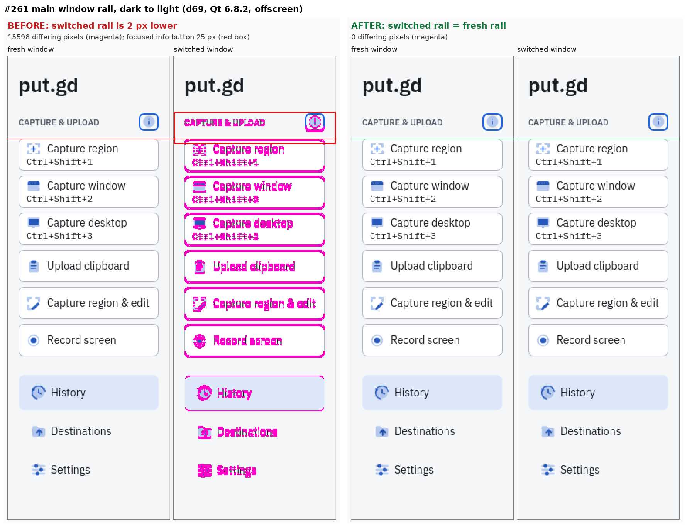
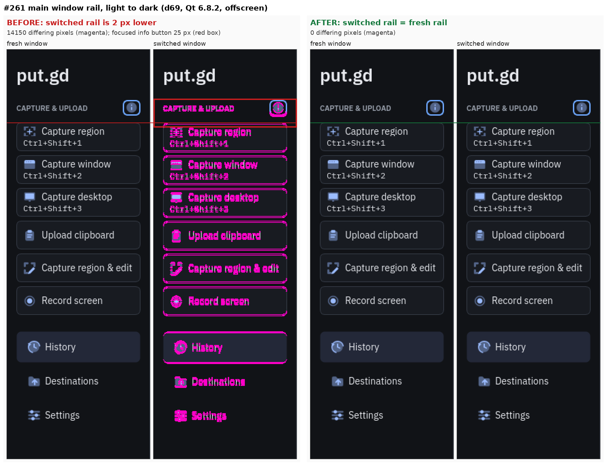
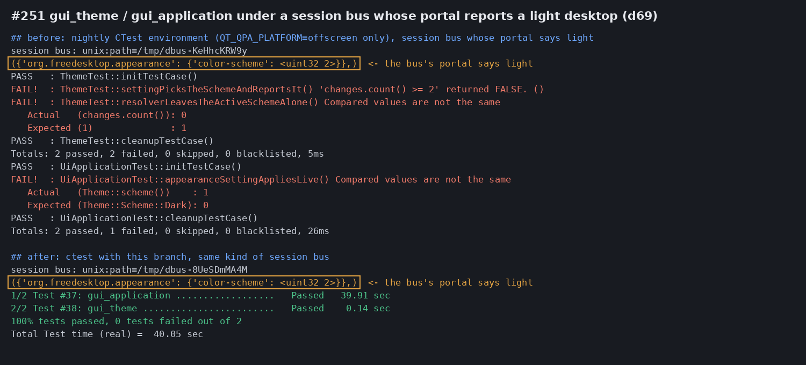

# Review window icon, steady rail after a theme switch, isolated theme tests

Issues #264, #261 and #251. Code PR #265 on branch `claude/r11-quick-knockouts`
(head `f29bdce`), measured against nightly `c2037cc` and, on m74, the nightly 588
AppImage (`0.1.1-dev.588+g9c035bf29568`) against this PR's CI AppImage
(`0.1.1-dev.724+g7090864a940f`, the PR merge build).

## #264 Review recording window icon

Taken on m74 (Linux Mint 22.3, Cinnamon 6.6.4, X11) under the desktop lock.
Each run used a private profile (`XDG_*` directories and runtime directory)
and a private session bus with no service directories, so nothing on the host
was started on it. Notifications were off. The only recorded region was the
run's own magenta `videotestsrc` window, which had no panel button of its own.
Frames came from the host's loopback VNC and stayed in memory. Only these crops
were written, and each was checked on the host first:

- the review window frame: nothing but the run's own windows above it in the
  stacking order, no override-redirect window over it, and at least 40% put.gd
  dark-theme or test-pattern pixels;
- the panel button: the columns that changed when the review window mapped and
  changed back when it closed, empty panel before and after, with focus only on
  the run's own windows.

Results:

- `putgd-record` now publishes `_NET_WM_ICON` (24, 48, 96 and 192 px brand icon),
  which nightly lacked. `WM_CLASS`, `_GTK_APPLICATION_ID` and
  `_KDE_NET_WM_DESKTOP_FILE` are `putgd-record` in both builds.
- For one pair of runs, a `putgd-record.desktop` entry was in place, the way the
  DEB and RPM install it. It was nightly's entry, without `StartupWMClass`, with
  its icon given by absolute path, in `~/.local/share/applications`, and was
  removed afterwards. With it, Cinnamon's window list shows the put.gd icon for
  this PR's review window and the generic gear for nightly's.
- With no desktop entry, which is the AppImage on X11, both builds show the
  gear. Cinnamon's window list takes an unmatched window's icon by name and
  falls back to `application-x-executable`; it doesn't draw `_NET_WM_ICON`.
  The AppImage adds a `putgd-record` icon entry only on Wayland
  (`packaging/appimage/AppRun`). This PR doesn't change that.
- Mint-Y title bars draw no application icon, so the title bar looks the same
  in both builds.

GNOME Wayland and Plasma Wayland weren't rechecked here. There the Wayland
app ID was already `putgd-record` (Qt's fallback is the executable name), and
it is now set explicitly.

`record_identity_contract` checks the desktop file name, the application and
window icon, and the configured `putgd-record.desktop` (`Icon=putgd`,
`NoDisplay=true`, `StartupWMClass=putgd-record`).

## #261 Rail offset after a theme switch

`QWidget::grab` of the main window rail on d69 (Debian 13, Qt 6.8.2),
offscreen, with a synthetic profile. Each picture shows a window opened in the
scheme next to one switched into it, for nightly's `redesign.qss` and for this
PR's. Magenta marks the pixels that differ.

The CAPTURE & UPLOAD heading's info button holds the window's first focus.
`min-height: 0` released its fixed 26 px height, so its row followed the size
hint, and the hint includes the `:focus` border (2 px focused, 1 px otherwise).
A fresh window caches the hint before the button gets focus, which gives 23 px.
A switch's re-polish recomputes it while the button is focused, which gives
25 px, and everything below moves down 2 px. The info button's height is now
23 px either way. The fresh layout is unchanged: the capture buttons still
start at y 107.

`gui_application` `switchedRailMatchesAFreshWindow` compares every rail
widget's geometry and font in both directions. It fails with nightly's
stylesheet and passes with this change.

## #251 Theme tests and the caller's session bus

On d69, a private `dbus-daemon` ran a stub `org.freedesktop.portal.Settings`
that reports `color-scheme` 2 (light), as the real desktop's bus can. Under
nightly's test environment (`QT_QPA_PLATFORM=offscreen` only), the issue's three
failures come back exactly. With this PR, `ctest` runs both tests with
`DBUS_SESSION_BUS_ADDRESS` pointing at a socket that doesn't exist, and with
`XDG_CURRENT_DESKTOP` and `QT_QPA_PLATFORMTHEME` unset, so they pass on the same
bus. A plain `dbus-run-session` isn't enough on a desktop machine, because it
can activate the real `xdg-desktop-portal`.

## Builds and tests

- d69, `claude/r11-quick-knockouts` at `f29bdce`: full `cmake --build --preset dev`
  and `ctest` (90/90 passed), headless, with a private `XDG_*` profile and no
  session bus.
- CI run 39481039054: Linux 24.04 and 26.04, Windows and the packages passed.
  The sanitizer job failed once in `operations_contract`
  (`historyImageSupersededWorkerReleasesNewerCopy`), which this change doesn't
  touch and which passed 5/5 on d69. It was re-run.
