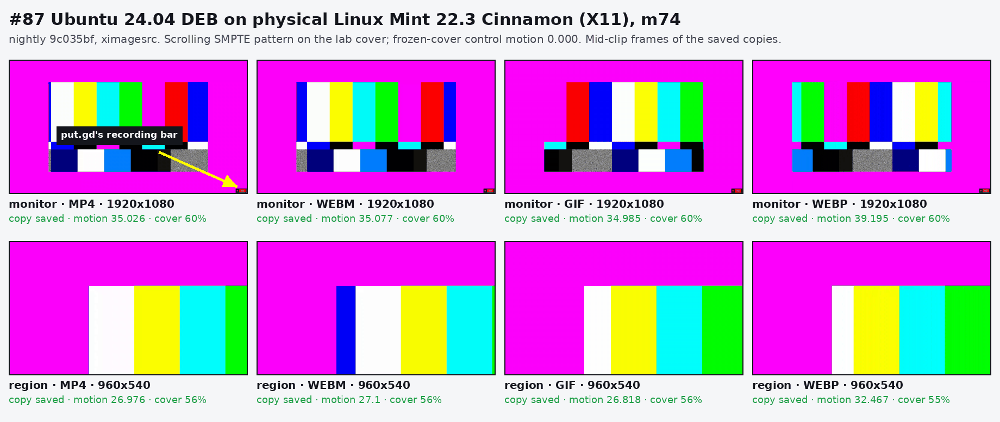
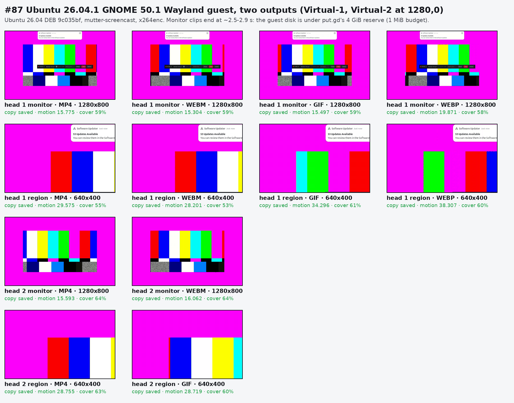
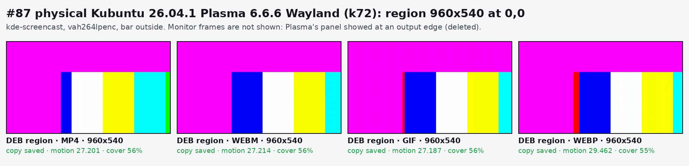
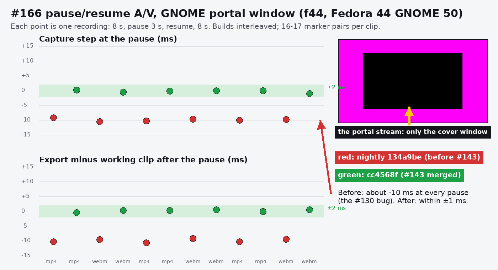
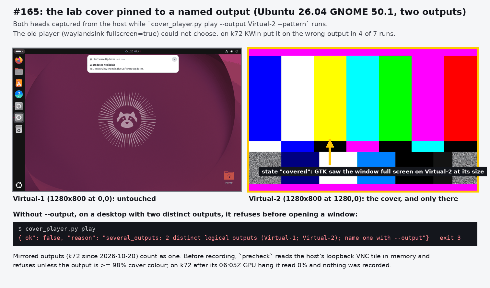
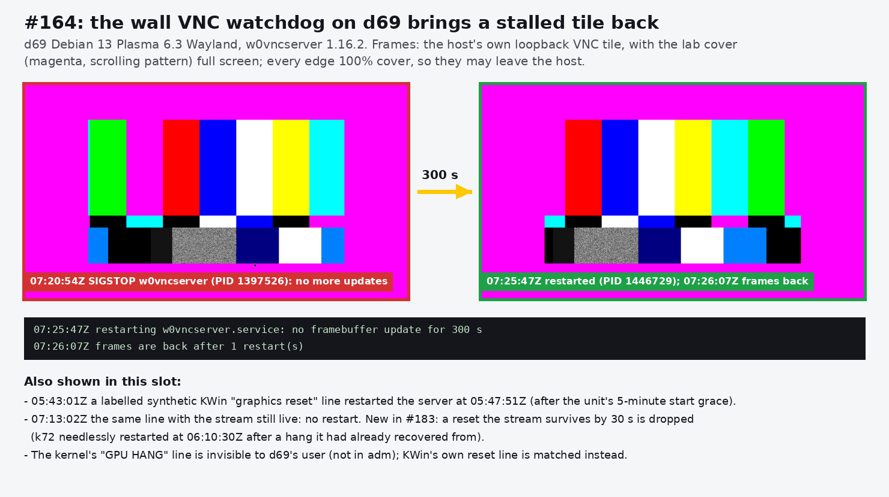

# Recording closeout: acceptance, portal pause A/V, lab cover player, wall watchdog, encoder order (issues #87, #166, #165, #164, #89)

Lab runs of 2026-10-20, 05:40–07:40Z, under desktop locks. Times are UTC.
Offsets are audio minus video in ms (positive means the sound is late), from
`putgd-record --av-sync` on recordings of the `--av-marker` clip.

Every capture followed the verified-cover rule. Each recording ran on the lab
cover (`tools/lab/cover_player.py`): a magenta full-screen window pinned to a
named output, with the moving pattern or the marker in its middle. Before
anything was recorded, `precheck` read the host's loopback VNC tile in memory
and required the output to be at least 98% cover colour. A frame was kept only
when `check-frame` found it at least half cover colour. Otherwise the frame and
that recording's clips were deleted unopened. The driver is
`tools/lab/record_run.py` (PR #183). Clips stay on the builders, and the
numbers, frames and identities are in the session's private `work/closeout`
tree.

## Builds

| Build | Source | Artifact (sha256 prefix) |
| --- | --- | --- |
| nightly `9c035bf` (`0.1.1~dev.588`) | CI run 39373943483 (packages green; the run failed only on a flaky `operations_contract`, see upload-followups) | Ubuntu 24.04 DEB `94ddc1877c7e1ecb`, Ubuntu 26.04 DEB `6458b10f8b23b737`, AppImage `3dc912a6c3c08305` |
| pre-#143 nightly `134a9be` | CI run 39354181904 | AppImage `e67fb614a7d1b4e9` |
| #143 merged, `cc4568f` | CI run 39360982558 | AppImage `23cee22c58d12b35` |

## #87: Ubuntu 24.04 DEB on physical Linux Mint Cinnamon (m74)

- **Host:** m74, Linux Mint 22.3, Cinnamon 6.6.4 on X11, kernel 6.14.0-37, Intel HD 530, iHD 24.1.0.
- **Build:** the Ubuntu 24.04 DEB of `9c035bf`, installed with apt (the transaction added only `putgd`) and removed afterwards.
- **Acquisition:** `x11` (`ximagesrc`). Live encoders, in order: `vah264lpenc`, `vaapih264enc`, `x264enc`, `openh264enc`.



| Target | MP4 | WebM | GIF | WebP |
| --- | --- | --- | --- | --- |
| monitor 1920×1080, motion (export) | 35.0 | 35.1 | 35.0 | 39.2 |
| region 960×540 at 0,0, motion (export) | 27.0 | 27.1 | 26.8 | 32.5 |
| frozen cover (control), motion | 0.000 | | 0.000 | |

Every copy was saved. Frames were 55–60% cover colour, and the bar sits in the
monitor clip's corner (`overlayPlacement: handle`).

A/V, two rounds, record 8 s, pause 3 s, record 8 s, 07:03–07:06Z. Host load
was 0.46 before the run; the rise to 2.3 came from the run itself. No GPU hang.

| Round | Format | Working / export median | Capture step at the pause | Export − working after the pause |
| --- | --- | --- | --- | --- |
| 1 | MP4 | +9.7 / +10.0 | +0.2 | −0.7 |
| 1 | WebM | +2.7 / +3.5 | −0.9 | −0.8 |
| 2 | MP4 | −17.7 / −17.3 | +0.2 | +0.2 |
| 2 | WebM | −5.0 / −4.5 | −0.9 | +1.0 |

An earlier A/V set (06:11–06:13Z) was taken while another session's tests loaded
m74 (load 1.1–2.1). Its steps were also within ±1 ms, but it was discarded as not quiet.

## #87: Ubuntu 26.04 GNOME, final code (VM on f44), and multi-monitor placement on Wayland

- **Guest:** Ubuntu 26.04.1 LTS, GNOME Shell 50.1 Wayland, two virtual outputs: `Virtual-1` 1280×800 at 0,0 and `Virtual-2` 1280×800 at 1280,0.
- **Image and host:** golden `563730cc…` on f44, 6 GiB, 2 vCPU, `lab.py launch --heads 2`. Both overlays were retired with guarded cleanup, and the golden's hash is unchanged.
- **Build:** the Ubuntu 26.04 DEB of `9c035bf`.
- **Acquisition and encoders:** `mutter-screencast`; live encoders `x264enc`, `openh264enc` (no VA-API in the guest).



- Monitor and region recordings on either output saved in every format, with motion 15–38 and 53–64% cover. The frozen control read 0.06–0.10.
- The monitor clips end at about 2.5–2.9 s. The guest disk has 2.36 GB free, less than put.gd's 4 GiB disk reserve, so `effectiveLimits.disk.availableBytes` is 0 and the recording gets a 1 MiB budget. It then ends itself (`reason: budget`), and a later `recording.stop` answers `recording_state`. Regions and still screens stay under 1 MiB for 8 s. Filed as #213.
- The bar: put.gd's GNOME Shell extension wasn't loaded in the fresh guest (it needs a re-login after install), so Mutter placed the bar. The helper reports that correctly (`overlayExcluded: false`, `overlayPlacement: compositor`), and the bar shows in head-1 monitor clips. With the extension, the bar moves off the recorded monitor (#87's 2026-10-19 two-head runs).

## #87: physical Plasma 6.6 Wayland (k72)

- **Host:** k72, Kubuntu 26.04.1, Plasma 6.6.6 Wayland, single output HDMI-A-1 1920×1080, Intel HD 530, kernel 7.0.0-38, iHD 26.1.2.
- **Builds:** the Ubuntu 26.04 DEB and the AppImage of `9c035bf`. The AppImage ran with `--real-data-home`, so KWin offered it the screencast protocol; its data dir was moved into the run afterwards.
- **Acquisition and encoder:** `kde-screencast`, `vah264lpenc`.

**First attempt, 06:04–06:07Z:**
- The DEB's monitor recordings saved in all four formats.
- During the WebM recording, the i915 GPU hung twice in `kwin_wayland` (06:05:19Z and 06:05:31Z, `ecode 9:1:85dffffb`), at host load 5–7 from two other sessions' jobs.
- The wall watchdog restarted the VNC server at 06:05:28Z. After that, `precheck` read 0% cover colour on the tile and refused the region runs.
- Patrick took k72 out for a hardware check. It came back at 06:17Z.

**Redo, 07:11–07:25Z:** quiet (load 0.25 at the start; at most 2.75 from the run itself), no GPU hang in the kernel log after any run.

| Build, target | MP4 | WebM | GIF | WebP | Bar |
| --- | --- | --- | --- | --- | --- |
| DEB, monitor, motion (export) | 35.7 | 35.4 | 35.3 | 39.5 | `hidden`: KWin 6.6 leaves it out of the stream |
| DEB, region 960×540 at 0,0, motion (export) | 27.2 | 27.2 | 27.2 | 29.5 | `outside` |
| AppImage, monitor, motion (export) | 35.0 | 35.0 | 34.9 | 39.4 | `hidden` |
| DEB, frozen cover (control) | 0.001 | | | | |

DEB pause A/V, two rounds:

| Round | Format | Working / export median | Capture step at the pause | Export − working after the pause |
| --- | --- | --- | --- | --- |
| 1 | MP4 | +6.7 / +6.0 | +0.5 | −0.3 |
| 1 | WebM | −12.3 / −12.5 | +0.4 | −0.3 |
| 2 | MP4 | −8.7 / −8.7 | +0.8 | −1.0 |
| 2 | WebM | −18.3 / −18.5 | +0.8 | −0.2 |



**No k72 monitor frames are kept.** Once a recording started, Plasma's panel
showed above the cover along the bottom edge of the monitor frames. The cover
had passed `precheck` at 100%, and the frames still passed the 50% gate. Every
k72 monitor frame and clip was deleted on k72 and on the workstation, and
the coordinator was told. The region frames don't reach that edge and stay on
the builder. Since PR #183, `check-frame` also requires every frame edge that
lies on an output edge to be at least 90% cover colour.

## #166: pause/resume A/V on the portal paths

### f44 GNOME 50 portal, window target

- **Host:** f44, Fedora 44, GNOME 50 Wayland, AppImages.
- **When:** 06:09–06:16Z.
- **Picker:** Patrick approved the portal picker for the cover window once, with restoring allowed. The `gnome/window` restore token then covered every later round and both builds.
- **Runs:** builds interleaved, three rounds of MP4 and WebM, 16–17 marker pairs per clip.
- **Load:** 0.9–2.5. It came from the run's own exports and GNOME's file indexer, with no other jobs.



| Build | Capture step at the pause (whole-frame slips folded out) | Export − working after the pause |
| --- | --- | --- |
| pre-#143 `134a9be` | −9.2, −10.5, −10.3, −9.6, −10.0, −9.8 | −10.3, −9.5, −10.6, −9.2, −10.3, −9.4 |
| #143 `cc4568f` | +0.2, −0.5, −0.2, 0.0, 0.0, −1.0 | −0.4, +0.3, +0.3, +0.5, 0.0, +0.5 |

The portal window path behaves like the native paths: the pre-#143 build loses
about 10 ms at every pause, and #143 holds within ±1 ms, inside #166's ±2 ms.

One #143 WebM round first read +16.1 ms. Its offsets alternate between 0 and
one frame, and the two pairs before the pause fell on either side of that split.
The driver now folds whole-frame slips to the clip's common phase before taking
the step.

### d69 Plasma 6.3 portal, monitor target: pending

The run started at 07:10:53Z on a quiet d69 (load 0.00), with the cover up and
a 99.99% precheck. The KDE portal picker opened for the first `prepare`, but
nobody was at the desktop to approve it. The run was stopped cleanly at
07:12Z, and nothing was recorded. It needs one approval (screen HDMI-A-1,
"Allow restoring") while the same driver runs:

```sh
python3 record_run.py --run RUN --build pre=…134a9bec08b3…AppImage --build post=…cc4568f248ce…AppImage \
  --analyzer EXTRACTED_cc4568f --video marker --target monitor --format mp4 webm --rounds 3 \
  --output HDMI-A-1 --prepare-timeout 1500 --frames
```

## #165: the lab cover pinned to a named output



`cover_player.py play --output NAME` opens a GTK 3 window full screen on that
output (`xdg_toplevel.set_fullscreen` with its `wl_output`, or
`_NET_WM_FULLSCREEN_MONITORS` on X11). It reports `covered` only after GTK sees
the window full screen on that output at its size.

- **Placement:** on the two-output GNOME 50.1 guest the cover went to `Virtual-2` and left `Virtual-1` untouched. In an isolated nested `kwin_wayland --virtual --output-count 2` on d69 it went to `Virtual-0` and `Virtual-1` as asked.
- **Refusal:** without `--output`, with two distinct logical outputs, it refuses before opening a window (exit 3). Mirrored outputs count as one.
- **Real desktops:** on d69 (Plasma 6.3), m74 (Cinnamon), f44 (GNOME 50) and k72 (Plasma 6.6, mirrored) the precheck read 99.99–100% cover.
- **Failing closed:**
  - k72 after its GPU hang: the precheck read 0% and refused.
  - A gap found here: on Plasma 6.6 the panel came back above the cover once a recording started, at the bottom edge, which the 50% gate let through. The edge check now catches it (see k72 above).
  - m74's first run: a window from the resident's first start on a fresh configuration covered part of the screen. Its frames read 0–29% and were deleted unopened, along with their clips. The driver now starts each build's resident once before the cover opens.

## #164: wall VNC watchdog on d69

- **Install:** `tools/lab/wall_vnc_watchdog.py` was installed on d69 as `~/.local/bin/wall-vnc-watchdog` (sha256 `4ae8e5ed…`, the same file as k72's), with the user unit `wall-vnc-watchdog.service` enabled under `plasma-workspace-wayland.target`.
- **Trigger test:** a labelled synthetic journal line (`wall-vnc-watchdog-selftest`, "SYNTHETIC … A graphics reset attributable …") at 05:43:01Z was held for the 5-minute grace after the unit started. It restarted `w0vncserver.service` at 05:47:51Z (PID 25432 → 1397526). The RFB frame hashes changed afterwards (05:48:02Z and 05:49:04Z), and no prompt appeared.
- **Journal visibility:** d69's `patrick` user isn't in `adm` or `systemd-journal`, so the kernel's `GPU HANG` line is invisible to the unit. KWin's own "graphics reset attributable to the current GL context" line is in the user journal, and the watchdog matches it; checked against the real 2026-10-19 06:44Z hang. On k72 the user is in `adm`, so the watchdog sees both.


- **Stale trigger, 07:20–07:26Z, with the updated watchdog:** with the cover up and a 99.99% precheck, w0vncserver (PID 1397526) was stopped with SIGSTOP at 07:20:54Z. The watchdog restarted it after 300 s without updates (07:25:47Z, PID 1446729), and frames were back at 07:26:07Z. All four tile frames are 100% cover at every edge.
- **Survived reset:** the labelled synthetic line again at 07:13:02Z, now with the stream live. The updated watchdog dropped it as survived and did not restart.
- **k72 re-login check:** still pending. Patrick's apps were open on k72, and k72 is now out for a hardware check.
- **Redundant restart:** the k72 hang above exposed one. A second hang logged 3 s after a restart forced another restart when the grace ended (06:10:30Z), though the new stream was live. PR #183 drops a reset that the stream survives by 30 s.

## #89: GPU-first encoder order kept

(See the recording docs, "Encoder order and the Skylake GPU hangs".) Kernel logs, read only, 2026-10-12 to 2026-10-20:

| Host | Desktop | i915 GPU hangs | Context | During a VA-API encode |
| --- | --- | --- | --- | --- |
| k72 | Plasma X11, then Wayland | 6: 10-17 07:35Z, 08:13Z, 10-19 02:32Z (Xorg); 10-20 02:16Z, 06:05:19Z, 06:05:31Z (kwin_wayland) | `rcs0` (render), compositor | 3 of 6, in two events (10-19 02:32Z; 10-20 06:05:19Z and 06:05:31Z), at load 5–9 |
| d69 | Plasma 6.3 Wayland | 1: 10-19 06:44Z | `rcs0`, kwin_wayland | no (a CPU GIF export) |
| f44 | GNOME 50 | 0 | | f44's iHD 25.4.6 has no H.264 encode; OpenH264 |
| m74 | Cinnamon X11 | 0 (since its 2026-10-20 boot) | | yes, today's `vah264lpenc` runs |

All four hosts have the same HD 530 (`8086:1912`), DMC firmware 1.27 and HuC
off. Every hang has the same `ecode 9:1:85dffffb` and "Resetting rcs0 for
preemption time out", in the compositor's context. The video engine (`vcs0`)
that `vah264lpenc` uses never reset, and four of the seven hangs had no
VA-API encode running.
