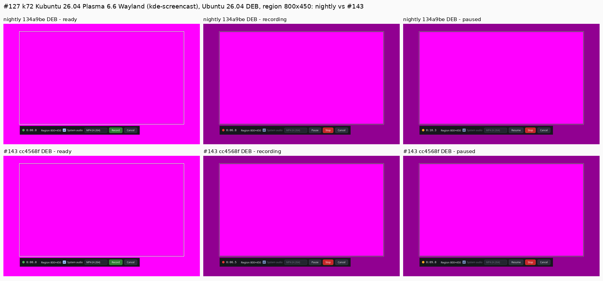

# Recording reliability: d69 quiet re-run and k72 Plasma 6.6 (PR #143)

This addendum to PR #143's receipt (`docs/evidence/2026-10-20-recording-reliability.md`) covers one re-run. The receipt's d69 PR row came from runs at host load 3.7–6.9: another session's build was running on d69 at the same time. The same three runs were repeated on a quiet host.

- **Host:** d69, Debian 13, Plasma 6.3.6 Wayland, `kde-screencast`.
- **Build:** AppImage `putgd-0.1.1-dev.533+gcc4568f248ce`, sha256 `23cee22c58d12b35…`. This is PR #143 head `cf397e1` merged into nightly.
- **When:** 2026-10-20, 03:25–03:28Z.
- **Load during the runs (1-min):** 0.55, 1.40, 1.97.
- **Each run:** the `--av-marker` clip played full screen through the default sink. Record 8 s, pause 3 s, resume, record 8 s, stop, then Save copy.
- **Measurement:** the build's own `putgd-record --av-sync`, with offsets split at the pause by `pairTimesS`. Offsets are audio minus video in ms; positive means the sound is late.

| Run | Format | Capture step at the pause | Export − working after the pause |
| --- | --- | --- | --- |
| p1 | MP4 | −0.3 | 0.0 |
| p2 | WebM | +0.4 | −1.2 |
| p3 | MP4 | −1.3 | −0.7 |

The loaded run gave −0.3/0.0/0.0 and −0.3/+0.5/+1.4. Nightly `134a9be` on the same path gave capture steps of +17.0/+16.7/0.0 and an export 10 ms earlier than the working clip in every run.

## k72 Plasma 6.6 Wayland (#127 and #130)

- **Host:** k72, Kubuntu 26.04, Plasma 6.6 Wayland, `kde-screencast`. Both outputs mirror one 1920×1080 desktop (HDMI-A-2 replicates HDMI-A-1).
- **When:** 2026-10-20, 03:37–03:47Z.
- **Builds:** the Ubuntu 26.04 DEBs of nightly `134a9be` (sha256 `81a9bd5c34340074…`) and of #143 as merged (`cc4568f`, sha256 `09b2f42732743d4b…`). Each was installed for its round and removed afterwards.
- **Load:** 1.0–2.1.
- **GPU:** no i915 GPU hang in the kernel log during the slot.

### Frames

The frames show a region recording (800×450 at 560,240) with the bar outside it, on a magenta full-screen background. Each one was verified on the host to be at least 50% background before it was copied. A pre-check frame confirmed a single 1920×1080 output, fully covered by the player.

Plasma 6.6 doesn't show #127: KWin 6.6 already keeps the bar above the dim strips on nightly. The bug is specific to Plasma 6.3, as on d69. With #143 the 6.6 result is unchanged: the strips exist from the ready state, but they are clear until Record.

| Pixel | nightly recording / paused | #143 recording / paused |
| --- | --- | --- |
| bar background (640,735) | (21,23,28) / (21,23,28) | (21,23,28) / (21,23,28) |
| Stop button (1080,721) | (244,233,237) hovered / (198,40,40) | (244,233,237) hovered / (198,40,40) |
| outside the region (200,200) | (145,0,145) | (145,0,145) |
| ready state, outside | (255,0,255) | (255,0,255) |

### Pause A/V

The method is the same as the receipt's. Every clip contained the marker, so none was destroyed.

| Build | Capture step at the pause (whole frames removed) | Export − working after the pause |
| --- | --- | --- |
| nightly | +16.3, 0.0, −0.6 | −10.0, −9.5, −9.7 |
| #143 | 0.0, −0.3, 0.0 | −0.3, +0.8, −0.3 |
