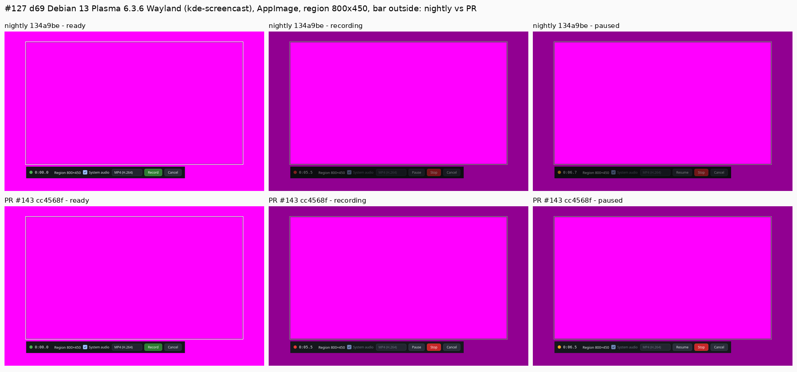

# Recording reliability: Stop, pause/resume A/V, bar above the dim, outdated GNOME extension (issues #129, #130, #127, #131)

PR #143. This receipt covers the lab runs of 2026-10-20 (01:50–03:25Z). Times
are UTC. Offsets are audio minus video in ms (positive means the sound is late),
from `putgd-record --av-sync` on recordings of the `--av-marker` clip played
full screen. The private raw data (clips, logs, results JSON) is in the
session's work/rr130 tree on the workstation.

## Builds

| Build | Source | Artifact (sha256 prefix) |
| --- | --- | --- |
| nightly before | `134a9be` (CI run 39354181904) | AppImage `putgd-0.1.1-dev.514+g134a9bec08b3` `e67fb614a7d1b4e9`; Ubuntu 26.04 DEB `81a9bd5c34340074` |
| PR, first fix | `86cf689` merged into nightly as `c1df3b9` (run 39358132934) | AppImage `c1f5428d3e8b8eca`; Ubuntu 26.04 DEB `3297e7c9af3aa147` |
| PR, Stop fix complete | `5a16c44` merged as `9999974` (run 39359686615) | Ubuntu 26.04 DEB `e073999f0b78b5e2` |
| PR, final | `cf397e1` (nightly with #140) merged as `cc4568f` (run 39360982558) | AppImage `23cee22c58d12b35`; Ubuntu 26.04 DEB `09b2f42732743d4b` |

## #129 Stop hangs with system audio on a null sink

**Cause, from a headless reproduction plus gdb:** Stop sent EOS through the
pipeline to the sources, and a `GstBaseSrc` takes its streaming lock for EOS.
The `pulsesrc` streaming thread holds that lock while it waits: in
`gst_audio_ring_buffer_read` (GstAudioBaseSrc has no `unlock`), or pushing into
a full audio queue. The helper's main thread therefore blocked in
`gst_element_send_event`, logging `command stop` and nothing after it.

The guest showed why the audio stalls there. The suspended `auto_null`
monitor sometimes stamps audio about 2³² ring-buffer segments ahead (audio
"lateness" −42,949,672,9xx ms after ~212 buffers), so the muxer never takes
those buffers. The upstream report is tracked in #167.

**Headless reproducer** (d69 PipeWire 1.4.2 and k72 1.6.2): a private
PipeWire with wireplumber and a SUSPENDED `auto_null` sink, a KWin-like
screencast source (from #140's `screencast_like_src`), `RecordingPipeline` as
the helper builds it, and the monitor link cut 2 s into the recording
(`pw-link -d`).

| Build | Stop |
| --- | --- |
| nightly | hung 2 of 2 (main thread in `gst_element_send_event`) |
| PR | 6 of 6 in 17–64 ms, finalized clips, including pause/resume and a frozen screen |

**Lab guest:** Kubuntu 26.04 Plasma 6.6.6 (`kde-screencast`), 2 vCPU on d69,
golden `49fcacff…`, default sink `auto_null`, moving pattern, through the
installed resident and `putgd-cli`.

| Build | Case | Stops | Result |
| --- | --- | --- | --- |
| nightly `134a9be` | WebM, no pause | 6 (1 trial + 5) | 3 × `recording_helper_timeout` after 30 s |
| PR `c1df3b9` (EOS per branch, sequential) | WebM, no pause / MP4 with pause | 10 | 0 timeouts; 4 ended by the 10 s fallback with 13–16 s clips (runaway audio) |
| PR `9999974` (+ audio guard, EOS per branch in parallel, Stop ends the clip) | WebM, no pause | 10 | all in 0.32–0.36 s, clips 4.9–5.3 s |
| PR `9999974` | MP4, pause/resume | 5 | all in 0.33–0.59 s; the guard re-anchored runaway audio in 5 of the 15 recordings |

The overlay was retired with guarded cleanup. Golden hash unchanged.

## #130 pause/resume A/V

Each run: start → 8 s → pause 3 s → resume → 8 s → stop → Save copy. Offsets
are split at the pause using each pair's time (`pairTimesS`, new in #143), and
the nightly clips are measured with the PR's `--av-sync`.

The marker and the capture both run at 30 fps, so any clip can jump by
exactly one frame (±33.3 ms) at a random point, before or after the pause.
The table therefore gives:
- **Capture step:** the change at the pause in the working clip, between the
  last two pairs before it and the first three after it, after removing whole
  frames.
- **Export − working:** the exported file minus the working clip after the
  pause. This is the export's own shift.

| Host / path | Build | Capture step | Export − working | Load during |
| --- | --- | --- | --- | --- |
| f44 Fedora 44 GNOME 50 `mutter-screencast`, AppImage | nightly | −0.3, −0.6, −9.4 | −9.7, −9.5, −10.0 | 2.3–2.8 |
| same | PR `c1df3b9` (shared pause, interval not frame-aligned) | −0.3, 0.0, −0.6 | +13.0, +17.2, −12.7 | 2.1–2.5 |
| same | PR `cc4568f` (frame-aligned pause) | +0.4, −0.6, −0.3, −0.3 | −1.7, −0.2, +1.6, −1.0 | 0.4–1.2 |
| d69 Debian 13 Plasma 6.3.6 `kde-screencast`, AppImage | nightly | +17.0, +16.7, 0.0 | −10.0, −9.5, −10.0 | 0.6–1.2 |
| same | PR `cc4568f` | −0.3, 0.0, 0.0 | −0.3, +0.5, +1.4 | 3.7–6.9 (another session's job) |

The export's −10 ms was the 10 ms hole that the old fixed 20 ms audio step
left after a resume: the encoder hides it in the working clip, and the export
numbered audio by samples. The capture step came from each branch measuring
its own gap.

The intermediate `c1df3b9` build shows why the pause interval is now rounded
to whole frames. Off the 30 fps grid, the export's `fps` filter snapped the
post-resume frames by up to half a frame.

**k72 Plasma 6.6 Wayland DEB:** on this two-output desktop the full-screen
marker player opened on the second output in 4 of 7 runs. Those clips didn't
show the marker and were destroyed unmeasured. The one valid pair per build
(nightly b1, PR p1) isn't a fair comparison, so k72 is left to #165.

The portal rows of the issue's table aren't re-measured (#166).

## #127 bar above the dim strips on Plasma Wayland

d69 Debian 13 Plasma 6.3.6 Wayland, AppImage in realdata mode
(`kde-screencast`), region 800×450 at 560,240, bar outside below it, on a
magenta full-screen background. Every frame was checked to be at least 50%
background before it was kept.

| Pixel (1920×1080 frame) | nightly recording / paused | PR recording / paused | true colour |
| --- | --- | --- | --- |
| bar background (640,735) | (12,13,16) / (12,13,16) | (21,23,28) / (21,23,28) | `#15171c` |
| Stop button (1080,721) | (129,82,82) hovered / (113,23,23) | (226,145,145) hovered / (198,40,40) | `#c62828` |
| outside the region (200,200) | (145,0,145) | (145,0,145) | dimmed |
| ready state, outside | (255,0,255) | (255,0,255) | the PR's strips exist but are clear |

On nightly the strips dim the bar to 57%. With the PR the bar keeps its own
colours and everything else is dimmed. No k72 Plasma 6.6 frame was taken, for
the multi-output reason above (#165).

## #131 outdated GNOME extension message

Lab guest: Ubuntu 26.04.1 GNOME Shell 50.1 Wayland, 2 vCPU on d69, golden
`563730cc…`. It carries put.gd `0.1.1~dev.63` with extension version 1
enabled and ACTIVE. The newer package was installed without logging out, so
the installed `metadata.json` says version 2 while Shell keeps running
version 1.

| Build | Rectless region `recording.prepare` | `capabilities` helper |
| --- | --- | --- |
| nightly `134a9be` | failed `region_unavailable`: "This desktop has no region selector for recordings; pass target.rect, or enable the put.gd GNOME Shell extension" | `extensionVersion: 1`, `recordingVersion: 0` |
| PR `9999974` | failed `helper_outdated` `{loaded: 1, packaged: 2}`: "The put.gd GNOME Shell extension was updated; log out and back in to load the new version" | `outdated: true`, `packagedExtensionVersion: 2` |
| PR after a re-login (guest reboot) | the Shell selector opened (`selecting`); `recording.select [200,150,640,360]` reached `ready` with that region | `extensionVersion: 2`, `outdated: false`, `recordingVersion: 1` |

The overlay was retired with guarded cleanup. Golden hash unchanged.

## CI

PR #143 head `cf397e1`: all jobs passed. The `contracts` job needed one re-run
of a flaky AppRun test (#160), unrelated to this change.
