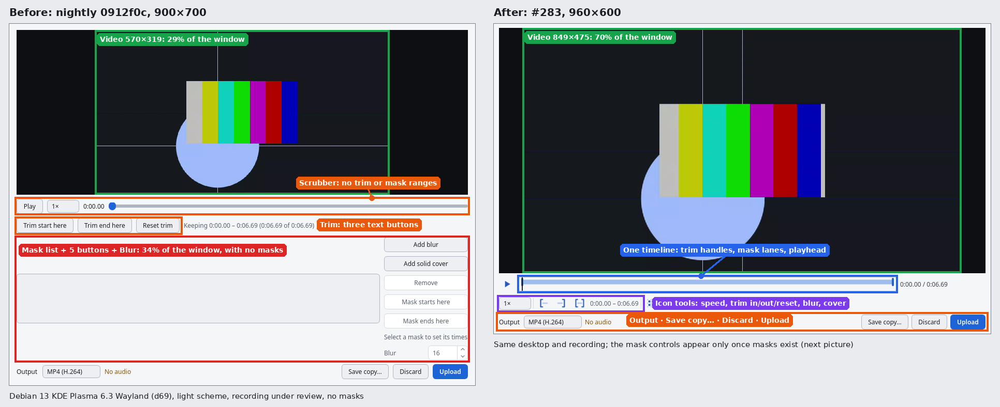
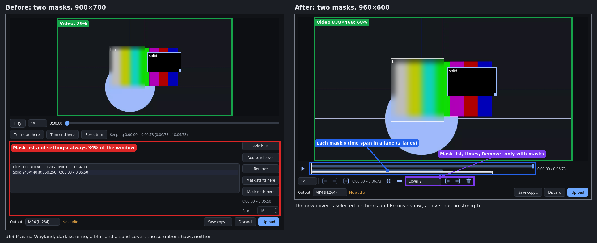
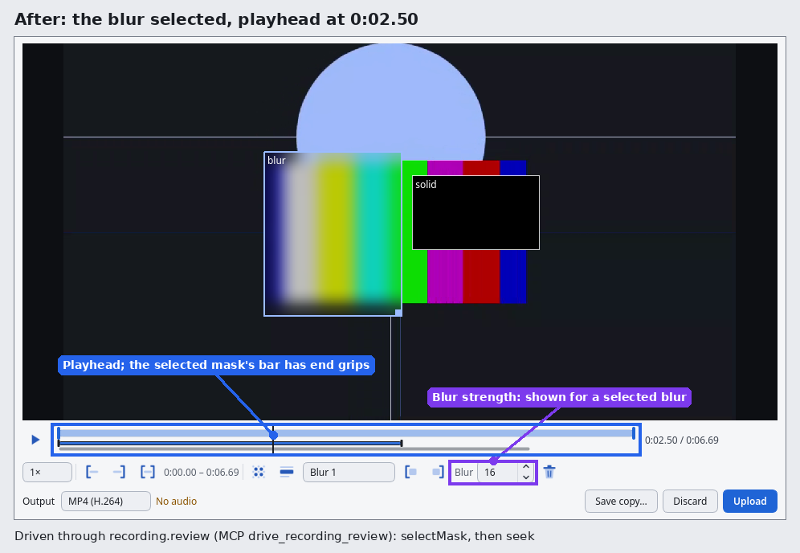
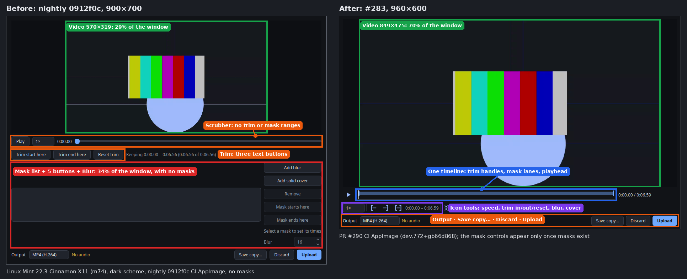
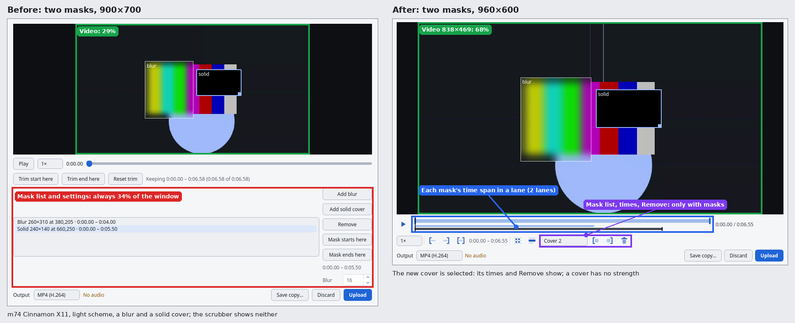

# Review window: the video first, compact tools around it (#283)

Code: [PR #290](https://github.com/patrick-hudson/put.gd-desktop/pull/290)
(branch `claude/review-window-compact-283`, lab builds from `7e34165`).
Before: nightly `0912f0c` (the review window is unchanged on nightly since).
Taken 2026-10-20 22:08–22:38Z under the desktop locks for d69 and m74.

## Result

| | Before (nightly) | After (#283) |
| --- | --- | --- |
| Default window (client area) | 900×700 | 960×600, fits 1366×768 with a panel and title bar |
| Video, no masks | 570×319, **28.9 %** of the window | 849×475, **70.0 %** (window's own inspect: 69.9 %) |
| Video, two masks | 570×319, 28.9 % | 838×469, **68.2 %** (inspect: 68.2 %); the timeline grows a lane |
| Mask list and settings | always 34 % of the window, also with no masks | a list once masks exist; times and Remove for a selected mask; strength for a selected blur |
| Trim | three text buttons, scrubber without ranges | one timeline with trim handles, mask lanes and the playhead; I/O at the playhead |

The video's share is the area of the scaled 1272×712 picture inside the frame
view over the window's client area, measured on the light crops, where the
frame's `#0d0f13` surround stands out from the window
(`d69/measured.json`, `m74/measured.json`). The layout is the same in both schemes
and on both desktops. For the branch build `recording.review inspect`
reports the same rectangle (`video.share` in `*/after-*.json`).

The host driver's own first estimate (`measured.videoShare` inside
`d69/before-light.json`, 14 %) split the frame at the test card's ball and is
wrong; the table uses the surround-based measurement.

## Pictures

Annotated (boxes and arrows mark what changed):

- [d69 Plasma Wayland, light, no masks](annotated/d69-light-empty-before-after.png)
- [d69 Plasma Wayland, dark, two masks](annotated/d69-dark-masks-before-after.png)
- [d69, light, the blur selected and the playhead moved (contextual strength)](annotated/d69-light-selected.png)
- [m74 Cinnamon X11, dark, no masks](annotated/m74-dark-empty-before-after.png)
- [m74 Cinnamon X11, light, two masks](annotated/m74-light-masks-before-after.png)

Unannotated crops: `d69/` and `m74/`, `{before,after}-{dark,light}-{empty,masks}.png`
plus `after-*-selected.png`, with each run's JSON beside them.

## How they were taken

`lab/r283lab.py capture` on each host, from a plain SSH shell, in the desktop
session's display and bus:

- A magenta cover pinned to the output (`cover_player.py`, a scratch copy whose
  pattern pipeline is `lab/cover_player_r283.diff`) with a 1280×720 test card in
  its middle: put.gd's dark surface `#181b21`, a bouncing ball in `#9bbcff` and a
  480×270 scrolling 75 % SMPTE strip. `precheck` confirmed the cover on the
  loopback VNC tile before anything was recorded.
- A private put.gd profile (config, data, state, cache, runtime and archive
  under the run), seeded from `settings.developmentTemplate` with the scheme set,
  then a restart, so no window opens by itself.
- `recording.prepare` (region over the card, inset 4 px), 6.5 s, `stop`; the
  review window opens. Two masks come from `recording.edit` (a blur over the
  strip's left half, a solid cover over its right); for the branch build the
  third view uses `recording.review` (`selectMask`, `seek 2.5 s`).
- The window is placed at (40, 40), kept above and checked for anything above
  it (KWin script `stackingOrder` on d69; `_NET_CLIENT_LIST_STACKING` and
  `xwininfo` on m74). One VNC frame is grabbed in memory and cropped to the
  window's client rectangle. A crop is kept only if every 3 px edge strip is
  at least 90 % the window background, no pixel is cover magenta, and at least
  40 % of its pixels are put.gd colours (both palettes and the frame surround).
  Every kept crop scored 86–96 %. Full frames never left the hosts.

| Host | Desktop | Builds |
| --- | --- | --- |
| d69 | Debian 13, KDE Plasma 6.3 Wayland, 1920×1080 | scratch `cmake --preset dev` builds of `0912f0c` and `7e34165`, with temporary KWin entries for each `putgd-record` (removed, `kbuildsycoca6`) |
| m74 | Linux Mint 22.3, Cinnamon X11, 1920×1080 | CI AppImages `0.1.1-dev.762+g0912f0ce6a5b` (nightly) and `0.1.1-dev.772+gb66d8680c946` (PR #290) |

## End to end through MCP

`lab/r283_mcp_e2e.py` ran the official MCP SDK client against this branch's
`putgd-mcp`, whose `putgd-cli` is d69's production CLI over SSH
(`lab/cli-d69.sh`). The resident's destination was the repository's offline S3
fixture on loopback with its synthetic keys in session mode. Record (9.6 s of
the moving card), then only `drive_recording_review`: `seek 1 s` + `setIn`,
`seek 7 s` + `setOut`, `seek 1.5 s`, `addMask blur`, `addMask solid`,
`selectMask` (the blur), `strength 24`, `seek 5 s` + `setMaskOut`. Then
`preview_recording` (`e2e/e2e-preview-3s.png`), `save_recording_copy` and
`upload_recording`. All 17 checks passed (`e2e/e2e.json`). They cover the
contextual controls (none without masks; the new cover selected with times
and Remove but no strength; strength for the blur), two timeline lanes, trim
1–7 s, the blur's strength and end, a saved copy of 6.000 s, and the upload
completing with a link.

| Clip | `putgd-record --motion` |
| --- | --- |
| Saved copy (trimmed, blur + cover) | 18.323 |
| Uploaded object, fetched from the fixture link (same SHA-256 as the copy) | 18.323 |
| Control: the same card frozen (no ball, strip stopped), same edits | 0.875 |

## Suites

d69: full `ctest` on the `2f29ea3` tree passed 90 of 91. The one failure
was the new `recording_service_integration` case, which caught the reply
overtaking the edit event. After the fix (`e53a0b4`, `7e34165`), the
recording suites (`recording_service`, `recording_helper`, `recording_model`,
`gui_review_window`) passed 4/4 there. The new `gui_review_window` offscreen
suite covers the default size and video share at 1366×768, large text,
contextual mask controls, timeline in/out (handles, I/O, Shift+I/O, Delete,
arrows), icons with names in both schemes, and `recording.review`. CI on PR #290
is green.
