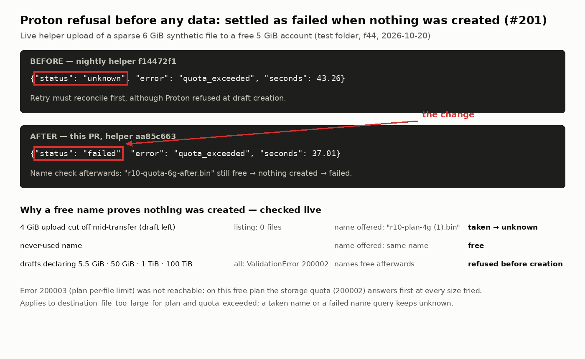
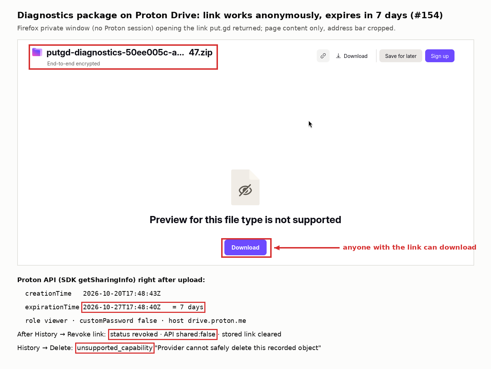
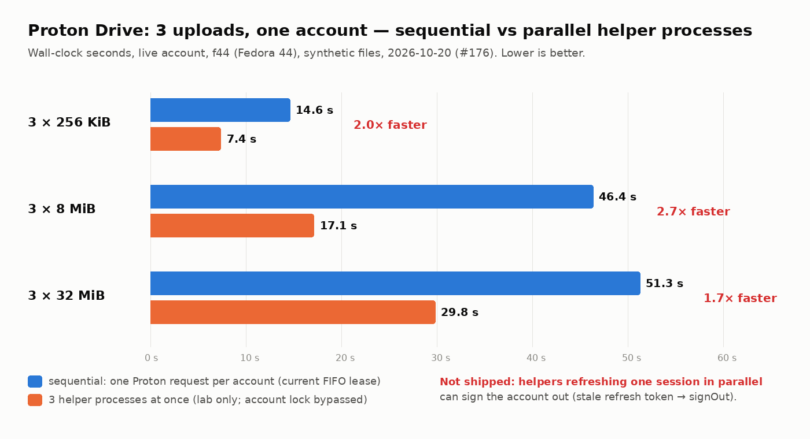

# Round 10: live Proton Drive checks (#201, #154, #176)

2026-10-20, 17:39–17:57Z. Patrick approved live tests in a new folder,
`put.gd-acceptance-round10`, with synthetic files only, and signing in through
the existing Proton web session in Patrick's Firefox on f44 (no password typed).
Code: branch `claude/proton-live-round10` (its pull request links this evidence).

## Setup

- **Host:** f44, Fedora 44 GNOME Wayland, under the f44 desktop lock
  (released `--verified-clean` at 17:56:48Z).
- **Build:** `cmake --preset dev -DPUTGD_BUNDLE_PROTON=ON`, from that branch.
  - Helper `aa85c663…` (`c51ff11b…` before the quota extension).
  - Unchanged nightly reproduced the published helper `f14472f1…` byte for byte on the same host.
- **Profile:** a headless resident (`QT_QPA_PLATFORM=offscreen`) with private XDG directories,
  a private session bus and a private, temporary gnome-keyring. The Proton
  session never reached Patrick's login keyring.
  - Only the sign-in step touched the desktop: put.gd's auth URL went to the running Firefox,
    the existing account was picked on Proton's chooser, and that tab was closed.
- **Account:** a free plan with 5 GiB of Drive storage (`Subscribed: 0`).
- **Driving:** uploads for #201/#176 ran the production helper directly, with the same
  JSON request the app sends. #154 ran through `putgd-cli diagnostics.bundle`.
  A lab-only SDK harness (not shipped) read the account plan, sharing info and name
  availability.
- **Output:** URLs, emails and tokens were redacted from all output.

## #201: plan and quota refusals

| Probe | Result |
| --- | --- |
| Sparse 4 GiB file through the helper (60 s deadline) | Accepted: draft created, data streaming, deadline → `unknown` |
| Name of that interrupted draft | Hidden from the folder listing (0 files), but reported taken (`r10-plan-4g (1).bin` offered) |
| Sparse 6 GiB file, nightly-equivalent helper | `quota_exceeded`, status `unknown`; name still free afterwards |
| Draft creation declaring 5.5 GiB, 50 GiB, 1 TiB, 100 TiB (no data sent) | `ValidationError` **200002** each time; names free afterwards |
| Sparse 6 GiB file, final helper `aa85c663` | `quota_exceeded`, status **`failed`**; name free |

Error 200003 (`MAX_FILE_SIZE_FOR_FREE_USER`) could not be reached on this
account: the storage quota answers first at every size tried. The SDK sends the
intended size with draft creation, so Proton refuses before any data or node
exists. The helper now checks, after a plan or quota refusal, whether the
candidate name is still free. Unfinished drafts hold names, as the 4 GiB row
shows, so a free name proves nothing was created.

## #154: diagnostics share link

- **Upload:** `diagnostics.bundle {"upload":true,"profileId":"r10-proton"}` uploaded
  `putgd-diagnostics-<uuid>.zip` in 15 s and returned a `drive.proton.me` link.
  `diagnostics.uploadTarget` reported `shareExpirationDays: 7`.
- **Expiry:** Proton's sharing info gave
  `creationTime` 2026-10-20T17:48:43Z and `expirationTime` 2026-10-27T17:48:40Z:
  7 days, computed when the request was sent.
- **Anonymous access:** a Firefox private window with no Proton session opened the
  link and showed the file with Download.
- **Revoke:** History → Revoke link reported `revoked`; Proton then reported no link.
- **Delete:** History deletion is refused for Proton (`unsupported_capability`), as
  for every Proton upload; docs/diagnostics.md now says so.
- **Follow-up:** put.gd does not show the confirmed expiry anywhere (#253).

## #176: concurrent uploads for one account

Raw rows: [176-bench.jsonl](176-bench.jsonl). Each row is the wall time for 3
uploads of the same size into the test folder.

| Files | One at a time | 3 helpers in parallel | Speed-up |
| --- | --- | --- | --- |
| 3 × 256 KiB | 14.6 s | 7.4 s | 2.0× |
| 3 × 8 MiB | 46.4 s | 17.1 s | 2.7× |
| 3 × 32 MiB | 51.3 s | 29.8 s | 1.7× |

**Why parallel is faster:** each helper spends several seconds on setup, and a
single upload does not fill the uplink (about 2 MiB/s alone, about 3.2 MiB/s for
three).

**Why it is not enabled:**
- The upstream account code deduplicates token refresh only inside one process
  (`ApiClient.activeRefreshPromise`).
- Separate helpers each hold their own copy of the refresh token.
- If one helper refreshes and another later refreshes with the stale token,
  Proton refuses it and `performTokenRefresh` calls `credentials.signOut()`.
  That removes the keychain entry and disconnects the account.
- The lab runs were short enough that no refresh happened.

#176 stays open, narrowed to coordinating refresh across helpers, or one
multiplexed helper, before `maximumConcurrentRequests` can rise.

## Found on the way

- #252: a Secret Service without a `login` collection makes Connect fail as a
  generic `operation_failed`; `Bun.secrets` writes to `/collection/login`.

## Cleanup

- **Test folder:** moved to Proton's Trash, with all 19 files and the interrupted
  draft. My files no longer lists it, and Trash lists only that folder from this run.
  Permanent deletion from Trash is left to Patrick.
- **Lab session:** ended on the server (`DELETE /auth/v4` → 200) and its local
  keychain entry cleared.
- **Lab profile:** keyring, bus and resident stopped by exact PID, and the private
  directories removed.
- **Firefox:** only the tabs and the private window opened for this run were
  closed; the window was restored to its earlier size and position.
