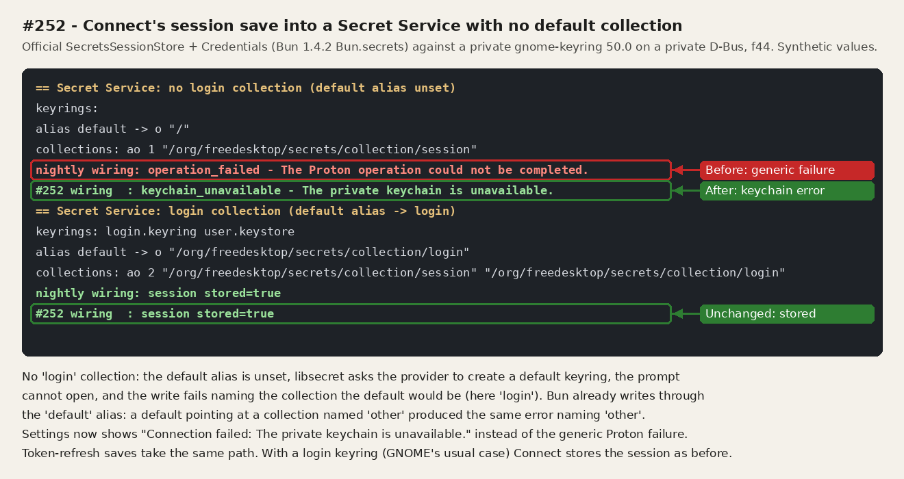
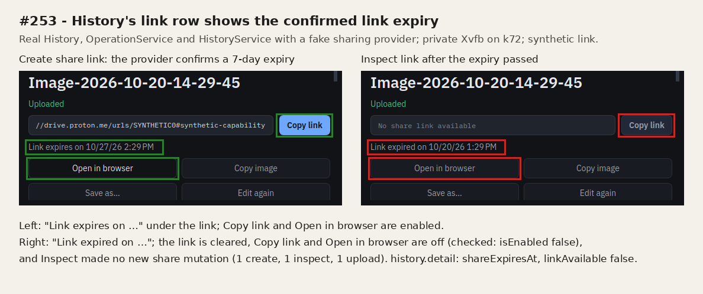

# Round 11: Proton keychain save and link expiry (#252, #253)

2026-10-20. Code: pull request #266, branch `claude/proton-keyring-link-expiry-r11`
(head d26026d). No live Proton account was used.

## #252: a Secret Service without a default collection

- **Host:** f44 (Fedora 44), over SSH, with no display.
- **Keyring:** a private gnome-keyring 50.0 (`--components=secrets`) on a private
  D-Bus (`dbus-run-session`) with private XDG directories. The values were synthetic.
- **Probe:** the official `SecretsSessionStore` and `Credentials` from the pinned CLI
  sources, run with the provisioned Bun 1.4.2. It made the two saves Connect makes,
  first with nightly's wiring, then with the `saveToKeychain` wrapper. The error went
  through `serviceFailure(error, 'operation_failed')`, as `run()` does for Connect.
  Output: [252-keyring-probe.txt](252-keyring-probe.txt).
- **No default collection** (`ReadAlias default` → `/`): libsecret asked the provider to
  create a default keyring. The prompter could not open, and the write failed naming
  `collection/login`.
  - Nightly reported `operation_failed`; the fix reports `keychain_unavailable`.
  - When the keyring's `default` file named a missing `other` collection, the error
    named `collection/other`. Bun stores through the `default` alias, not a fixed `login` path.
- **With a login collection:** both wirings stored the session.
- **Not tested:** KWallet and KeePassXC Secret Services.

## #253: History's link row shows the confirmed expiry

- **Host:** k72 (Kubuntu 26.04), in a private Xvfb with private XDG directories and a
  private session bus. Each picture is `QWidget::grab()` of put.gd's own window only.
  The program checked the expiry label, link and button states before saving.
- **Setup:** a scratch program (not committed) ran the real `OperationService`,
  `HistoryService` and `MainWindow` on History, with a fake sharing provider. The
  upload was synthetic; Create share link returned a 7-day expiry.
  - Inspect link then returned `private` with an expiry an hour in the past.
- **After Inspect:**
  - The row says "Link expired on …".
  - Copy link and Open in browser are disabled (`isEnabled()` false).
  - `history.detail` has `shareExpiresAt` and `linkAvailable: false`.
  - The provider saw one create, one inspect and one upload.
- Uncropped captures: [expires](history-link-expires.png), [expired](history-link-expired.png).

## Tests

- **k72, `ctest`:** `history_contract`, `operations_contract`, `gui_history_view`,
  `proton_contract`, `proton_transport` and `diagnostics_*` pass. Build without the
  Proton bundle; private XDG directories and session bus.
- **k72, MCP integration suite:** 5 tests pass.
- **f44, helper provisioning:** 45 bun tests pass.
  - The helper built from nightly reproduced `aa85c663…` exactly.
  - The new helper is `e93b3b520d20a19e37569c7a97a1680f47bc43fcb5acaf6a5d69fa660e0a34b0`.
