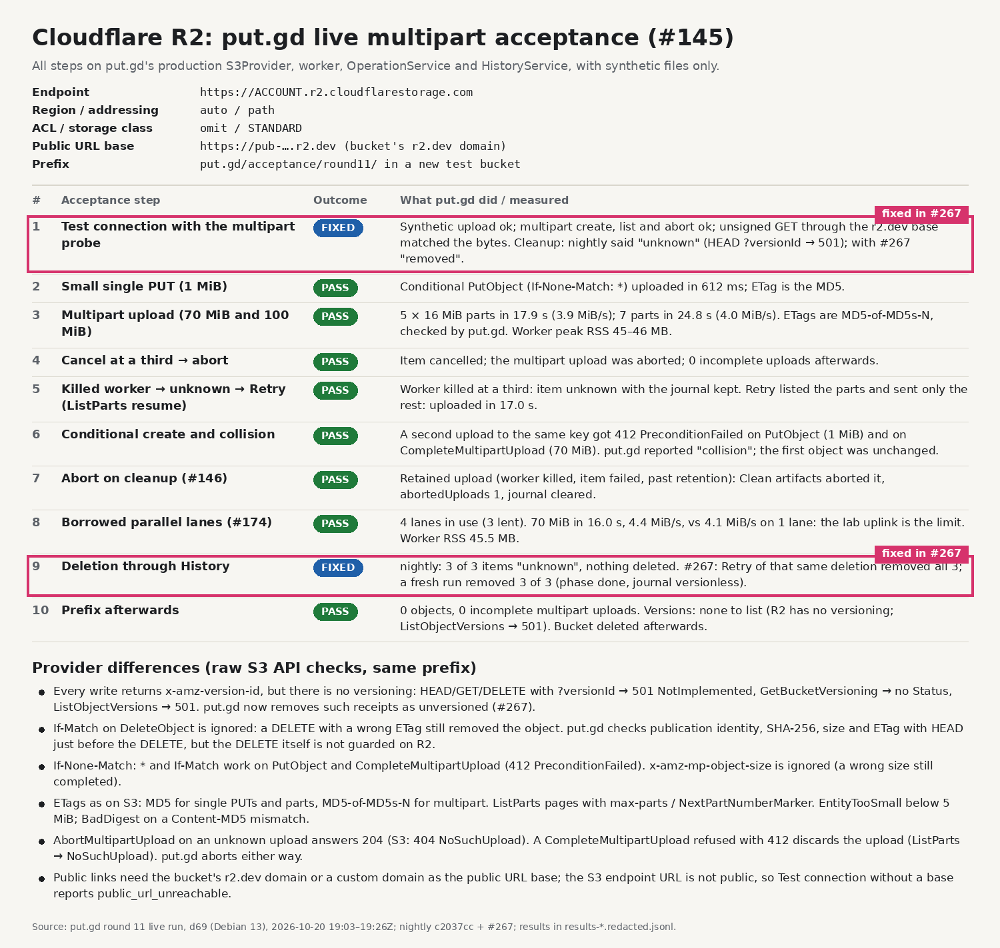
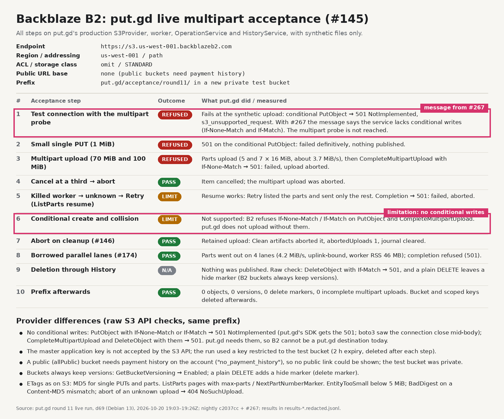
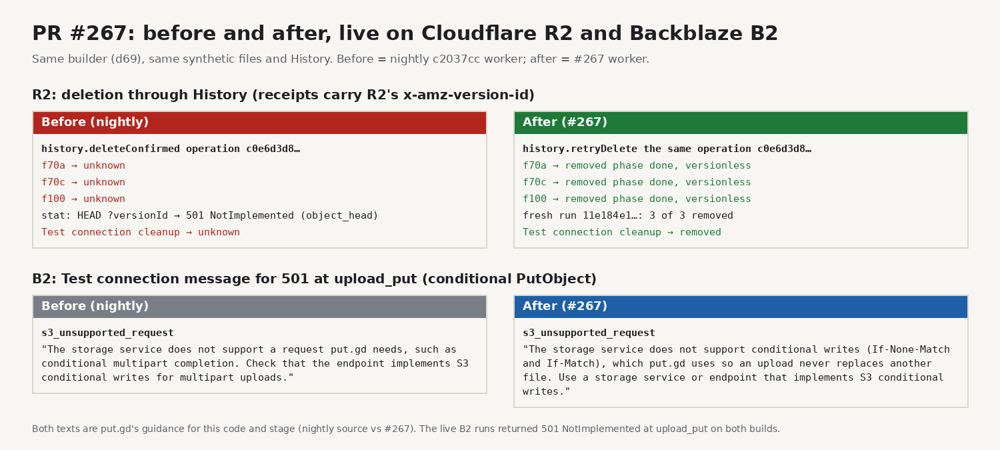
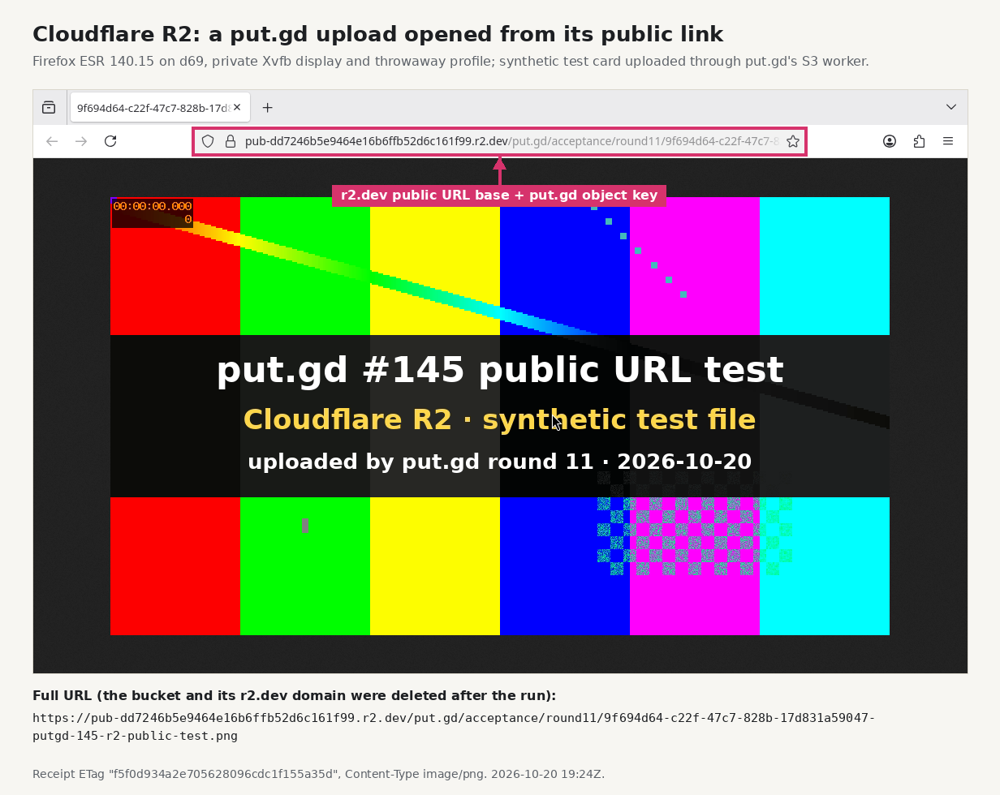

# Round 11: live multipart acceptance on Cloudflare R2 and Backblaze B2 (#145)

This closes #145. AWS S3 passed in rounds 6–8 (the #150 comment and
[round 8 storage](../2026-10-20-round8-storage/README.md)). This run repeats the same
steps against Cloudflare R2 and Backblaze B2's S3-compatible APIs. It found one put.gd
defect (R2 deletion), fixed in #267, and one provider limitation (B2 has no
conditional writes), documented in [s3.md](../../s3.md#s3-compatible-services).

- **Builder:** d69 (Debian 13, 4 cores), headless. Offscreen Qt, private XDG
  directories, D-Bus disabled. No desktop lock was needed.
- **Build:** `dev` preset, nightly `c2037cc` in a scratch tree, then nightly + #267
  (`4f1c72a`).
- **When:** 2026-10-20, 19:03–19:26Z.
- **Destinations:** new test buckets created for this run with Patrick's approval,
  prefix `put.gd/acceptance/round11/`, synthetic AES-CTR files and a synthetic PNG
  test card only. Both buckets, the R2 bucket's r2.dev domain and every scoped B2
  key were deleted afterwards.
- **Keys:** read from `~/Documents/creds.txt` on d69 into memory and handed to the
  probes on stdin. They were never printed, logged or copied.

## Results

| Step | AWS S3 (rounds 6–8) | Cloudflare R2 | Backblaze B2 |
| --- | --- | --- | --- |
| Test connection, with the multipart probe | ok | ok; cleanup `removed` with #267 (nightly: `unknown`) | fails: 501 on the conditional PUT (`s3_unsupported_request`) |
| Small single PUT | ok | ok, 1 MiB in 612 ms | refused (501) |
| Multipart upload (70 MiB, 100 MiB) | ok | ok, 3.9–4.0 MiB/s, MD5-of-MD5s-N ETags | parts sent, completion refused (501), aborted |
| Cancel at a third → abort | ok | ok | ok |
| Killed worker → unknown → Retry (ListParts resume) | ok | ok, resumed in 17.0 s | resume ok, completion refused (501) |
| Conditional create and collision | ok | 412 → `collision` (single PUT and multipart) | not supported (501) |
| Abort on cleanup (#146) | ok | `abortedUploads: 1` | `abortedUploads: 1` |
| Borrowed parallel lanes (#174) | 4.4 MiB/s | 4 lanes, 4.4 vs 4.1 MiB/s (uplink-bound) | 4 lanes for the parts |
| Deletion through History | ok | 3/3 `removed` with #267 (nightly: 3/3 `unknown`) | nothing to delete |
| Prefix afterwards | empty | 0 objects, 0 incomplete uploads (no versioning) | 0 objects, 0 versions, 0 incomplete uploads |

Upload rates are limited by the lab uplink (about 4 MiB/s), as they were on AWS.

### Provider settings

| | Cloudflare R2 | Backblaze B2 |
| --- | --- | --- |
| Endpoint | `https://<account-id>.r2.cloudflarestorage.com` | `https://s3.<region>.backblazeb2.com` (here `us-west-001`) |
| Region | `auto` | the endpoint's region, e.g. `us-west-001` |
| Addressing | path (tested) | path (tested) |
| ACL mode | `omit` | `omit` |
| Storage class | `STANDARD` | `STANDARD` |
| Public URL base | the bucket's `https://pub-….r2.dev` domain or a custom domain | `https://f00N.backblazeb2.com/file/<bucket>` for a public bucket (not testable here) |
| Credentials | R2 API token's S3 access key pair | an application key; the master key is refused by the S3 API |

### Differences from AWS S3

Raw S3 API checks with boto3 1.37.9 (`compat.py raw`), with checksums sent only when
required, as put.gd does:

| Behaviour | AWS S3 (documented) | Cloudflare R2 | Backblaze B2 |
| --- | --- | --- | --- |
| `If-None-Match: *` on PutObject | 412 on an existing key | 412 | 501 NotImplemented |
| `If-Match` on PutObject | 412 on a mismatch | 412 | 501 NotImplemented |
| `If-None-Match` on CompleteMultipartUpload | 412 | 412; the upload is then discarded | 501 NotImplemented |
| `If-Match` on DeleteObject | 412 on a mismatch | **ignored**: a wrong ETag still deletes | 501 NotImplemented |
| `x-amz-mp-object-size` | checked | ignored | not tested alone (501 together with the condition) |
| ETag, single PUT / part / multipart | MD5 / MD5 / MD5-of-MD5s-N | same | MD5 / MD5 / not reached |
| ListParts paging (`max-parts=1`) | `NextPartNumberMarker` | same | same |
| Minimum part size | 5 MiB (`EntityTooSmall`) | same | same |
| Content-MD5 mismatch | `BadDigest` | same | same |
| Abort an unknown upload | 404 `NoSuchUpload` | 204 | 404 `NoSuchUpload` |
| Version ID on writes | only when versioning is on | always, but no versioning | yes (buckets always keep versions) |
| HEAD/DELETE with `versionId` | supported | 501 NotImplemented | DELETE supported (HEAD not tested) |
| GetBucketVersioning | Enabled / Suspended / none | none | Enabled |
| ListObjectVersions | supported | 501 NotImplemented | supported |
| Missing object HEAD | 404 (with ListBucket) | 404 | 404 |

Where boto3 sends a conditional PutObject, B2 drops the connection mid-body. put.gd's
SDK (libcurl) receives the 501, so put.gd reports a definite failure, not an
unknown outcome.

## The fix: #267

- **R2 deletion.** R2 returns an `x-amz-version-id` on every write, so put.gd's
  receipts recorded one. Deletion then treated the object as an immutable version:
  HEAD `?versionId=` got 501, and every History deletion ended `unknown`. With #267,
  when that HEAD gets 501 and the bucket has never had versioning, `stat` and delete
  handle the receipt as unversioned. The deletion journal records `versionless`.
  The same History deletion (`c0e6d3d8…`), retried with #267, removed all three
  objects. A fresh run (`11e184e1…`) removed 3 of 3.
- **B2 guidance.** A 501 at `upload_put` or `upload_complete` now says that the
  service lacks conditional writes.

## Public link (R2)

A synthetic PNG test card was uploaded through put.gd's S3 worker with the bucket's
r2.dev domain as the public URL base. It was then opened from the receipt's URL in
Firefox ESR 140.15, in a private Xvfb display with a throwaway profile. The whole
display belonged to this run. After cleanup the URL returns 404.

B2 has no public-link picture. A public (`allPublic`) bucket needs payment history
on the account (`no_payment_history`), and put.gd can't upload to B2 anyway.

## Cleanup receipts

- R2: the History deletions removed every object uploaded through History. The scratch upload probe does
  not record History, so `compat.py r2 purge` removed its 6 objects plus 3 Test
  connection files from the pre-fix runs (cleanup `unknown`). After that: 0 objects and
  0 incomplete uploads. Then the r2.dev domain was disabled and the bucket deleted.
- B2: nothing was published. 0 objects, 0 versions, 0 delete markers and 0 incomplete
  uploads, then the bucket was deleted. Every scoped key was deleted after its step,
  and `b2_list_keys` and `b2_list_buckets` both came back empty.
- d69: `/home/patrick/work/put.gd-r11compat` (scratch tree, synthetic files, Xvfb
  profile) was removed after this evidence was copied.

## Files

- `results-r2.jsonl` and `results-b2.jsonl` hold every step's JSON line. The R2
  account ID is replaced by `ACCOUNT`, the B2 bucket ID by `BUCKETID`. No key
  material was ever in them.
- `compat.py` is the driver. It creates the buckets, runs the raw checks, starts the
  probes with keys on stdin, then verifies, purges and tears down.
- `scratch-probes.diff` shows the scratch variants of
  `tests/performance/s3_upload_probe.cpp` and `s3_live_probe.cpp`. They differ in
  three ways: settings and keys come on stdin, collision skips the moto-only marker,
  and there is a `--delete-existing` retry mode. They are not committed as tests.
