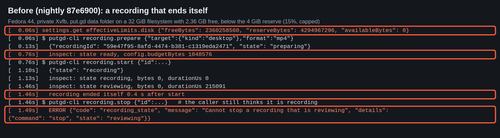
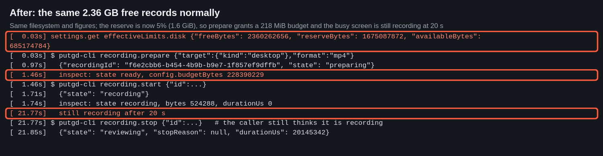
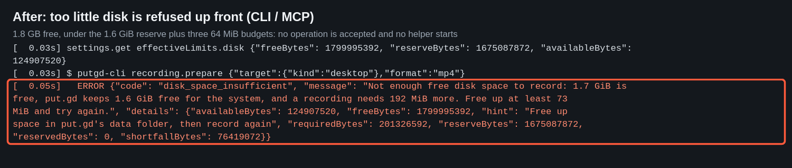
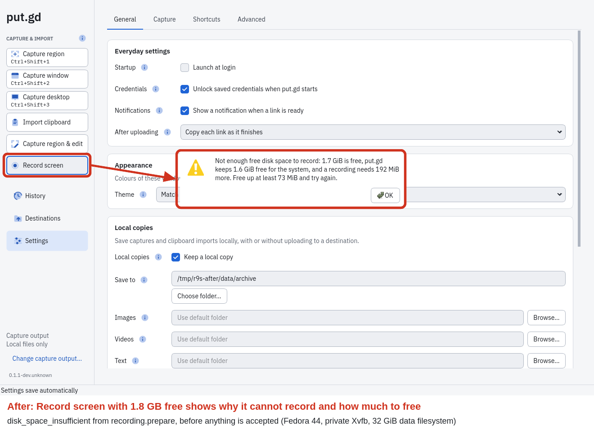
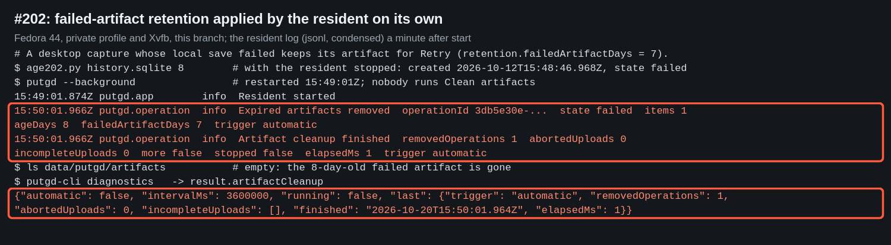
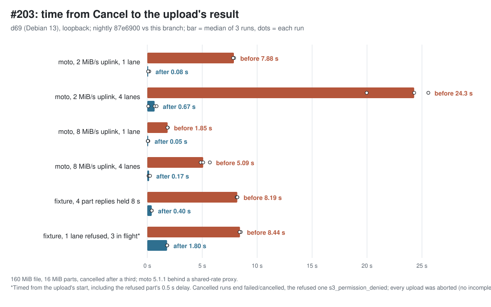

# Round 9 storage follow-ups (#202, #203, #213)

Evidence for the code pull request #227 (branch
`claude/storage-followups-202-203-213`, head `c2a25fb`, based on nightly
`87e6900`). "Before" is nightly `87e6900`; "after" is that branch.

Scratch trees on the builders were plain copies of the sources (no `.git`),
so the builds report `0.1.1-dev.unknown`. One exception: for the before
measurements, the nightly tree on d69 also got this branch's
`tests/performance/s3_upload_probe.cpp` (which adds `cancelLatencyMs`) and
`tests/integration/test_s3_multipart.cpp` (the new #203 tests). Neither file
changes the product.

## Verification

- d69 (Debian 13), headless (`QT_QPA_PLATFORM=offscreen`, no display or
  session bus, private XDG directories): the full suite passed, 89/89 tests
  (`ctest` in the dev preset's build tree).
- The new tests: `operations_contract`
  (`automaticCleanupAppliesRetentionWithoutTheUser`),
  `recording_service_integration`
  (`lowDiskRefusesPrepareAndBudgetStopAnswersStop`), `payload_contract`
  (reserve figures), and `s3_multipart_integration` (`cancelCutsPartsInFlight`,
  `failedLaneCutsThePartsInFlight`, `cutPartIsSentAgainOnRetry`).

## #213: low-disk recording

f44 (Fedora 44). Each variant ran on its own private Xvfb display (`:93`, `:94`)
with private XDG directories and `dbus-run-session`. put.gd's data folder was a
32 GiB ext4 loop filesystem (`-m 0`), filled with `fallocate` to the lab
guest's figure from #213: 2,360,406,016 bytes free. A videotestsrc noise
pattern kept the screen busy. Driver: `scripts/disk213.sh`, `scripts/drive213.py`,
`scripts/setup213.py`. Local copies went to the loop filesystem.

| Image | What it shows |
| --- | --- |
|  | **Before:** a 4 GiB reserve (15%, capped) leaves `availableBytes: 0`. `prepare` still reaches `ready` with a 1 MiB budget, the clip ends itself 0.4 s after `start`, and the caller's `stop` fails with `recording_state` ([transcript](213-before-transcript.txt)). |
|  | **After, same figures:** the reserve is 5% (1.6 GiB). `prepare` grants a 218 MiB budget, and the noise-pattern recording is still running at 20 s ([transcript](213-after-lab-transcript.txt)). |
|  | **After, 1.8 GB free:** `recording.prepare` answers `disk_space_insufficient` with free, reserve, required and shortfall figures. No operation is accepted ([transcript](213-after-refused-transcript.txt)). |
|  | **After, UI:** Record screen in the main window shows the same message. The capture is of the private Xvfb display, cropped to put.gd's own window. |

## #202: automatic artifact cleanup

f44, same private setup, data folder with 10 GB free.

1. A desktop capture whose local save failed (a read-only archive folder) kept
   its artifact for Retry.
2. With the resident stopped, `scripts/age202.py` moved the operation's
   `created` back 8 days. `retention.failedArtifactDays` is 7.
3. Restarted the resident and touched nothing else.

Sixty seconds after start, the automatic pass removed the artifact and logged
it. `diagnostics.artifactCleanup` reports the pass.

The raw log lines are in [202-resident-log-lines.jsonl](202-resident-log-lines.jsonl).
The multipart abort on an expired item (#146) is covered by the operations test.

## #203: cancel latency

d69, loopback only, synthetic credentials and a synthetic 160 MiB file
(16 MiB parts). moto 5.1.1 (`moto_server`) sat behind `scripts/throttle_proxy.py`,
which caps the client-to-server rate shared by all connections (2 or 8 MiB/s,
like a slow uplink). `s3_upload_probe ... cancel 0 LANES` cancels after a third
of the bytes. The probe reports `cancelLatencyMs`: the time from the
cancellation to the provider's result, including the abort. Runner:
`scripts/run_cancel.py`; data: [203-moto-cancel-latency.jsonl](203-moto-cancel-latency.jsonl).
The fixture rows come from the new tests run against both builds
([before](203-fixture-before.txt), [after](203-fixture-after.txt)).

| Case (median of 3) | Before | After |
| --- | --- | --- |
| moto, 2 MiB/s, 1 lane | 7.88 s | 0.08 s |
| moto, 2 MiB/s, 4 lanes | 24.3 s | 0.67 s |
| moto, 8 MiB/s, 1 lane | 1.85 s | 0.05 s |
| moto, 8 MiB/s, 4 lanes | 5.09 s | 0.17 s |
| fixture, 4 part replies held 8 s | 8.19 s | 0.40 s |
| fixture, 1 lane refused, 3 in flight (from upload start) | 8.44 s | 1.80 s |

Every cancelled run ended `failed`/`cancelled` with its upload aborted
(`incompleteUpload: false`). None became `unknown`.

## Lab state afterwards

- d69 and f44: no processes, mounts or temp directories left from these runs.
- Scratch trees `/home/patrick/work/put.gd-r9storage{,-base}` on both hosts are
  removed after the merge.
- Nothing was installed.

## Follow-ups

- #225: tell the user when a recording stopped on its byte budget mid-capture.
- #226: notify when automatic cleanup can't abort retained multipart uploads.
