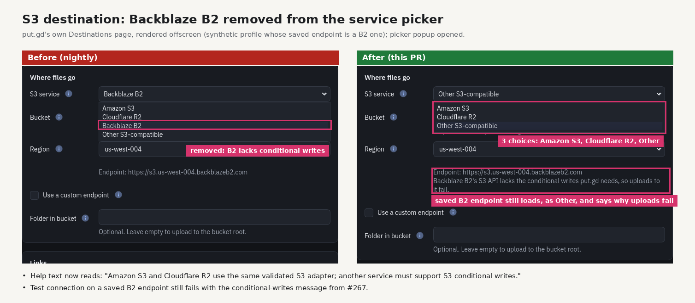

# S3 destination: Backblaze B2 removed from the service picker (2026-10-20)

Backblaze B2's S3 API has no conditional writes (#145), so the S3 destination can't
upload there. Settings no longer offers it in the S3 service picker.

- **Picker:** offers Amazon S3, Cloudflare R2 and Other S3-compatible.
- **Help text:** "Amazon S3 and Cloudflare R2 use the same validated S3 adapter;
  another service must support S3 conditional writes."
- **Saved B2 profiles:** a saved profile with a `backblazeb2.com` endpoint still
  loads and validates, and shows as "Other S3-compatible". Its endpoint hint adds:
  "Backblaze B2's S3 API lacks the conditional writes put.gd needs, so uploads to it
  fail." Test connection still fails with the conditional-writes message from #267.

Pictures: put.gd's own Destinations page, rendered offscreen on d69 (Debian 13,
Qt 6.8.2) from a synthetic profile, with the picker popup opened. Before is nightly
`1305cdb`; after is the code PR. No desktop content is involved.
`SettingsGui::s3ServicePickerOmitsBackblazeAndExplainsSavedB2Endpoint` checks the
same behaviour, and the full `gui_settings` suite passes (76/76).
