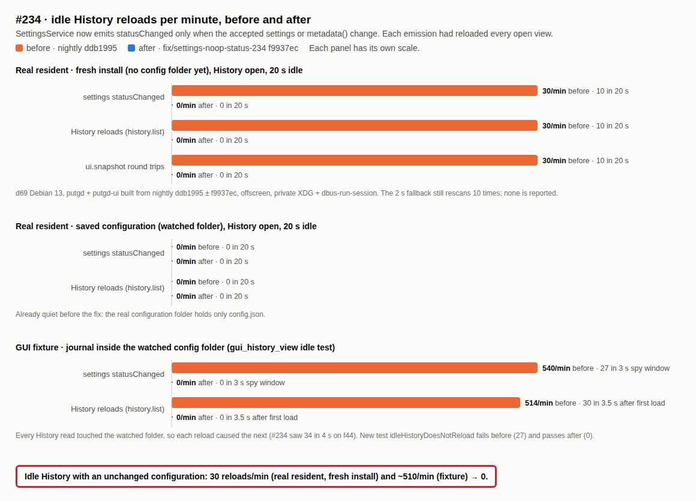

# Idle History reloads from unchanged settings rescans (#234), 2026-10-20

`SettingsService::statusChanged` fired after every configuration rescan, even
when nothing changed. The resident forwards it to `UiProcessController::invalidate`,
so each emission refreshed every open view. History re-ran `ui.snapshot`,
`history.list`, `operation.recent` and `history.detail`. statusChanged now fires
only when the settings were accepted or `metadata()` changed
([configuration](../../configuration.md)).

Measured on d69 (Debian 13), a scratch build of nightly ddb1995 before and with
the fix, with temporary log lines on the watcher, the emission and the resident's
`history.list`/`ui.snapshot`/`operation.recent`/`history.detail` dispatch (not committed).

| Case | Before | After |
| --- | --- | --- |
| Real `putgd` + `putgd-ui`, fresh install (no `~/.config/putgd` yet, so `watching` is false), History open, 20 s idle | 10 `statusChanged`, 10 `history.list`, 10 `ui.snapshot` | 0, 0, 0 (the fallback still rescans 10 times) |
| Real resident, saved configuration (watched folder), History open, 20 s idle | 0 | 0 |
| `gui_history_view` `idleHistoryDoesNotReload`, 3 s spy window | 27 `statusChanged`; 30 `history.list` in the 3.5 s after the first load | 0; 0 |

The real resident ran offscreen with private XDG directories under
`dbus-run-session`. The GUI fixture keeps the journal (`data/`) inside the
watched configuration folder. Every History read touched that folder, and the
watcher's rescan emitted again, which looped. #234 saw that loop on f44 (34
emissions in 4 s). The real configuration folder holds only `config.json`, so a
saved configuration was already quiet. The fresh-install case, at one reload
every 2 s, is the one users had.

The `missingPreviewIsMadeOnSelection` test (#190) relied on those reloads; it now
reloads History every 150 ms on purpose. On d69 the related ctest set (`settings`,
`history`, `ui_`, `local_ipc`, `split`, `operation`: 18 tests) passes.
