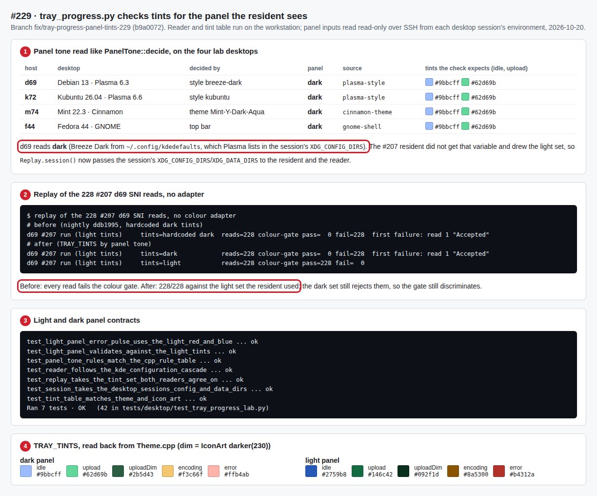

# Tray tints by panel tone in tray_progress.py (#229), 2026-10-20

`tools/lab/tray_progress.py` `check_tooltip` assumed the dark-panel tray tints, so
a correct light-panel icon failed the first non-idle read. The replay now picks
`TRAY_TINTS['light']` or `['dark']` from the panel tone it reads like `PanelTone`
(in the resident's own environment), cross-checks put.gd's `diagnostics.trayTint`,
and checks every read against that set. See
[Replay tray progress](../../testing-tray-progress.md).

1. **The lab desktops.** The reader (`PANEL_READER`) ran over SSH in each
   desktop shell's environment (`plasmashell`, `cinnamon`, `gnome-shell`),
   read-only. All four panels are dark today: d69 Breeze Dark (`plasma-style`),
   k72 Kubuntu (`plasma-style`), m74 Mint-Y-Dark-Aqua (`cinnamon-theme`), f44
   GNOME (`gnome-shell`). d69's style comes from `~/.config/kdedefaults`, which
   Plasma lists in the session's `XDG_CONFIG_DIRS`. The #207 driver gave its
   resident no `XDG_CONFIG_DIRS`, so that resident tinted for Plasma's light
   default. The replay now exports the session's `XDG_CONFIG_DIRS` and
   `XDG_DATA_DIRS`. Only the decision was kept from these reads, not the files.
2. **Replay of the 228 #207 d69 reads** ([`replay207.py`](replay207.py), run as
   `python3 replay207.py <checkout>`): with nightly ddb1995's hardcoded dark tints
   all 228 fail the colour gate, from read 1. With the light set the resident used,
   228/228 pass; the dark set still rejects them. Text and counter checks need
   the full production rows the #207 log did not keep, so only the colour gate is
   replayed.
3. **Contracts** (`tests/desktop/test_tray_progress_lab.py`, 42 tests): the light
   set passes idle, upload, completion and error-pulse reads and the dark set
   fails them; the KDE cascade (user, `kdedefaults`, `XDG_CONFIG_DIRS`, style
   colours), the C++ rule rows from `tests/gui/test_theme.cpp`, the
   `ui.snapshot` agreement and the session directories.
4. **The tint table** is read back from `src/ui/Theme.cpp`; the dim remainders
   are `IconArt`'s `darker(230)` of the upload tint.

No native tray run was repeated for this change: no lab desktop has a light
panel today, and the #207 reads already hold real light-set SNI frames.
