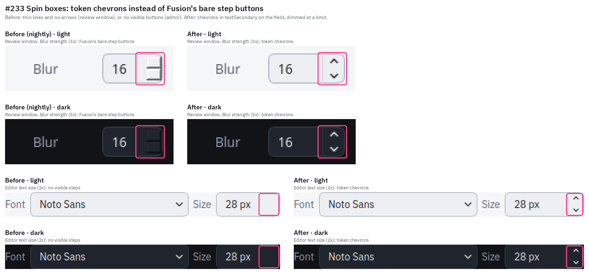
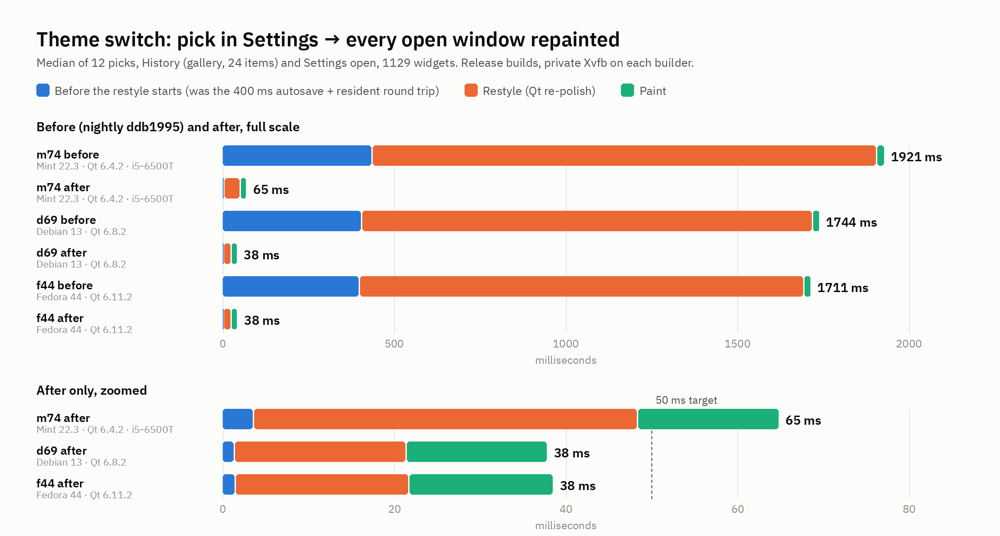
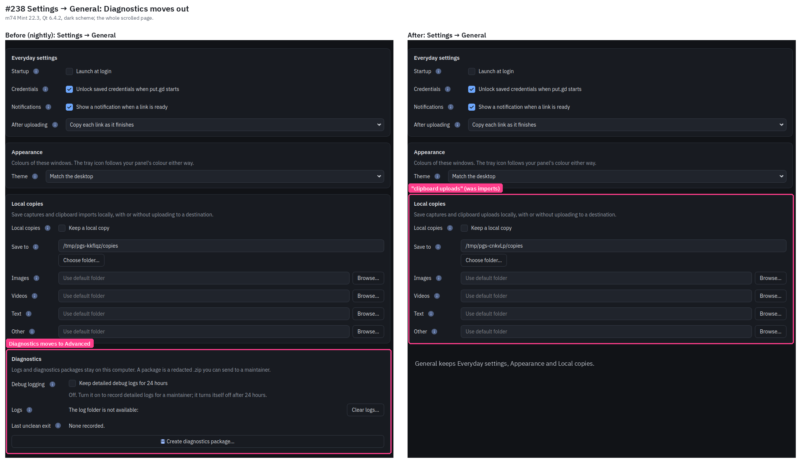
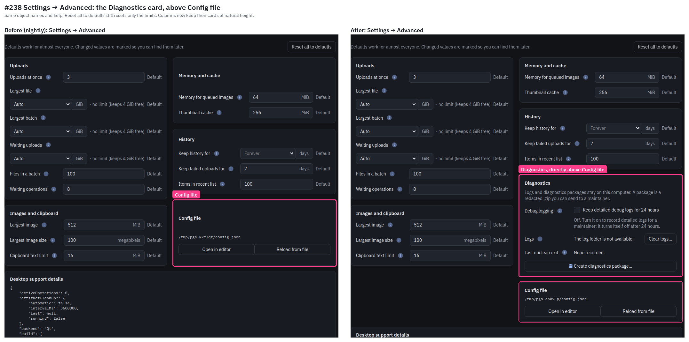
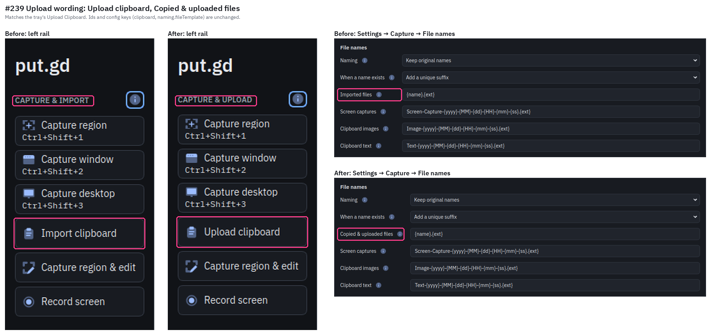

# Settings and UI polish: spin boxes, instant theme switch, Diagnostics placement, upload wording

Issues #233, #237, #238 and #239; code PR on branch
`claude/ui-theme-switch-r10`, measured against nightly `ddb1995`.

Every picture here is a grab of put.gd's own windows (`QWidget::grab`) from a
synthetic profile under a private Xvfb on the builders (private `XDG_*`
directories and runtime directory, no session bus). No physical desktop and
no lab-desktop capture was used. The callouts were drawn with PIL.

## #233 Spin boxes

On nightly the review window's Blur box (d69, Qt 6.8.2; the #198 pictures
showed the same on m74, Qt 6.4.2) drew Fusion's bare step buttons, thin
lines with no arrows. The editor's text size box drew no visible buttons at
all. Both now draw chevrons painted from `textSecondary` (dimmed in
`textDisabled` at a limit or when disabled) on the themed field, with a
`border` divider. `gui_theme` (`spinBoxStepsUseTokenChevrons`) checks the
chevron pixels and the field colour in both schemes. The three spin boxes in
the app are the review window's Blur box (its own stylesheet), the editor's
text size and Settings' Proton link expiration, which both use the redesign
stylesheet.

## #237 Theme switch timing

Measured with `putgd-bench-theme-switch` (`tests/performance/bench_theme_switch.cpp`),
release builds. It opens the production `UiApplicationController` with an
in-process resident, puts History in gallery view (24 synthetic captures) and
shows Settings → General, for 1129 widgets. It then picks Light and Dark in
Appearance 12 times and times each pick until every visible window has
repainted. Raw results are in [timing/](timing/).

| Host | Qt | Before: pick → repainted (median / max) | After | Before: restyle | After: restyle |
| --- | --- | --- | --- | --- | --- |
| m74 Mint 22.3, i5-6500T | 6.4.2 | 1921 / 1966 ms | 65 / 67 ms | 1468 ms | 45 ms |
| d69 Debian 13 | 6.8.2 | 1744 / 1807 ms | 38 / 38 ms | 1312 ms | 20 ms |
| f44 Fedora 44 | 6.11.2 | 1711 / 1746 ms | 38 / 39 ms | 1294 ms | 20 ms |

The same runs on the physical desktop sessions: the session's own display,
private XDG directories, no session bus, under a desktop lock, with only the
synthetic put.gd window on screen. Raw results are `timing/*-session-*.json`.

| Desktop | Qt platform | Before (median / max) | After (median / max) |
| --- | --- | --- | --- |
| m74 Cinnamon X11 | xcb, Qt 6.4.2 | 1670 / 1696 ms | 64 / 67 ms |
| f44 GNOME 50 Wayland | wayland, Qt 6.11.2 | 1731 / 1793 ms | 39 / 44 ms |
| d69 Plasma 6.3 Wayland | wayland, Qt 6.8.2 | 1723 / 1776 ms | 38 / 39 ms |

The time went to two places:

- **Waiting, about 400 ms.** The theme applied only after the 400 ms
  autosave, the resident's accepted revision and the UI following it. A pick
  now applies in the same event (an optimistic preview) and saves at once.
  The resident accepts it one round trip later and passes it to
  `putgd-record` (43 ms on d69, 86 ms on m74 in the in-process run, where the
  resident waits for the restyle). A refused or discarded save puts the
  accepted theme back (`gui_application`,
  `pickedThemeAppliesBeforeTheSaveAndRevertsWhenRefused`).
- **The restyle, 1.3 to 1.5 s.** `QApplication::setStyleSheet` re-polishes
  every widget, and the recursion visits a widget again for each ancestor.
  That cost 0.9 to 1.2 s whatever the stylesheet said: a one-rule sheet cost
  the same. The window's own `setStyleSheet` added 0.2 s. Neither fix the
  issue suggested helps. Prebuilding the strings saves nothing, because the
  cost is the re-polish, not the text. A `palette(role)` reference in a
  stylesheet is resolved when Qt builds the rule, so changing the palette
  later leaves it stale (checked on Qt 6.4.2 and 6.8.2).

What it does now: the application and redesign stylesheets are set once and
hold both schemes' rules, each scoped to a `themeScheme` property that every
widget carries (`VisualStyle::schemeScoped`). Each rule gets the same mark,
so rule order and precedence between stylesheets are unchanged. A switch sets
the palettes and re-polishes only the visible widgets (113 here). A widget
that was hidden at the switch catches up just before it is shown.

Equivalence check: every page (History list and gallery, Destinations, all
four Settings tabs, the per-action exceptions, About) was rendered on d69 by
nightly and by this branch, starting in a scheme or switched into it. The
renders of the same scheme are pixel-identical between nightly and this
branch, except for this change's own edits (rail wording, the Diagnostics
card, File names). A switched render matches a fresh one except for a
2-pixel rail offset, the synthetic temporary paths and the diagnostics text.
Nightly shows those same three differences.

m74's 65 ms is above the 50 ms target. The remaining 45 ms is Qt 6.4's own
re-polish of the 113 visible widgets on a 35 W i5-6500T, and the physical
Cinnamon session measures the same (64 ms). Follow-up #260 tracks it.

## #238 Diagnostics on Advanced

The whole Diagnostics card (debug logging, logs and Clear logs…, last
unclean exit, Create diagnostics package…) moved from General to Advanced,
directly above Config file. Its object names and help are unchanged, and
`ui.diagnostics` now switches to the Advanced tab. Reset all to defaults
still resets only the limits (`gui_settings` checks the placement and that a
reset leaves debug logging on). Both Advanced columns now end in space, so
cards keep their natural height. Before, the shorter column's cards
stretched and their titles floated.

## #239 Upload wording

The clipboard action now says upload, matching the tray's Upload Clipboard:
the rail heading CAPTURE & UPLOAD, **Upload clipboard** and its help,
**Clipboard upload** in the per-action exceptions, **Copied & uploaded
files** in Settings → Capture → File names with its hint, and
uploaded/uploading in the limit and naming help. A failed clipboard action
in History reads "Upload failed". Action id `clipboard`,
`naming.fileTemplate` and every config key are unchanged.

## Suites

On m74 (Qt 6.4.2) all seven `gui_*` suites pass: `gui_editor_window`,
`gui_application`, `gui_theme`, `gui_tray`, `gui_version`, `gui_settings` and
`gui_history_view`. On d69 (Qt 6.8.2) all `gui_*` suites pass too.
