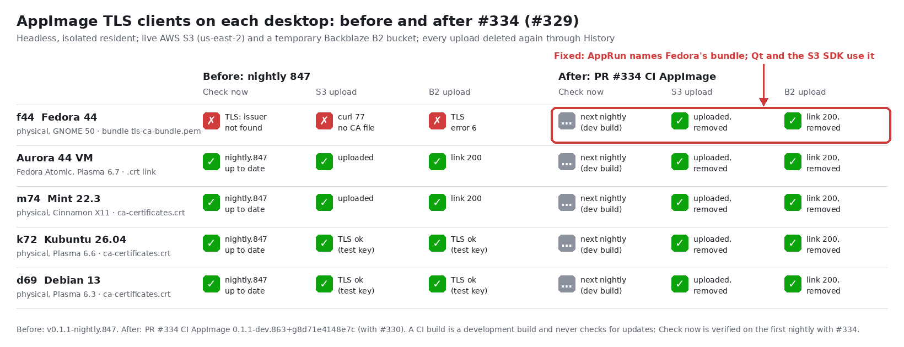

# AppImage TLS on Fedora: the host's CA bundle (issue #329)

PR #334 makes the AppImage's own TLS clients use the host's CA certificates. Before it, on
Fedora 44, **Check now**, S3 and R2 uploads, and Backblaze B2 all failed TLS. This is the
reproduction, the cause, and the live check of the fix on every lab desktop.

## What was broken (nightly 847)

All runs were headless and isolated: a private XDG profile and runtime directory, offscreen
Qt and no session bus ([lab/i329.py](lab/i329.py)). The S3 and B2 checks first used a synthetic
key. A TLS failure then shows as a transport error. A working TLS stack shows as the
service refusing the key (403 or 401).

| TLS client | f44 Fedora 44 | m74, k72, d69 | Aurora 44 VM |
| --- | --- | --- | --- |
| Update check (`putgd-cli` child, Qt 6.8 OpenSSL backend) | `update_feed_unavailable`: "The issuer certificate of a locally looked up certificate could not be found" | up to date (847) | up to date (847) |
| S3 / R2 (`putgd-s3-worker`, AWS SDK + libcurl) | `s3_transport_unknown`, curl code 77 (CA file not loadable) | 403 from AWS (TLS works) | live upload works |
| Backblaze B2 (`putgd-b2-worker`, Qt) | `b2_transport_unknown`, network error 6 (TLS handshake) | 401 from B2 (TLS works) | live upload works |
| Proton Drive (`putgd-proton-runtime`, Bun 1.4.2) | not affected: Bun has its own roots, and the same binary fetched `nightly.json` with status 200 on f44 | | |

Each host's lines are in `HOST/before-847.txt`. Setting `SSL_CERT_FILE` to Fedora's bundle
in the resident's environment changed none of the three failures.

### Why

- The image carries Ubuntu 24.04's `libssl.so.3`, `libcrypto.so.3` (`OPENSSLDIR "/usr/lib/ssl"`) and
  `libcurl.so.4`, and Qt 6.8.3's OpenSSL backend.
- **Qt** loads its CA list itself and never calls OpenSSL's default paths:
  - it scans Debian-style directories for `*.pem` and `*.crt` files, and also tries `/etc/pki/tls/certs/ca-bundle.crt`;
  - on Fedora 44, `/etc/ssl/certs` → `/etc/pki/tls/certs` holds only hash links (`ce5e74ef.0`), and the bundle file is missing;
  - so Qt loads zero CAs. [f44/before-847-qt-ca-scan.strace.txt](f44/before-847-qt-ca-scan.strace.txt)
    shows every directory and file it opened; no certificate file is among them.
- **libcurl** has `/etc/ssl/certs/ca-certificates.crt` compiled in as its CA file. Fedora 44 doesn't
  have it, so every handshake fails with code 77.
- **Fedora Atomic (Aurora)** keeps `/etc/ssl/certs/ca-certificates.crt` as a link to Fedora's
  bundle, so Aurora was never affected. The full-acceptance pass saw the same:
  [#336](../2026-10-21-appimage-full-acceptance/README.md).

## The fix

- AppRun exports `PUTGD_CA_BUNDLE`, the first readable file of `SSL_CERT_FILE` and five known
  bundle paths ([diagnostics.md](../../diagnostics.md)).
- The update check and the B2 worker add its certificates to Qt's default CAs.
- The S3 worker sets the SDK's `caFile`.
- Verification stays on, and nothing is bundled or newly trusted. DEB and RPM builds never set the variable.

`HOST/bundle.json` shows the value each resident got:

| Desktop | `PUTGD_CA_BUNDLE` |
| --- | --- |
| f44 | `/etc/pki/ca-trust/extracted/pem/tls-ca-bundle.pem` |
| Aurora VM, m74, k72, d69 | `/etc/ssl/certs/ca-certificates.crt` |

## Live check of PR #334 (2026-10-21, 21:18–21:20Z)

- **Build:** the PR's CI AppImage `0.1.1-dev.863+g8d71e4148e7c` (CI run 39675800150; it
  includes #330), SHA-256 `315547be94b496ee78c254d7f973ff4fbbcf21c80e91c25624192f722cf0d99f`.
  It was copied to each builder and into the guest, and run headless as above.
- **S3:** live AWS, bucket `put.gd` (us-east-2), prefix `acceptance/i329/<run>/`. Key set 2 is the
  IAM user `putgd-acceptance-87`, with inline policy `putgd-acceptance-i329` limited to `acceptance/*`.
  No ACL is set, so the object link answers 403. The receipt and History are the proof.
- **B2:** a temporary allPublic bucket `putgd-i329-f53d5a37`, each step with a 2 h key limited
  to that bucket, deleted afterwards ([lab/b2lab.py](lab/b2lab.py)). Test connection ran too.
- **Upload:** each upload is a synthetic 640×360 PNG, sent through **Edit & upload** (`editor.open` on
  the file, then `editor.submit`). Each was then removed with **Delete from destination**
  (`delete.prepare`, then `delete.confirm`).

| Desktop | S3 upload → delete | B2 Test connection, upload, link → delete |
| --- | --- | --- |
| f44 Fedora 44 GNOME 50 (physical) | uploaded → `removed` | completed, uploaded, link 200 (PNG) → `removed`, link 404 |
| Aurora 44 Plasma 6.7 (VM on f44) | uploaded → `removed` | completed, uploaded, link 200 → `removed`, link 404 |
| m74 Mint 22.3 Cinnamon (physical) | uploaded → `removed` | completed, uploaded, link 200 → `removed`, link 404 |
| k72 Kubuntu 26.04 Plasma 6.6 (physical) | uploaded → `removed` | completed, uploaded, link 200 → `removed`, link 404 |
| d69 Debian 13 Plasma 6.3 (physical) | uploaded → `removed` | completed, uploaded, link 200 → `removed`, link 404 |

Each host's records are in `HOST/s3-upload.json` and `HOST/b2-upload.json`.

Before the IAM fix, a temporary Cloudflare R2 bucket briefly stood in for S3. On d69, nightly 847's
S3 worker passed Test connection, uploaded, returned the r2.dev link (200) and deleted the
upload. That bucket was then deleted.

### Check now

A CI AppImage is a development build, and those never run the update check
(`update_check_unavailable`, reason `development_build`; see `HOST/update-check.json`). Patrick's
decision: merge #334 after the uploads, pictures and docs. Then verify **Check now** on f44,
Aurora, m74, k72 and d69 with the first nightly that contains it, before closing #329.
That result will be added here.

## Cleanup

- `put.gd/acceptance/i329/` was listed with key set 2 after the last run (2026-10-21 21:20:44Z):
  0 objects, 0 versions, 0 delete markers, 0 incomplete uploads.
  One synthetic object from an aborted guest script run was removed by
  [lab/s3verify.py](lab/s3verify.py) `--purge` first.
- The B2 bucket had 0 file versions, 0 hide markers and 0 unfinished large files at 21:20:33Z.
  Every scoped key was deleted by its own run.
- The R2 bucket `putgd-i329-r2-e0c7ae41` had its r2.dev domain disabled (200) and was deleted (204).
  No `putgd-i329` R2 bucket remains.
- All residents were quit and their private run and runtime directories removed, on every host
  and in the guest. The Aurora overlay was stopped and its disk deleted. The golden is read-only and was not touched.
- No credential appears in any file here. The lab scripts read `~/Documents/creds.txt` on the
  builder and pass keys only through a pipe to the session socket.
