# #326: host programs start with the host's environment (2026-10-21)

Acceptance for [#326](https://github.com/patrick-hudson/put.gd-desktop/issues/326) and the
code PR [#330](https://github.com/patrick-hudson/put.gd-desktop/pull/330). See
[diagnostics.md](../../diagnostics.md#opening-links-and-folders-on-the-host) for the behaviour.

## Build under test

| | |
| --- | --- |
| AppImage | `putgd-0.1.1-dev.851+g037cbafecd48-x86_64.AppImage` (CI run [39669100216](https://github.com/patrick-hudson/put.gd-desktop/actions/runs/39669100216), artifact `release-appimage`) |
| SHA-256 | `575d410df736e98a7ab6b9820a25b6f5c543a0f1695925567d162727201962b0` |
| Source | `037cbafe`: #330 head `ac18e788` merged onto nightly `4604426c` |
| DEB (regression) | `putgd_0.1.1~dev.851+g037cbafecd48_amd64.deb`, same run, artifact `release-native-ubuntu26.04` |
| Before | `putgd-0.1.1-nightly.842-x86_64.AppImage` (release `v0.1.1-nightly.842`, SHA256SUMS verified) |

## Method

Every desktop ran the same steps from SSH, as user `patrick` (VM: `lab`). The steps used the
AppImage acceptance driver `afa.py` of the full-acceptance session, plus [`lab/i326.py`](lab/i326.py),
[`lab/run326.sh`](lab/run326.sh) and [`lab/finish326.sh`](lab/finish326.sh):

1. Start the AppImage as a user would (`APPIMAGE --background`, so AppRun runs), with private
   `XDG_CONFIG/STATE/CACHE_HOME`, a loopback S3 fixture and synthetic credentials.
2. Make a URL recorder the user's real default `x-scheme-handler/http(s)` handler with
   `xdg-mime default`. The portal reads the user's own `~/.config/mimeapps.list`, not the
   resident's private config. The previous files were saved byte for byte and restored at the end
   (`handler-off`: `same` and `filesMatch` true everywhere). The recorder writes the URL and its
   own `LD_LIBRARY_PATH`, `QT_PLUGIN_PATH` and `APPDIR` to a log. It also shows a dialog for the
   picture, which closes itself after 25 s.
3. Put wrappers for `gio`, `xdg-open`, `gsettings` and `coredumpctl` first on the resident's
   `PATH`. Each logs its arguments, the image variables it inherited and the real program's exit
   status. On the builders, `sudo strace -f -v -e execve` on the resident also recorded every
   program it started, with its environment (`env-check`).
4. Upload a synthetic PNG through Edit & upload with notifications on. Click the link-ready
   notification with real input (uinput agent on Wayland, xdotool on X11, the VM's VNC), and
   capture the desktop.
5. `history.openLink` (MCP `open_history_link`) on the same entry.
6. `diagnostics.bundle`, then `diagnostics.reveal` (MCP `show_diagnostics_package`), with
   `dbus-monitor` watching FileManager1 and the portal. The file manager window it opened was closed
   by its exact new PID.
7. Quit from the tray, then clean up: the default handler, the run state and the input agent.
   `leftovers` reported no process, mount or desktop entry of the run.

## Results

| Desktop | Notification click | `history.openLink` | Show in folder | Host programs (environment) |
| --- | --- | --- | --- | --- |
| Ubuntu 26.04.1 GNOME 50.1 Wayland VM (`gnome-provisioned-20261016` overlay on d69) | opened, `route: portal` | portal; with the portal masked, `launcher` via host `gio`, exit 0 | Files, package selected (ShowItems) | `gio open` (fallback): `LD_LIBRARY_PATH`, `APPDIR`, `PUTGD_HOST_*` unset |
| Kubuntu 26.04 Plasma 6.6 Wayland (k72) | opened, portal | portal | Dolphin, package selected | `coredumpctl`: no image path |
| Debian 13 Plasma Wayland (d69) | opened, portal | portal | Dolphin, package selected | none started (no `coredumpctl` on the host) |
| Linux Mint 22.3 Cinnamon X11 (m74) | opened, portal | portal | Nemo, package selected | `gsettings get org.cinnamon.theme name`, `coredumpctl`: no image path |
| Fedora 44 GNOME 50 Wayland (f44) | opened, portal | portal | Files, package selected | `coredumpctl`: no image path |
| DEB regression, k72 | opened, portal | portal | Dolphin, package selected | `coredumpctl`: the DEB launcher's private SDK path only, as before |

On f44 the banner says the link could not be copied. That is the GNOME clipboard path for an AppImage without the put.gd GNOME Shell extension, unrelated to #326. The click still opens the link.

In every case the recorder logged `lib=unset plugins=unset appdir=unset`. The resident's log has one
`Opened on the host` record per open, with its `route` (`portal`, `file-manager` or `launcher`) and,
for the fallback, `fallbackFrom` (`org.freedesktop.systemd1.UnitMasked`). Per-desktop records are in
[`results/`](results/).

**Before (nightly 842, Ubuntu VM):** the click reached put.gd (`ActionInvoked(…, "default")`) and
nothing opened. The wrapper logged the resident's
`gio open http://127.0.0.1:…/Screen-Capture-….png` with `LD_LIBRARY_PATH=/tmp/.mount_putgd-…/usr/bin/../lib/putgd:/tmp/.mount_putgd-…/usr/lib:…`
and `APPDIR=/tmp/.mount_putgd-…`, and it exited 127. With the resident's exact environment, the host
gio prints `symbol lookup error: /usr/bin/gio: undefined symbol: g_unix_mount_entry_get_options`
(GLib 2.88 host, older bundled libgio).

## Pictures

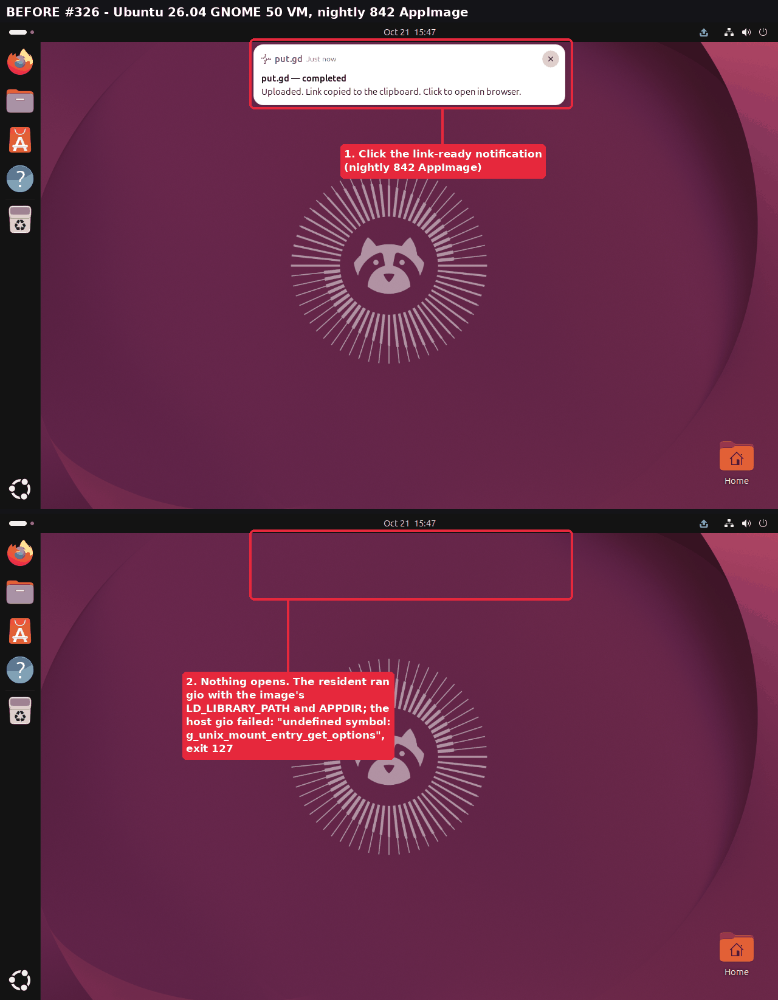

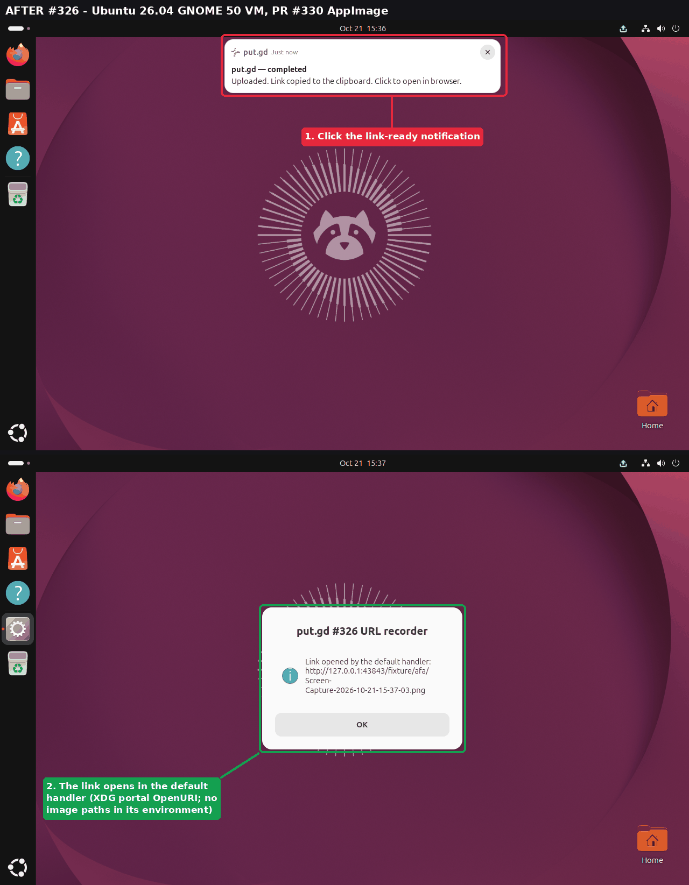

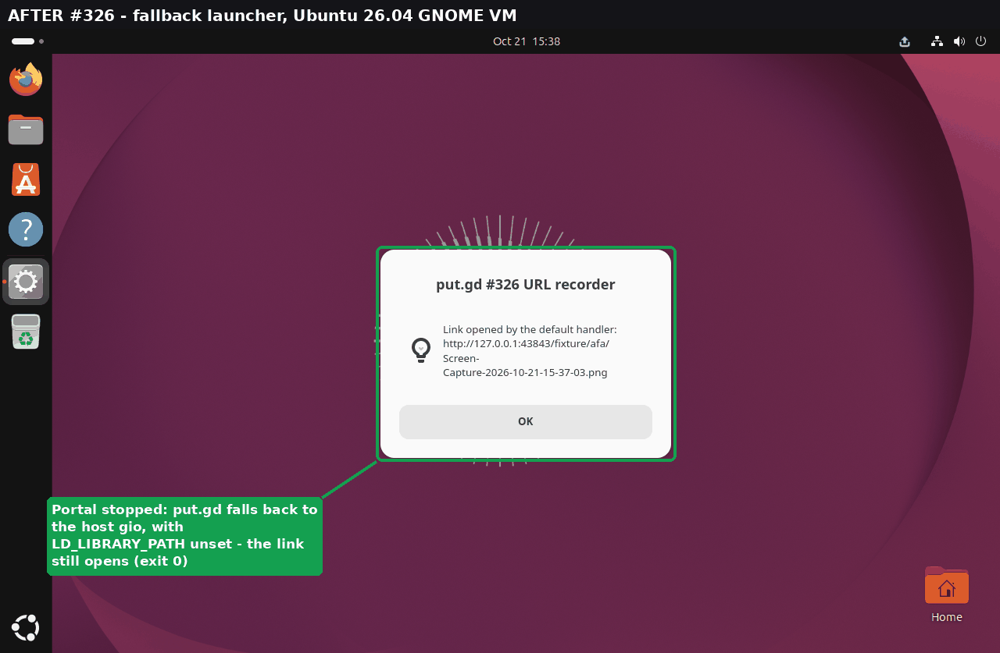

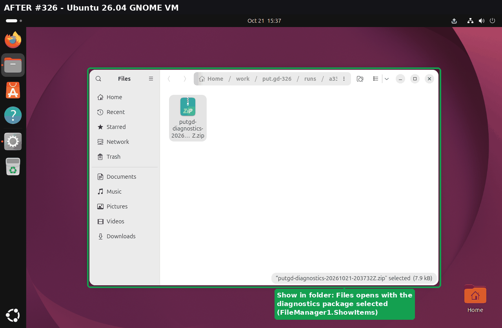

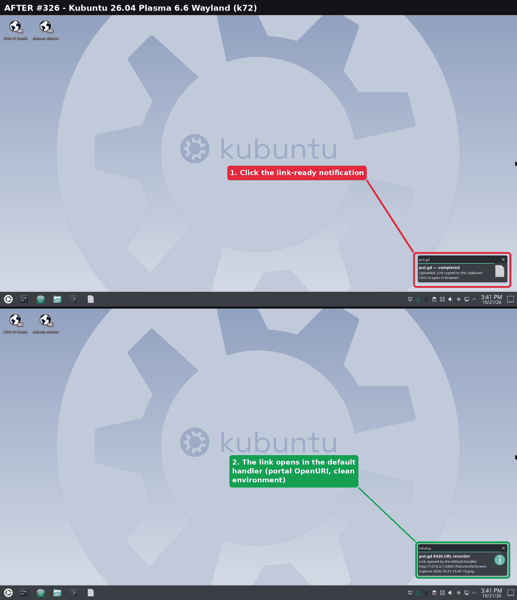

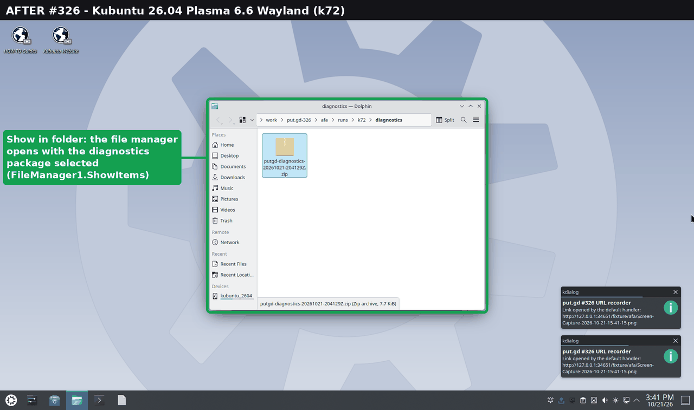

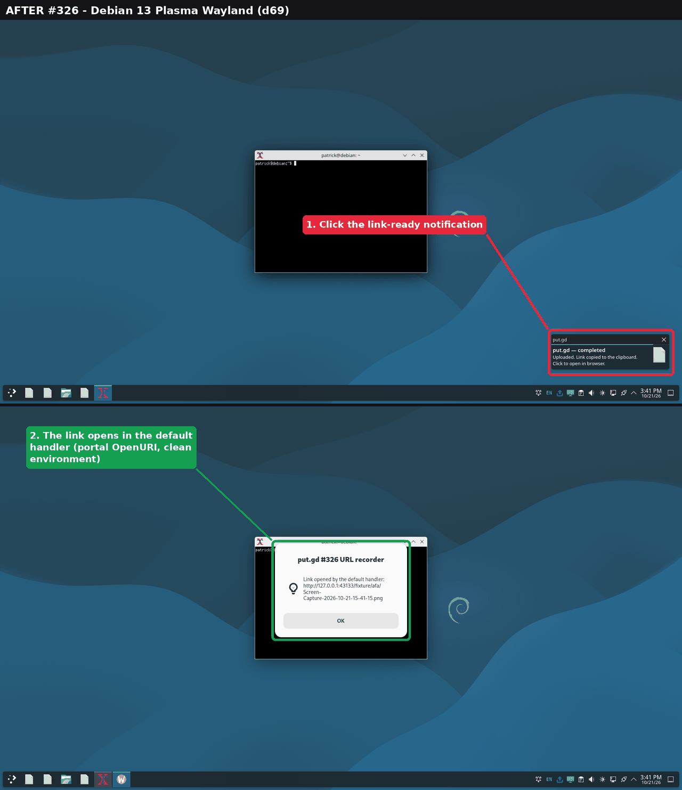

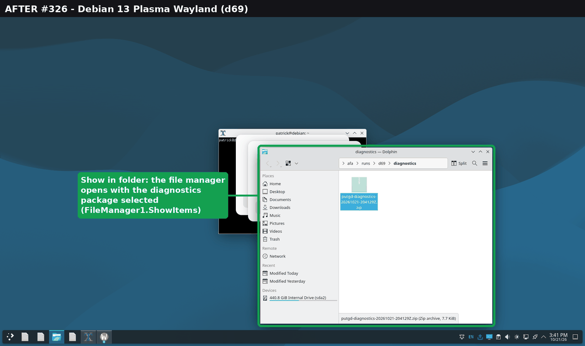

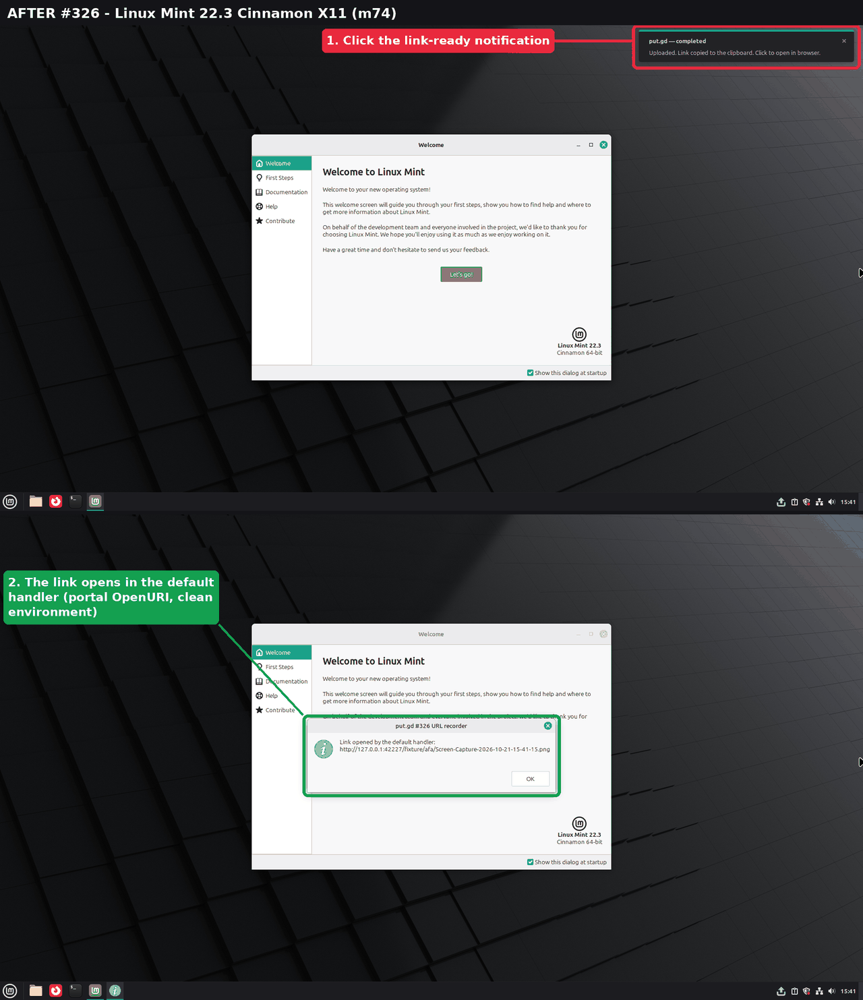

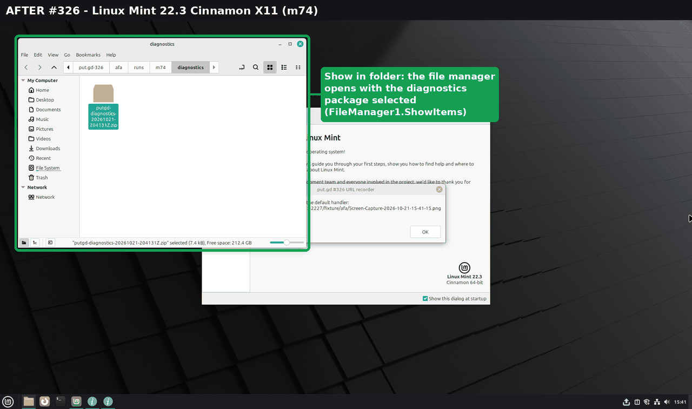

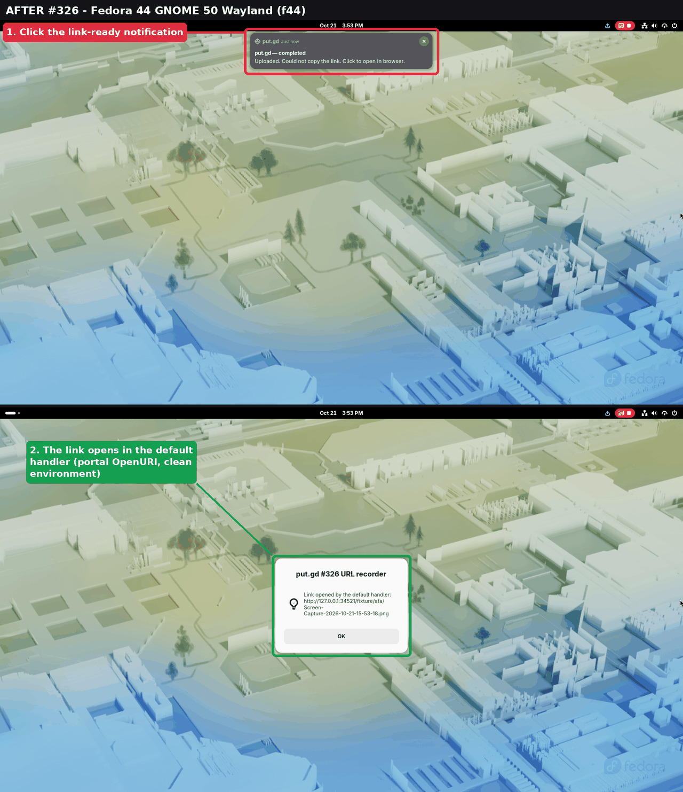

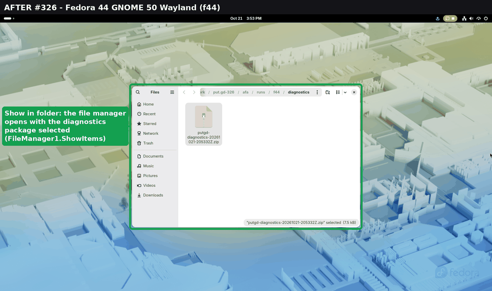

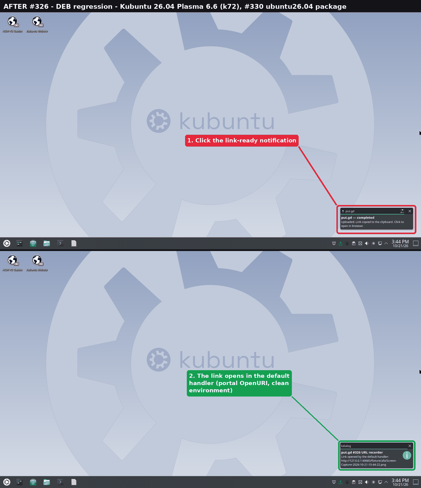

The pictures are full-desktop frames from each host's loopback VNC (Patrick sanitised the
builders; VMs are always fine), annotated by [`lab/annotate326.py`](lab/annotate326.py), scaled to
1280 px and reduced to 256 colours.

## Clean-up

Desktop locks: k72, d69 and m74 20:38–20:45Z, f44 20:52–20:54Z, all released `--verified-clean`. The DEB was purged on k72
(`dpkg-query`: no package). The `putgd-lab-input.sock` the agent left on d69, k72 and f44 was removed (on f44 it replaced an unused socket from an earlier session).
The VM overlay (`/home/patrick/work/put.gd-326/vm` on d69) was retired after the f44 run. Its golden
was never booted, and its hash `563730cc…342bb` was verified before use.
