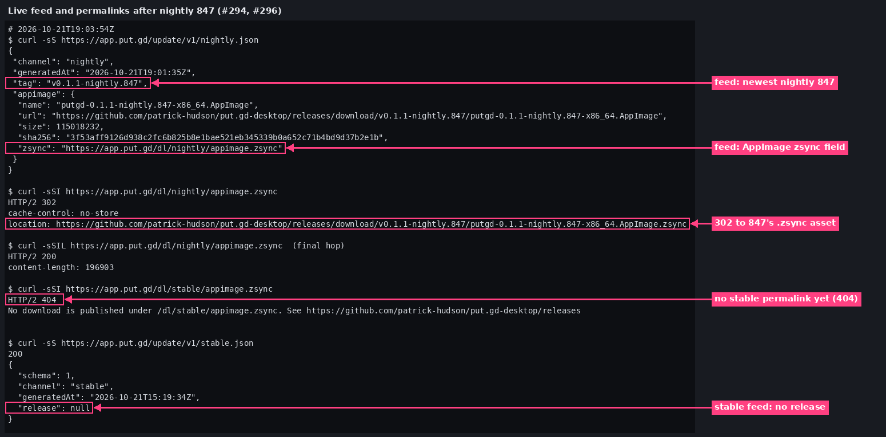
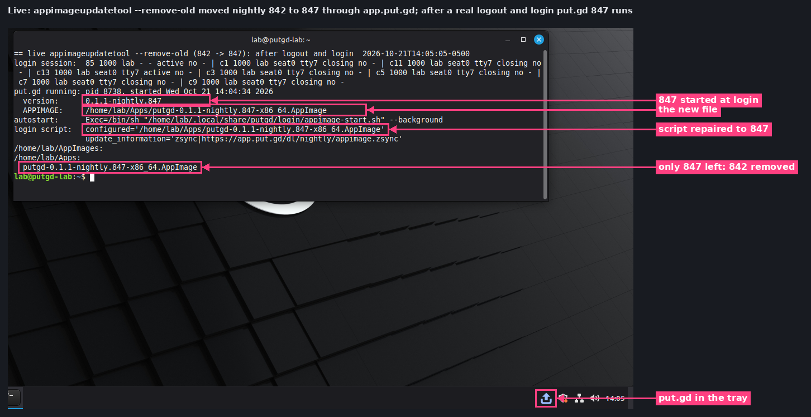
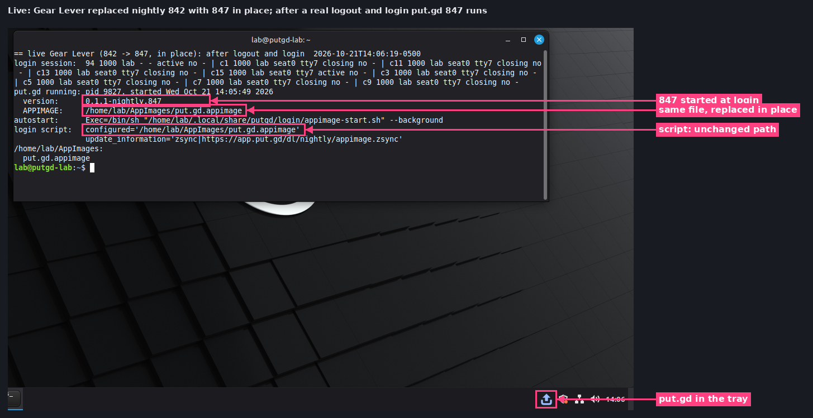
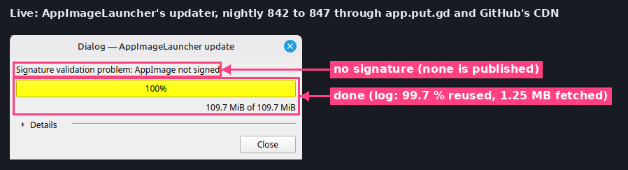
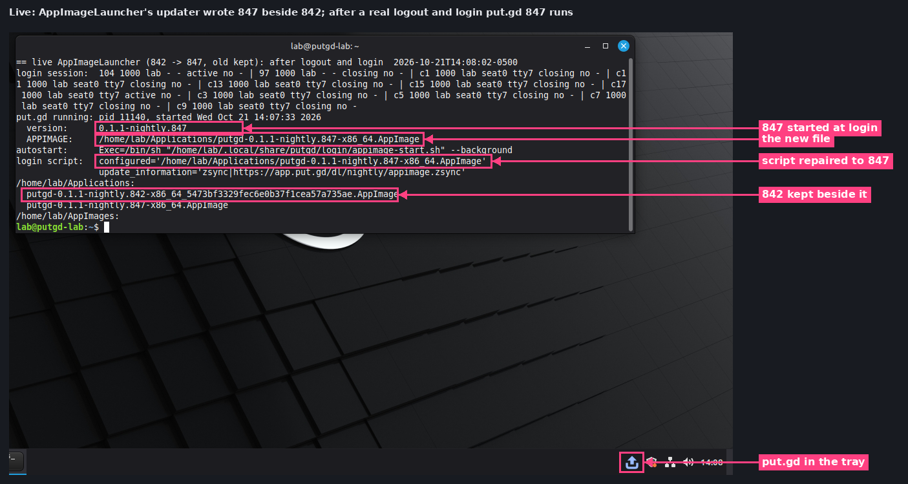

# Live AppImage update from nightly 842 to 847 (#294, #296)

The live close-out of [#294](https://github.com/patrick-hudson/put.gd-desktop/issues/294) and
[#296](https://github.com/patrick-hudson/put.gd-desktop/issues/296): two published nightlies
that both carry the #307 login script
([#318](https://github.com/patrick-hudson/put.gd-desktop/pull/318)), updated through
`https://app.put.gd/dl/nightly/appimage.zsync` with appimageupdatetool, Gear Lever and
AppImageLauncher, each followed by a real logout and login. Recorded 2026-10-21 by the
appimage-update-polish session.

| | Release | Commit | AppImage SHA-256 (`SHA256SUMS`) |
| --- | --- | --- | --- |
| N | `v0.1.1-nightly.842` (run 39648935208) | `08878c9`, #318 merged | `36b5eac7…` |
| N+1 | `v0.1.1-nightly.847` (run 39649047693) | `4a9103b`, #322 and #325 merged | `3f53aff9…` |

The guest, driver and login procedure are those of the
[#306/#307 acceptance](../2026-10-21-appimage-login-306-307/README.md#guest-and-images) (Mint 22.3
Cinnamon 6.6.4 X11 on d69, umask 002, real `cinnamon-session-quit --logout` and LightDM login,
the lab-started resident quit first). This time nothing was re-wrapped: the images are the release
assets as published, and every update went through the live site and GitHub's download CDN.
Before the rows the guest was reset: AppImageLauncher removed (package and daemons), all earlier
images and menu entries deleted, and only put.gd's own settings (launch at login on) kept.

| Check | Result |
| --- | --- |
| `--appimage-updateinformation` of N and N+1 | `zsync\|https://app.put.gd/dl/nightly/appimage.zsync` |
| `.zsync` published and in `SHA256SUMS` and `release-builds.json` | ✅ both releases ([release checks](results/release-checks.txt)) |
| AppDir root of N | `putgd.desktop` only (#306) |
| `nightly.json` | tag `v0.1.1-nightly.847`, AppImage `zsync: https://app.put.gd/dl/nightly/appimage.zsync` |
| `/dl/nightly/appimage.zsync` | 302 to `…/v0.1.1-nightly.847/putgd-0.1.1-nightly.847-x86_64.AppImage.zsync`, which answers 200 |
| `/dl/stable/appimage.zsync` | 404 (no stable release ships a `.zsync` yet); `stable.json` has `release: null` |
| `appimageupdatetool --check-for-update` on N | exit 1 (update available) |
| appimageupdatetool `--remove-old`, N → N+1 | delta from `release-assets.githubusercontent.com`: 99.72 % reused, 1.25 MB in 10 Range requests, checksum OK; SHA-256 = 847's line; then login starts 847 ✅ |
| Gear Lever 4.6.2, N → N+1 | whole image, replaced in place, SHA-256 = 847's line; login starts 847 ✅ |
| AppImageLauncher 3.0.0-beta-3 updater, N → N+1 | same delta, 847 written beside the kept 842, SHA-256 = 847's line; login starts 847 ✅ |

## Feed and permalinks

Raw: [results/feed-permalink.txt](results/feed-permalink.txt), checked at 19:03:54Z, right after the
signer published 847 (the feed and permalink moved to 847 by 19:03:37Z; the release was created at
18:59:30Z).

## appimageupdatetool `--remove-old`

N copied to `~/Apps` (`775`), started once (so the login script names it), quit, then
`appimageupdatetool --check-for-update` (exit 1) and `--remove-old`. At login the script logged
`…nightly.842… is missing; starting …nightly.847…`.

Logs: [check](results/live-B-check.log), [update](results/live-B-update.log),
[before](results/live-b-before.txt), [script](results/live-b-script-log.txt),
[after login](results/live-b-login.txt) ([JSON](results/live-b-login.json)).

## Gear Lever

`--integrate` moved N to `~/AppImages/put.gd.appimage`; put.gd started from it and quit; **Update**
replaced the file in place with 847. The script started the configured file without probing.

Logs: [update](results/live-A-gearlever-update.log), [before](results/live-a-before.txt),
[after login](results/live-a-login.txt) ([JSON](results/live-a-login.json)).

## AppImageLauncher

Reinstalled, `ail-cli integrate` moved N to `~/Applications/putgd-0.1.1-nightly.842-x86_64_5473bf33….AppImage`;
put.gd started from it and quit; `/opt/appimagelauncher.AppDir/usr/bin/update` (the menu action
fails upstream on Mint 22.3) wrote `putgd-0.1.1-nightly.847-x86_64.AppImage` beside it. The daemon
listed both (**put.gd** and **put.gd (1)**). At login the script logged
`starting …nightly.847…, which is newer than …nightly.842…_5473bf33….AppImage`.

Logs: [update](results/live-C-ail-update.log), [files after](results/live-c-after-update.txt),
[before](results/live-c-before.txt), [script](results/live-c-script-log.txt),
[after login](results/live-c-login.txt) ([JSON](results/live-c-login.json)).

Signed release-asset query strings in the logs are redacted. The relogin helper is
[lab/relogin.sh](lab/relogin.sh); the other scripts are in the
[#306/#307 lab folder](../2026-10-21-appimage-login-306-307/lab/).

## Clean-up

After this run the guest was stopped, its overlay (`~/work/put.gd-r12aiu/vm` on d69) deleted and
the `cinnamon-x11` golden rehashed (`4a21566d…`). The workstation tunnel `putgd-vm-mint-r12aiu`
was stopped and only its wall entry removed. The scratch trees `~/work/put.gd-r12aiu` on d69
and f44 were removed.
