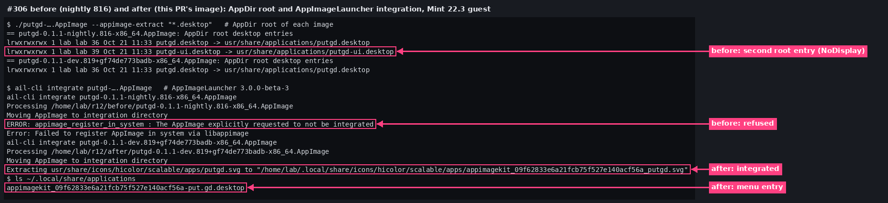
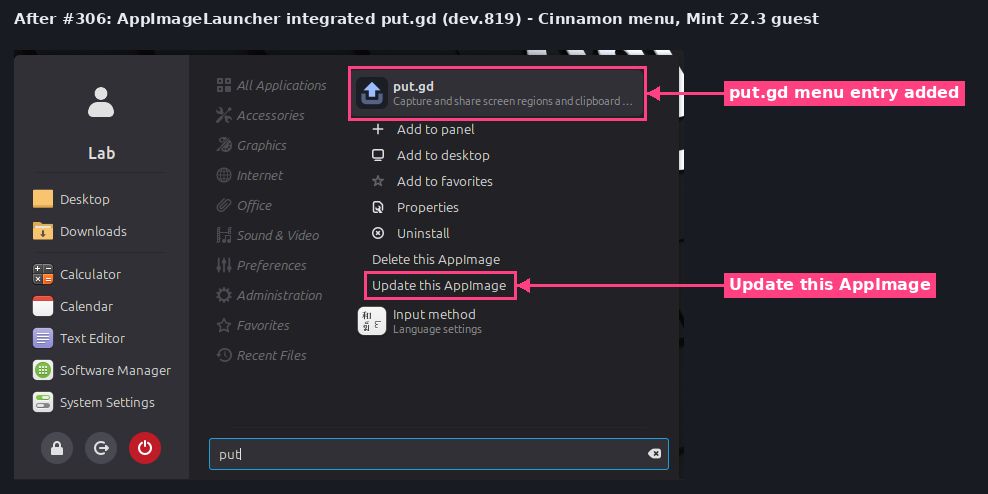
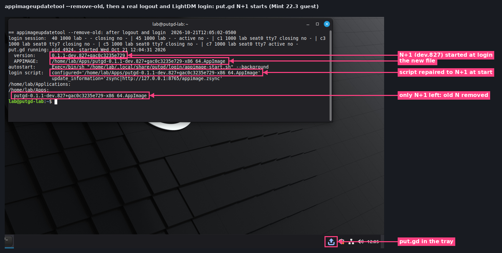
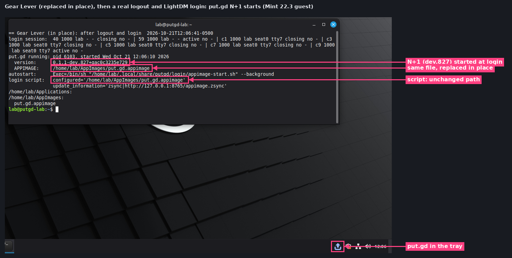
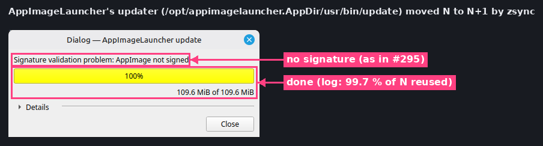
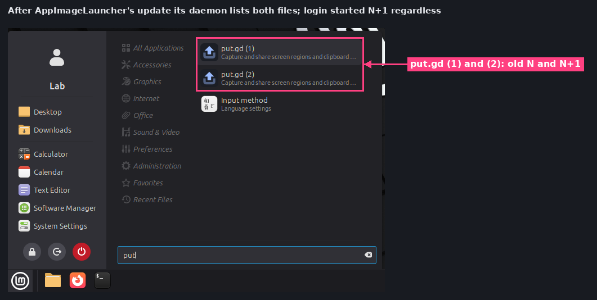
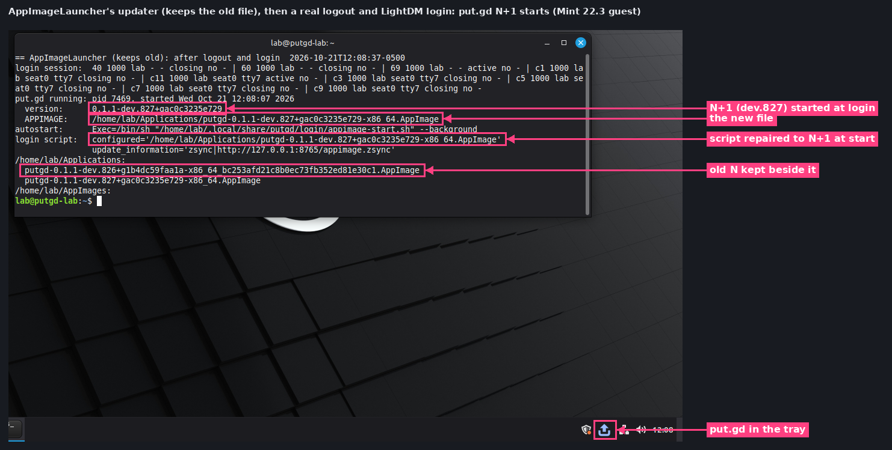
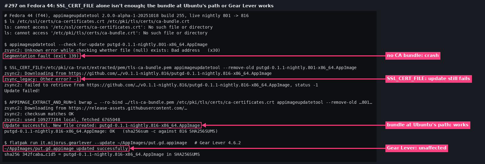

# AppImage integration and start at login after updates (#306, #307, #297)

Acceptance for [#318](https://github.com/patrick-hudson/put.gd-desktop/pull/318), which closes
[#306](https://github.com/patrick-hudson/put.gd-desktop/issues/306) and
[#307](https://github.com/patrick-hudson/put.gd-desktop/issues/307), and the Fedora findings for
[#297](https://github.com/patrick-hudson/put.gd-desktop/issues/297). Recorded 2026-10-21 by the
appimage-update-polish session.

| Check | Result |
| --- | --- |
| AppDir root of the PR's CI images | `putgd.desktop` only; the receipt records `rootDesktopEntry: {file: putgd.desktop, removedLinks: [putgd-ui.desktop]}` |
| AppImageLauncher integration (#306) | nightly 816: refused; the PR's image: integrated, menu entry with **Update this AppImage** |
| Login after `appimageupdatetool --remove-old` (#307) | ✅ N+1 starts (before: nothing started) |
| Login after Gear Lever's in-place update | ✅ N+1 starts (as before) |
| Login after AppImageLauncher's update, old file kept (#307) | ✅ N+1 starts (before: the old N) |
| Fedora 44, appimageupdatetool (#297) | `SSL_CERT_FILE` alone isn't enough; the bundle at Ubuntu's path works |
| Fedora 44, Gear Lever (#297) | not affected |
| Live delta 801 → 816 through `app.put.gd/dl/nightly/appimage.zsync` | ✅ on Mint (pre-check for #296) |

## Guest and images

A disposable Mint 22.3 Cinnamon 6.6.4 X11 guest on d69: an overlay on the `cinnamon-x11` golden
(`4a21566d…`, hash checked before and after), QEMU 10.0.13, KVM, 2 vCPU, 6 GiB, on the wall
as **Mint 22.3 VM r12aiu**. User `lab`, umask 002 (so images and `~/Applications` are `775`).
Every login below is a real one: `cinnamon-session-quit --logout --no-prompt`, then the
password typed into LightDM over VNC. Before each logout the lab-started resident was quit
(`ui.quit`), so only the autostart entry could start put.gd. The driver is [lab/r12.py](lab/r12.py)
(start, enable, state, summary, quit) with [lab/relogin.sh](lab/relogin.sh).

N and N+1 are the CI AppImages of two consecutive commits of #318, both with the fix:

| | Commit | CI run | Version | CI SHA-256 |
| --- | --- | --- | --- | --- |
| N | `e7b82e3` | 39635799785 | `0.1.1-dev.826+g1b4dc59faa1a` | `346d9328…` |
| N+1 | `2e897af` | 39638027577 | `0.1.1-dev.827+gac0c3235e729` | `1282dc28…` |

CI builds carry no update information, so, as in #295, both were re-wrapped with
`zsync|http://127.0.0.1:8765/appimage.zsync` by the pinned appimagetool 1.9.1, type2
runtime 20251108, `-b 16384` and its zsyncmake 0.6.2 ([lab/repack.sh](lab/repack.sh)). The
guest served them with the #293 Range server plus the #295 302
(`/appimage.zsync` → `/rel/<N+1>.zsync`), as the site permalink redirects to GitHub.
The first #306 check used the image of `d29c49d` (`0.1.1-dev.819`), the PR's first push.

## #306: one root desktop entry, and AppImageLauncher integrates put.gd

AppImageLauncher 3.0.0-beta-3 (`appimagelauncher_3.0.0-beta-2-gha287.96cb937_amd64.deb`,
digest checked against the release). Log: [results/mint/ail-integrate-306.txt](results/mint/ail-integrate-306.txt).

## #307: start at login after each updater

Each row: N started from its folder with launch at login on, so put.gd wrote
`Exec=/bin/sh "~/.local/share/putgd/login/appimage-start.sh" --background` and the script
names N; put.gd quit; the updater ran; real logout and login. The resident's parent is
`cinnamon-session` (through AppImageLauncher's `binfmt-bypass` once that is installed) in
the new session's scope.

Baseline, N in `~/Apps`, no update: login started N through the script
([results/mint/baseline-login.txt](results/mint/baseline-login.txt)).

### appimageupdatetool `--remove-old`

zsync delta, 99.71 % reused, 1.26 MB in 10 Range requests, checksum OK, N deleted. At login
the script logged `…dev.826… is missing; starting …dev.827…`.

Before the fix the same row started nothing:
[#295's picture](../2026-10-21-updates-acceptance-303/vm-login-remove-old.png).
Logs: [update](results/mint/row-b-aut-B.log), [server](results/mint/row-b-server.log),
[script](results/mint/row-b-script-log.txt), [after login](results/mint/row-b-login.txt) ([JSON](results/mint/row-b-login.json)).

### Gear Lever (in place)

Gear Lever 4.6.2 (Flathub, user install). **Integrate** moved N to `~/AppImages/put.gd.appimage`;
**Update** downloaded the whole N+1 (one GET after the 302) and replaced the file (SHA-256
`32c3e62b…` = the served N+1). No versioned sibling, so the script started the configured
file without probing anything.

Logs: [update](results/mint/row-a-gearlever-update.log), [server](results/mint/row-a-server.log),
[before](results/mint/row-a-before.txt), [after login](results/mint/row-a-login.txt) ([JSON](results/mint/row-a-login.json)).

### AppImageLauncher (keeps the old file)

`ail-cli integrate` moved N to `~/Applications/putgd-0.1.1-dev.826+g1b4dc59faa1a-x86_64_bc253afd….AppImage`.
Its updater, `/opt/appimagelauncher.AppDir/usr/bin/update` (the menu's **Update this AppImage**
fails upstream on Mint 22.3, see #307), wrote `putgd-0.1.1-dev.827+gac0c3235e729-x86_64.AppImage`
beside it (99.71 % reused, checksum OK). The daemon then listed both files. At login the
script logged `starting …dev.827…, which is newer than …dev.826…_bc253afd….AppImage`.

Before the fix the old N started:
[#295's log](../2026-10-21-updates-acceptance-303/results/vm295/ail-relogin-1.txt).
Logs: [update](results/mint/row-c-ail-update.log), [files after](results/mint/row-c-after-update.txt),
[server](results/mint/row-c-server.log), [script](results/mint/row-c-script-log.txt),
[after login](results/mint/row-c-login.txt) ([JSON](results/mint/row-c-login.json)).

## Fedora (#297)

On f44 (Fedora 44, ca-certificates 2025.2.80_v9.0.304-6.fc44) with appimageupdatetool
2.0.0-alpha-1-20251018 (build 255), against the live nightly 801 → 816 (the 801 image
checked against its `SHA256SUMS`):

- Neither `/etc/ssl/certs/ca-certificates.crt` nor `/etc/pki/tls/certs/ca-bundle.crt` exists
  on f44 any more, so the path #297 recorded is gone. Fedora's bundle is
  `/etc/pki/ca-trust/extracted/pem/tls-ca-bundle.pem`.
- Without a bundle: the 30 `Bad address` lines and a segfault ([log](results/f44-297/no-cert-check.log)).
- With `SSL_CERT_FILE` set to Fedora's bundle, `--check-for-update` works (exit 1,
  [log](results/f44-297/cert-check.log)), but the update fails at the download:
  `zsync_legacy: Other error? -1` ([log](results/f44-297/cert-update.log)). zsync2 first
  resolves the image URL's redirect with a `HEAD` that uses libcurl's built-in bundle path, not
  `SSL_CERT_FILE` (`resolveRedirections` in zsync2's `zsutil.cpp`). That `HEAD` fails, a status
  of 0 counts as "no redirect", and its legacy range client, which reads header lines into
  512 bytes (`legacy_http.c`), then gets github.com's 302 with a 3,863-byte
  `Content-Security-Policy`. The failing run downloads "from https://github.com/…", the working
  ones from `release-assets.githubusercontent.com`.
- With Fedora's bundle shown at `/etc/pki/tls/certs/ca-certificates.crt` (that is
  `/etc/ssl/certs/…` on Fedora) by a rootless `bwrap`, the update works: 95.09 % reused, 6.77 MB
  fetched, SHA-256 equal to 816's `SHA256SUMS` line ([log](results/f44-297/bw-update.log)).
- Gear Lever 4.6.2, from a private Flatpak user dir and a private `HOME` under the scratch tree
  (headless CLI under `dbus-run-session`), integrated 801 and updated it to 816, SHA-256 equal to
  816's line ([log](results/f44-297/gearlever-update.log)). It downloads the whole image inside
  its runtime, so #297 doesn't affect it.
- AppImageLauncher's updater uses the same zsync2 library and isn't tested on Fedora here.

To rule out GitHub's CDN itself, three loopback trials on f44 replayed 801 → 816 against
[lab/rangeserver.py](lab/rangeserver.py) with 801's `.upd_info` patched to the loopback
([lab/patch_updinfo.py](lab/patch_updinfo.py), [lab/trial.sh](lab/trial.sh)): multipart ranges, a
server that answers multi-range requests with 501 (as GitHub's CDN does), and a 1.5 kB redirect.
All three succeeded: zsync2 sends one range per request (9 requests) and resolves a redirect
when its `HEAD` succeeds ([multipart](results/f44-297/trial-multipart-update.log),
[501](results/f44-297/trial-github-update.log), [long redirect](results/f44-297/trial-longredirect-update.log)).
Both zsync2 problems (the out-of-bounds CA-bundle search behind the crash, and the redirect `HEAD` without the bundle) are reported upstream as [AppImageCommunity/zsync2#91](https://github.com/AppImageCommunity/zsync2/issues/91); #297 tracks it.

## Live pre-check 801 to 816

In the Mint guest, appimageupdatetool updated the published nightly 801 (checked against its
`SHA256SUMS`) through `https://app.put.gd/dl/nightly/appimage.zsync` and GitHub's CDN:
95.09 % reused, 6.77 MB fetched, checksum OK, SHA-256 equal to 816's line
([log](results/mint-pre/aut-801-816.log), [check](results/mint-pre/aut-801-check.log)). Neither
nightly carries #307, so the close-out with logins is #296's, after two nightlies with this fix.

## Clean-up

The f44 scratch tree (`~/work/put.gd-r12aiu`: build, Flatpak user dir, private `HOME`, trials) is
removed after this PR. One `flatpak-session-helper` (PID 1873468) that the first, bus-less Gear
Lever call activated on f44's user bus was stopped by its exact PID; f44 has no other Flatpaks.
The guest overlay, its tunnel (`putgd-vm-mint-r12aiu`) and wall tile stay for #296's close-out
and are removed after it.
