# In-app AppImage update: lab acceptance, 2026-10-21 (#293 phase 3)

This is the acceptance for [#343](https://github.com/patrick-hudson/put.gd-desktop/pull/343) at its frozen head `04aff235`. It also covers the two pieces #343 depends on:

- the signer's AppImage mirror, [#342](https://github.com/patrick-hudson/put.gd-desktop/pull/342) (merged as `dc1ab32` and deployed on d69);
- the `.zsync` permalink served from the signer's bucket, [put.gd-site#4](https://github.com/patrick-hudson/put.gd-site/pull/4) (applied and merged as `11d6cb1`).

The design is in [#293](https://github.com/patrick-hudson/put.gd-desktop/issues/293#issuecomment-6326523916), and the user guide is [Download and install from put.gd](../../updates.md#download-and-install-from-putgd).

Every picture and number below comes from lab N `0.1.1-nightly.886` updating to lab N+1 `0.1.1-nightly.887`.

## Builds under test

| | Commit | Tag (local, never pushed) | AppImage SHA-256 |
| --- | --- | --- | --- |
| N | `04aff235` (#343 head) | `v0.1.1-nightly.886` | `e31f1f0d47b330416aafbebbe27833dce8adc3c1439201415d8d10896cb87d4e` |
| N+1 | `8ab81f15`, an empty lab commit on `04aff235` | `v0.1.1-nightly.887` | `250acc5c4a022a2c8a135c10aa7e767738f7e2d3d571c5de496c5795d08cd9d5` |

**How they were built:**

- Both were built the way `package.yml`'s `appimage` job builds, in one long-lived pinned `ubuntu:24.04` podman container on f44 ([lab/appimage-lab-build.sh](lab/appimage-lab-build.sh)): aqt Qt 6.8.3, `provision-sdk.sh`, `provision-appimage.py`, the Proton helper, then `build-appimage.sh` with the tag.
- `PUTGD_APPIMAGE_UPDATE_BASE=https://pkg.put.gd/lab/` gives them the live layout under the signer's lab prefix:
  - update information `zsync|https://pkg.put.gd/lab/dl/nightly/appimage.zsync`;
  - `.zsync` `URL:` `https://pkg.put.gd/lab/releases/<tag>/<name>`.
- The image's own start, recording and encoder checks passed for both.

**The lab release:**

- Only N+1 was published, by the deployed signer (`dc1ab32`) in `publish-local` lab mode. It is signed with the nightly key: `SHA256SUMS.minisig` verifies with `put.gd v0.1.1-nightly.887 nightly`.
- The lab feed at `https://pkg.put.gd/lab/update/v1/nightly.json` named 887.
- The resident got `PUTGD_UPDATE_FEED_URL`, `PUTGD_UPDATE_RELEASE_URL` and `PUTGD_UPDATE_MIRROR_URL` pointing at `https://pkg.put.gd/lab/`. Everything ran over real TLS through CloudFront, including on stock Fedora 44.

## Desktops

| Host | System | Session | appimageupdatetool for (a) |
| --- | --- | --- | --- |
| f44 | Fedora 44, GNOME 50 | Wayland (stock CA layout, the #297 host) | continuous build 254, `8d17a50e…` |
| m74 | Linux Mint 22.3, Cinnamon 6.6 | X11 | same |
| k72 | Kubuntu 26.04, Plasma 6.6 | Wayland | same |
| d69 | Debian 13, Plasma 6.3 | Wayland | same |
| Aurora | Aurora 44.20260908.1 (Fedora Atomic), Plasma 6.7, VM on f44 | Wayland | same |

**How each run worked:**

- The driver is [lab/upd293.py](lab/upd293.py) with [lab/scenarios.sh](lab/scenarios.sh), run from SSH on each host (inside the guest for Aurora).
- Each run used private `XDG_CONFIG/STATE/CACHE_HOME` and runtime directories, and its own copy of N in a private folder.
- `PATH` started with the run's `bin/`:
  - **(a)** the real `appimageupdatetool`;
  - **(b)** no zsync tool, and none on the host;
  - **(c)** a shim `appimageupdatetool` that kills itself with SIGSEGV, as appimageupdatetool does on stock Fedora 44.
- `update.check`, `update.install {"confirm": true}` and `update.restart {"confirm": true}` were driven through `putgd-cli`, which is the MCP path.
- `ui.show {"view": "updates"}` showed Settings scrolled to Updates for each full-desktop frame.
  For these runs the driver called it twice, because a freshly opened window could still leave Updates below the fold ([#348](https://github.com/patrick-hudson/put.gd-desktop/issues/348)). After the #348 fix, `upd293.py` calls it once; see [the #348/#349 acceptance](../2026-10-22-updater-polish-348-349/README.md).

## Results: N → N+1 on every desktop

| Desktop | (a) zsync | (b) no zsync tool | (c) zsync crashed |
| --- | --- | --- | --- |
| f44 | zsync, 9.0 s | download, 9.0 s | `crashed` → download, 8.7 s |
| m74 | zsync, 9.4 s | download, 8.8 s | `crashed` → download, 8.2 s |
| k72 | zsync, 8.8 s | download, 6.9 s | `crashed` → download, 7.0 s |
| d69 | zsync, 8.5 s | download, 8.7 s | `crashed` → download, 6.9 s |
| Aurora | zsync, 7.7 s | download, 6.9 s | `crashed` → download, 8.0 s |

**In all 15 runs:**

- The file at the image's path ends as `250acc5c…`, the signed `SHA256SUMS` line of 887.
- The hidden `.putgd-update-backup-0.1.1-nightly.886.AppImage` holds `e31f1f0d…` until **Restart put.gd**.
- The restarted resident reports `0.1.1-nightly.887` from the same path. Its first start removed the backup (`backupRemoved: true`), so the folder holds only the image.
- After the restart, `update.status` reports `updateAvailable: false`, and Settings shows "Up to date… Updated from 0.1.1-nightly.886 to 0.1.1-nightly.887". This was missing on the previous head; Patrick spotted it, and `04aff235` fixed it.

**Notes:**

- In (a), appimageupdatetool reused 114.9 MB of the old image and fetched 1.25 MB. That includes stock Fedora 44: put.gd passes the host CA bundle as `SSL_CERT_FILE`, and the `.zsync` names a URL that doesn't redirect, so neither #297 bug is reached.
- The full download comes from the release URL, which is the lab mirror here. Each run's details are in [results/runs.json](results/runs.json): phases, timings, the signature's trusted comment, the zsync output and the files in the folder.

## Refusals

On m74 and f44, a loopback server served release 887 with one thing broken at a time. The image was never changed, and nothing was left in its folder.

| Broken | Result |
| --- | --- |
| A flipped byte in the AppImage (`SHA256SUMS` and signature intact) | `update_verification_failed` (`sha256`): "The download doesn't match the release's SHA256SUMS; nothing was changed" |
| No `SHA256SUMS.minisig` | `update_signature_invalid` (`missing`) |
| `SHA256SUMS` rewritten to match a tampered image, original signature | `update_signature_invalid` (`signature`) |

The unit and integration tests also cover a foreign key, another release's trusted comment, a missing `SHA256SUMS` line, a feed that disagrees with `SHA256SUMS`, and `method: zsync` without fallback.

## Start at login after the update

[lab/login.sh](lab/login.sh) did the following on each desktop:

1. Turned **Launch at login** on in lab N.
2. Installed N+1 with zsync, without restarting.
3. Quit put.gd.
4. Did a real logout and an autologin.

| Desktop | Logout and login | What login started |
| --- | --- | --- |
| m74 | `cinnamon-session-quit --logout --no-prompt` at 23:13:26Z, LightDM restart 23:13:30Z (autologin), Cinnamon up 23:13:32Z | `cinnamon-session` started `putgd 0.1.1-nightly.887` from the configured image path (`250acc5c…`) at 23:13:33Z |
| d69 | D-Bus `org.kde.Shutdown.logout` at 23:13:05Z, then an SDDM restart with a temporary `Relogin=true` drop-in at 23:14:06Z (removed the same second) | A new session (`ksmserver`/`plasmashell` 18:14:07 local); `app-putgd@autostart.service` started `putgd 0.1.1-nightly.887` at 23:14:10Z |

**Details:**

- On d69 the old session hadn't finished its logout after 60 s, and the SDDM restart ended it.
- The login script now reads the configured image's version from the image itself, so the in-place update, which keeps the file name `…886…`, is recognised as 887.
- The login-started resident used the user's default profile. The run's own profile was then started once, and it removed the backup as in the scenarios.

## Idle memory (quiet slot, m74 and k72)

[lab/memrun.sh](lab/memrun.sh) compared the real nightly 874 (no phase 3, from `pkg.put.gd/releases`, SHA-checked) with lab 886. Both used the same private profile, a 30 s settle, and RSS sampled every second for 180 s.

| Desktop | 874 cold idle | 886 cold idle | 886 after a full `update.install` | Pss 874 → 886 | TLS or network libraries mapped |
| --- | --- | --- | --- | --- | --- |
| m74 Cinnamon X11 | 29.22 MiB | 29.33 MiB (+0.11) | 29.36 MiB | 23.38 → 23.45 MiB | none |
| k72 Plasma 6.6 Wayland | 29.66 MiB | 29.86 MiB (+0.20) | 29.95 MiB | 23.25 → 23.46 MiB | none |

- RSS is the median over the 180 s window, and load was at or below 0.1 during the windows.
- The resident gained the install state and the backup settle, about 0.1–0.2 MiB of code and data. The download, TLS, signature check and swap all run in the `putgd-cli` child, so the resident maps no `libssl`, `libcrypto` or Qt Network, before or after an install.

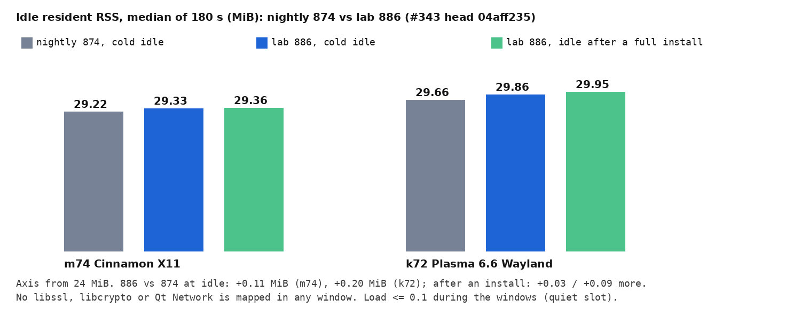

## Pictures (lab 886 → 887, #343 head `04aff235`)

f44 Fedora 44 GNOME: an update is found. **Download and install** comes first, and **Download** stays.
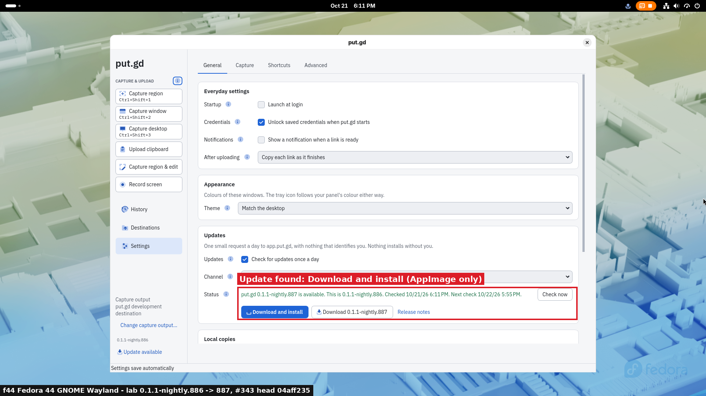

f44: the zsync path through the host's appimageupdatetool, with progress.
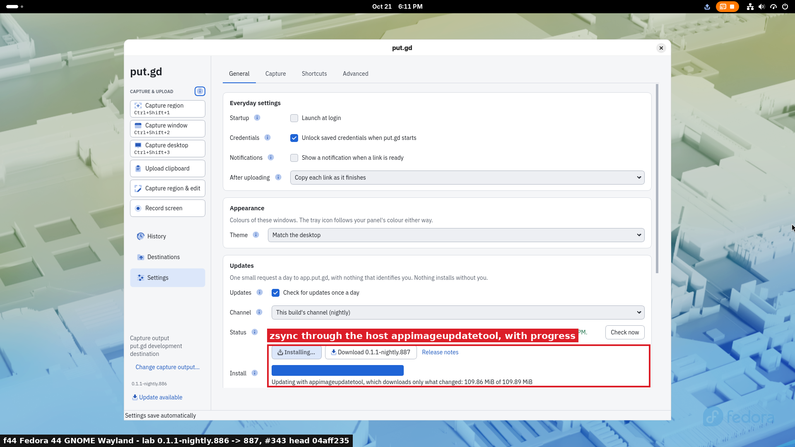

f44: installed and verified. **Restart put.gd**; the old image is kept as a hidden backup.
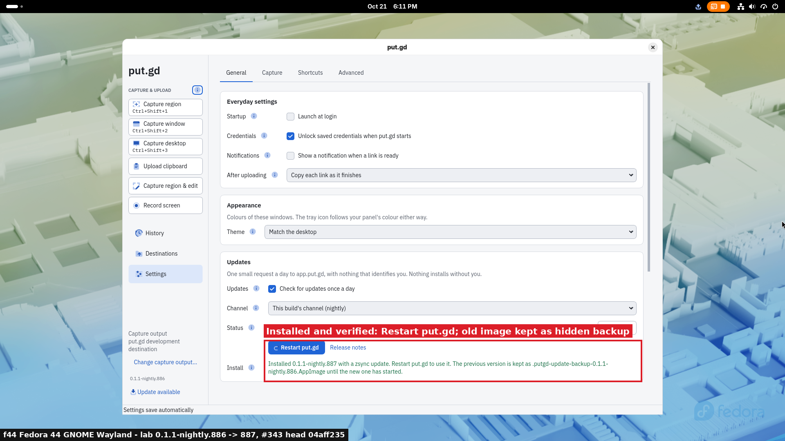

f44: after the restart, 887 runs and Settings says it's done.
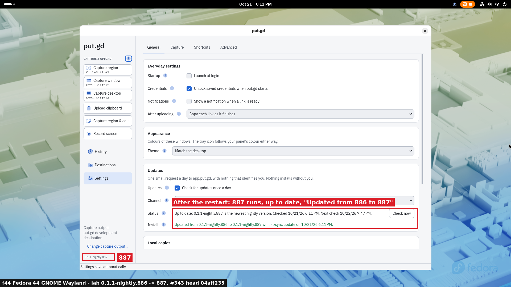

k72 Kubuntu Plasma 6.6: the forced zsync crash (Plasma's crash notification for the shim), then the verified full download.
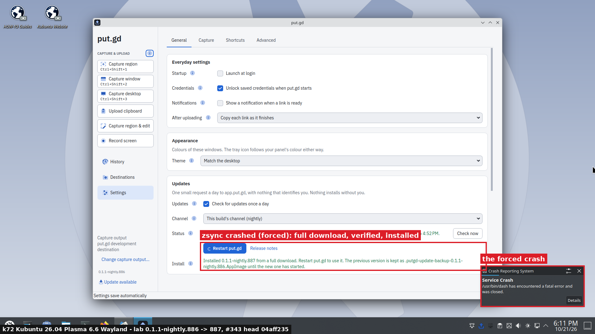

d69 Debian Plasma: after the restart.
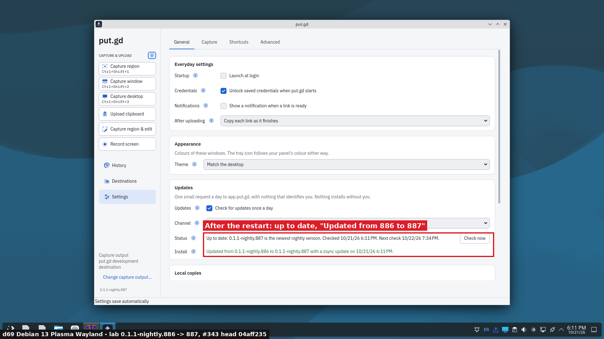

m74 Mint Cinnamon: a tampered download is refused and nothing changes.
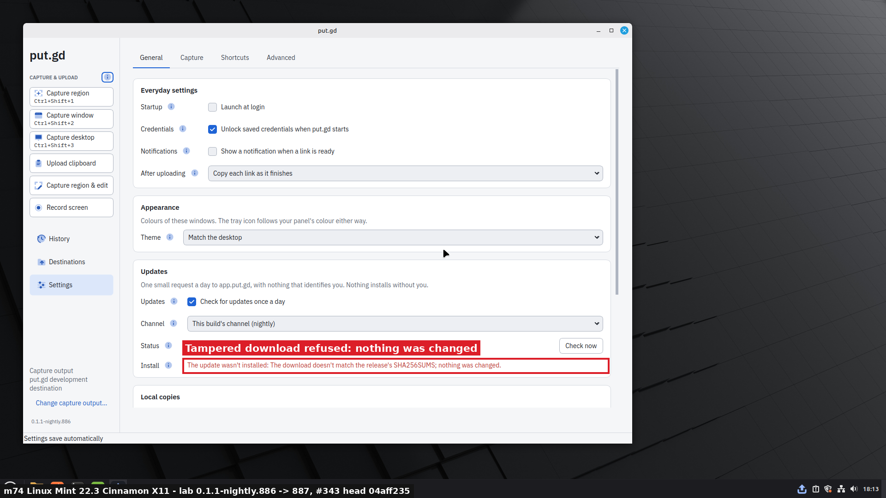

Aurora VM: after the restart. The notification is Aurora's own `uupd`.
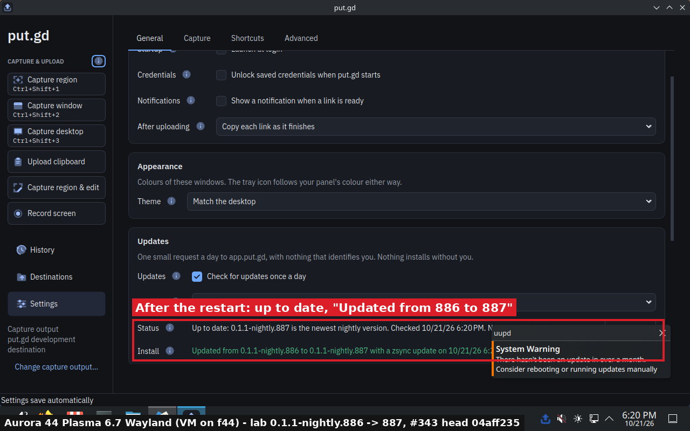

[lab/annotate.py](lab/annotate.py) drew the overlays on the frames each run captured from its host's loopback wall VNC, or the guest's QEMU display. Patrick has cleared the builders for full-desktop frames.

## The mirror and the permalink

**#342, the signer mirror:**

- Before merging, the signer ran in lab mode on d69 with three AppImage-only lab releases (701–703, synthetic 8 MiB images):
  - 200 with `immutable`, and a three-range request answered with `206 multipart/byteranges`;
  - republishing a tag was refused;
  - only the newest 2 kept their image, and the oldest was deleted at the origin by the retire pass (404 on the CDN).
- A dry run of the deployed signer against the PR on nightly 847, with nothing uploaded, gave the same 28 apt/dnf files, upload phases and headers; the PR adds only the image, its `.zsync` and the permalink.
- Logs: [results/signer-lab-publish-342.txt](results/signer-lab-publish-342.txt), [results/signer-retention-342.txt](results/signer-retention-342.txt), [results/signer-dryrun-342.txt](results/signer-dryrun-342.txt), [results/signer-lab-clean-342.txt](results/signer-lab-clean-342.txt). The scripts are in [lab/](lab/).
- After deploying (`~/putgd-signer/src` `d07e9ff` → `dc1ab32`; the timer ran clean at 21:50:11Z), nightly 874 was the first release mirrored.

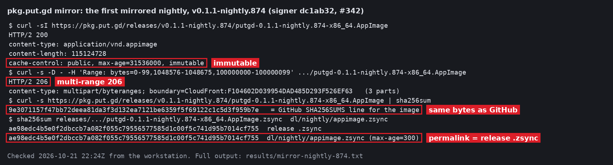

**put.gd-site#4:** applied from the reviewed plan, then merged. A fresh plan shows no changes.

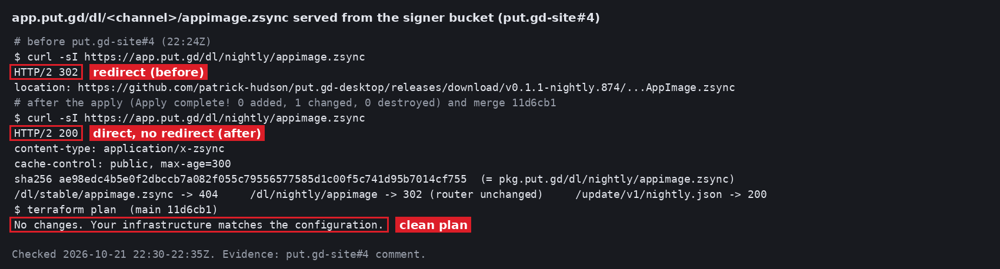

## What was done on the hosts

All of this was under the builder authority Patrick gave through the coordinator. Desktop locks were held for every desktop run and released `--verified-clean`.

- **m74:** one real logout and LightDM autologin; no apps of Patrick's were open in the `:0` session. Then the quiet memory slot.
- **d69:**
  - One real logout. The session-restored `xterm` (an idle `bash`, no child process) was closed by it.
  - A temporary `/etc/sddm.conf.d/zz-i293-relogin.conf` existed only for one SDDM restart.
  - `w0vncserver` (the wall) came back after one restart of its unit.
  - The signer's lab scope was used and then emptied.
- **Every host:** scenario (c)'s shim leaves a crash record for `/usr/bin/dash` (systemd-coredump). On Plasma it also leaves a DrKonqi "Service Crash" notification. This is the intended forced failure.
- **f44:**
  - The podman build container `putgd-i293lab` and `~/work/put.gd-i293lab` are kept until #343 merges, so a rebuild stays cheap; the local lab tags are deleted.
  - The Aurora overlay was retired with the guarded cleanup and an explicit evidence manifest. The golden is untouched.
- **Removed everywhere:**
  - the files a login-started resident wrote under an existing `~/.local/state/putgd` (its PID's log and the `running.*` markers);
  - the run folders `~/work/put.gd-i293acc` (results copied here);
  - every `pkg.put.gd/lab/` object of these runs (50 objects, `/lab/*` invalidated; the lab URLs answer 404) and the signer's lab workspace;
  - the local lab tags `v0.1.1-nightly.875/876/885/886/887`.

## Superseded runs

The same scenarios first ran on head `c05f48d1`/`132e85d7` (lab 875 → 876 and 885 → 886). They passed, but Patrick watched the wall and noticed that after the restart Settings still offered the running version. `04aff235` fixed that, so all of the above was redone on the new build. Nothing from those earlier runs is used here.
