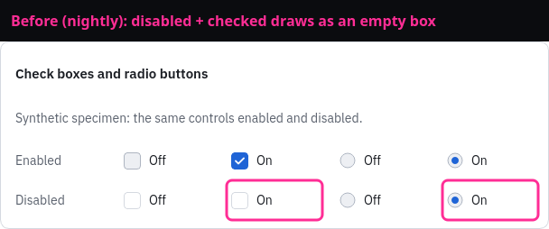
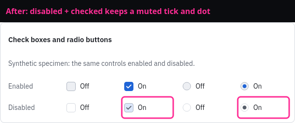
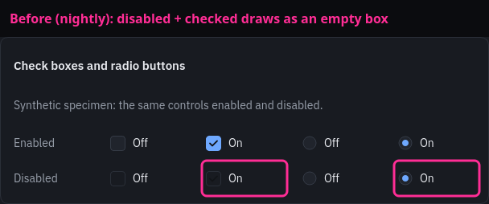
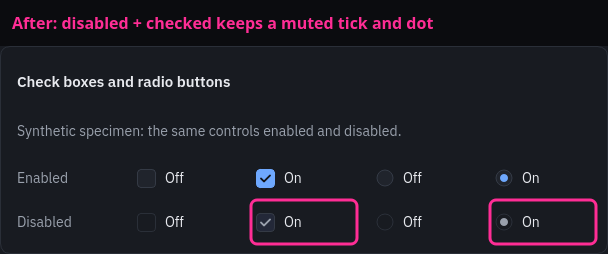
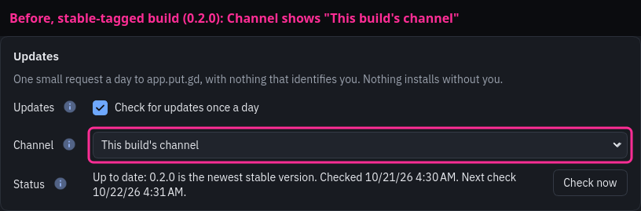
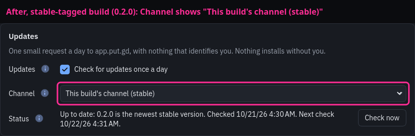
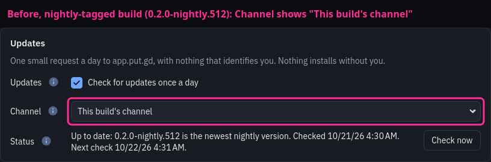
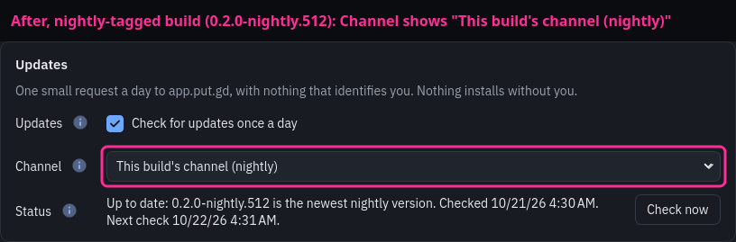

# Checked, disabled indicators and the named update channel

Issues #300 and #305. Code PR [#316](https://github.com/patrick-hudson/put.gd-desktop/pull/316) on branch `claude/checkbox-channel-300-305`
(head `306fdb2`), measured against nightly `d07e9ff`.

## How the pictures were made

Both trees were built on d69 (Debian 13, Qt 6.8.2): this branch, and nightly
`d07e9ff` from `git archive`. A scratch harness, not committed, was built in each tree. It
ran with `QT_QPA_PLATFORM=offscreen`, no `DISPLAY`, `WAYLAND_DISPLAY` or session
bus, and private `XDG_*` directories. It rendered synthetic widgets through
`RedesignTheme`, and no desktop or other window was captured. Each crop is a single
put.gd card grabbed from its own widget. Before it was kept, the harness checked
that at least 40% of the crop was put.gd theme surface colours (`bg`, `surface`,
`surfaceRaised`, `selected`, `border`, `borderStrong`, ±6). Every crop measured
94–96%. The magenta boxes and captions were drawn afterwards.

## #300 Checked, disabled check boxes and radio buttons

The specimen card shows check boxes and radio buttons, off and on, enabled and
disabled. On nightly, a checked, disabled check box draws as an empty box, and a
checked, disabled radio button keeps the full accent dot, so it looks enabled.
With this PR, the box keeps the accent-tinted `selected` fill and a `textMuted`
tick. The radio button gets a muted ring and dot.

| | Before (nightly) | After |
| --- | --- | --- |
| Light |  |  |
| Dark |  |  |

## #305 Settings → Updates names the build's channel

These are Settings → General → Updates cards in the dark scheme. The `update.status`
data was injected through the test fixture: a stable-tagged build (`0.2.0`) and a
nightly-tagged build (`0.2.0-nightly.512`), both on *This build's channel*. On
nightly the two look the same. With this PR, the first choice reads
*This build's channel (stable)* or *(nightly)*.

| | Before (nightly) | After |
| --- | --- | --- |
| Stable-tagged |  |  |
| Nightly-tagged |  |  |

## Tests on d69

`ctest -R '^gui_(theme|settings)$'` was run with the same private, offscreen
environment. `gui_theme` passed in 0.18 s and `gui_settings` in 74.5 s.

- `gui_theme` → `checkedDisabledIndicatorsStayChecked` (new) passes. With nightly's
  `redesign.qss` put back, it fails: `dark: checked, disabled box is not on the muted
  accent fill`.
- `gui_settings` → `updateChannelNamesWhatThisBuildFollows` (new) passes. It covers
  stable, nightly, a nightly build watching stable, a development build and a
  tagged Flatpak.
