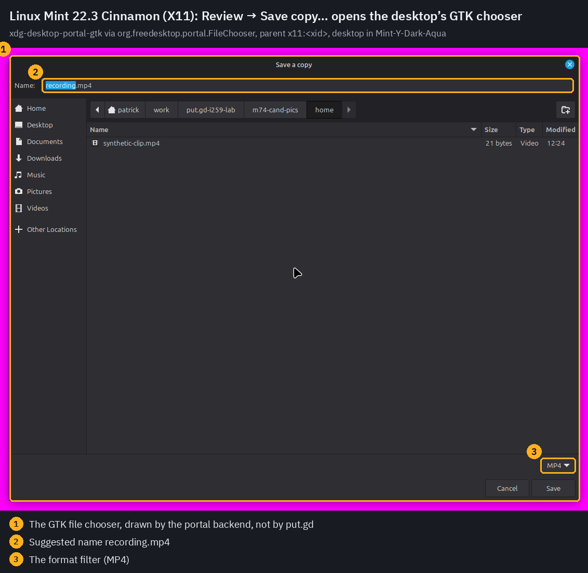
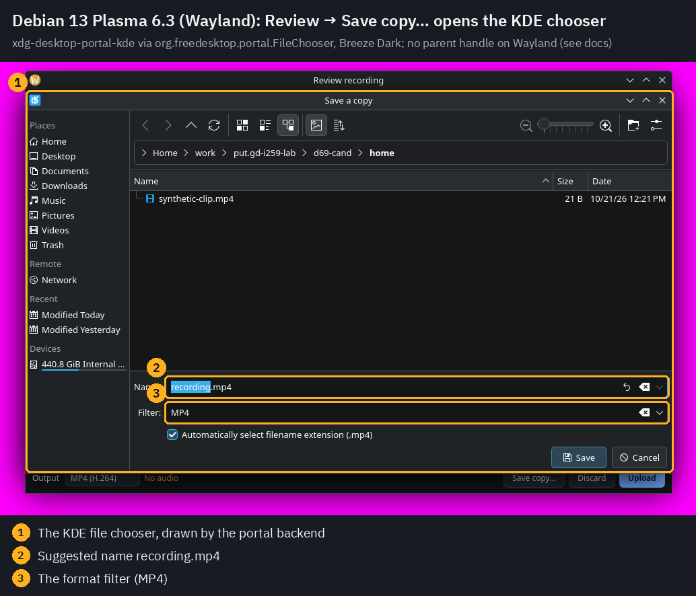
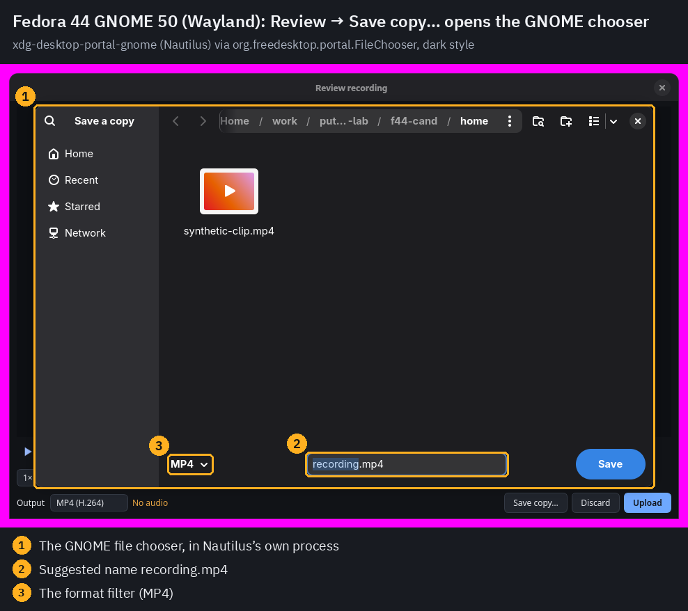
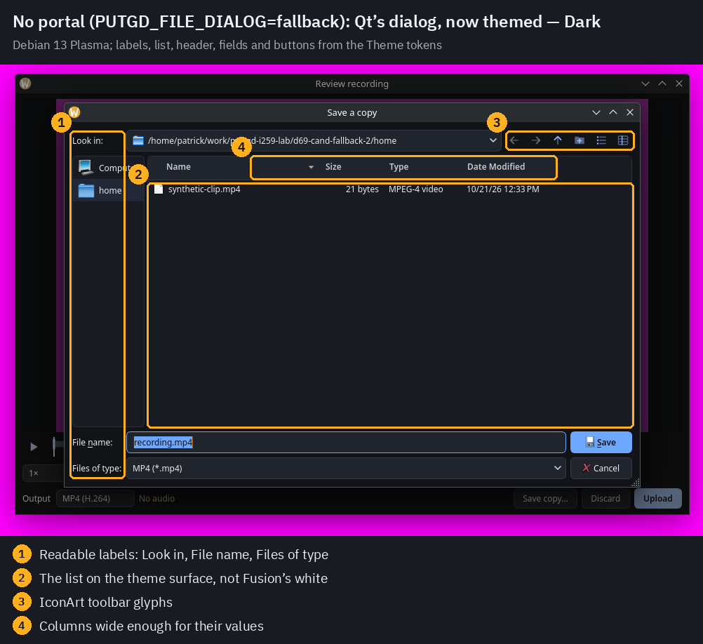
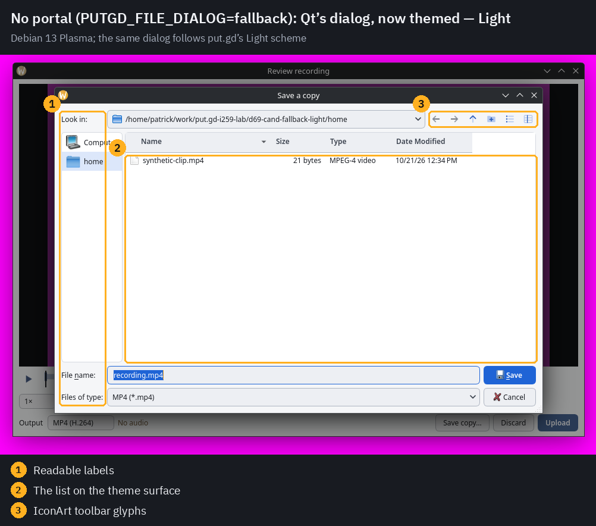
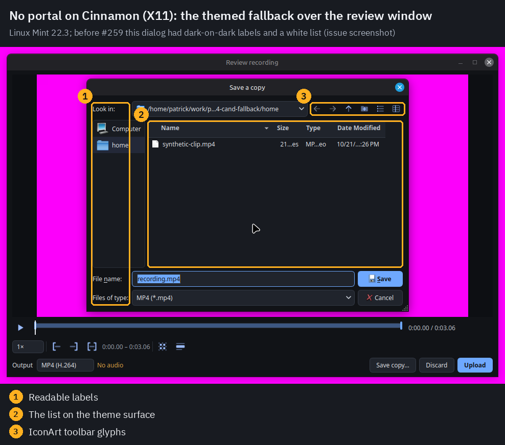

# File dialogs through the XDG portal, themed fallback (issue #259)

Code: [PR #321](https://github.com/patrick-hudson/put.gd-desktop/pull/321)
(`5753383f` for ctest and CI, `a5ec7d63` for the fallback's column widths).
Design: [file-dialogs.md](../../file-dialogs.md). Recorded 2026-10-21 on the
physical lab desktops, each under its `desktop_lock.py` lock with the
coordinator's grant.

## What was checked

The Review recording window's **Save copy…** was opened the way its button
opens it (`recording.review` `saveCopyDialog`, the session method MCP's
`drive_recording_review` calls) on a recording made on each desktop.

| Desktop | Session | Chooser | `backend` | `parentWindow` |
| --- | --- | --- | --- | --- |
| m74 Linux Mint 22.3 Cinnamon 6.6 | X11 | `xdg-desktop-portal-gtk` 1.15.1 (xapp has no FileChooser) | `portal` | `x11:4e0006c` |
| d69 Debian 13 Plasma 6.3 | Wayland | `xdg-desktop-portal-kde` 6.3.5 | `portal` | empty (Wayland) |
| f44 Fedora 44 GNOME 50 | Wayland | `xdg-desktop-portal-gnome` 50.0 (Nautilus) | `portal` | empty (Wayland) |
| m74 and d69, `PUTGD_FILE_DIALOG=fallback` | as above | Qt's widget dialog, themed | `fallback` (`disabled`) | — |

Each desktop was switched to its dark style for the slot, with the
coordinator's approval, and restored exactly at release:
- m74 Mint-Y-Aqua → Mint-Y-Dark-Aqua → Mint-Y-Aqua, with `color-scheme` default → prefer-dark → default;
- d69 BreezeLight → BreezeDark → BreezeLight;
- f44 `color-scheme` default → prefer-dark → default.

put.gd itself ran in Dark (Light for one fallback picture).

### Capture method

[`lab259.py`](lab259.py) runs the resident with private XDG directories, a
private runtime directory, and a private `HOME` holding three synthetic files,
so the chooser lists nothing of the host user's. The resident has a local-only
profile with notifications off. Before anything opened, a full-screen magenta
cover (`tools/lab/cover_player.py`) filled the only output and passed its
precheck at 1.0. Each frame comes from the host's loopback VNC and is never
written whole. It is cropped to the area that isn't cover, leaving out a
full-width panel band at the top or bottom edge. A crop is kept only if:
- everything outside it is at least 99.5% cover;
- its edge strips are at least 97% cover.

Frames that failed were dropped unwritten: the first runs before the panel band
was handled, and a chooser that touched the screen edge before the review was
centred on X11. [`annotate.py`](annotate.py) drew the boxes.

## Pictures

| | |
| --- | --- |
|  |  |
|  |  |
|  |  |

Before: Patrick's screenshot in the issue (nightly 0.1.1-dev.683, Mint 22.3
Cinnamon Dark), where Save copy… showed Qt's half-themed dialog with dark-on-dark
labels and a light list.

## Memory

Builds:
- **m74:** the PR's CI AppImage `0.1.1-dev.824+g91e18890b397` (the PR merged
  onto nightly `c746dfec`, so it also carries #316/#317), against the nightly
  816 AppImage (`d07e9ff3`). m74 has no GStreamer/FFmpeg development packages
  for a scratch `putgd-record`.
- **d69:** scratch `dev` builds of the PR (`b6dc4f3d`'s application code)
  against nightly `d07e9ff3`.
- **f44:** a PR scratch build (`a5ec7d63`).

Method: RSS is the median of 1 s `statm` samples; PSS comes from
`smaps_rollup` at each window's end. Windows were 120 s idle, 60 s review open
and 30 s for each dialog window; the picture runs used shorter windows. Load
stayed under 0.5 on every host. On d69 another session's idle Mint VM was also
running.

Idle resident, in MiB (RSS / PSS):

| Desktop | Nightly before → after the recording | PR before → after the recording |
| --- | --- | --- |
| m74 Cinnamon X11 | 28.84 / 23.04 → 29.04 / 23.24 | 28.97 / 23.16 → 29.11 / 23.31 |
| d69 Plasma Wayland | 31.84 / 12.10 → 31.86 / 12.05 | 31.91 / 12.17 → 32.05 / 12.15 |

The resident is unchanged within noise (+0.07–0.13 MiB RSS) and stays under
the 40 MiB target. It maps no TLS, GTK, KDE or Qt platform-theme library in
any window of any run; this change doesn't touch the resident.

`putgd-record` with the review window open, then with Save copy… open, in MiB (RSS / PSS):

| Desktop | Nightly, review open | PR, review open | PR, portal chooser open | PR, fallback dialog open |
| --- | --- | --- | --- | --- |
| m74 Cinnamon X11 | 100.30 / 82.72 | 100.41 / 82.89 | 100.53 / 82.98 (**+0.12 / +0.09**) | 101.09 → 106.45 / 87.85 (+5.36 / +4.39) |
| d69 Plasma Wayland | 141.59 / 97.44 | 141.69 / 98.39 | 141.74 / 96.57 (**+0.05**) | 141.59 → 146.99 / 99.35 (+5.40 / +2.64) |
| f44 GNOME Wayland | — | 124.90 / 83.81 | 124.75 / 83.78 (−0.15) | — |

With the portal, the chooser runs in its backend's process. Nautilus served it
on f44 and peaked at 123 MiB, in its own process. `putgd-record` only makes a
D-Bus call, and grows by at most 0.12 MiB. Qt's widget dialog costs it about
5.4 MiB while open, and 3.4–4.3 MiB stays after it closes until the helper
exits.

In every run, `putgd-record` maps no GTK, KDE or Qt platform-theme library.
Two library groups did show up, and both appear identically in the nightly
baseline:
- the Intel VA-API driver `dri/iHD_drv_video.so`, from the encoder probe;
- `libssl`/`libcrypto`/`libgnutls` on d69, through Debian's FFmpeg.

The raw numbers and library lists per window are in [`results/`](results/).

## Tests and CI

- **ctest:** `ctest --preset dev` on k72 (Kubuntu 26.04, Qt 6.10.2) at `5753383f`:
  97/97 passed in 805 s.
- **New tests:**
  - `file_dialog_integration` runs against a fake portal on a bus that can
    activate nothing (`tests/fixtures/dbus-session-isolated.conf`).
  - `file_dialog_x11_parent` runs under Xvfb.
  - `gui_review_window` and `gui_settings` cover the new dialog commands.
  - `mcp_integration` covers the new tools.
- **Full build on m74 at Qt 6.4.2, the minimum supported version:** one fix was
  needed, `QFileDialog::accept()` being protected there.
- **CI:** green on `5753383f` (run 39636640533): Linux 24.04/26.04,
  the clang ASan/UBSan job, the Windows portable build, the AppImage and the four native packages.
- **Found while testing:** `dbus-run-session`'s default configuration lets a test
  bus start the real `xdg-desktop-portal`. The file dialog tests therefore run
  on the isolated configuration and refuse to run where the portal could be
  started.
