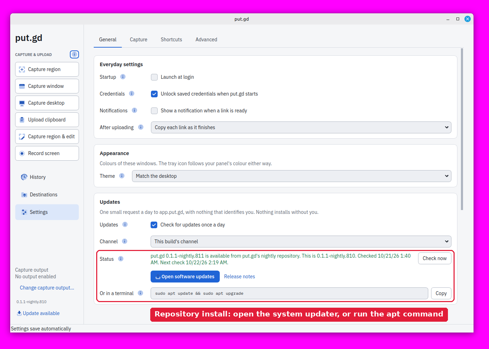
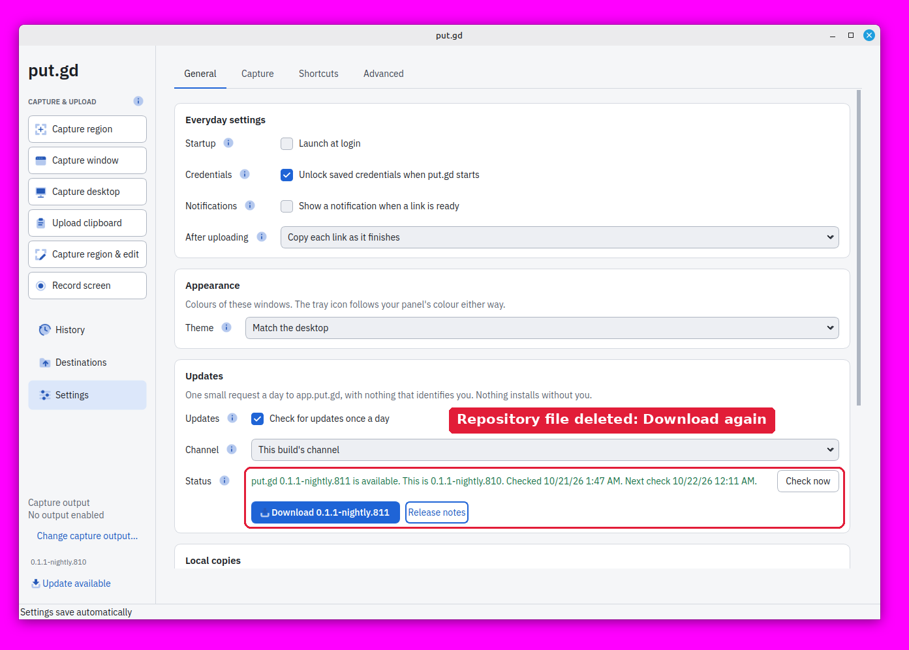
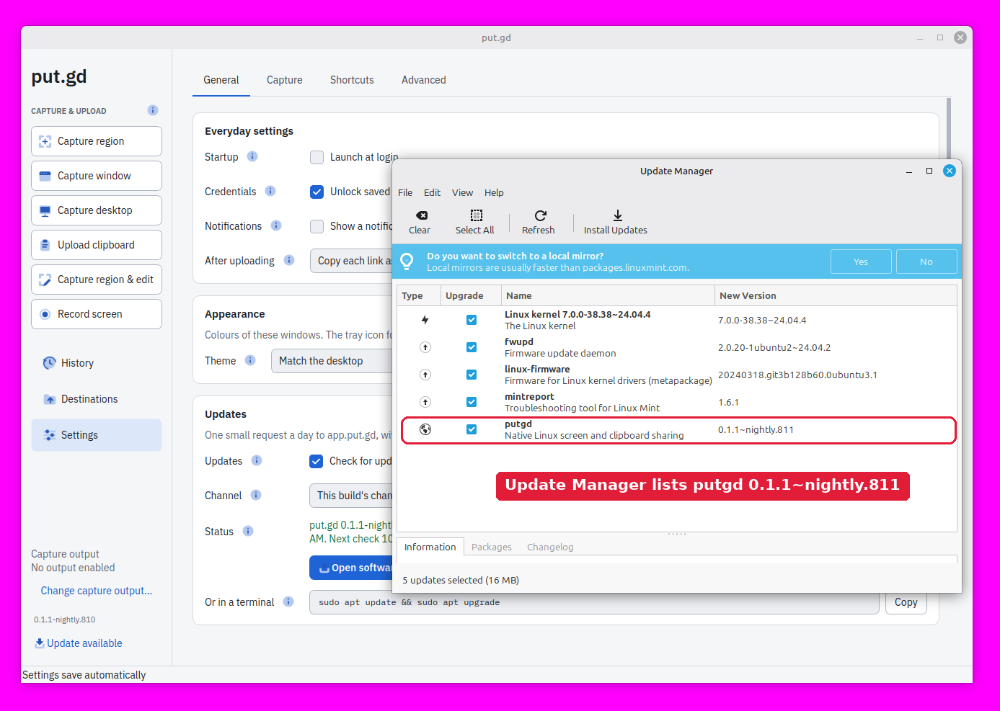
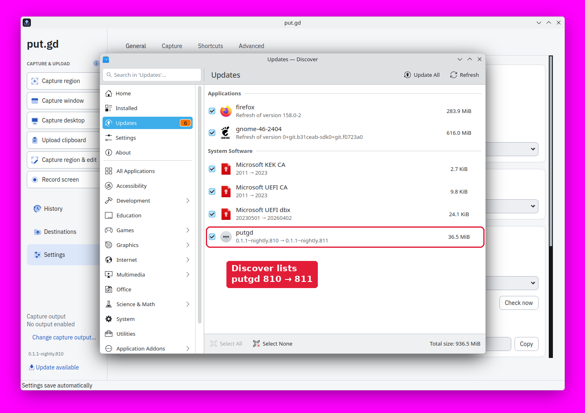
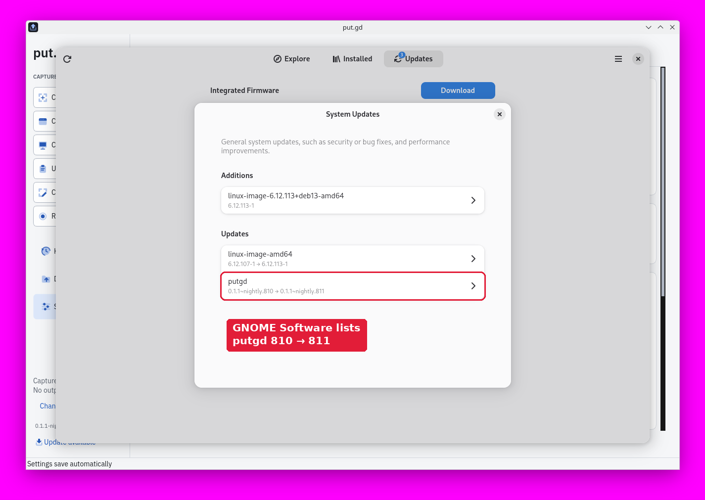
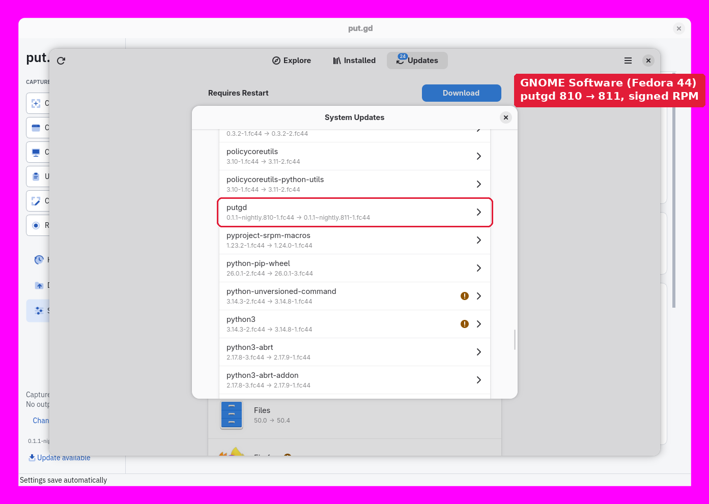

# #293 phase 2: package repository acceptance (2026-10-21)

These checks cover lab-scope acceptance of the signed apt and dnf repositories at
`pkg.put.gd` (put.gd-desktop #308, #309).

## What was tested

- **Packages:** the final branch `claude/pkg-repo-files-293` at `eea125a7`, on top of the signer at `d435a045`.
- **Lab builds:** `v0.1.1-nightly.809`, `.810` and `.811` are local tags on empty lab commits and were never pushed. They're release builds (`cmake --preset release`, Proton off) made on each target host, with `-DPUTGD_PACKAGE_REPOSITORY_URL=https://pkg.put.gd/lab`.
- **Publication:** the signer's lab scope on d69 published 810 and 811 to `https://pkg.put.gd/lab/`, signed with the real nightly key, through the real bucket, CDN, invalidation and readback. 809 was installed from its file.
- **Earlier passes:** passes 1–4 (797–808) found the bugs and design points listed at the end. All the results below come from pass 5 on the final code.

| Host | System | Desktop | Package |
| --- | --- | --- | --- |
| m74 | Linux Mint 22.3 | Cinnamon 6.6.9, X11 | `ubuntu24.04` DEB |
| k72 | Kubuntu 26.04.1 LTS | Plasma 6.6.6, Wayland | `ubuntu26.04` DEB |
| d69 | Debian 13 | Plasma, Wayland (GNOME Software installed, no Discover) | `debian13` DEB |
| f44 | Fedora 44 Workstation | GNOME 50, Wayland | `fedora44` RPM |

## Results

| Check | m74 | k72 | d69 | f44 |
| --- | --- | --- | --- | --- |
| Installing from the file adds the repository file (conffile or `%ghost`) and the key | pass | pass | pass | pass |
| `apt`/`dnf` moves N → N+1 from the repository | pass (809 → 810, 810 → 811) | pass (810 → 811) | pass (809 → 810, 810 → 811) | pass (810 → 811, signed RPM) |
| Settings shows **Open software updates** and the terminal command, and sends no notification of its own | pass | pass | pass | pass |
| Settings → **Open software updates** opens the desktop's updater, which lists putgd 811 | Update Manager | Discover | GNOME Software | GNOME Software (System Updates) |
| `update.openSoftwareUpdates` (CLI/MCP) opens the same updater | pass | pass | pass | pass |
| Repository file deleted: Settings offers **Download** again and `update.openSoftwareUpdates` returns `software_updates_unavailable` | pass | — | — | — |
| A deleted repository file stays deleted across an upgrade (810 → 811 from the file) | pass | pass | pass | pass |
| Purge/erase removes the repository file and key | pass | pass | pass | pass |
| Tampered `InRelease` (bad signature) and `Packages` (size and hash) rejected by apt | pass | pass | pass (sqv) | n/a |
| Forged repository: unsigned RPM and foreign-signed RPM refused by dnf | n/a | n/a | n/a | pass ("not signed", "wrong key") |
| Tampered `primary.xml` rejected by dnf | n/a | n/a | n/a | pass (checksum) |
| A re-written `repomd.xml` is accepted, because the repodata is unsigned (`repo_gpgcheck=0`); packages from it still need the putgd key's signature | n/a | n/a | n/a | as designed |
| PackageKit installs the signed update in trusted-only mode, importing the key itself | n/a | n/a | n/a | pass |

Logs are in [logs/](logs/), and the scripts that ran them are `logs/accept-pkg.sh`, `logs/gui293.py` and `logs/labbuild.sh`.

On k72, Discover also showed its own "Update Issue" dialog ("Failed to obtain authentication") as soon as it opened, in pass 3 as well as pass 5. That's Discover's background PackageKit refresh asking polkit for a password in the lab session; it doesn't involve put.gd's repository. The dialog was closed before the picture below was taken.

On f44, `pkcon update putgd` first answered "There are no updates available at this time", because PackageKit's own metadata cache predated 811. After `pkcon refresh force` it installed the signed 811 in trusted-only mode. The putgd key was already in rpm's keyring by then (dnf imported it for the forged-repository test), so PackageKit importing the key itself was last shown in pass 3; the repository file and key haven't changed since.

### Pictures

Each picture is a crop of the host's own VNC frame. A full-screen magenta cover hid everything except the lab windows, and each crop was checked on the host to have cover colour on all four edges before it was kept.

### Signer receipt

[receipt-lab-v0.1.1-nightly.811.json](receipt-lab-v0.1.1-nightly.811.json) records:
- the inputs it verified;
- the signatures it made, with key fingerprints;
- the RPM digest mapping (GitHub build `317d5e0d…` → signed `bd1b03c6…`);
- the 27 S3 uploads and two invalidations;
- the CDN readback of `InRelease`, `Packages` and `repomd.xml` on all labels before the feed was written.

The publication took 57 s.

### Secrets

On d69 the signer's state, receipts, source copy and user journal were searched for the AWS access key id, its secret and the minisign secret key. None was found; the search printed file names only, never values. No private key block exists outside source files that hold redaction patterns. The repository holds only the public keys, and `tests/releases/test_pkgrepo.py` checks that.

### Idle memory

The resident's memory was measured with the installed release build on each physical desktop: three alternating pairs of the nightly baseline (`v0.1.1-nightly.795`, nightly `71f241b`) and the final code. Each run idles for 180 s, runs `update.check` against the lab feed, then idles for another 180 s. The figures are the medians of the three post-check windows.

| Host | Session | Baseline RSS | Final RSS | Baseline PSS | Final PSS | Private dirty |
| --- | --- | --- | --- | --- | --- | --- |
| m74 | Cinnamon X11 | 28.10 MiB | 28.10 MiB (808) | 17.77 MiB | 17.75 MiB | 3.21 → 3.15 MiB |
| k72 | Plasma Wayland | 31.57 MiB | 31.65 MiB (811) | 9.73 MiB | 9.73 MiB | 3.53 → 3.52 MiB |
| f44 | GNOME Wayland | 34.78 MiB | 34.92 MiB (811) | 20.78 MiB | 20.95 MiB | 3.96 → 3.86 MiB |

On Cinnamon and Plasma the change is within run-to-run noise. On GNOME the final code uses 0.15 MiB more after a check, and the three pairs don't overlap. All of it is clean, file-backed pages: Private_Clean rises by about 0.2 MiB while anonymous memory and Private_Dirty fall by about 0.08 MiB. A per-mapping comparison on f44 ([logs/f44-smapsdiff.txt](logs/f44-smapsdiff.txt), two idle runs of each build, no check) puts +204 KiB in the `putgd` binary's own mapping, offset by −62 KiB anonymous and −72 KiB in `libQt6DBus`, for +40 KiB in total. The Fedora resident's `.text` is 12 KB larger than the baseline's (4,088,886 against 4,076,662 bytes). Clean code pages can be dropped and re-read under memory pressure; they don't grow over time.

No run left a child process behind. No TLS library was loaded into the resident on m74 or k72; on f44 `libcrypto.so.3` is mapped in the baseline and the final build alike. m74 was measured on 808. The resident's code is the same size in 808 and 811 (`.text` 4,116,322 bytes and `.rodata` 174,893 bytes in both `ubuntu24.04` builds); only `putgd-cli` changed between them (192 bytes more `.text`).

## Found and fixed during the lab passes

- **dnf repodata signing.** `repo_gpgcheck=1` makes GNOME Software's dnf5daemon on Fedora 44 fail to load the repository (`std::exception`), and OpenAI's ChatGPT repo fails the same way. Patrick chose signed RPMs with unsigned repodata instead.
- **`dnf remove` and the repo file.** It left `/etc/yum.repos.d/putgd.repo` behind, because RPM keeps a `%ghost %config` file on erase. A `%postun` now removes it on erase only.
- **DEB control file permissions.** The `conffiles` control file picked up the builder's umask (0664); control permissions are now strict.
- **`appstream://` links.** Discover and GNOME Software can't open put.gd's page without catalog data, and QUrl lowercased the id. The links were removed; #314 tracks the catalogs.
- **Resident memory.** Reading the repository file in the resident added about 0.23 MiB of code pages on GNOME. The `putgd-cli` child now reads the file and starts the updater, so the resident links none of it.
- **Discover killed by SIGPIPE.** Discover inherited the child's output pipes and died when the child exited (k72, pass 4). The updater now starts with its standard streams on `/dev/null`.
- **First stable publication.** It failed when no stable workspace existed yet. A round-trip test caught it and it's fixed.

## Not covered here

- **Real GitHub nightlies.** Installing an actual GitHub nightly that carries the repository, then upgrading it to the next one, can only happen after #308 and #309 merge and the signer runs in production. That check runs then, on all four hosts.
- **Installing through the updaters.** Installing from Update Manager, Discover or GNOME Software needs the host user's password (polkit). The updaters were checked to list the update; apt, dnf and PackageKit did the installs.
