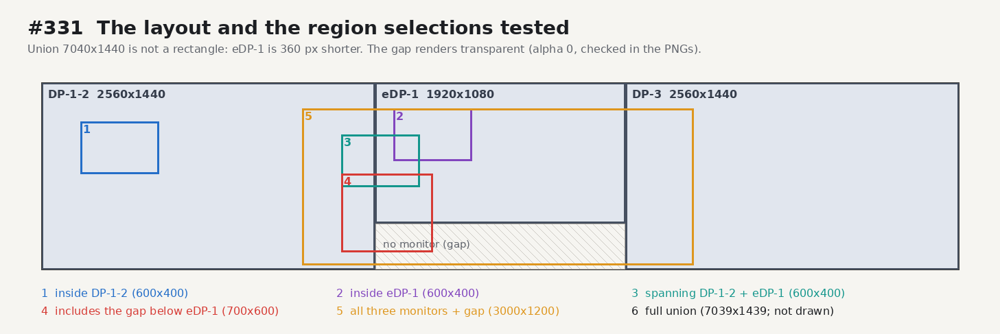
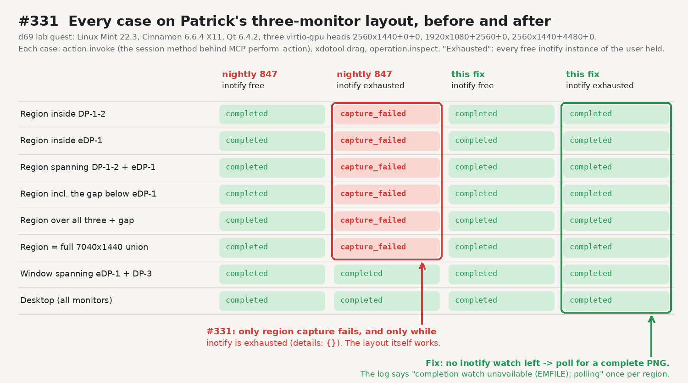
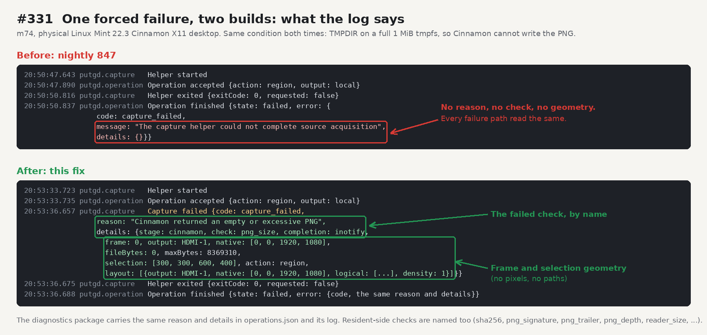

# Region capture on Cinnamon without a free inotify instance (issue #331, 2026-10-21)

Evidence for the code PR on `fix/multimonitor-region-331`. Region capture failed every
time on Patrick's workstation (Mint 22.3, Cinnamon 6.6.9 X11, Qt 6.4.2, three monitors)
with a bare `capture_failed`, a helper exit code 0 and empty `details`.

## Cause

It was not a code regression and not the monitor layout:

- Patrick's own log shows the same resident (nightly 683, one process) completing
  region captures at 16:16Z and failing at 20:11Z. The binaries, the running Cinnamon
  (up since Oct 14) and the 7040x1440 framebuffer (since boot) were the same.
- The helper exited 0 without being asked to stop, so the failure came from the
  helper itself and not from the resident's decode checks, which kill the helper.
- `CinnamonRegionCapture`, the region-only acquisition on Cinnamon, needs one inotify
  instance per capture to wait for each monitor's PNG. inotify instances are a
  per-user limit (`fs.inotify.max_user_instances`, 128 by default) that every program
  shares. On the workstation, a fresh `inotify_init1` returned `EMFILE`; the main
  holders were the many agent processes running there. Window and desktop capture
  read the root window and never needed inotify.
- Cinnamon 6.6's `ScreenshotArea` is a synchronous JavaScript method without out-arguments:
  its D-Bus reply returns before the PNG is painted and written, so it cannot replace the watch.

The fix polls each output (every 20 ms, inside the same ten-second deadline) until it
ends in a stable PNG IEND trailer when no watch can be created, and logs
`Cinnamon capture completion watch unavailable (EMFILE); polling for finished PNGs`.
It also names every capture failure (below).

## The layout and the selections tested

## Before and after on the three-monitor layout

d69 lab guest `mm331-a`: golden `cinnamon-x11` (sha256 `4a21566d…`), Linux Mint 22.3,
Cinnamon 6.6.4, Muffin 6.6.1, Qt 6.4.2, three virtio-gpu heads arranged with
`lab.py launch --layout 2560x1440+0+0,1920x1080+2560+0,2560x1440+4480+0` and verified
by `lab.py layout` (Virtual-1/2/3, three RandR outputs, QMP screendumps of each head's size).

- Builds: nightly 847 (`putgd-0.1.1-nightly.847-ubuntu24.04-x86_64.deb`, sha256 `8bc9a650…`,
  the build Patrick runs) and the fix (`putgd_0.1.1~dev.unknown_amd64.deb`, Release
  preset and CPack on m74 from the code branch, sha256 `f1af2893…`).
- Each case: `action.invoke` through `putgd-cli` (the session method behind MCP
  `perform_action`), an xdotool drag in the guest, then `operation.inspect`.
- "Exhausted": a guest process holds every free inotify instance of the guest user
  (87 of 128; the desktop session holds the rest), as on the workstation.
- X confines the pointer to the monitors, so a selection that includes the gap starts
  on DP-1-2 and ends on eDP-1. The gap pixels of every spanning capture are transparent
  (alpha 0) and monitor pixels opaque (alpha 255), checked in the saved PNGs.
- 847 with inotify free passes every case: the non-rectangular union itself works.
  847 exhausted fails all six region cases with `capture_failed`, `details: {}`; window and
  desktop pass. The fix passes all eight cases both ways, with one polling record per region.

## Diagnostics before and after (physical m74)

m74, the physical Mint 22.3 Cinnamon 6.6.9 X11 desktop (one output, HDMI-1 1920x1080),
under a desktop lock, with a private put.gd profile. Patrick asked for m74 first:

- 847, control: region completes. 847 with inotify exhausted (65 free instances held):
  `capture_failed`, `details: {}`, the same records as Patrick's log.
- The fix, inotify exhausted: region completes, with the polling record in the log.
  Window (700x532) and desktop (1920x1080) complete.
- Forced failure, same condition for both builds: `TMPDIR` on a full 1 MiB tmpfs, so
  Cinnamon cannot write its PNG. 847 reports the generic message and empty details. The
  fix reports `Cinnamon returned an empty or excessive PNG`, check `png_size`,
  `fileBytes: 0`, the frame, output and native rectangle, the selection and the layout,
  in a `Capture failed` log record, in the operation's error and in the diagnostics
  package's `operations.json` and log.

No physical builder has two or more monitors: m74, k72, d69 and f44 each report one
connected output (HDMI-A-1), so the multi-monitor runs are the lab guest above.

## Tests in the code PR

- `geometry_contract`: the three-monitor union with mixed sizes, selections inside one
  monitor, across two, including the gap, over all three and the full union, with a PNG
  round trip to the formats the resident accepts.
- `x11_isolated`: three mixed-size Cinnamon frames requested at once; the polling
  fallback (`EMFILE`) with a complete writer and a slow two-part writer that stays open;
  each Cinnamon failure names its check and frame geometry, never the service's text or a path.
- `capture_process_integration`: the helper's reason and details reach the operation's
  error; the resident's own checks (`sha256`, `descriptor_limits`, `ready_frame`,
  `result_frame`, `helper_exit`) are named.

All three plus `capture_control_integration`, `x11_capture_decode`, `x11_native_snapshot`
and `capture_preparation_x11` pass on m74 (Qt 6.4.2).
