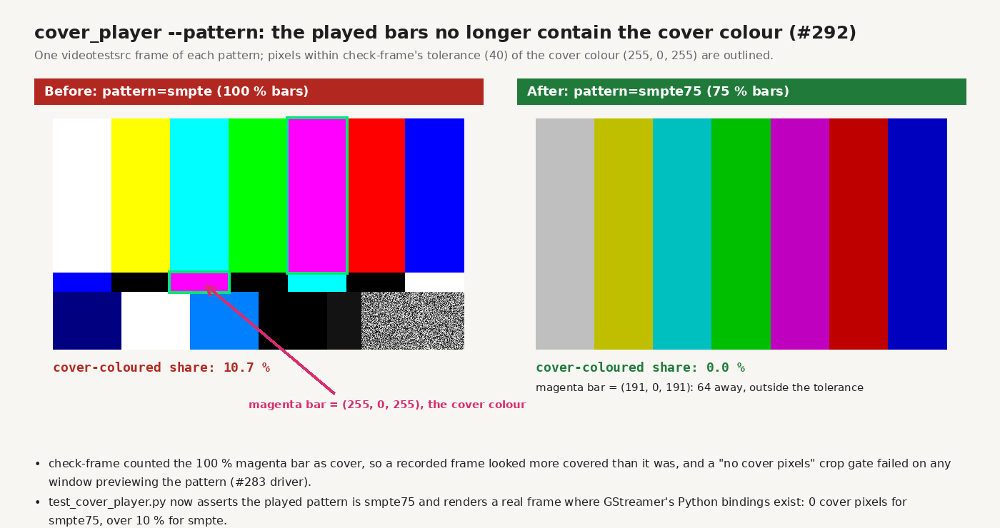
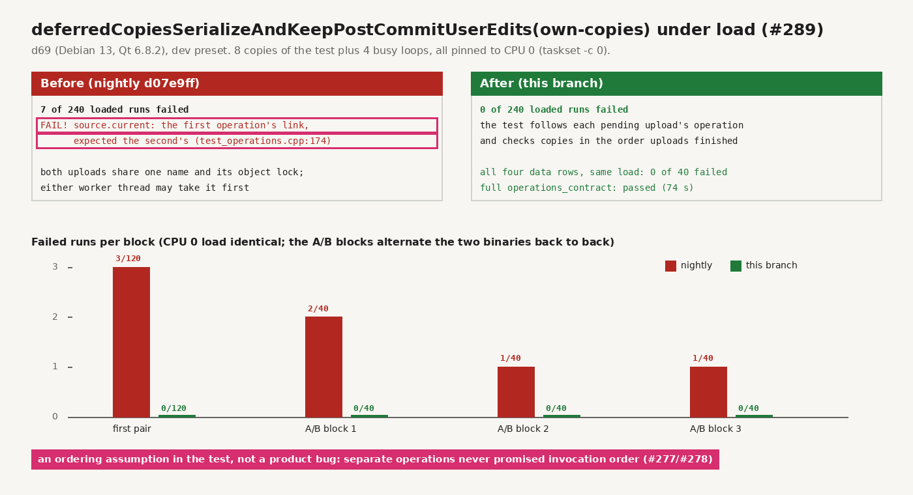
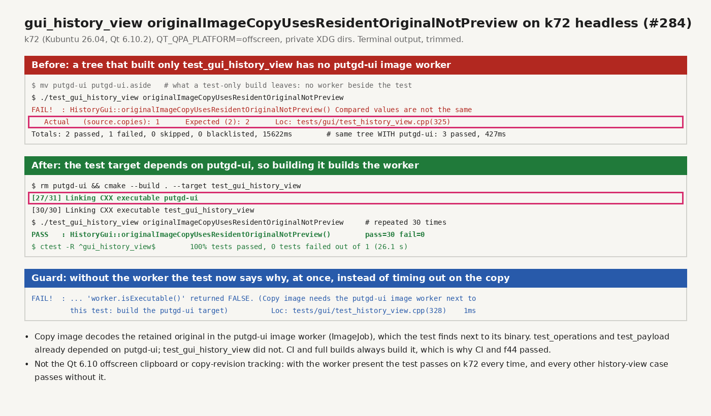
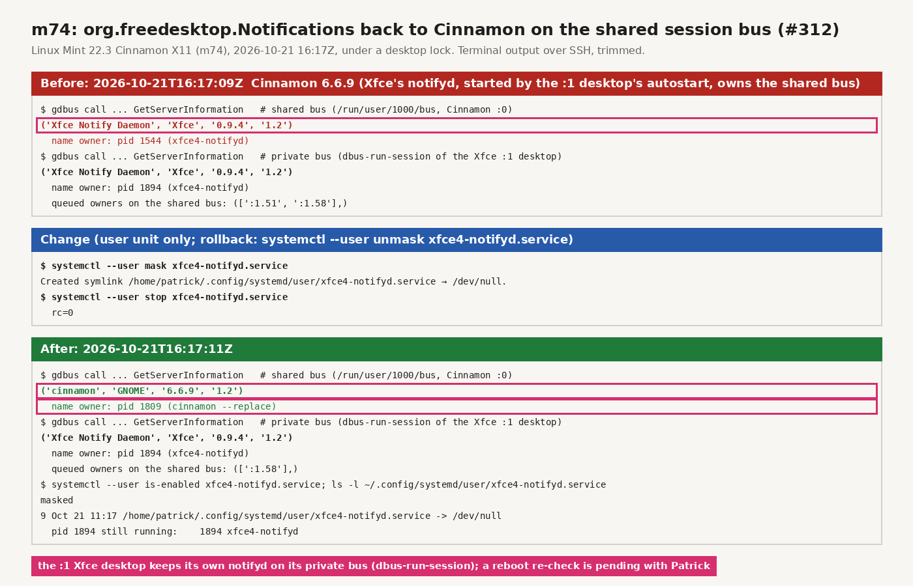

# Test and lab reliability: #292, #289, #284, #312 (2026-10-21)

Evidence for the test fixes in the code PR (`claude/test-lab-reliability`) and the m74
lab change in [remote-builders](../../remote-builders.md#m74-notifications-belong-to-cinnamon-312-2026-10-21).
All runs were on the builders (d69, k72, m74), with private XDG directories and
`QT_QPA_PLATFORM=offscreen`.

## #292: the lab test pattern drew the cover colour

`tools/lab/cover_player.py play --pattern` played `videotestsrc pattern=smpte`. Its
100 % magenta bar is (255, 0, 255), the cover colour, so `check-frame` counted 10.7 %
of a pattern frame as cover, and a crop gate that requires zero cover pixels failed
on any window previewing the pattern. The player now uses `smpte75`, whose bars stop
at 191: magenta (191, 0, 191) is 64 away, outside the tolerance of 40.
`test_cover_player.py` asserts the played pattern is `smpte75` and that no 75 % bar
colour falls within the tolerance. Where GStreamer's Python bindings exist, it renders
a frame and finds 0 cover pixels (and over 10 % for the old `smpte`).

## #289: deferredCopiesSerializeAndKeepPostCommitUserEdits(own-copies) under load

The test queues two clipboard uploads of one name and assumed the first pending upload
belonged to the first operation. Uploads of one name share its object lock (a
`std::mutex`, no FIFO order), and each operation's worker thread may take it first. When the
second operation won, the first operation copied its link last, and the final check
(`test_operations.cpp:174`) expected the second's. This is the same ordering
assumption as #277, fixed by #278. put.gd has never promised that separate
operations finish in invocation order. Test-only fix: identify each pending
upload's operation from the recorded request and check the copies in the order the
uploads finished.

On d69 (Debian 13, Qt 6.8.2), eight copies of the test plus four busy loops, all on
CPU 0 (`taskset -c 0`), the tests at `nice 10`:

| Binary | Loaded runs | Failed |
| --- | --- | --- |
| nightly `d07e9ff` | 240 | 7, all at `test_operations.cpp:174` |
| this branch | 240 | 0 |
| this branch, all four data rows | 40 | 0 |

The first pair (120 + 120) ran one after the other while another session's build also
loaded the host. The three A/B blocks (40 + 40 each) alternated the two binaries back
to back under the same conditions: 4 failures against 0. The full
`operations_contract` suite passed with the fix (74 s).

## #284: originalImageCopyUsesResidentOriginalNotPreview failed on k72 headless

Copy image decodes the retained original in the `putgd-ui` image worker (`ImageJob`),
which the test looks for next to its own binary. `test_operations` and `test_payload`
depend on `putgd-ui`; `test_gui_history_view` did not. A tree that built only that
test has no worker. The copy then fails once the worker can't start, and the test reads
`source.copies` as 1 after about 15 s. That is the k72 failure. CI and full builds
always build the worker, which is why CI and f44 passed. The Qt 6.10 offscreen
clipboard and copy-revision tracking aren't involved: with the worker present the
test passed 30 of 30 runs on k72 (Kubuntu 26.04, Qt 6.10.2), and the `gui_history_view`
ctest passed.

The test target now depends on `putgd-ui`: after `rm putgd-ui`, building only
`test_gui_history_view` relinks the worker. If the worker is missing anyway, the test
fails at once with "Copy image needs the putgd-ui image worker next to this test:
build the putgd-ui target", without waiting for the copy to time out.

## #312: m74 notifications from xfce4-notifyd

The `:1` Xfce desktop's autostart started the `xfce4-notifyd.service` user unit, and
the unit runs on the shared session bus, where it claimed
`org.freedesktop.Notifications` before Cinnamon. Masking the user unit leaves the name
to Cinnamon; the `:1` desktop keeps its own notifyd on its private bus. Applied under a
desktop lock at 16:17Z. Details and rollback are in
[remote-builders](../../remote-builders.md#m74-notifications-belong-to-cinnamon-312-2026-10-21).

Still open for #312's acceptance:
- a put.gd notification's default action on m74, in a coordinator-granted slot;
- a `GetServerInformation` check after the next reboot, which the coordinator
  arranges with Patrick.
