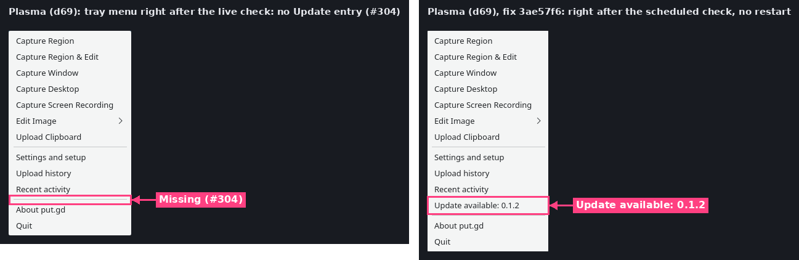
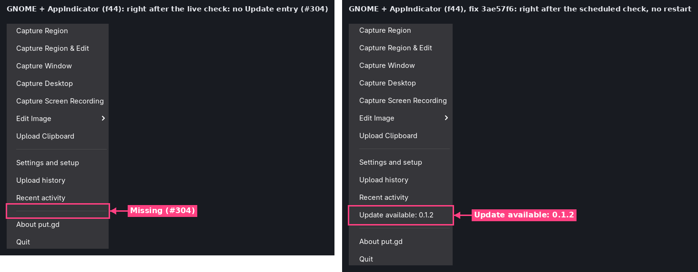
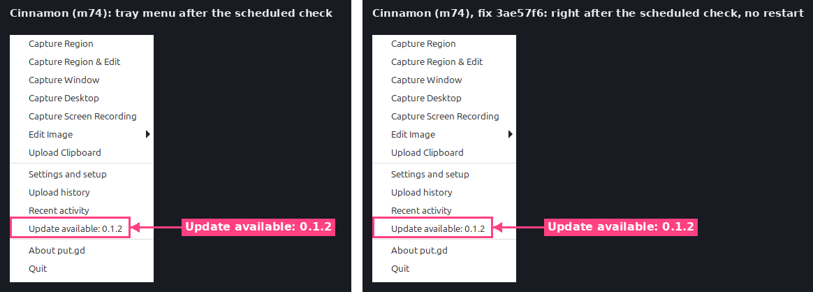
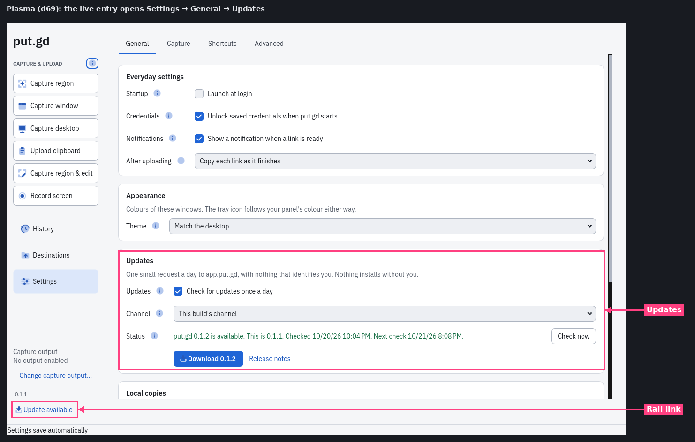
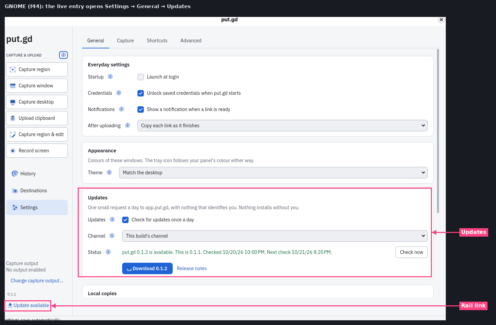

# Tray "Update available" entry shown live (#304)

Fix: [#311](https://github.com/patrick-hudson/put.gd-desktop/pull/311) (commit `3ae57f6`).
The problem was found by the [#303 desktop acceptance](../2026-10-21-updates-acceptance-303/README.md#2-stable-channel-the-scheduled-check-one-notification-the-tray-entry).
Recorded 2026-10-21 by the updates-acceptance session.

**Cause:** the dbusmenu layout hid the update entry with `visible: false` and showed it
by leaving `visible` out, the default. Plasma (libdbusmenu-qt) and GNOME's AppIndicator
update a known item only with the properties the new layout carries, so they kept it
hidden until put.gd restarted.

**Fix:** the entry always carries an explicit `visible`, and `setUpdateLabel` also
emits `ItemsPropertiesUpdated` (`label`, `visible`) before `LayoutUpdated`.
`native_tray_integration` checks the layout, `GetProperty` and the signal; it passed
on d69 (`ctest -R native_tray_integration`, 15.3 s).

## How it was run

Same method as #303 ([driver](../2026-10-21-updates-acceptance-303/lab/accept303.py)):

- **Build:** `3ae57f6`, built by [build304.sh](build304.sh) with a local, never-pushed
  `v0.1.1` tag and each host's `PUTGD_PACKAGE_TARGET` (`fedora44`, `debian13`, `ubuntu24.04`).
- **Profile:** private, local-only, on screen in the physical session, under a
  desktop lock.
- **Feed:** loopback, offering `v0.1.2`.
- **Steps:** nobody pressed **Check now**. The resident's own first check ran, and
  then, **without a restart**, the tray icon was opened with a real click. The
  update entry was picked from the keyboard.

| Desktop | Started | Scheduled check | Notifications | dbusmenu after the check | Tray entry live (no restart) | Entry opens |
| --- | --- | --- | --- | --- | --- | --- |
| d69 Debian 13 Plasma 6.3 Wayland | 02:55:45Z | 03:04:50Z (9 min 05 s) | 1, release notes opened | revision 2, `Update available: 0.1.2`, `visible: true` | ✅ | Settings → General → Updates |
| f44 Fedora 44 GNOME 50 + AppIndicator | 02:55:36Z | 03:00:51Z (5 min 15 s) | 1, release notes opened | revision 2, `visible: true` | ✅ | Settings → General → Updates |
| m74 Mint 22.3 Cinnamon 6.6.9 X11 | 03:42:14Z | 03:53:38Z (11 min 24 s) | 1 (see below) | revision 2, `visible: true` | ✅ (no regression) | Settings → General → Updates |

Each resident ran from a single start (`update.status`, `starts` in [results](results/)).

## Before and after

The before pictures are the #303 run on the same desktops, at nightly `71f241b` without the fix.

**Notification on m74:** since the host rebooted at 02:55Z, its notifications come from
xfce4-notifyd, from the Xfce session on the second VNC display, not from Cinnamon
([#312](https://github.com/patrick-hudson/put.gd-desktop/issues/312)). It showed put.gd's
one notification with an **Open in browser** button, and a click on its body opened
nothing. In #303, before the reboot, Cinnamon's banner opened the release notes. The
fix doesn't touch notifications.

The live entry opens Settings on General, where the Updates section shows the update:

## Clean-up

Every resident, feed server, input agent and private runtime dir was removed, and
each desktop lock was released `--verified-clean`. The update notifications on
d69 and f44 were clicked, which closes them. m74's expired on its own.
