# Update check and AppImage updates on real desktops (#303, #295)

Desktop acceptance for the daily update check ([#301](https://github.com/patrick-hudson/put.gd-desktop/pull/301),
[updates](../../updates.md)) and for AppImage updates through the embedded zsync
information ([#298](https://github.com/patrick-hudson/put.gd-desktop/pull/298),
[AppImage updates](../../release.md#appimage-updates)). Recorded 2026-10-21 by the
updates-acceptance session.

Every run used the physical desktops' own sessions, on screen, with a private profile
(`XDG_CONFIG/DATA/CACHE/STATE_HOME` and `XDG_RUNTIME_DIR` under `~/work/put.gd-303`).
Each profile was local-only, with no shortcuts and launch at login off. A desktop
lock was held for every desktop run. The release-notes link went to a URL recorder
(a private `x-scheme-handler/https` entry), so no browser opened. Pictures are
cropped to put.gd's own popup, menu or window, with edges and contents checked on
the host before copying. On GNOME, 10 px are trimmed so rounded corners show
nothing behind them. The AppImage half ran in a disposable Mint 22.3 guest on d69.

## Builds

Scratch clones from a bundle of `origin/nightly`, with local tags that were never
pushed. Built on each builder with [lab/build303.sh](lab/build303.sh)
(`--preset release`, targets `putgd putgd-ui putgd-cli`).

| Name | Source | Tag | `PUTGD_PACKAGE_TARGET` |
| --- | --- | --- | --- |
| base | `85582d6` (nightly before #301) | `v0.1.1-nightly.781` | f44 `fedora44`, d69 `debian13` |
| nightly | `71f241b` (nightly with #301/#302) | `v0.1.1-nightly.795` | same |
| stable | `71f241b` | `v0.1.1` | f44 `fedora44`, d69 `debian13`, m74 `ubuntu24.04` |

The stable and nightly checks used a loopback feed (`PUTGD_UPDATE_FEED_URL=http://127.0.0.1:18303/`,
[stable](lab/feed-stable.json): `v0.1.2`, [nightly](lab/feed-nightly.json): `v0.1.1-nightly.800`).

## 1. Memory gate (QUIET slots, f44 and d69)

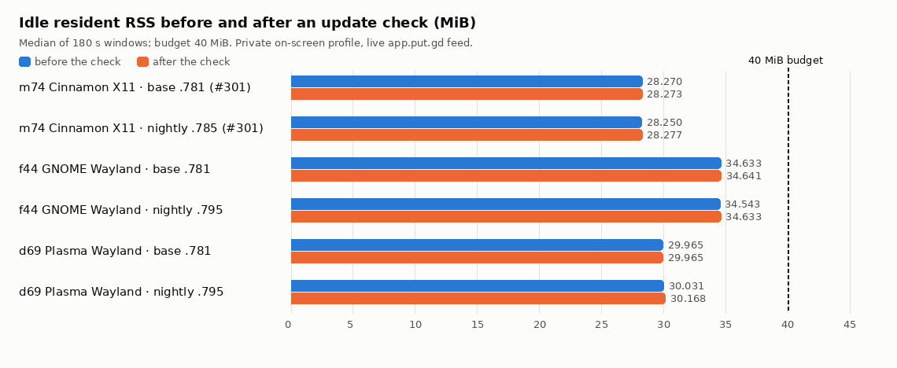

[lab/mem303.py](lab/mem303.py) is #301's `mem293.py` for any desktop. It reads the
session from `cinnamon`, `plasmashell` or `gnome-shell`. gnome-shell is the
compositor, so `WAYLAND_DISPLAY`/`DISPLAY` come from `systemctl --user show-environment`.
Every launch, including the one that writes the private settings, runs in the real
session. The resident ran on Wayland with Qt's default platform. Each run takes 180 s
idle windows before and after `update.check` against the live app.put.gd nightly feed.

| Desktop | Build | RSS before → after (MiB) | PSS before → after (MiB) | Check | TLS/network libraries in the resident |
| --- | --- | --- | --- | --- | --- |
| f44 GNOME 50 Wayland | base `.781` | 34.633 → 34.641 | 20.72 → 20.73 | `unknown_method` | `libcrypto` before and after |
| f44 | nightly `.795` | 34.543 → 34.633 (+0.090) | 20.64 → 20.73 | ok, 0.69 s, no child left | `libcrypto` before and after |
| d69 Plasma 6.3 Wayland | base `.781` | 29.965 → 29.965 | 10.38 → 10.38 | `unknown_method` | none |
| d69 | nightly `.795` | 30.031 → 30.168 (+0.137) | 10.41 → 10.48 | ok, 0.56 s, no child left | none |

**Result: pass** on both, at least 5.3 MiB under the 40 MiB budget. Load stayed
under 0.2. On f44 the base build maps `libcrypto` too, so it comes from the Fedora
desktop stack, not the check. The check's Qt Network and TLS stay in the
`putgd-cli` child. Raw results: [f44](results/f44/), [d69](results/d69/); m74 is in
#303 (28.25 → 28.28 MiB).

## 2. Stable channel: the scheduled check, one notification, the tray entry

The stable build started with no saved check, and nobody pressed **Check now**. The
driver is [lab/accept303.py](lab/accept303.py): `setup`, `start`, `notify`, `menu`,
`tray`, `stop`, `age`.

| | m74 Cinnamon 6.6 X11 | f44 GNOME + AppIndicator | d69 Plasma 6.3 Wayland |
| --- | --- | --- | --- |
| First check after start (resident's own timer, `manual: false`) | 9 min 42 s | 10 min 44 s | 9 min 07 s |
| Notifications shown | 1 | 1 | 1 |
| Clicking it opened | `…/releases/tag/v0.1.2` | same | same |
| Tray **Update available: 0.1.2** right after the live check | ✅ | ❌ (#304, fixed in [#311](../2026-10-21-tray-update-visible-304/README.md)) | ❌ (#304, fixed in #311) |
| …after a restart | ✅ | ✅ | ✅ |
| Tray entry opens Settings → General → Updates | ✅ | ✅ | ✅ |
| Restart: next check | a day later (2026-10-22T01:08Z) | 2026-10-22T01:13Z | 2026-10-22T03:44Z |
| Restart with `attemptedAt` aged 25 h: second scheduled check | 11 min 21 s, 0.1.2 again, **no notification** | 14 min 48 s, none | 13 min 57 s, none |

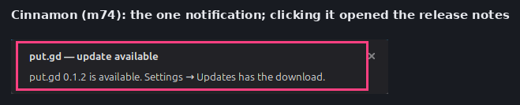
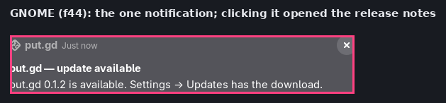
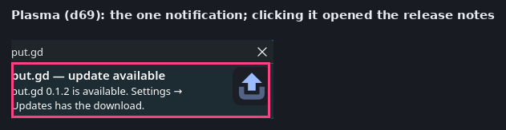

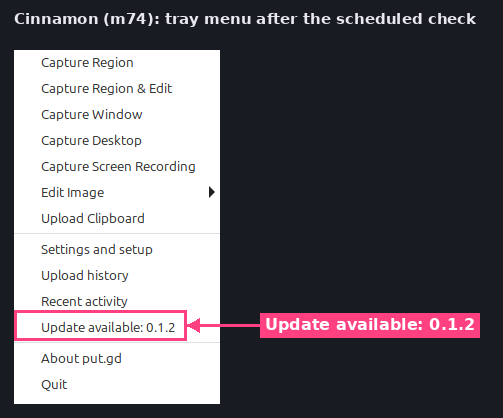

On Plasma and GNOME, put.gd's own dbusmenu (`GetLayout`, revision 2) listed the item
as visible at the same moment. Both hosts kept the hidden state from revision 1:
the layout leaves `visible: true` out as the default, so they never apply it.
Filed as [#304](https://github.com/patrick-hudson/put.gd-desktop/issues/304). After a
restart the item is visible from the first layout:

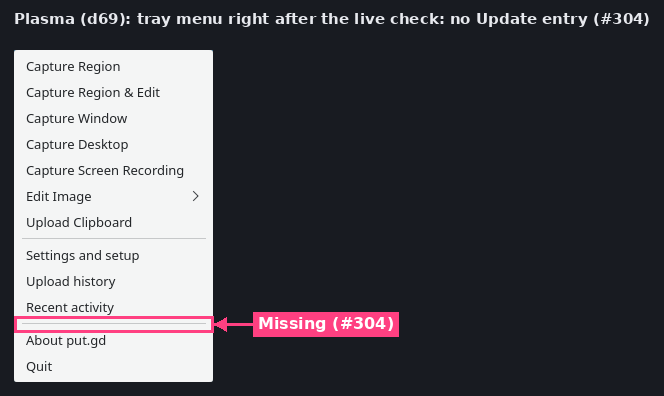
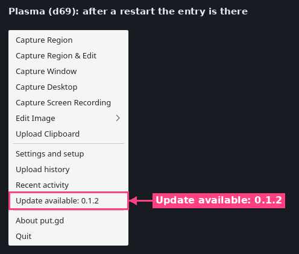
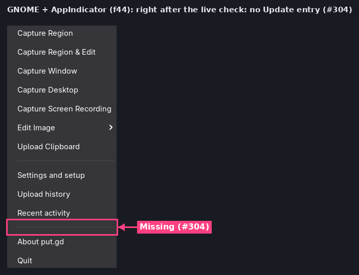
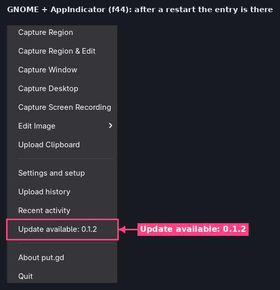

The entry opens Settings on General, where the Updates section shows the update:

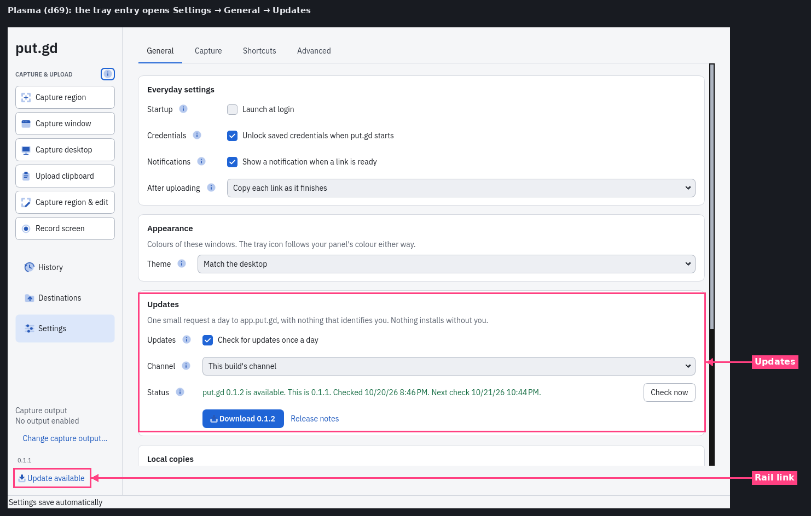
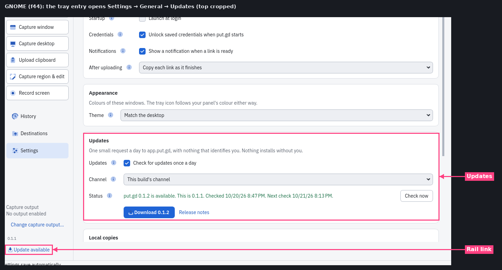

**Channel** shows *This build's channel*, the default, and doesn't say which channel
it resolved to. Here it was stable (`update.status` → `"channel": "stable"`).
Filed as [#305](https://github.com/patrick-hudson/put.gd-desktop/issues/305).

Status and event logs: [m74](results/m74/), [f44](results/f44/), [d69](results/d69/).

## 3. Nightly channel (f44 and d69)

The nightly build used the loopback feed with `v0.1.1-nightly.800`. The scheduled
check ran 6 min 53 s (f44) and 10 min 43 s (d69) after start and found `nightly.800`.
**No notification**, and the tray item stayed hidden (dbusmenu revision 1). Settings
and the rail show the update:

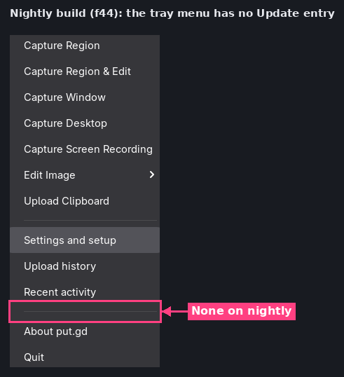
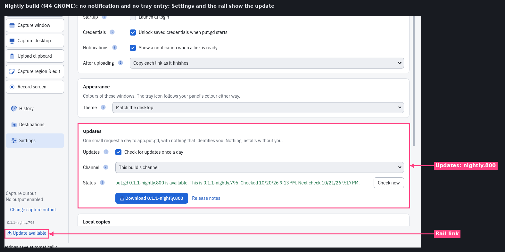

## 4. AppImage updates: Gear Lever, AppImageLauncher, start at login (#295)

No published nightly carries a `.zsync` yet (the first is the 2026-10-21 05:23Z
nightly), so this used the lab origin. The CI AppImages of two consecutive nightly
pushes were re-wrapped with the pinned appimagetool 1.9.1, type2 runtime 20251108,
`-b 16384` and the bundled zsyncmake 0.6.2 ([lab/repack295.sh](lab/repack295.sh)):

| | Source | Embedded update information | SHA-256 |
| --- | --- | --- | --- |
| N | `putgd-0.1.1-dev.788+gfbd9ce8eea45` (run 39520849409) | `zsync\|http://127.0.0.1:8765/appimage.zsync` | `53c3e4d2…` |
| N+1 | `putgd-0.1.1-dev.795+g71f241b8f5d3` (run 39523685149) | same | `754c3d59…` |

The guest served them with #298's Range server. [lab/redirect_server.py](lab/redirect_server.py)
adds a 302 from `/appimage.zsync` to a release-style path, as `app.put.gd/dl/<channel>/appimage.zsync`
redirects to GitHub. The `.zsync`'s `URL:` names the image at a third path.
Guest: Mint 22.3 Cinnamon 6.6 (`cinnamon-x11` golden, read-only backing), on the wall.

| Updater | What it did | File afterwards | Login after a real logout |
| --- | --- | --- | --- |
| Gear Lever 4.6.2 (Flathub) | Reads `.upd_info` (`StaticFileUpdater\|embedded`). Fetches the `.zsync` (follows the 302), then **downloads the whole image** from its `URL:` (no delta). Refuses while put.gd runs. | Replaced in place (`~/AppImages/put.gd.appimage`), SHA-256 = N+1 | ✅ N+1 starts (`0.1.1-dev.795`) |
| AppImageLauncher v3.0.0-beta-3 updater (libappimageupdate) | zsync **delta** through the 302: 95.35 % reused, 6.15 MB fetched in 4 Range requests (206), checksum OK, "AppImage not signed" warning | New file `putgd-0.1.1-dev.795+…AppImage` **beside** the old one, which is kept | ⚠️ **Old N** starts until N+1 has been launched once; then N+1 ([#307](https://github.com/patrick-hudson/put.gd-desktop/issues/307)) |
| appimageupdatetool 2.0.0-alpha-1-20251018 `--remove-old` | Same delta | Old file removed | ❌ **Nothing starts**: autostart points at the removed file (#307) |

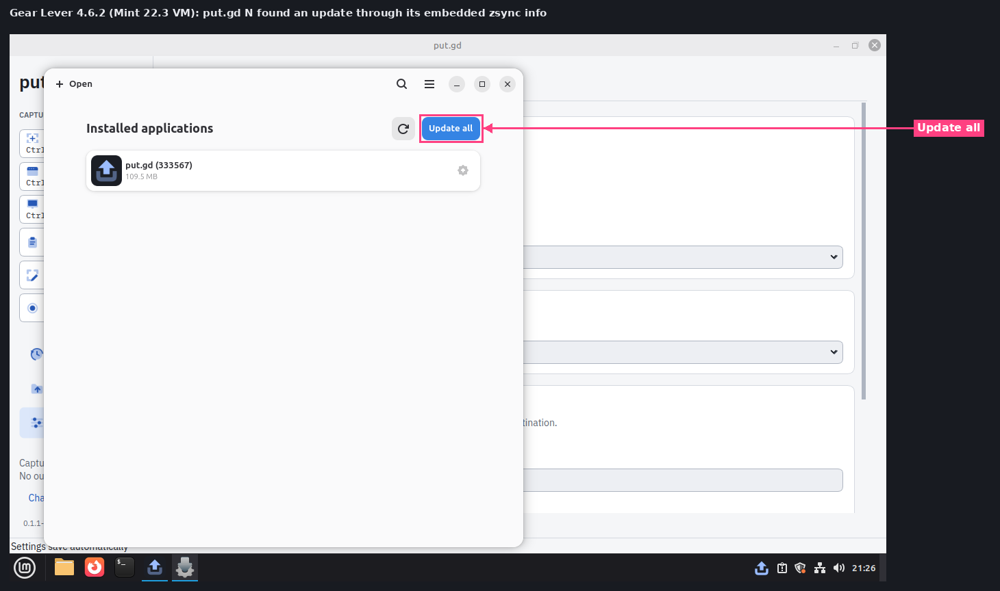
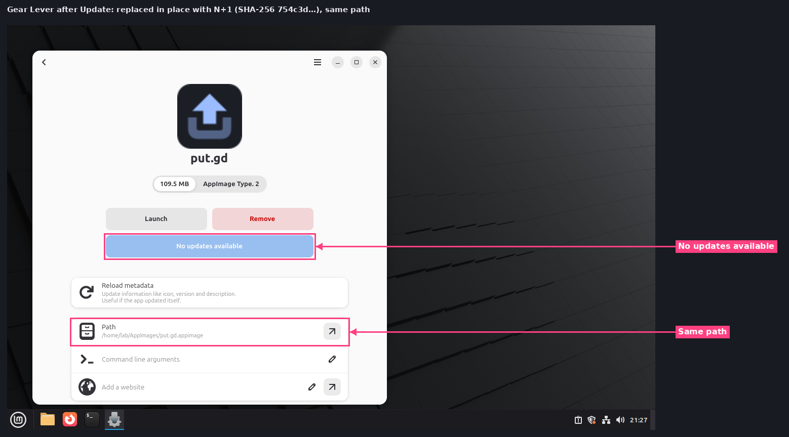
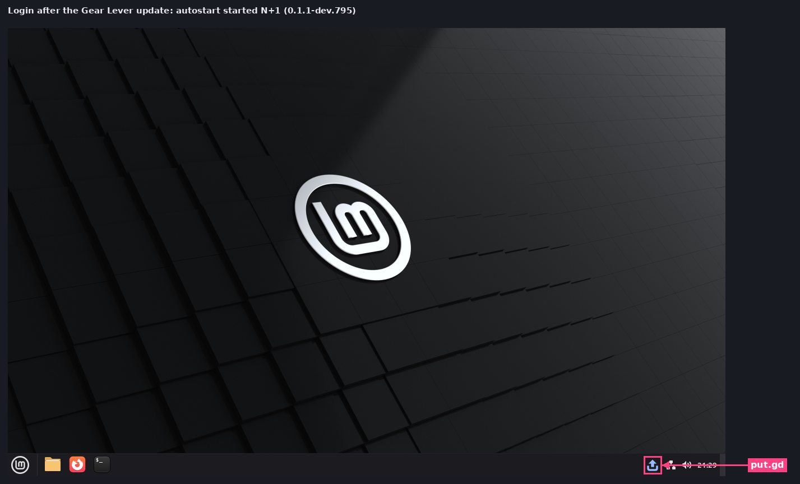
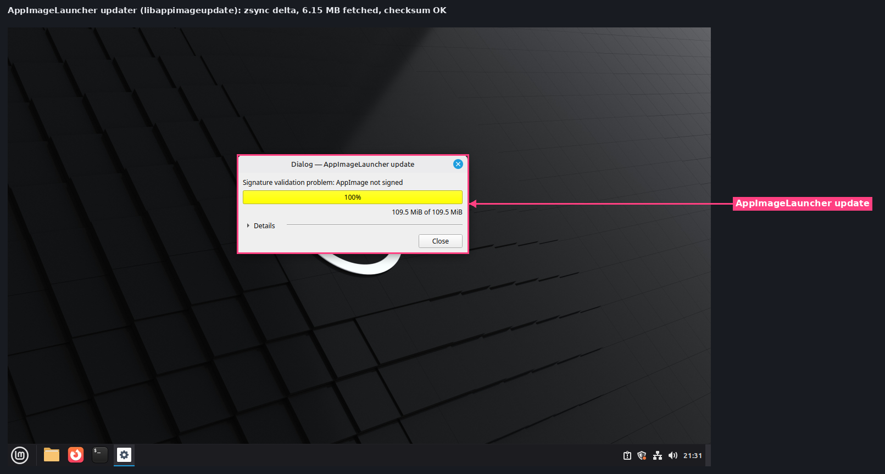
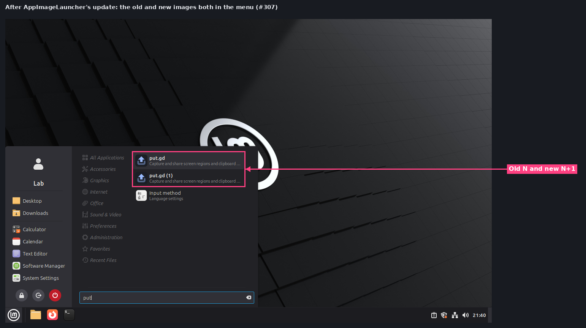
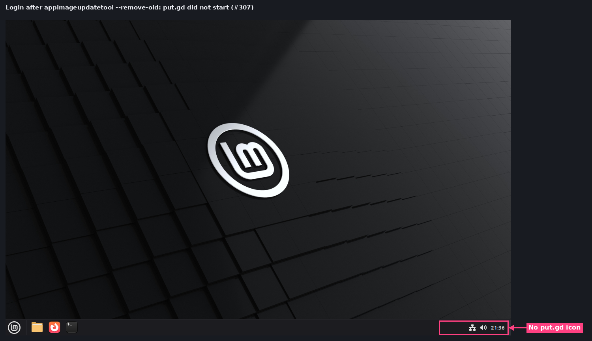

Also found:

- **AppImageLauncher won't integrate put.gd** ([#306](https://github.com/patrick-hudson/put.gd-desktop/issues/306)).
  The image root has two desktop entries, `putgd.desktop` and `putgd-ui.desktop`
  (`NoDisplay=true`). libappimage reads the second and stops with "The AppImage
  explicitly requested to not be integrated". With the root `putgd-ui.desktop` link
  removed ([lab/repack295-onedesktop.sh](lab/repack295-onedesktop.sh)),
  integration works and adds **Update this AppImage**. After an update the daemon
  registers the new file as a second menu entry, **put.gd (1)**.
- AppImageLauncher v3.0.0-beta-3's own **Update this AppImage** action fails on
  Mint 22.3 (`…/appimagelauncher/update: libQt5QuickWidgets.so.5: cannot open shared object file`).
  That is upstream; `/opt/appimagelauncher.AppDir/usr/bin/update` works.
- put.gd rewrites its autostart `Exec` to the running `$APPIMAGE` at every start, so
  updaters that keep the path (Gear Lever) need nothing else.

Logs: [results/vm295](results/vm295/) (Range/redirect server, updater output, login checks).

## Not covered

- A live update through `https://app.put.gd/dl/nightly/appimage.zsync` and GitHub's
  CDN: #296, which needs two published nightlies with a `.zsync`.
- A stable build seeing a real stable release: there is none yet. The loopback feed
  stood in for one.
- Retesting #304, #306 and #307 after their fixes.

## Clean-up

Every resident, feed server, input agent (`putgd-lab-input.service`), private
runtime dir and frame was removed, and the locks were released `--verified-clean`.
Only the three update notifications above were shown, and each was clicked, which
closes it. The guest overlay, its tunnel (`putgd-vm-mint-295`) and its wall entry
were removed. The `cinnamon-x11` golden on d69 still hashes `4a21566d…`. Build
trees in `~/work/put.gd-303` on f44, d69 and m74 are removed after this PR.
