# Switching an AppImage between nightly and stable: lab acceptance, 2026-10-22 (#344)

This is the acceptance for [#359](https://github.com/patrick-hudson/put.gd-desktop/pull/359) at head `a82a5192`. That head is the feature plus merges of `nightly`, including #351 and #358.

- **What it covers:** the AppImage part of [#344](https://github.com/patrick-hudson/put.gd-desktop/issues/344), built to the design Patrick approved ([comment](https://github.com/patrick-hudson/put.gd-desktop/issues/344#issuecomment-6331023230)).
- **What stays open in #344:** DEB/RPM, Flatpak and Windows.
- **User guide:** [Switching channels](../../updates.md#switching-channels).

## Builds under test

All three were built from `a82a5192` plus one local commit, `8d55de8c`. That commit replaces `packaging/linux/repo/keys/putgd-stable.minisign.pub` with a lab-only key, so that these images trust the lab stable feed. The real stable key stays on the workstation. The source tree is otherwise identical, and the tags and lab commits were never pushed.

| Build | Lab commit (`gitCommit` in the image) | Tag | AppImage SHA-256 |
| --- | --- | --- | --- |
| stable `0.1.1` | `8d55de8c` | `v0.1.1` | `60dcdfae62e0d5a2ceac8168b674eb8e74d17f65af2a141b3ae6829bdd3f01b2` |
| nightly `0.1.1-nightly.9101` | `bc9eb31f` (empty commits on `8d55de8c`) | `v0.1.1-nightly.9101` | `c06a2dd7c52dc137f57ae25b97d17b578447b9ef43e8796b862a07b786b297e9` |
| nightly `0.1.1-nightly.9102` | `9343a617` | `v0.1.1-nightly.9102` | `5ee142150cc8e4f9f5a9e051a071acc6ece07d1f29a23000426570b2371650b1` |

**How they were built:**
- **Like CI:** the way `package.yml`'s `appimage` job builds, in a pinned `ubuntu:24.04` podman container on f44 ([lab/appimage-lab-build.sh](lab/appimage-lab-build.sh)).
- **Inputs:** Qt, the SDK and the AppImage dependencies were reflink copies of the inputs #348's lab tree had already provisioned.
- **Lab layout:** `PUTGD_APPIMAGE_UPDATE_BASE=https://pkg.put.gd/lab/` gives them the live layout under the lab prefix. The update information is `zsync|https://pkg.put.gd/lab/dl/<channel>/appimage.zsync`.

## The lab channels (pkg.put.gd/lab, over real TLS)

**Nightly:**
- The deployed signer (`dc1ab32`) published `v0.1.1-nightly.9102` with `publish-local`, signed by the real nightly key.
- The trusted comment is `put.gd v0.1.1-nightly.9102 nightly`.

**Stable:**
- [lab/lab344_stable.py](lab/lab344_stable.py) wrote `lab/update/v1/stable.json` (first `release: null`, then naming `v0.1.1`), `lab/releases/v0.1.1/*` and `lab/dl/stable/appimage.zsync`.
- It signed them with the lab-only stable key, with the trusted comment `put.gd v0.1.1 stable`.
- It reuses `pkgrepo.py`'s own lab-scope `Publisher` (phase order, cache headers, invalidation, CDN readback) with its own state, after a dry run each time. The live signer's configuration, state and timer were untouched.

**The resident's environment:**
- `PUTGD_UPDATE_FEED_URL=https://pkg.put.gd/lab/update/v1/`;
- `PUTGD_UPDATE_RELEASE_URL` and `PUTGD_UPDATE_MIRROR_URL=https://pkg.put.gd/lab/releases`.

**Afterwards:**
- **Lab objects:** every one was deleted ([lab/clean_nightly344.py](lab/clean_nightly344.py) and `lab344_stable.py clean`), and the lab URLs answer 404. Each of the 37 keys created and deleted is listed in [results/lab-keys-removed.txt](results/lab-keys-removed.txt): 7 stable and 30 nightly, including the 9102 receipt. The live feeds were never written.
- **Lab-only minisign keys:** the stable key and a second "foreign" key used only for the tamper case were shredded on d69 (`shred -u`), and d69's `~/work/put.gd-i344lab` was removed.
- **Signer:** its source tree (`dc1ab32`) is unchanged, and its lab workspace and lab-nightly publisher state are gone.

## Desktops and how each run worked

| Host | System | Session |
| --- | --- | --- |
| f44 | Fedora 44, GNOME 50 | Wayland (stock CA layout) |
| m74 | Linux Mint 22.3, Cinnamon 6.6 | X11 |

- **Driver:** [lab/upd344.py](lab/upd344.py) with [lab/scenarios.sh](lab/scenarios.sh) and [lab/login.sh](lab/login.sh), run from SSH on each host. The driver is #343's, with `channel` and `install --channel/--allow-older` added.
- **Isolation:** each run had private `XDG_CONFIG/STATE/CACHE_HOME` and runtime directories, and its own copy of the image in a private folder.
- **zsync:** the nightly → stable runs had the real `appimageupdatetool` (continuous build 254, `8d17a50e…`) on `PATH`. The stable → nightly runs had none, so they took the full download.
- **Control:** everything went through `putgd-cli` (the MCP path): `update.check`, `update.install`, `update.restart` and `settings.patch` for the channel.
- **The confirmation dialog:** on m74 it was opened by clicking the button with `xdotool`, then declined, then accepted.
- **Frames:** taken from each host's loopback wall VNC. Desktop locks were held for every run and released `--verified-clean`.

## Results

f44 and m74 each passed every check.

| Check | f44 | m74 |
| --- | --- | --- |
| **No stable release yet:** 9101 chooses Stable while `stable.json` has `release: null` | "There's no stable release yet…", `install.reason: no_release`, no button, no error | same |
| **Nightly 9101 → stable 0.1.1 (newer)** | `update.install {confirm}` alone → `update_switch_confirm_required`. With `channel: "stable"`: zsync used 109.2 MB of the nightly image and fetched 6.7 MB, signature `put.gd v0.1.1 stable`, 7.9 s | same, 9.7 s |
| **Restart after nightly → stable** | Runs `0.1.1` (`60dcdfae…`) from the same path, channel stable, `updateAvailable: false`, "Switched from nightly 0.1.1-nightly.9101 to stable 0.1.1 with a zsync update". The backup was removed at the first start | same |
| **Stable 0.1.1 → nightly 9102 (older)** | Offered as "(older)". Without `allowOlder` → `update_switch_older`. With it: full download, signature `put.gd v0.1.1-nightly.9102 nightly`, 7.9 s | Same refusal. In Settings, the dialog was declined (nothing changed), then accepted with **Yes**: full download, same signature |
| **Restart after stable → nightly** | Runs `0.1.1-nightly.9102` (`5ee14215…`), "Switched from stable 0.1.1 to nightly 0.1.1-nightly.9102" | same |
| **Tamper (loopback copy of the lab stable release)** | Flipped byte → `update_verification_failed` (`sha256`); foreign key → `update_signature_invalid` (`keyId`); nightly trusted comment → `update_signature_invalid` (`release`). The image is unchanged and nothing is left in its folder | same |
| **Start at login after a switch** | See below. Login started stable `0.1.1` from the configured path (`AppRun`), and the decoy was ignored | Same. Login started `0.1.1`, with `cinnamon-session` as its parent |

**No stable release yet, against the live feed:**
- **Setup:** lab nightly 9101 ran on f44 through its own AppRun, headless with private folders, and with no `PUTGD_UPDATE_*` variables. So it read the real `https://app.put.gd/update/v1/stable.json` (`release: null`) over real TLS with stock Fedora 44's CA layout.
- **Steps:** Channel was set to Stable with `settings.patch`, then `update.check`.
- **Result:**
  - `ok: true` and no error;
  - `result.latest: null`, `updateAvailable: false`;
  - `install: {kind: switch, available: false, reason: no_release, switch: null}`.
- **The resident's log:** "Update check finished" with `channel: stable, latest: null`. The feed was only read.

**How the login check worked:**
1. Launch at login was turned on in 9101.
2. A copy of 9102 named `putgd-0.1.2-nightly.1-x86_64.AppImage` was put beside it. That's a nightly decoy with a newer-looking name.
3. The switch to stable ran, without a restart. The login script's `update_information` changed from `…/dl/nightly/…` to `…/dl/stable/…` right away.
4. Quit, then a real logout and login. On f44 that's a GDM restart (AutomaticLogin). On m74 it's `cinnamon-session-quit --logout` followed by a LightDM restart.

The details of every run are in [results/runs.json](results/runs.json): phases, timings, the trusted comments, the zsync output, the files in the folder and the login script lines.

**Notes:**
- f44's run took place with GNOME's overview still open from an earlier re-login, so the window appears in the overview layout. f44's tray host (AppIndicator) was ACTIVE after each login.
- An earlier f44 run on head `852bef17` (before the #358 merge) passed the same checks. It's superseded, and nothing from it is used here.

## External updaters after a switch

The swapped file embeds the new channel's permalink, so tools that read it follow the new channel:

- **appimageupdatetool and AppImageLauncher** read the file's `.upd_info`.
- **Gear Lever** re-reads the embedded update information at each check (`UpdateManagerChecker.check_url_for_app` in Gear Lever's source). The exception is a custom update URL the user saved in its app details, which it keeps. Gear Lever was not run in this lab.

## Idle memory (m74, quiet)

These used the same method as #343: one private profile, `--background`, a 30 s settle, and RSS sampled every second for 180 s. The window marked "B" followed a `Check now`.

| Build | Cold idle RSS (median) | After a check | Pss | TLS or network libraries mapped |
| --- | --- | --- | --- | --- |
| real nightly `0.1.1-nightly.893` (this branch's base, SHA-checked) | 29.36 MiB | 29.38 MiB | 23.48 MiB | none |
| lab `0.1.1-nightly.9101` | 29.41 MiB (+0.05) | 29.43 MiB | 23.52 MiB | none |

## Pictures

Every picture names its desktop and the exact build in its footer. [lab/annotate.py](lab/annotate.py) drew the overlays.

**Channel** on m74 offers only Stable and Nightly, starting on the build's own:

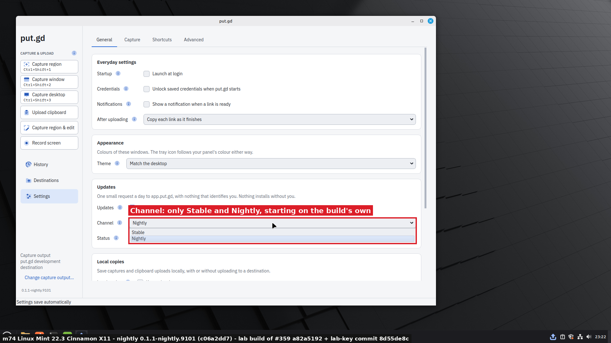

f44: no stable release yet.
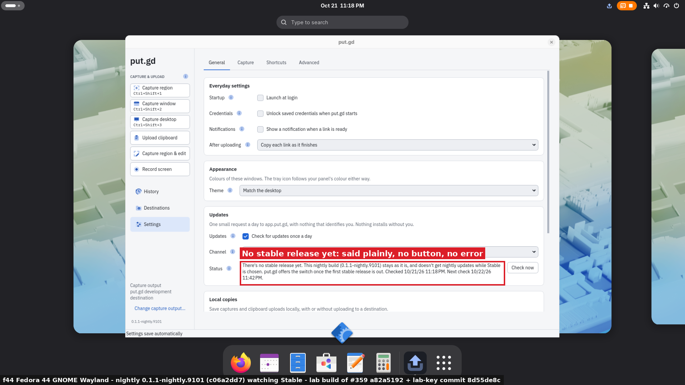

f44: once lab stable 0.1.1 exists, **Switch to stable 0.1.1** appears.
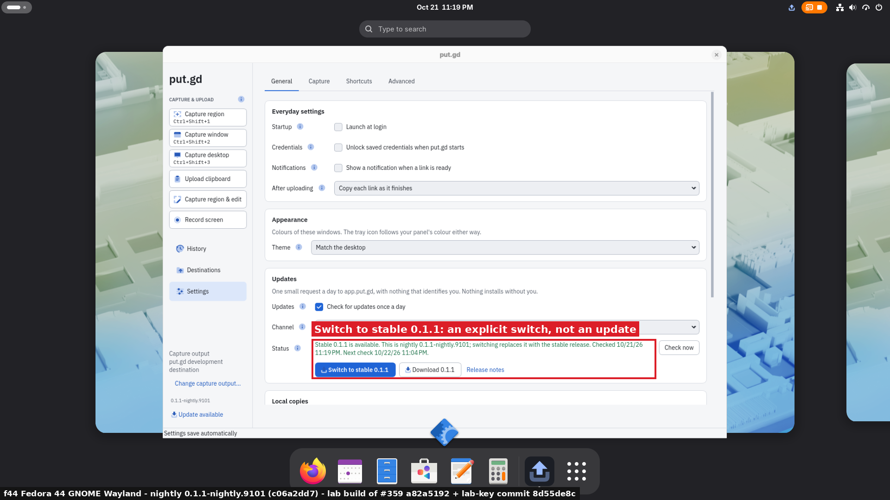

f44: switched with zsync and checked with the stable key; **Restart put.gd** comes next.
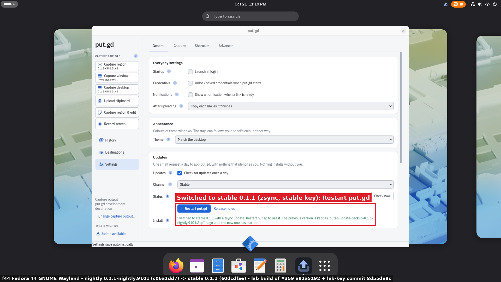

f44: after the restart, stable 0.1.1 runs and Settings says "Switched from nightly".
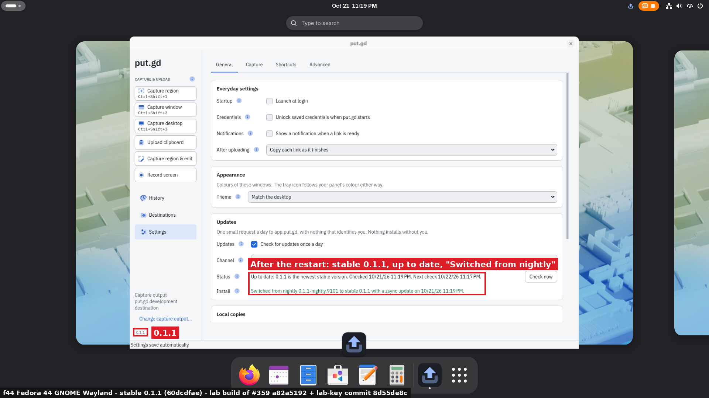

f44: a stable release signed by another key is refused.
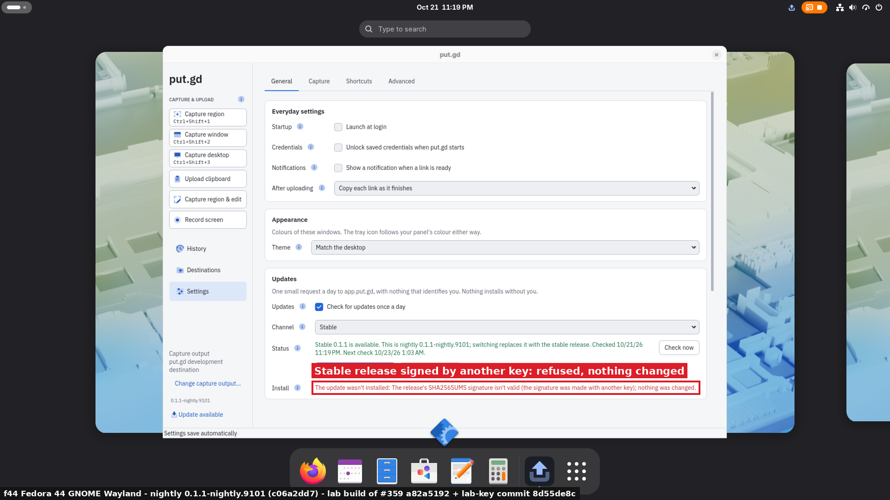

m74: from stable, nightly 9102 is older, so the button says so.
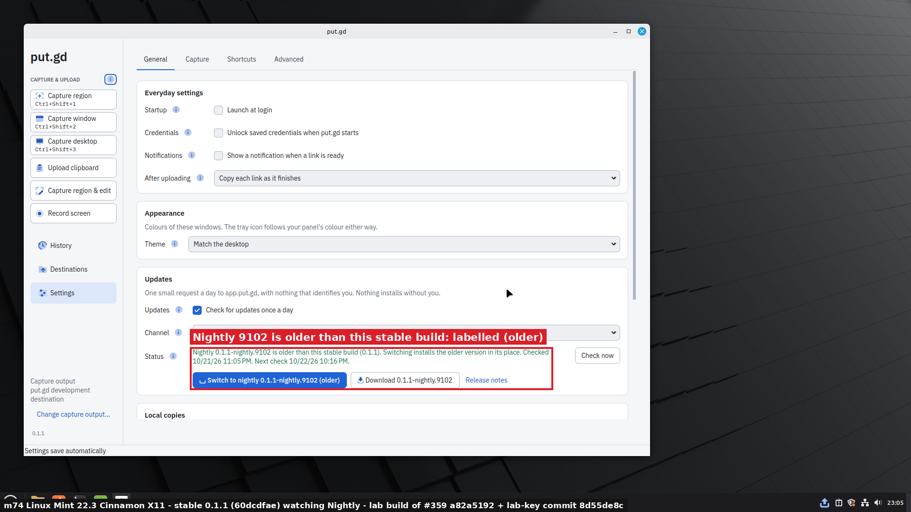

m74: an older version is confirmed first.
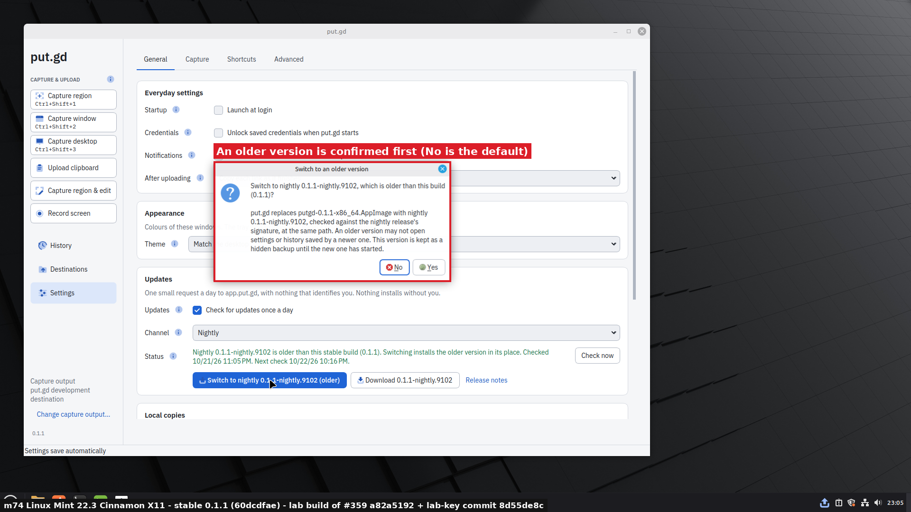

m74: switched to nightly 9102 after **Yes**.
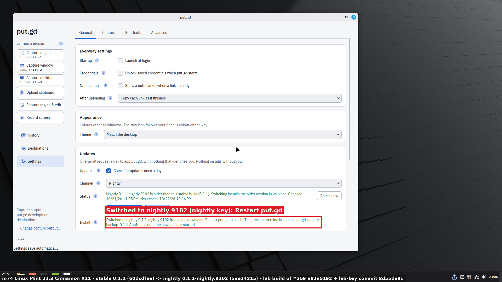

m74: after the restart, nightly 9102 runs and Settings says "Switched from stable".
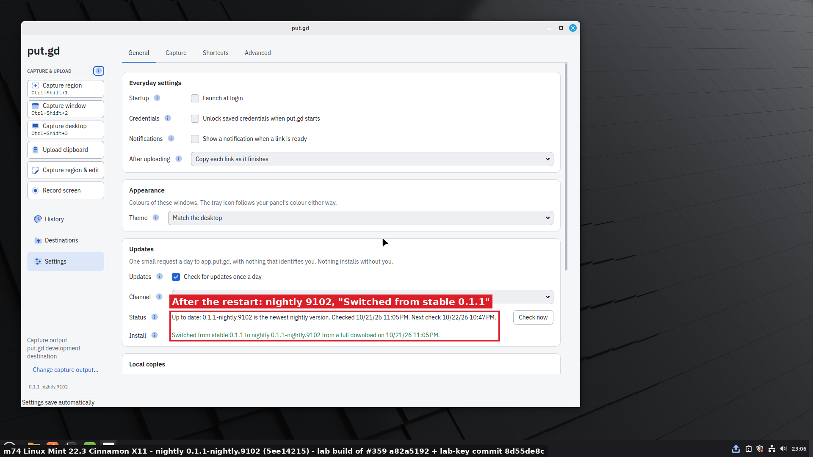

m74: after a switch and a real logout and login, login starts the switched image.
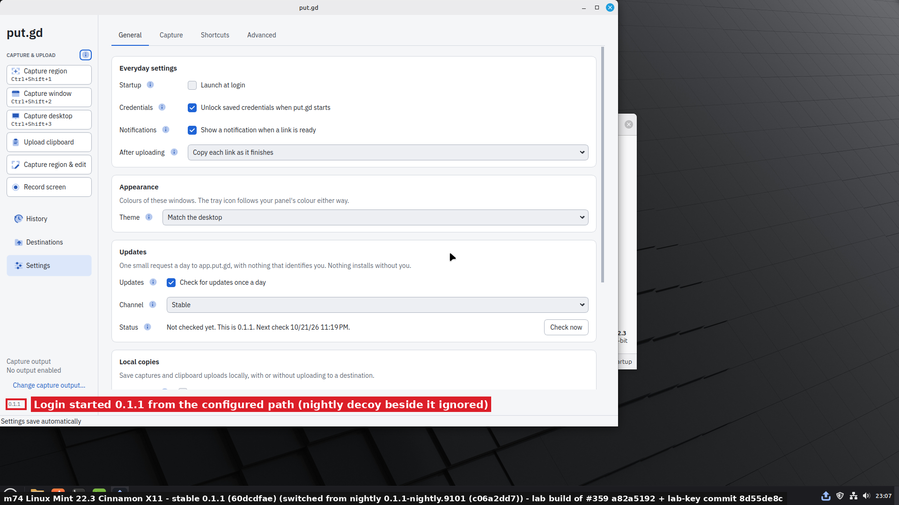

## What was done on the hosts

All of this ran under the builder authority Patrick gave through the coordinator.

- **f44:**
  - two GDM restarts (re-logins);
  - the podman container `putgd-i344lab` and `~/work/put.gd-i344{,lab,acc}`, kept until #359 merges and then removed.
- **m74:** one Cinnamon logout and LightDM restart. Mint's Welcome window was the only one open.
- **Both hosts:** each login-started resident wrote its own log file under the existing `~/.local/state/putgd`. Only that file was removed. The folders the runs created (`~/.config/putgd`, `~/.cache/putgd`, `~/.local/share/putgd` and the autostart entry) were removed by the run cleanup.
- **d69:** `~/work/put.gd-i344lab` holds the lab stable script, the lab-only keys and its publisher state. The signer's lab workspace and lab-nightly state were removed after the clean-up, and its local receipt for 9102 is kept.
