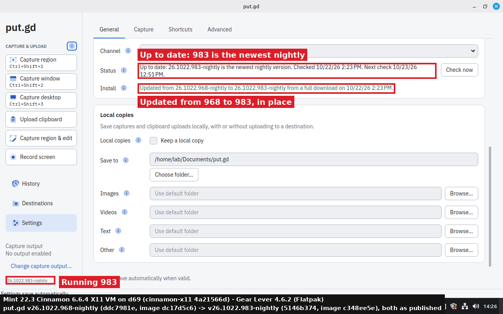
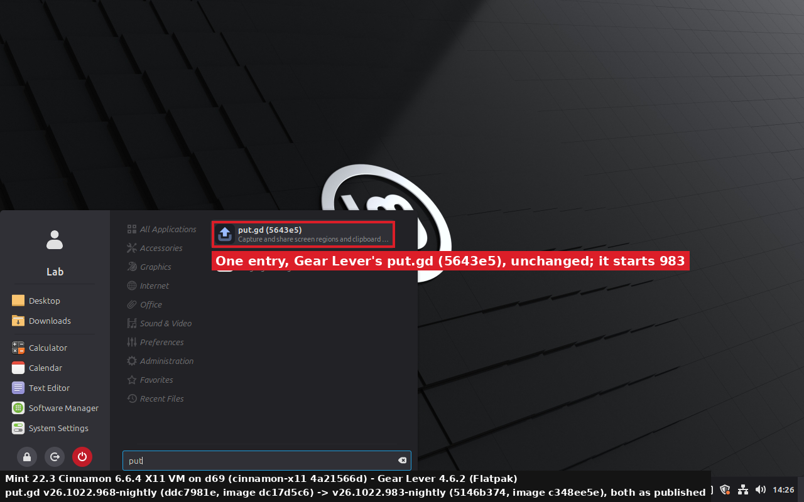
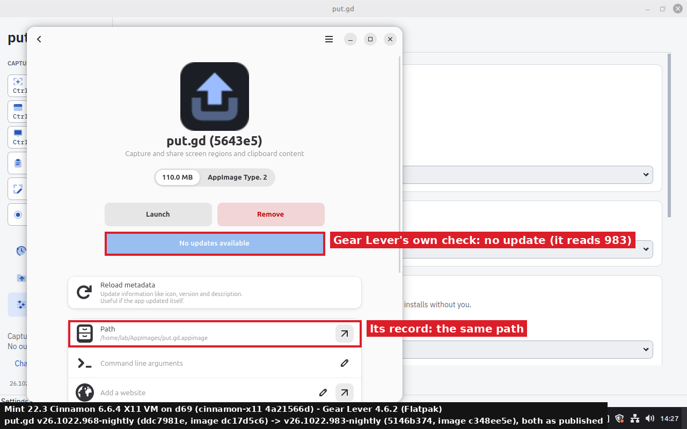
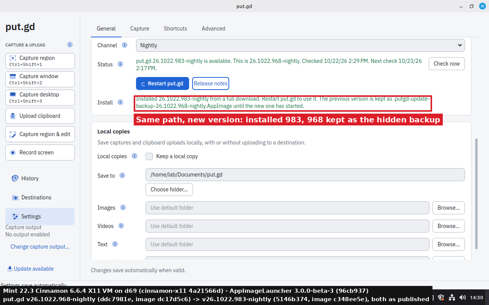
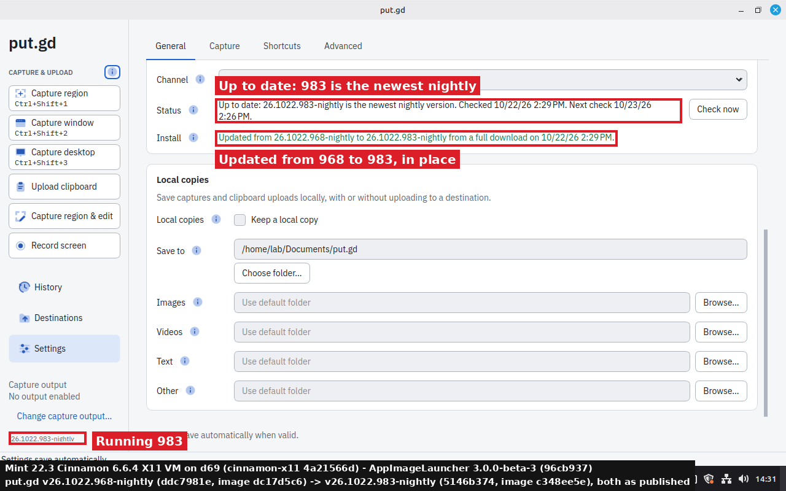
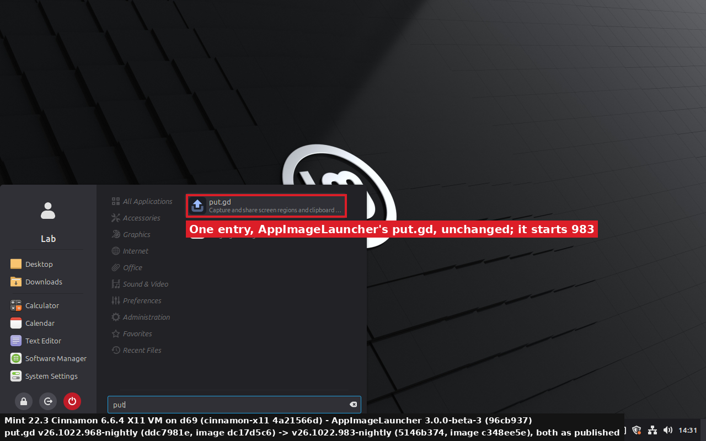
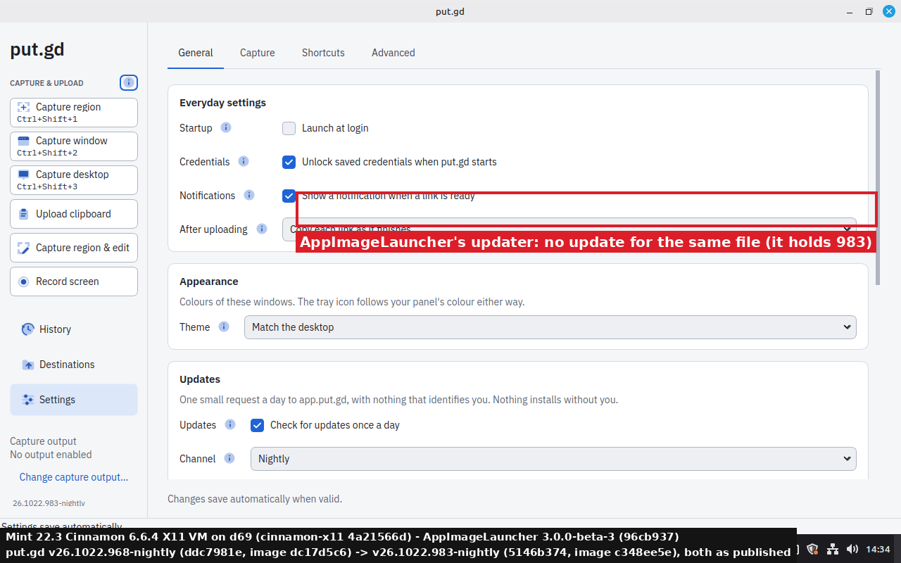

# In-app AppImage update under Gear Lever and AppImageLauncher, 2026-10-22 (#412)

The lab check from [#412](https://github.com/patrick-hudson/put.gd-desktop/issues/412): put.gd's own
**Download and install** ([updates.md](../../updates.md#download-and-install-from-putgd)) replaces the
AppImage in place, at the same path. This run checks that an AppImage integrated by **Gear Lever** and one
integrated by **AppImageLauncher** still work afterwards: their menu entries and records still start
the new version, and nothing is duplicated or orphaned. The #293 phase 3 plan promised this, and #343's
acceptance didn't cover it. Recorded 2026-10-22 by the #412 session.

| | Release | Commit | AppImage SHA-256 (`SHA256SUMS`) |
| --- | --- | --- | --- |
| Old | `v26.1022.968-nightly`, as published | `ddc7981e` | `dc17d5c6…` |
| New | `v26.1022.983-nightly`, as published (19:19:10Z), mirrored by the d69 signer at 19:22:50Z | `5146b374` | `c348ee5e…` |

Nothing was rebuilt or re-wrapped, and no lab feed was used. The resident read the live feed
`app.put.gd/update/v1/nightly.json` ([copy](results/nightly-feed.json)), and the release's `SHA256SUMS` and
signature. The guest has no `appimageupdatetool`, so both updates took the verified full download.

## Guest

- **VM:** a disposable Linux Mint 22.3 Cinnamon 6.6.4 X11 guest on d69, from an overlay of the
  `cinnamon-x11` golden (`4a21566d…`, hash checked before and after), QEMU with KVM, 2 vCPU, 6 GiB.
  Shown on the wall as **Mint 22.3 VM i412**. User `lab`, umask 002, put.gd's default profile.
- **Driving:** over SSH with the session's environment: [snap.sh](lab/snap.sh) records the state and
  [cli.sh](lab/cli.sh) is 968's `putgd-cli`, a client only. Clicks and frames went through the guest's
  VNC ([vnc.py](lab/vnc.py), on `tools/lab/rfb.py`). Every click on Settings, the menu and the dialogs was
  a real pointer event.
- **Order:** Gear Lever first, with AppImageLauncher not installed. Then Gear Lever's integration was
  removed, and AppImageLauncher was installed and checked.
- **Pictures:** full guest frames, annotated by [annotate412.py](lab/annotate412.py). The footer of each
  names the guest, the integrator and both builds.

## Gear Lever 4.6.2 (Flatpak, `it.mijorus.gearlever`, Flathub)

1. `gearlever --integrate` moved 968 to `~/AppImages/put.gd.appimage` (inode 534477). It wrote
   `~/.local/share/applications/put.gd.desktop` (`Exec=env DESKTOPINTEGRATION=1 /home/lab/AppImages/put.gd.appimage`)
   and the record `file_path = /home/lab/AppImages/put.gd.appimage`
   ([before](results/snap-gl-0-integrated.txt)).
2. put.gd was started from that menu entry. Settings offered 983, and **Download and install** was clicked.
   The new file went onto the same path (inode 534549, `c348ee5e…`), and 968 stayed beside it as
   `.putgd-update-backup-26.1022.968-nightly.AppImage` (inode 534477) ([installed](results/snap-gl-1-installed.txt)).
3. **Restart put.gd**: 983 started from `~/AppImages/put.gd.appimage`, and put.gd removed the backup
   (`backupRemoved: true`).
4. put.gd was quit, then started again by clicking the Cinnamon menu's only put.gd entry,
   **put.gd (5643e5)**. It ran 983 (`APPIMAGE=/home/lab/AppImages/put.gd.appimage`,
   `DESKTOPINTEGRATION=1` from the entry).
5. Gear Lever afterwards ([after](results/snap-gl-2-after-menu-launch.txt)):
   - `--list-installed` still shows one app at the same path;
   - its desktop entry and `gearlever.conf` record are byte-identical to step 1;
   - `--list-updates` says *No updates available* ([log](results/gl-list-updates.txt)), and so does
     its window, so it reads 983 from the file;
   - no hidden `.putgd-update-*` file is left.
6. **Remove** in Gear Lever (`--remove`) then took the updated file and its menu entry, and left nothing
   behind.

## AppImageLauncher 3.0.0-beta-3 (`appimagelauncher_3.0.0-beta-2-gha287.96cb937_amd64.deb`, digest checked against the release)

1. The package was installed and `appimagelauncherd` enabled. `ail-cli integrate` then moved 968 to
   `~/Applications/putgd-26.1022.968-nightly-x86_64_5f3321a4….AppImage` (inode 534501). It wrote
   `appimagekit_ee40cb6c…-put.gd.desktop`, which has the **Delete this AppImage** and **Update this AppImage**
   actions ([before](results/snap-ail-0-integrated.txt)).
2. put.gd was started from that menu entry, and **Download and install** was clicked. A 1-second watch of
   `~/Applications` and the menu entries ([log](results/ail-watch.log)) saw these changes and nothing else:
   - put.gd's staging folder, then the hidden backup;
   - after the restart, the backup's removal.

   The daemon didn't integrate the backup or the staging folder, and added no entry. The file keeps its
   name `…968…`, now holding 983 (inode 534495, `c348ee5e…`) ([installed](results/snap-ail-1-installed.txt)).
3. **Restart put.gd**: 983 started from AppImageLauncher's path, and the backup was removed.
4. put.gd was quit, then started from the menu's only put.gd entry. It ran 983.
5. AppImageLauncher's updater on the file reported *No updates found*
   ([log](results/ail-updater-check.log)), so it reads 983 from the file.
6. The desktop entry is byte-identical to step 1, and `~/Applications` holds the one file plus
   AppImageLauncher's own empty `.trash` folder ([after](results/snap-ail-2-after-menu-launch.txt)).

The menu action **Update this AppImage** fails on Mint 22.3 with
`libQt5QuickWidgets.so.5: cannot open shared object file`, as [updates.md](../../updates.md#other-appimage-updaters)
already says. The check used `/opt/appimagelauncher.AppDir/usr/bin/update` instead.

## Result

Both integrators keep working through an in-app update, and neither needs a change in put.gd:

- The swap keeps the path, so each tool's menu entry and record still point at the file. That file now
  holds the new version.
- The hidden backup and staging names (leading dot) are never integrated, and both are gone once the new
  version has started.
- Each tool reads the new version from the file: Gear Lever and AppImageLauncher both report no update.

No issue was filed: nothing broke.

## Clean-up

- The guest was stopped through QMP and its overlay deleted (`~/work/put.gd-i412lab` on d69).
- The `cinnamon-x11` golden was rehashed: `4a21566d…`, unchanged.
- The workstation tunnel `putgd-vm-mint-i412` was stopped, and only its wall entry was removed.
