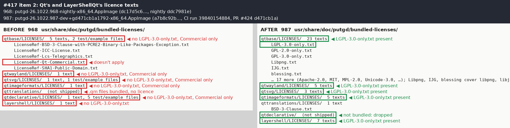
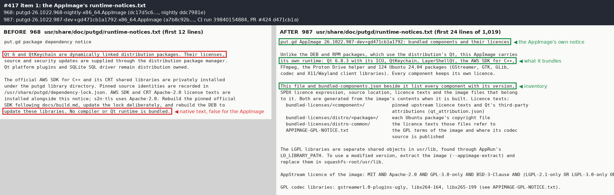
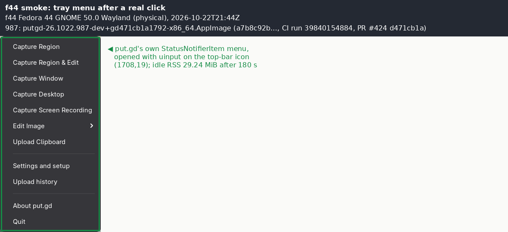
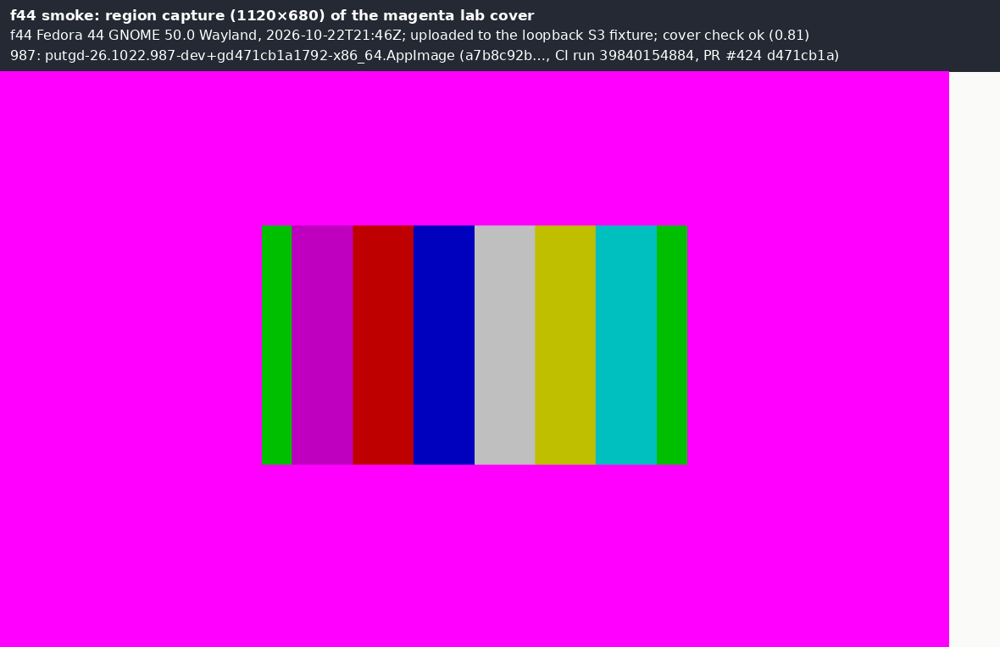

# AppImage notices and content hygiene (#417, #421): before and after — 2026-10-22

[#417](https://github.com/patrick-hudson/put.gd-desktop/issues/417) (release-blocker) and
[#421](https://github.com/patrick-hudson/put.gd-desktop/issues/421) were found by the
[#383 audit rehearsal](../2026-10-22-appimage-license-audit/README.md) on the 968 nightly.
The fix is in [#424](https://github.com/patrick-hudson/put.gd-desktop/pull/424). Every "after"
number below was measured on the exact AppImage that CI built from #424's head.

| | Before | After |
| --- | --- | --- |
| Asset | `putgd-26.1022.968-nightly-x86_64.AppImage` | `putgd-26.1022.987-dev+gd471cb1a1792-x86_64.AppImage` |
| SHA-256 | `dc17d5c6fb92a35514f381051d58f9a0170fad2b40c7e0e328dae64b219f51cf` | `a7b8c92b64b3887d416d5a527180f3085dfcdd6ccff122456ff081e2211af1dc` |
| Built by | nightly run 39737710388, `ddc7981e` | [dispatched CI run 39840154884](https://github.com/patrick-hudson/put.gd-desktop/actions/runs/39840154884), `workflow_dispatch` on #424's branch at `d471cb1a`, every job green. The PR run 39840157716 on the same head is green too. |
| Measured on | f44, over SSH, with the extracted image (`--appimage-extract`) | the same |

The measurements come from [tools/notices_compare.py](tools/notices_compare.py), standard library only, run with `python3 -I IMAGE SQUASHFS_ROOT`. The results are in `data/measure-968.json` and `data/measure-987.json`. The CI job's own audit of the built image is [data/ci-appimage-notices-987.json](data/ci-appimage-notices-987.json).

## Result

| Check | 968 (before) | 987 (after, `a7b8c92b`) |
| --- | --- | --- |
| `runtime-notices.txt` | The native packages' text: "put.gd package dependency notice … No compiler or Qt runtime is bundled" (1,623 bytes) | The AppImage's own text, "put.gd AppImage 26.1022.987-dev+gd471cb1a1792: bundled components and their licences" (56,268 bytes, 1,019 lines). The native text appears in no file under `usr/share/doc/putgd`. |
| Inventory | none | `bundled-components.json`: 137 components (13 upstream, 124 Ubuntu packages), each with version, SPDX licence, source location, licence files and image files. All 618 paths in the image are listed exactly once. |
| AppStream `project_license` | `MIT AND Apache-2.0 AND GPL-3.0-only` | The AND of every component's licence, including `GPL-2.0-or-later` (FFmpeg, x264, x265), `(LGPL-3.0-only OR GPL-2.0-only OR GPL-3.0-only)` (Qt), the LGPL libraries, ICU, curl and the others ([data](data/measure-987.json)). `appstreamcli validate --no-net` 1.0.2 passes. |
| `APPIMAGE-GPL-NOTICE.txt` | Says where the codec source is | The same, and it names the inventory as the source location of every other component, Qt and the LGPL libraries among them. It makes no source offer: #416 decides that. |
| Absolute RUNPATH/RPATH | 1: `liblayer-shell.so` → `/home/runner/work/…/appimage-deps/lib:/home/runner/work/…/Qt/6.8.3/gcc_64/lib` | 0 of 224 ELF files with a search path; `liblayer-shell.so` is `$ORIGIN/../../lib` |
| linuxdeploy leftovers | `AppRun.wrapped`, `apprun-hooks/` | none |
| Qt plugins also in `usr/lib` | 6 | 0 |
| AWS/S3 libraries also in `usr/lib` | 16 | 0 |
| Distro `copyright` copies in `usr/share/doc/PACKAGE` | 122, identical to `bundled-licenses/distro` | 0. All 124 copies stay under `bundled-licenses/distro`. |
| Proton notices in `usr/share/doc/putgd/proton` | 15 regular files, 13 of them identical to the helper's copies | 13 relative links to `usr/libexec/putgd/proton/…`. The 2 doc-only files (`LICENSE.proton`, `README.md`) stay. |
| Identical files outside the notices | 47 pairs | 1 pair, intended: the Proton manifest, which the helper and the app each read from their own place, and which `audit_proton` requires in both |
| Extracted size | 305,789,903 bytes, 741 files, 18 links | 288,612,443 bytes, 587 files, 31 links (−17.2 MB) |
| AppImage size | 115,374,584 bytes | 115,243,512 bytes. SquashFS had already deduplicated the copies. The 19 commits between the two builds also differ. |

### Licence texts per component

| `bundled-licenses/` | 968 | 987 |
| --- | --- | --- |
| `qtbase` | `LICENSES/`: only the 5 `LicenseRef-*` texts, including `LicenseRef-Qt-Commercial`; 2 test/example licences; no LGPL/GPL text | 23 `LICENSES/` texts: `LGPL-3.0-only`, `GPL-2.0-only`, `GPL-3.0-only` and every SPDX id of the third-party code compiled into the bundled Qt files (`Libpng`, `libpng-2.0`, `IJG`, `blessing`, `Unicode-3.0`, `MPL-2.0`, …), plus those packages' `qt_attribution.json` entries and licence files. No Commercial text, no test or example texts. |
| `qtwayland` | Commercial only | 5 texts, `LGPL-3.0-only` among them, and the Wayland protocol attributions |
| `qtsvg` | Commercial and 1 test-suite licence | 3 texts, plus XSVG's attribution and licence |
| `qtimageformats` | Commercial only, plus libtiff/libwebp files | 5 texts (`libtiff` among them) and libtiff's and libwebp's attributions |
| `qttranslations` | not shipped, though 31 `.qm` files are bundled | `BSD-3-Clause`, the licence Qt's SBOM gives the translations |
| `qtdeclarative` | 10 files (Commercial, 5 test/example), with no Qt Quick/QML bundled | dropped |
| `layershell` | `LicenseRef-KDE-Accepted-LGPL` only | all 7 `LICENSES/` texts (`LGPL-2.1-only`, `LGPL-3.0-only`, `MIT`, …) |
| `icu` | not shipped (ICU 73.2 bundled) | `icu4c/LICENSE` of ICU `release-73-2` |
| `qtkeychain`, `ffmpeg`, `distro/`, `distro-common/` | present | unchanged |

### Inventory (upstream components of `a7b8c92b`)

From `data/bundled-components-987.json`. The 124 Ubuntu packages follow in that file and in [data/runtime-notices-987.txt](data/runtime-notices-987.txt). Each has its binary and source version, its Launchpad source URL, and the SPDX licence of its `Files: *` stanza. That licence is NOASSERTION where the copyright file isn't machine-readable, or has no `Files: *` stanza (GStreamer's, for example).

| Component | Version | Licence | Files | Licence files |
| --- | --- | --- | ---: | ---: |
| put.gd | 26.1022.987-dev+gd471cb1a1792 | MIT | 26 | 4 |
| AWS SDK for C++ (CRT, s2n-tls) | 1.11.907 | Apache-2.0 | 30 | 14 |
| Proton Drive helper | external-drive-put_gd@0.1.1-alpha (SDK js@0.22.2, Bun 1.4.2) | MIT AND GPL-3.0-only | 3 | 28 |
| QtKeychain | 8eac9889775c | BSD-3-Clause | 1 | 1 |
| LayerShellQt | 6.4.6 | (LGPL-2.1-only OR LGPL-3.0-only OR LicenseRef-KDE-Accepted-LGPL) AND MIT | 2 | 7 |
| FFmpeg | 7.1.5 | GPL-2.0-or-later | 6 | 5 |
| ICU | 73.2 | Unicode-DFS-2016 AND ICU AND BSD-3-Clause AND NAIST-2003 | 3 | 1 |
| AppImage type2-runtime | 20251108 | MIT (embedded: musl, libfuse, squashfuse, zstd, zlib) | 0 | 1 |
| Qt qtbase | 6.8.3 | LGPL-3.0-only OR GPL-2.0-only OR GPL-3.0-only | 22 | 84 |
| Qt qtimageformats | 6.8.3 | LGPL-3.0-only OR GPL-2.0-only OR GPL-3.0-only | 5 | 9 |
| Qt qtsvg | 6.8.3 | LGPL-3.0-only OR GPL-2.0-only OR GPL-3.0-only | 2 | 5 |
| Qt qttranslations | 6.8.3 | BSD-3-Clause | 31 | 1 |
| Qt qtwayland | 6.8.3 | LGPL-3.0-only OR GPL-2.0-only OR GPL-3.0-only | 8 | 22 |

The Qt modules and the third-party code in them come from the official Qt binaries' own SPDX documents (`Qt/6.8.3/gcc_64/sbom`). qtbase lists 38 embedded packages, among them libpng 1.6.47, libjpeg-turbo 3.1.0 (the SBOM's version; the #383 rehearsal had estimated 3.0.3), SQLite 3.49.1, HarfBuzz 10.4.0 and PCRE2 10.45. qtimageformats lists libtiff 4.7.0 and libwebp 1.5.0. Each is named with the bundled files that contain it. The build fails if a Qt file has no SBOM entry, if the SBOM's module commit differs from `tools.lock.json`, or if a passed licence source has no bundled files. So a Qt bump (#418) or a codec change (#419) changes the inventory with it.

## Which copy of the AWS libraries is loaded

The AWS SDK libraries were in both `usr/lib` and `usr/lib/putgd`, byte-identical (all 16 have the same SHA-256). AppRun's `LD_LIBRARY_PATH` lists `usr/lib` first, so the copy that loaded was not the one `aws-runtime-manifest.json` verifies.

- **Loader check:** [tools/loaded_copies.py](tools/loaded_copies.py) loads `usr/lib/putgd/libputgd-s3.so` with AppRun's `LD_LIBRARY_PATH` and lists the mapped files.
  - 968: all 14 AWS libraries and libs2n from `usr/lib` ([data](data/s3-module-loaded-968.json)).
  - 987: all 15 from `usr/lib/putgd` ([data](data/s3-module-loaded-987.json)).
- **The running app (f44, 987):** two live `putgd-s3-worker` processes, each uploading a capture, mapped every AWS/S3 library and `libputgd-s3.so` from `<mount>/usr/lib/putgd/` ([data](data/f44-s3-worker-maps-987.txt)).
- The bytes are the same, so nothing changes at run time apart from the path.

## Smoke on f44 with the exact CI AppImage

f44, Fedora 44 GNOME 50.0 Wayland (physical, gdm autologin). Desktop lock 21:39:06–21:48:07Z, released `--verified-clean`. The driver is the full-acceptance pass's [afa.py](../2026-10-22-appimage-full-acceptance-rerun/lab/afa.py). It used a private profile, the loopback S3 fixture with synthetic keys and real uinput input, with no other apps open.

| Check | Result |
| --- | --- |
| Start | `a7b8c92b…` from the AppImage, `--background`: the resident is ready in 0.32 s, and diagnostics report build `d471cb1a`, not dirty |
| Idle memory (180 s, `afa.py memory`) | RSS 29.24 MiB final and peak, PSS 23.22 MiB, private 22.87 MiB; budget 40 MiB, pass. GTK, KDE platform theme, libssl and QtNetwork are not loaded at idle. For comparison, 942 measured 29.28 MiB on f44. |
| Tray | Found on the top bar. A real click opens put.gd's menu, and the D-Bus menu lists the same items ([data](data/f44-tray-menu-987.json)). |
| Capture | 1120×680 region capture of the moving lab cover, uploaded to the fixture (`uploaded: 1`, 4,946 bytes). `cover_player.py check-frame` passes, all edges 1.0, fraction 0.81. |

**A host detail, not a defect:** put.gd's region and desktop capture on GNOME go through its GNOME Shell extension. The extension wasn't installed on f44, because the previous pass had removed its user copy. The first two capture attempts therefore failed with `helper_unavailable` (D-Bus `UnknownMethod`), before anything was captured.
- **Install:** the image's own `usr/share/gnome-shell/extensions/putgd@put.gd` was installed as a user copy and enabled, then loaded by a real re-login (`gnome-session-quit --logout`, then a GDM restart for autologin).
- **Restore:** after the smoke, the user copy was removed, `enabled-extensions` was put back to `[background-logo, appindicatorsupport]`, and a second re-login confirmed the extension was gone.
- **Clean:** `afa.py cleanup` reported no leftover processes, mounts or entries. The input agent was stopped by its PID, and the run tree was deleted.

The timeline is in [data/f44-timeline.txt](data/f44-timeline.txt).

## Before CI: the same steps on the 968 AppDir

Before the first CI run, the new post-deployment steps ran on the extracted 968 AppDir, in an `ubuntu:24.04` container on f44 that held its 124 Ubuntu packages and the Qt 6.8.3 binaries with their SBOMs.
- The run: `finish` (licence texts, inventory, notices, hygiene), the existing `audit_deployed` (program identities, the recording probe, `ldd` of every ELF file), `audit_platforms` (the offscreen image worker) and the new audit.
- The result: 137 components and 618 files, with 22 library copies, 122 doc copies and 2 leftovers removed, and 13 Proton doc files made links.
- **First CI run:** it then found one case the 968 AppDir couldn't show. appimagetool adds `.DirIcon` (a link to `putgd.svg`) only when it packs. The build now creates that link before the inventory is written (`d471cb1a`, with a test).

## Not covered

- The DEB and RPM: their notices were already right, and #417 is about the AppImage.
- #416 (source offer), #418 (Qt version) and #419 (codecs) are Patrick's decisions. The inventory records what is bundled and decides none of them.
- A Cinnamon/X11 run of the smoke: f44 was the slot the coordinator assigned. The change touches packaging only, and no runtime code.
